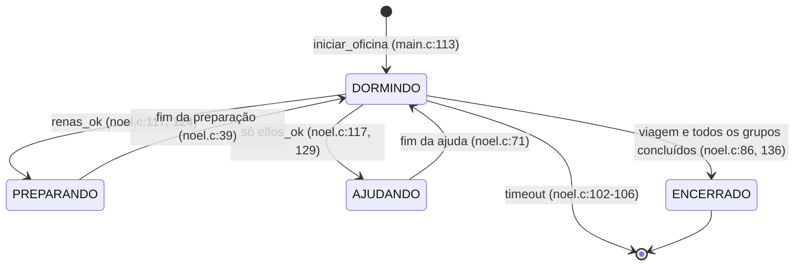
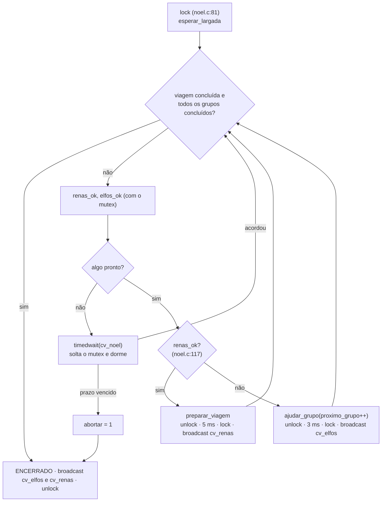
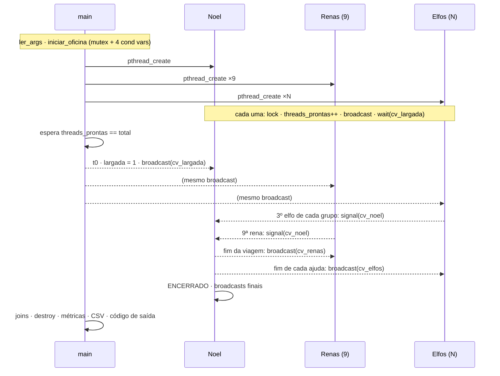
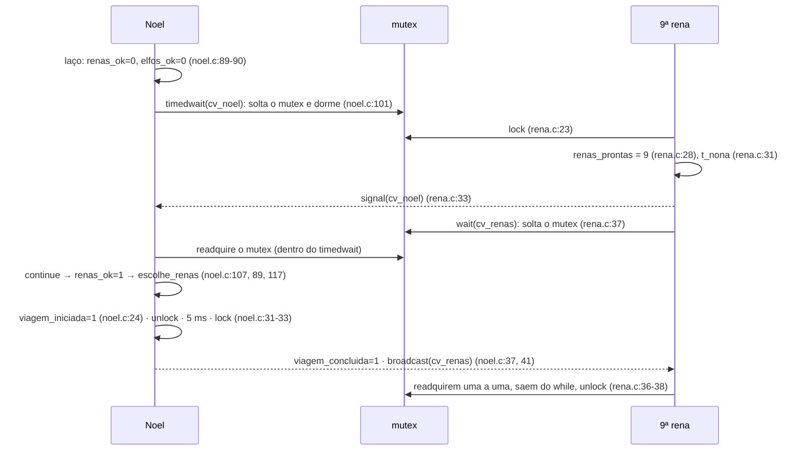
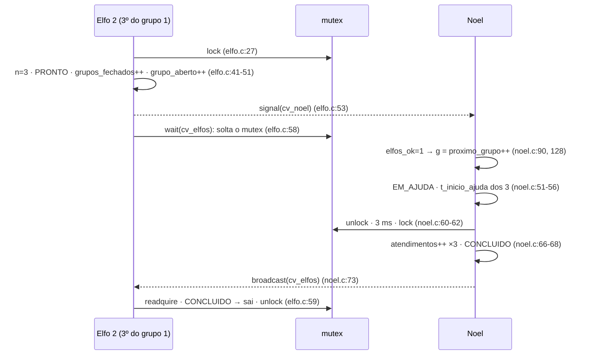

# Guia Completo da Apresentação (Papai Noel)

> **Substituído pela v4.** Este guia acompanha a apresentação **v3** (37 slides). O roteiro atual é [[Guia da Apresentação v4 (Papai Noel)]]; use este para aprofundar.

Este é o guia principal de estudo para apresentar e defender o Tema 11, o **Problema do Papai Noel** em C11 com pthreads. Ele foi escrito para você **entender**, não para decorar. Ele parte dos conceitos de Sistema Operacional, passa pelo problema, pelo código real, pela sincronização, pelas perguntas do professor e pelo roteiro dos 37 slides, e termina com um plano de estudo e uma simulação de defesa.

Ele é autossuficiente: dá para estudar o trabalho inteiro só com ele. As notas abaixo servem para aprofundar:

| Para aprofundar | Nota |
|---|---|
| Visão geral, status, como rodar | [[_Papai-Noel]] |
| Cada arquivo de `src/` em blocos | [[Guia da Pasta src (Papai Noel)]] |
| Mecanismo a mecanismo (mutex e cada cond var) | [[Sincronização no Código (Papai Noel)]] |
| Fase a fase, com cenários e linhas do tempo | [[Fluxo do Código e Sincronização (Papai Noel)]] |
| Regras, estados e linhas do tempo da rodada oficial | [[Lógica e Fluxo (Papai Noel)]] |
| O que pode dar errado, classificado | [[Riscos de Sincronização (Papai Noel)]] |
| As 15 perguntas com resposta oral | [[Perguntas da Apresentação (Papai Noel)]] |
| Números e fala de cada gráfico | [[Testes e Gráficos (Papai Noel)]] |
| Compilar, rodar, todas as flags | [[Execução e Flags (Papai Noel)]] |
| Teoria geral de concorrência (texto genérico, ver aviso na seção 12.3) | [[Guia de Estudo Teórico (Papai Noel)]] |

### Legenda: de onde vem cada afirmação

| Marca | Significado |
|---|---|
| **[CÓDIGO]** | lido em `tema11_papai_noel/src/` em 2026-10-28; as referências `arquivo:linha` são desse código |
| **[MEDIDO]** | número lido dos CSVs de `tema11_papai_noel/dados/` (rodada de 2026-10-28) ou de uma execução de verificação feita em 2026-10-28 numa pasta temporária (indicado no texto) |
| **[TEORIA]** | vale para qualquer programa concorrente; vem da literatura de SO |
| **[HIPÓTESE]** | previsão feita antes de medir, ou dedução não executada |
| **[NÃO VERIFICADO]** | não foi possível confirmar com as fontes disponíveis |

Quando nenhuma marca aparece, a frase é explicação didática do que já foi marcado ao redor.

---

## Sumário

0. [[#0. O trabalho em um minuto]]
1. [[#Parte 1. Fundamentos de Sistemas Operacionais e concorrência]]
2. [[#Parte 2. O Problema do Papai Noel de cabo a rabo]]
3. [[#Parte 3. A implementação real]]
4. [[#Parte 4. Sincronização em profundidade]]
5. [[#Parte 5. As perguntas do professor]]
6. [[#Parte 6. Roteiro dos 37 slides]]
7. [[#Parte 7. Experimentos, métricas e os quatro gráficos]]
8. [[#Parte 8. Propriedades e limitações da solução]]
9. [[#Parte 9. Plano de estudo e simulação de defesa]]
10. [[#Parte 10. Fontes, divergências e lacunas]]

---

## 0. O trabalho em um minuto

> **Mensagem central (slide 2):** 1 mutex protege todo o estado; 4 variáveis de condição fazem as threads esperarem sem gastar CPU; só Noel decide, e decide com o mutex: renas primeiro, sem interromper a ajuda.

| Fato | Valor | Base |
|---|---|---|
| Linguagem e biblioteca | C11 + POSIX Threads (`pthread.h`) | [CÓDIGO] |
| Threads | 1 Noel + 9 renas + N elfos, todas criadas antes de qualquer `pthread_join` | [CÓDIGO] `main.c:186-204` |
| Mecanismos | **1 `pthread_mutex_t` + 4 `pthread_cond_t`** (`cv_largada`, `cv_noel`, `cv_elfos`, `cv_renas`). **Nenhum semáforo**, nenhuma barreira POSIX, nenhum atômico | [CÓDIGO] `comum.h:82-86` |
| Onde o mutex nasce | `pthread_mutex_init(&o->mutex, NULL)` em `main.c:131`, destravado | [CÓDIGO] |
| Como se impede a invasão | fila de grupos com id: o 3º elfo fecha o grupo e avança `grupo_aberto` na **mesma** seção crítica | [CÓDIGO] `elfo.c:41-53` |
| Como se garante a prioridade | `escolhe_renas = renas_ok`, lido e decidido com o mutex | [CÓDIGO] `noel.c:89-90`, `117` |
| Por que a ajuda não é interrompida | só Noel decide, e durante a ajuda ele está num sleep, sem olhar nada | [CÓDIGO] `noel.c:60-62` |
| Matriz | 5 configurações × 5 repetições = 25 execuções, **25/25 válidas**, 0 violações | [MEDIDO] |
| Teste de prioridade | **PASSOU**; a versão `--ingenua` gerou 2 violações | [MEDIDO] |
| Estresse | 300/300 `ok` | [MEDIDO] |
| Vazão | 163 → 281 → 436 pedidos/s para 3, 6, 12 elfos | [MEDIDO] |
| p95 da espera (6 elfos) | 5,20 ms com renas junto; ≈ 2,1 ms antes ou depois | [MEDIDO] |
| Resposta às renas | ≈ 18–24 µs em média | [MEDIDO] |

---

# Parte 1. Fundamentos de Sistemas Operacionais e concorrência

Cada conceito segue o mesmo formato: **Definição** (técnica) → **Intuição** → **Exemplo simples** → **No Papai Noel** → **Se for ignorado** → **🎤 Como falar**. A analogia sempre volta para o mecanismo técnico real.

## 1.1 Sistema Operacional e execução de programas

**Definição.** O Sistema Operacional é o software que gerencia o hardware (CPU, memória, dispositivos) e oferece abstrações aos programas: processos, threads, arquivos, relógios e primitivas de sincronização. Ele decide **quem usa a CPU, quando e por quanto tempo** (escalonamento) e é ele quem **bloqueia e acorda** quem está esperando.

**Intuição.** O programa diz *o que* fazer; o SO decide *quando* cada parte roda. Você não controla a ordem em que duas threads executam, assim como um aluno não controla em que ordem o professor chama as pessoas.

**Exemplo simples.** Dois programas abertos ao mesmo tempo num computador de 1 núcleo: o SO alterna entre eles milhares de vezes por segundo (troca de contexto), e cada um "acha" que roda sozinho.

**No Papai Noel.** O programa cria 10 + N threads, e o **escalonador do Linux** decide qual delas roda em cada um dos 12 núcleos lógicos da máquina [MEDIDO, `dados/ambiente.txt`]. Quando uma thread chama `pthread_cond_wait` ou `clock_nanosleep`, é o SO que a retira da CPU e a acorda depois.

**Se for ignorado.** Quem escreve código concorrente supondo uma ordem fixa ("a rena sempre roda antes do elfo") escreve código que funciona às vezes. Exemplo real: na referência, o elfo 0 entrou no mutex antes da 9ª rena (10,080 contra 10,091 ms) [MEDIDO], e em outras execuções a ordem muda.

**🎤 Como falar.** "O SO é quem cria e escalona as threads. A gente não controla a ordem em que elas rodam, então o programa tem que ser correto para qualquer ordem. É por isso que precisamos de sincronização, e as ferramentas dela, como mutex e variável de condição, são fornecidas pelo SO e pela biblioteca pthreads."

## 1.2 Processos e threads

**Definição.** Um **processo** é um programa em execução com seu próprio espaço de endereçamento (memória isolada), seus recursos (arquivos abertos) e pelo menos uma thread. Uma **thread** é uma linha de execução dentro de um processo, com pilha, registradores e contador de programa próprios, mas **compartilhando** a memória global e o heap com as outras threads do mesmo processo.

**Intuição.** O processo é uma casa; as threads são as pessoas que moram nela. Cada pessoa tem o próprio caderno (pilha), mas a geladeira (memória global) é de todos. Duas pessoas mexendo na geladeira ao mesmo tempo precisam de combinação.

**Exemplo simples.** Um navegador pode ter um processo por aba (isolamento) e várias threads dentro de cada aba (uma desenha, outra baixa dados).

**No Papai Noel.** É **um processo** (`simulacao`) com 1 + 9 + N **threads**. Todas recebem o ponteiro `&o` para a mesma struct `Oficina` (`main.c:171`, `187-204`). Cada thread tem variáveis locais próprias, por exemplo `int g` e `Grupo *gr` no elfo (`elfo.c:34-35`), mas o estado do problema (contadores, grupos, flags) está na `Oficina`, que é compartilhada [CÓDIGO].

**Se for ignorado.** Esquecer que as threads compartilham memória leva a corridas. Esquecer que **processos não** compartilham levaria a usar um mutex comum entre processos, o que não funcionaria sem memória compartilhada e o atributo `PTHREAD_PROCESS_SHARED`.

**🎤 Como falar.** "Processo tem memória própria; threads do mesmo processo dividem a memória. A gente usou threads porque o Noel, as renas e os elfos precisam enxergar o mesmo estado, que está numa struct chamada Oficina. Por isso todo acesso a ela é protegido."

## 1.3 Concorrência e paralelismo

**Definição.** **Concorrência**: várias tarefas progridem em intervalos sobrepostos de tempo, mesmo que intercaladas num único núcleo. **Paralelismo**: várias tarefas executam **literalmente ao mesmo tempo**, em núcleos diferentes. Concorrência é sobre estrutura (lidar com várias coisas); paralelismo é sobre execução (fazer várias coisas no mesmo instante).

**Intuição.** Um cozinheiro alternando entre duas panelas é concorrência; dois cozinheiros, cada um com sua panela, é paralelismo.

**Exemplo simples.** Num computador de 1 núcleo, 2 threads são concorrentes mas nunca paralelas; com 12 núcleos, podem ser as duas coisas.

**No Papai Noel.** As threads são **concorrentes por projeto**, e nesta máquina **podem** rodar em paralelo. As 9 renas acordam do sleep no mesmo instante (`rena.c:21`) e disputam o mutex de fato. Os problemas de sincronização existem **mesmo num único núcleo**: basta o SO trocar de thread no meio de um `renas_prontas++`.

**Se for ignorado.** Achar que "num núcleo só não há corrida" é errado: a preempção pode acontecer entre a leitura e a escrita de uma variável.

**🎤 Como falar.** "Concorrência é várias threads progredindo ao mesmo tempo, intercaladas; paralelismo é executarem literalmente juntas em núcleos diferentes. A corrida acontece nos dois casos, porque o SO pode interromper uma thread no meio de uma operação."

## 1.4 Disputa de recursos e dados compartilhados

**Definição.** Um **recurso compartilhado** é qualquer coisa que várias threads usam: uma variável, uma estrutura, um arquivo, um dispositivo, ou um "servidor" como o Noel. Há disputa quando mais de uma thread quer usar o recurso e o uso simultâneo não é seguro, ou quando ele é único.

**Intuição.** Uma única impressora para a sala inteira: duas pessoas imprimindo "ao mesmo tempo" sem fila misturariam as páginas.

**No Papai Noel.** Há dois níveis de disputa:
1. **Dados:** `renas_prontas`, `grupos[k]`, `grupo_aberto`, `grupos_fechados`, `proximo_grupo`, `viagem_*` etc. Tudo está na `Oficina` (`comum.h:79-123`), com o comentário "Todos os campos são protegidos por `mutex`" (`comum.h:78`) [CÓDIGO].
2. **O Noel em si:** ele é um **recurso único** disputado por dois tipos de cliente (renas e elfos), com prioridades diferentes. Ele atende um de cada vez, como uma CPU.

**Se for ignorado.** Dados sem proteção sofrem corrida (1.6). Um recurso único sem política de decisão leva a decisões arbitrárias, sem garantir a prioridade.

**🎤 Como falar.** "No nosso problema há duas disputas: pelos dados, que são os contadores e a fila de grupos, e pelo próprio Noel, que só faz uma coisa por vez. A primeira resolvemos com mutex; a segunda, com a regra de decisão que dá prioridade às renas."

## 1.5 Seção crítica

**Definição.** Seção crítica é o trecho de código que acessa dados compartilhados e **não pode** ser executado por mais de uma thread ao mesmo tempo, porque o resultado dependeria do entrelaçamento. O problema da seção crítica pede um protocolo de entrada e de saída que garanta exclusão mútua, progresso e espera limitada (1.10).

**Intuição.** O provador de roupas de uma loja: só uma pessoa por vez; quem chega espera do lado de fora; quem sai libera.

**Exemplo simples.** `saldo = saldo - 100;` executado por dois caixas sobre a mesma conta.

**No Papai Noel.** Toda seção crítica fica entre `pthread_mutex_lock(&o->mutex)` e `pthread_mutex_unlock(&o->mutex)` [CÓDIGO]:

| Thread | Entra | Sai | Faz dentro |
|---|---|---|---|
| main | `main.c:207` | `main.c:213` | espera todas prontas, grava `t0`, `largada = 1` |
| Noel | `noel.c:81` | `noel.c:145` | o laço de decisão (soltando só para dormir em `noel.c:31/33` e `60/62`) |
| Rena | `rena.c:23` | `rena.c:25` ou `38` | `renas_prontas++`, avisa Noel, espera a viagem |
| Elfo | `elfo.c:27` | `elfo.c:29`, `38` ou `59` | inscreve-se, fecha o grupo, espera a ajuda |

**Se for ignorado.** Duas threads dentro da mesma seção crítica corrompem o estado: contador errado, grupo com 4 elfos.

**🎤 Como falar.** "Seção crítica é o trecho que mexe em dado compartilhado e só pode ter uma thread por vez. No nosso código, todas elas ficam entre o lock e o unlock do único mutex. Por exemplo, a rena só incrementa o contador de renas com o mutex na mão."

## 1.6 Condição de corrida

**Definição.** Há condição de corrida (*race condition*) quando o resultado de um programa depende da ordem relativa, não controlada, em que as threads executam. A forma mais comum é a **corrida de dados** (*data race*): dois acessos à mesma posição de memória, pelo menos um de escrita, sem sincronização entre eles. Em C11, uma corrida de dados é **comportamento indefinido**.

**Intuição.** Duas pessoas editando a mesma planilha sem salvar e recarregar: quem salva por último apaga o trabalho do outro.

**Exemplo passo a passo, com o nosso contador.** `renas_prontas++` parece uma instrução, mas a CPU faz três: **ler** a memória para um registrador, **somar** 1 e **gravar** de volta.

| Passo | Rena A | Rena B | `renas_prontas` na memória |
|---|---|---|---|
| 1 | lê 7 | | 7 |
| 2 | *(SO troca de thread)* | lê 7 | 7 |
| 3 | soma, grava 8 | | 8 |
| 4 | | soma, grava 8 | **8** ✗ (deveria ser 9) |

Com as 9 renas presentes, o contador para em 8, `renas_ok` (`noel.c:89`) nunca fica verdadeiro, Noel nunca prepara a viagem e o episódio termina em `timeout` [HIPÓTESE: cenário construído; não acontece no código atual porque `rena.c:23` trava o mutex].

**Como a sincronização evita isso.** Com o lock em `rena.c:23`, a rena B fica **bloqueada** dentro de `pthread_mutex_lock` até a rena A chegar ao unlock. "Ler, somar, gravar" vira indivisível **do ponto de vista das outras threads**: B só lê depois que A gravou.

**No Papai Noel.** A mesma coisa poderia acontecer com a inscrição dos elfos (dois elfos escrevendo em `membros[2]`, seção 4.8) e com a decisão de Noel (decidir com um retrato velho, seção 4.7).

**Se for ignorado.** Erros intermitentes, difíceis de reproduzir, que somem quando você adiciona um `printf` porque o atraso muda a ordem.

**🎤 Como falar.** "Condição de corrida é quando o resultado depende da ordem em que as threads rodam. O exemplo do nosso código: incrementar o contador de renas são três passos. Se duas renas leem 7 ao mesmo tempo, as duas gravam 8, uma chegada se perde, e o Noel nunca prepara a viagem. O mutex na linha 23 de rena.c impede isso."

## 1.7 Atomicidade

**Definição.** Uma operação é **atômica** se, para as outras threads, ela acontece por inteiro ou não acontece, sem que ninguém observe um estado intermediário. Pode ser atômica no hardware (uma instrução como *compare-and-swap*) ou atômica **por construção**, quando uma sequência de operações é envolvida por um mutex.

**Intuição.** Uma transferência bancária: ou o dinheiro saiu de uma conta e entrou na outra, ou nada aconteceu. Ninguém pode ver o dinheiro "no meio do caminho".

**No Papai Noel.** Três sequências precisam ser atômicas, e o mutex as torna atômicas [CÓDIGO]:
1. **Inscrever-se e fechar o grupo** (`elfo.c:34-53`): ler `grupo_aberto`, inscrever-se, marcar `PRONTO`, incrementar `grupos_fechados` e avançar `grupo_aberto`.
2. **Ler o estado e decidir** (`noel.c:89-132`): calcular `renas_ok`/`elfos_ok`, escolher e marcar `viagem_iniciada` ou `proximo_grupo++`.
3. **Soltar o mutex e dormir** dentro de `pthread_cond_wait`: a biblioteca garante que esses dois passos são atômicos em relação a um `signal` de outra thread que use o mesmo mutex [TEORIA, POSIX]. É isso que impede o "aviso perdido" na janela entre testar e dormir.

**Se for ignorado.** Uma sequência que precisa ser atômica e é feita em duas seções críticas separadas reabre a corrida, mesmo que cada pedaço esteja protegido. O exemplo clássico: verificar numa seção crítica e agir em outra ("check-then-act").

**🎤 Como falar.** "Atômico é o que as outras threads veem acontecer de uma vez. O que o mutex faz é transformar uma sequência de passos, como 'entrar no grupo, fechar o grupo e abrir o próximo', em algo atômico. Se esses passos fossem divididos em dois locks, o quarto elfo poderia entrar no meio."

## 1.8 Sincronização: o que é e por que é necessária

**Definição.** Sincronização é o conjunto de técnicas que restringem os entrelaçamentos possíveis de um programa concorrente, para que só os corretos aconteçam. Ela atende a duas necessidades diferentes:
- **Exclusão mútua:** só uma thread por vez numa seção crítica.
- **Coordenação (ordem):** uma thread só prossegue quando uma condição produzida por outra for verdadeira.

**Intuição.** Exclusão mútua é a tranca do banheiro; coordenação é o "me avisa quando a pizza chegar".

**No Papai Noel.** As duas aparecem em toda thread. A rena faz exclusão mútua para incrementar o contador (`rena.c:23-28`) e coordenação para esperar a viagem (`rena.c:36-37`). Noel faz exclusão mútua para decidir e coordenação para esperar trabalho (`noel.c:100-101`) [CÓDIGO].

**Se for ignorado.** Sem exclusão mútua, há corrida. Sem coordenação, ou a thread não espera (o elfo iria embora sem ajuda), ou espera gastando CPU (espera ocupada, 1.11).

**🎤 Como falar.** "Sincronizar é garantir duas coisas: que só uma thread por vez mexa no estado compartilhado, e que uma thread espere um evento de outra sem gastar CPU. No código, o mutex resolve a primeira e as variáveis de condição, a segunda."

## 1.9 Mutex, semáforo e variável de condição

### Mutex

**Definição.** Um mutex (*mutual exclusion*) é uma trava com **dono**: `lock` bloqueia se outra thread a possui; `unlock` libera e só deve ser chamado pela dona. Serve para exclusão mútua.

**Intuição.** A chave única do provador: quem está com ela entra; os outros esperam; só quem entrou devolve a chave.

**No Papai Noel.** Um único `pthread_mutex_t mutex` (`comum.h:82`), inicializado com `pthread_mutex_init(&o->mutex, NULL)` (`main.c:131`) e destruído depois dos joins (`main.c:150`, chamado em `222`) [CÓDIGO].

### Semáforo

**Definição.** Um semáforo é um **contador inteiro não negativo** com duas operações atômicas: `wait` (ou P, `sem_wait`), que decrementa e bloqueia se o valor for 0; e `post` (ou V, `sem_post`), que incrementa e acorda alguém. Inicializa-se com `sem_init(&s, pshared, valor)`. Ele **não tem dono** (qualquer thread pode dar `post`) e **guarda** os avisos no contador.

**Intuição.** Um estacionamento com um placar de vagas: quem entra decrementa; quem sai incrementa; se o placar está em 0, você espera na entrada.

**No Papai Noel.** **Não é usado.** Um `grep` por `sem_` em `src/` não encontra nada [CÓDIGO]. O papel que ele teria (a solução clássica de Downey tem `santaSem`, `reindeerSem` e `elfTex`) é cumprido por predicados + variáveis de condição e pela fila de grupos com id (seção 4.11).

### Variável de condição

**Definição.** Uma variável de condição (`pthread_cond_t`) é uma **fila de espera associada a um mutex**. Operações: `pthread_cond_wait(&cv, &m)`, que **atomicamente** solta `m` e dorme e, ao acordar, readquire `m` antes de retornar; `pthread_cond_signal`, que acorda pelo menos uma thread que espera; e `pthread_cond_broadcast`, que acorda todas. Ela **não tem valor nem memória**: um `signal` sem ninguém esperando se perde. Por isso é sempre usada com um **predicado** (uma condição sobre dados protegidos pelo mutex), testado num `while`.

**Intuição.** Um grupo de pessoas cochilando na sala de espera. Quem traz uma novidade cutuca uma pessoa (`signal`) ou grita para todas (`broadcast`). Quem acorda **olha o painel** (o predicado) para ver se é a sua vez; se não for, volta a cochilar. O cutucão não diz nada; o painel é que diz.

**No Papai Noel.** Quatro: `cv_largada`, `cv_noel`, `cv_elfos`, `cv_renas` (`comum.h:83-86`) [CÓDIGO]. Detalhes na Parte 4.

### Comparação direta

| | Mutex | Semáforo | Variável de condição |
|---|---|---|---|
| Serve para | exclusão mútua | contar recursos ou avisos | esperar uma condição |
| Estado inicial | destravado (sem número) | um número, em `sem_init(&s, 0, valor)` | fila vazia (sem valor) |
| Tem dono? | sim | não | não; sempre com um mutex |
| Guarda avisos? | — | sim, no contador | **não** |
| Operações | lock / unlock | wait / post | wait / signal / broadcast |
| Neste projeto | **1** | **0** | **4** |

**Se for ignorado.** Confundir os três leva a erros clássicos: usar cond var sem predicado (aviso perdido), esperar um `signal` que já aconteceu, ou um semáforo-tranca liberado por quem não o adquiriu.

**🎤 Como falar.** "Mutex é uma trava com dono, para exclusão mútua. Semáforo é um contador: wait decrementa e bloqueia no zero, post incrementa; ele lembra os avisos e não tem dono. Variável de condição é uma fila de espera sem memória, sempre usada com um mutex e uma condição testada num while. Nós usamos um mutex e quatro variáveis de condição, e nenhum semáforo."

## 1.10 Exclusão mútua, progresso, justiça, segurança e vivacidade

| Propriedade | Definição | Intuição | No Papai Noel | Se violada |
|---|---|---|---|---|
| **Exclusão mútua** | no máximo uma thread na seção crítica | uma pessoa no provador | todo estado mutável só com `mutex` (`comum.h:78`) [CÓDIGO] | corrida: contador em 8, grupo com 4 |
| **Progresso** | se a seção crítica está livre e alguém quer entrar, alguém entra; e, aqui, se há trabalho pronto, Noel acaba fazendo | ninguém fica parado na porta de um provador vazio | se `renas_ok \|\| elfos_ok`, Noel não dorme e decide (`noel.c:100-132`) [CÓDIGO] | Noel dormindo com um grupo pronto |
| **Espera limitada** | existe um limite para quantas vezes os outros passam na frente de quem espera | a fila anda | FIFO de grupos (`noel.c:128`) + no máximo 1 viagem [CÓDIGO] | starvation |
| **Justiça** (*fairness*) | participantes equivalentes recebem tratamento equivalente; ninguém é adiado indefinidamente | fila por ordem de chegada | entre grupos: FIFO. Entre tipos: **desigual por projeto** (prioridade às renas). O mutex em si **não** é FIFO [TEORIA, POSIX] | um grupo ultrapassado sempre |
| **Segurança** (*safety*) | "nada de ruim acontece": um estado proibido nunca é alcançado | o carro nunca bate | grupo ≠ 3, viagem com < 9 renas, prioridade violada, ajuda interrompida | um contraexemplo finito mostra a violação |
| **Vivacidade** (*liveness*) | "algo bom acaba acontecendo" | o carro chega ao destino | todo elfo é atendido; a viagem acontece; o programa termina | deadlock, starvation, travamento |

**Por que separar segurança e vivacidade.** Um programa travado satisfaz quase todas as propriedades de segurança (parado, ele nunca forma um grupo de 4). Uma boa solução precisa das duas. E elas se verificam de jeitos diferentes: uma violação de segurança aparece num instante identificável (o detector `noel.c:118-119` a conta); uma violação de vivacidade é "nunca acontece", e um teste finito só mostra "ainda não aconteceu". Por isso o timeout é um **indício**, não uma prova, de travamento [TEORIA].

**🎤 Como falar.** "Segurança é nada de ruim acontecer, como um grupo de quatro elfos ou a viagem com oito renas. Vivacidade é algo bom acabar acontecendo: todo elfo ser atendido e o programa terminar. Uma solução que trava é segura, mas inútil; por isso a gente verifica as duas."

## 1.11 Deadlock, starvation e espera ocupada

### Deadlock (impasse)

**Definição.** Um conjunto de threads em que cada uma espera por algo que só outra do conjunto pode fornecer, e nenhuma progride. As quatro condições de Coffman precisam valer **juntas**: exclusão mútua, posse e espera, não preempção e **espera circular**. Também existe o "deadlock de comunicação": esperar um aviso que ninguém vai dar.

**Intuição.** Dois carros numa ponte de mão única, de frente um para o outro, e nenhum dá ré.

**Exemplo simples.** A trava `m1` e depois `m2`; B trava `m2` e depois `m1`. Cada uma fica com uma e espera a outra.

**No Papai Noel.** Não ocorre, por argumento [CÓDIGO]: (1) só existe **um** mutex, então não há espera circular entre locks; (2) ele não é travado duas vezes pela mesma thread (`preparar_viagem`/`ajudar_grupo` já entram com ele, `noel.c:18`, `44`); (3) quem espera numa cond var **solta** o mutex; (4) todo predicado de espera tem quem o torne verdadeiro e quem avise. Evidência: 25 + 300 execuções sem timeout [MEDIDO].

### Starvation (inanição)

**Definição.** Uma thread fica pronta para progredir, mas é **adiada indefinidamente** porque outras sempre passam na frente. O sistema como um todo progride; ela não.

**Intuição.** Na fila do médico, os casos urgentes passam na frente. Se sempre chegar um caso urgente, o caso leve nunca é atendido.

**No Papai Noel.** Na versão **finita**, não ocorre: há **uma** viagem (os elfos são ultrapassados no máximo uma vez, por 5 ms) e os grupos são FIFO. Numa versão **contínua**, em que as renas voltassem sempre, `escolhe_renas = renas_ok` (`noel.c:117`) poderia deixar grupos esperando sem limite. Mitigações: *aging*, cota ou limite de viagens seguidas (Parte 8).

**Cuidado:** espera alta num teste finito **não prova** starvation. Starvation é uma afirmação sobre o infinito ("nunca"); um teste mostra só "demorou". Afirmar starvation exige um argumento de que existe uma execução em que alguém é ultrapassado sem limite [TEORIA]. (Segundo o [[Guia de Estudo Teórico (Papai Noel)]], o próprio enunciado faz esse alerta; o enunciado original não foi localizado.)

### Espera ocupada (*busy waiting*)

**Definição.** Esperar uma condição num laço que testa repetidamente, ocupando a CPU: `while (!pronto) {}`.

**Intuição.** Ficar abrindo a porta a cada segundo para ver se a pizza chegou, em vez de esperar a campainha.

**No Papai Noel.** Não há. Todas as esperas por condição usam `pthread_cond_wait`/`timedwait` (`main.c:30`, `209`; `noel.c:101`; `elfo.c:58`; `rena.c:37`), em que a thread **sai da CPU** [CÓDIGO]. Os `clock_nanosleep` (`tempo.c:48`) também bloqueiam no kernel, e servem **só** para simular durações, nunca para sincronizar. Há um risco teórico: se `timedwait` devolvesse um erro diferente de `ETIMEDOUT`, o `continue` de `noel.c:107` giraria sem dormir. Com os argumentos atuais, isso não acontece ([[Riscos de Sincronização (Papai Noel)]]).

**Se for ignorado.** Espera ocupada desperdiça CPU, pode atrasar justamente a thread que produziria o evento esperado (num núcleo só, a thread que gira rouba tempo da que avisaria) e, segundo o [[Guia de Estudo Teórico (Papai Noel)]], é proibida no enunciado.

**🎤 Como falar.** "Deadlock é todo mundo esperando todo mundo para sempre; não acontece aqui porque só existe um mutex e quem espera numa variável de condição solta o mutex. Starvation é alguém ser sempre passado para trás; na versão finita não ocorre, porque só há uma viagem e os grupos são atendidos em ordem, mas numa versão contínua as renas poderiam sempre ganhar. E espera ocupada é esperar girando num laço; aqui toda espera bloqueia a thread, que sai da CPU."

---

# Parte 2. O Problema do Papai Noel de cabo a rabo

## 2.1 A história e a especificação

**A história clássica** (Trono, 1994; popularizada por Downey em *The Little Book of Semaphores*): o Papai Noel dorme na oficina. Ele só acorda por dois motivos: quando **as nove renas** voltam de férias e precisam ser atreladas ao trenó, ou quando **três elfos** têm um problema e pedem ajuda. Se os dois acontecem, as renas têm prioridade. Elfos só são atendidos em trios, e um quarto elfo não pode se juntar a um trio já formado.

**A versão implementada é finita:** uma única viagem e um único pedido por elfo. As regras, comparando o que a especificação exige com o que o código faz:

| # | Regra (especificação) | Implementação | Onde | Status |
|---|---|---|---|---|
| R1 | Noel espera pedidos de grupos de 3 elfos e a chegada das 9 renas | dorme em `cv_noel` enquanto `!renas_ok && !elfos_ok` | `noel.c:100-101` | [CÓDIGO] |
| R2 | Cada atendimento envolve exatamente 3 elfos | só o 3º elfo marca `GRUPO_PRONTO`; Noel só atende grupos fechados | `elfo.c:45-49`, `noel.c:90` | [CÓDIGO] |
| R3 | Elfos novos não invadem grupo em atendimento | o elfo sempre entra em `grupos[grupo_aberto]`, e quem fecha avança `grupo_aberto` na mesma seção crítica | `elfo.c:34-51` | [CÓDIGO] |
| R4 | Viagem só depois das 9 renas | `renas_ok` exige `renas_prontas == NUM_RENAS` | `noel.c:89` | [CÓDIGO] |
| R5 | Com as duas demandas prontas **no momento da decisão**, renas primeiro | `escolhe_renas = renas_ok`, lido e decidido com o mutex | `noel.c:89-90`, `117` | [CÓDIGO]; testado (PASSOU) |
| R6 | Uma ajuda iniciada não é interrompida | só Noel decide, e durante a ajuda ele está num sleep | `noel.c:60-62` | [CÓDIGO] |
| R7 | Versão finita: 1 viagem, 1 pedido por elfo | `!viagem_iniciada` em `renas_ok`; cada thread elfo executa uma vez | `noel.c:89`, `elfo.c:15-61` | [CÓDIGO] |
| R8 | Depois da viagem, os grupos restantes são atendidos | o laço continua até `grupos_concluidos == n_grupos` | `noel.c:86-87` | [CÓDIGO] |
| R9 | O programa termina quando tudo estiver concluído | `break` do laço + broadcasts finais + joins | `noel.c:86-87`, `135-145`, `main.c:215-219` | [CÓDIGO] |

**Parâmetros da matriz** (README, relatório e `run_experimentos.sh`): o elfo *i* chega em 10 + *i* ms (espaçados de 1 ms); as 9 renas chegam juntas em 5 ms (antes), 10 ms (junto) ou 30 ms (depois); cada ajuda dura 3 ms; a preparação dura 5 ms; com 3, 6 ou 12 elfos. A referência é 6 elfos com as renas junto.

## 2.2 Participantes e threads

| Participante | Threads | Arquivo | Responsabilidade |
|---|---|---|---|
| **main** | 1 (a thread principal) | `main.c` | lê argumentos, cria o estado e os mecanismos, cria as threads, dá o **sinal de início**, faz os joins, calcula métricas e grava os CSVs. Não participa do problema: é o "palco" |
| **Noel** | 1 | `noel.c` | **único que decide.** Dorme até haver trabalho; escolhe viagem ou grupo; executa a tarefa; conclui e libera quem esperava; encerra |
| **Renas** | 9 (ids 1..9) | `rena.c` | chegam em `renas_ms`; contam-se; a 9ª acorda Noel; esperam a viagem terminar |
| **Elfos** | N (ids 0..N−1, N múltiplo de 3) | `elfo.c` | chegam em `10 + id`; entram no grupo aberto; o 3º fecha o grupo e acorda Noel; esperam o próprio grupo ser concluído |

Com 6 elfos são 16 threads de trabalho mais a main; com 12, 22 mais a main.

## 2.3 Informações compartilhadas

Tudo fica na struct `Oficina` (`comum.h:79-123`), uma variável local da `main` (`main.c:171`) que todas as threads recebem por ponteiro [CÓDIGO]. As informações essenciais para a lógica:

| Informação | Variáveis | Quem escreve | Quem lê |
|---|---|---|---|
| Quantas renas chegaram | `renas_prontas` | renas | Noel |
| Estado da viagem | `viagem_iniciada`, `viagem_concluida` | Noel | Noel, renas |
| Os grupos | `grupos[k].membros`, `.n`, `.estado` | elfos (inscrição, fechamento), Noel (atendimento) | elfos, Noel |
| A fila de grupos | `grupo_aberto`, `grupos_fechados`, `proximo_grupo`, `grupos_concluidos` | elfos (os dois primeiros), Noel (os dois últimos) | elfos, Noel |
| Sinal de início | `threads_prontas`, `largada`, `t0` | threads, main | main, threads |
| Abortar (timeout) | `abortar` | Noel | elfos, renas |
| Medição | `t_pedido[]`, `t_inicio_ajuda[]`, `t_nona`, `t_ini_preparo`, `eventos[]`, contadores de violação | todos | `calcular_metricas`, depois dos joins |

O que **não** muda depois da largada (`cfg`, `t0`) pode ser lido sem lock; todo o resto, só com o mutex ([[Riscos de Sincronização (Papai Noel)]], seção 1).

## 2.4 Condições que permitem Noel prosseguir

Noel avalia dois **predicados** com o mutex (`noel.c:89-90`) [CÓDIGO]:

```c
int renas_ok = o->renas_prontas == NUM_RENAS && !o->viagem_iniciada;  // 9 renas e viagem não feita
int elfos_ok = o->proximo_grupo < o->grupos_fechados;                 // há grupo fechado não atendido
```

| Situação | O que Noel faz |
|---|---|
| `viagem_concluida && grupos_concluidos == n_grupos` | **encerra** (`noel.c:86-87`) |
| `!renas_ok && !elfos_ok` | **dorme** em `cv_noel` até um aviso ou o prazo (`noel.c:100-101`) |
| `renas_ok` (com ou sem elfos) | **prepara a viagem** (`noel.c:117`, `123-126`) |
| só `elfos_ok` | **ajuda** o grupo mais antigo, `g = proximo_grupo++` (`noel.c:127-131`) |
| prazo `t0 + timeout_ms` vencido enquanto dorme | **aborta**: `abortar = 1` (`noel.c:102-106`) |

## 2.5 Como um grupo de três é formado e isolado

O vetor `grupos[0..n_grupos−1]` funciona como uma **fila FIFO de grupos numerados**. Três índices a controlam:

```
grupos:        [ g0 ][ g1 ][ g2 ][ g3 ]
                 ^           ^     ^
       proximo_grupo   grupos_fechados  grupo_aberto
   (próximo a atender)  (qtde já fechada)  (recebe novos elfos)
```

Passo a passo com 6 elfos (`n_grupos = 2`) [CÓDIGO, `elfo.c:34-53`]:

| Elfo | Ação, com o mutex | `g0.n` | `g1.n` | `grupo_aberto` | `grupos_fechados` |
|---|---|---|---|---|---|
| 0 | entra em g0 | 1 | 0 | 0 | 0 |
| 1 | entra em g0 | 2 | 0 | 0 | 0 |
| 2 | entra em g0 → **PRONTO**, `grupos_fechados++`, `grupo_aberto++`, `signal(cv_noel)` | 3 | 0 | **1** | **1** |
| 3 | entra em **g1** (g0 já não é o aberto) | 3 | 1 | 1 | 1 |
| 4 | entra em g1 | 3 | 2 | 1 | 1 |
| 5 | entra em g1 → **PRONTO**, `signal` (último grupo: `grupo_aberto` não avança, `elfo.c:50`) | 3 | 3 | 1 | 2 |

**O isolamento** vem de uma única propriedade: inscrição, fechamento e avanço de `grupo_aberto` acontecem **sem soltar o mutex**. Não existe instante em que outro elfo veja g0 com 3 membros e ainda aberto. O elfo 3, quando consegue o mutex, já lê `grupo_aberto = 1`. O `if` de `elfo.c:36` ("o grupo está aberto e tem vaga?") é uma **asserção defensiva**: com o código atual, nunca dispara.

**Diferença em relação à solução clássica.** Na solução de Downey com semáforos, há uma catraca (`elfTex`) que **barra** o 4º elfo até o trio atual ser atendido. Aqui o 4º elfo **não espera**: ele forma o próximo grupo, e vários grupos prontos podem ficar na fila. As duas formas respeitam R3.

## 2.6 Como a chegada das renas altera a decisão

- As 9 renas dormem até o **mesmo** instante (`rena.c:21`) e disputam o mutex. A **nona a conseguir o mutex** grava `t_nona` e acorda Noel (`rena.c:30-33`). O id da "9ª rena" varia de execução para execução [MEDIDO: rena 8, 1, 2 e 9 em execuções de verificação].
- A partir daí, `renas_ok = 1` em toda decisão até a viagem começar. Se houver grupos na fila, eles **esperam**: a viagem vence (`noel.c:117`).
- O custo aparece nos elfos: com as renas junto (10 ms), a viagem ocupa Noel de ~10 a ~15 ms, exatamente quando o grupo 1 se forma (~12 ms). O p95 da espera sobe de ≈ 2,1 para ≈ 5,2 ms [MEDIDO].

## 2.7 Se as renas chegarem durante uma ajuda

Noel **termina a ajuda** e, ao voltar ao topo do laço, vê as renas prontas e prepara a viagem. Durante a ajuda ele está dentro de `dormir_ate_ms` (`noel.c:61`), sem o mutex e fora de `cv_noel`: o `signal` da 9ª rena **não acorda ninguém**, mas `renas_prontas == 9` fica gravado e é relido em `noel.c:89`.

Verificação real com `--renas-ms 13` [MEDIDO, execução de verificação de 2026-10-28, fora da rodada oficial]:

```
12,070  elfo 2 → grupo 1 PRONTO · signal(cv_noel)
12,096  DECISÃO: grupo 1                      ajudando  (Noel solta o mutex e dorme 3 ms)
13,095  9ª RENA → signal(cv_noel)             ajudando  ← ninguém ouve
15,073  elfo 5 → grupo 2 PRONTO · signal      ajudando  ← também se perde
15,172  fim da ajuda 1 · broadcast(cv_elfos)
15,180  DECISÃO: viagem (renas E grupo 2 prontos → renas)
20,255  fim da preparação → 20,271 grupo 2 → 23,313 encerramento
```

> Os slides dizem, corretamente, que "nos parâmetros da matriz as renas nunca chegaram no meio de uma ajuda" (nota do slide 21). Esta execução com 13 ms é a evidência de que o caso "durante" funciona; ela não está em `dados/`.

## 2.8 Como os grupos restantes são atendidos depois da viagem

Não há código especial. Depois da viagem, `viagem_iniciada == 1`, então `renas_ok` é sempre 0. Cada volta ao topo do laço encontra `elfos_ok = 1` enquanto houver grupo fechado não atendido, e Noel encadeia as ajudas em ordem FIFO, **sem dormir**. Se o próximo grupo ainda não fechou, Noel dorme até o `signal` do 3º elfo. Na referência [MEDIDO, E06_R10_rep1]: fim da viagem em 15,185 ms → grupo 1 em 15,200 → fim em 18,271 → grupo 2 em 18,279 → fim em 21,358.

## 2.9 Como o programa sabe que terminou corretamente

1. **Noel**: sai do laço quando `viagem_concluida && grupos_concluidos == n_grupos` (`noel.c:86-87`), grava `ENCERRADO` e faz broadcast em `cv_elfos` e `cv_renas` (`noel.c:135-145`).
2. **Elfos e renas**: já foram liberados pelos broadcasts de cada tarefa; os finais são uma rede de segurança.
3. **main**: faz join das 10 + N threads (`main.c:215-219`); só então destrói os mecanismos (`main.c:222`).
4. **Verificação depois dos joins** (`metricas.c:35-41`): cada elfo deve ter `atendimentos == 1` e a viagem deve ter sido concluída. Senão, conta `violacoes_regras`. O status é `ok`, `violacao` ou `timeout` (`metricas.c:75-80`).
5. **Código de saída**: 0 (`ok`), 2 (`timeout`/`violacao`), 1 (erro ou teste que falhou), 64 (argumentos inválidos) ([[Execução e Flags (Papai Noel)]]).

## 2.10 Diagramas

### Estados de Noel



"DORMINDO" quer dizer "sem tarefa": bloqueado em `cv_noel` ou reavaliando o estado. **Não existe transição AJUDANDO → PREPARANDO**: sempre volta a DORMINDO e reavalia. É por isso que a prioridade vale **entre** tarefas e nunca **durante** uma (política não preemptiva).

### Estados de um grupo

`ABERTO →(3º elfo, elfo.c:47)→ PRONTO →(Noel decide, noel.c:51)→ EM_AJUDA →(Noel termina, noel.c:68)→ CONCLUIDO`

### Decisão de Noel



## 2.11 Linha do tempo de referência (6 elfos, renas em 10 ms)

[MEDIDO, `dados/eventos.csv`, E06_R10_rep1; ms desde o sinal de início]

```
t (ms)   evento                                 estado de Noel
10,080   elfo 0 chega (grupo 1)                 dormindo
10,091   9ª rena chega → signal(cv_noel)        dormindo
10,108   DECISÃO: viagem (só renas prontas)     preparando
12,072   elfo 2 → grupo 1 PRONTO                preparando   ← grupo espera na fila
15,061   elfo 5 → grupo 2 PRONTO                preparando   ← 2 grupos na fila
15,185   fim da preparação → broadcast renas    dormindo
15,200   DECISÃO: grupo 1                       ajudando
18,279   DECISÃO: grupo 2                       ajudando
21,362   encerramento                           encerrado
```

Outros cenários (antes, depois, durante a ajuda, empate) estão na seção 4.9 e em [[Fluxo do Código e Sincronização (Papai Noel)#5. Cenários]].

## 2.12 Especificação × implementação: onde é preciso cuidado ao falar

| Ponto | O que a especificação diz | O que o código faz | Como falar |
|---|---|---|---|
| "Prontos no momento da decisão" | renas e grupo prontos ao mesmo tempo → renas | "pronto" = **registrado no estado lido com o mutex**. Uma rena bloqueada no `lock` ainda não chegou | "A prioridade vale sobre o estado que Noel lê com o mutex; quem chegou primeiro é decidido por quem pegou o mutex primeiro" |
| O 4º elfo | não pode entrar num grupo formado | ele **não espera**: forma o próximo grupo | "Não barramos o quarto elfo: ele já cai no grupo seguinte" |
| Chegadas | elfos e renas chegam ao longo do tempo | os instantes são **fixos** (`10 + i`, `renas_ms`), simulados por sleep absoluto | "O cenário é dirigido pelo relógio; a variação vem só do SO" |
| Quantidade de elfos | — | **precisa** ser múltiplo de 3 (validado em `main.c:98`); senão sobraria elfo sem grupo e a versão finita não terminaria | "Exigimos N múltiplo de 3 para todo elfo caber num trio" |
| Timeout | — (rede de segurança, segundo o guia de estudo) | só é verificado com Noel **sem trabalho**; não é limite de duração total | "O timeout grava `timeout` em vez de travar, mas não substitui a análise" |
| Disputa na matriz | a regra de prioridade deve ser respeitada | **na matriz, nenhuma decisão teve disputa** (`com disputa: 0` nas 25) [MEDIDO, `dados/log_execucao.txt`] | "O zero da matriz é fraco; quem prova a prioridade é o teste funcional" |

---

# Parte 3. A implementação real

> Para cada arquivo bloco a bloco, veja [[Guia da Pasta src (Papai Noel)]]. Aqui ficam os blocos essenciais, respondendo às sete perguntas de cada um.

## 3.1 Mapa rápido

| Arquivo | Papel |
|---|---|
| `comum.h` | constantes (`NUM_RENAS 9`, `TAM_GRUPO 3`, `MAX_ELFOS 300`), enums, `Config`, `Grupo`, `Evento`, **`Oficina`** |
| `main.c` | `main` (ponto de entrada, `main.c:163`), `ler_args`, `iniciar_oficina`, criação das threads, largada, joins; também `esperar_largada` e `registrar`, usadas por todas as threads |
| `noel.c` | `thread_noel`, `preparar_viagem`, `ajudar_grupo` |
| `elfo.c` | `thread_elfo` |
| `rena.c` | `thread_rena` |
| `tempo.c` | `agora` (`CLOCK_MONOTONIC`), `dormir_ate_ms` (sleep absoluto) |
| `metricas.c` | invariantes finais, vazão, esperas, p95, resposta às renas, status |
| `csv.c` | nomes da execução e gravação de `resumo.csv`, `eventos.csv`, `espera_elfos.csv` |
| `scripts/` | `run_experimentos.sh` (roda tudo), `graficos.py` (G1–G4), `gerar_relatorio.py`, `gerar_slides.py` |

Compilação, em `src/`: `gcc -std=c11 -O2 -Wall -Wextra -pthread *.c -o simulacao` (sem warnings) [MEDIDO].

## 3.2 Ciclo de vida do programa



## 3.3 Os blocos essenciais

### B1. Leitura dos argumentos: `ler_args` (`main.c:75-105`)

| Pergunta | Resposta |
|---|---|
| O que faz? | converte as flags em `Config`, aplica padrões (`main.c:77-78`) e valida: `--elfos` múltiplo de 3 entre 3 e 300; `--renas-ms` obrigatório; `--timeout-ms ≥ 1` |
| Por que existe? | os experimentos variam elfos e chegada das renas sem recompilar |
| Quando roda? | primeiro, antes de existir qualquer thread |
| Dados | `argv` → `Config` (que nunca mais muda) |
| Relação | todas as threads leem `o->cfg` sem lock, porque ele é imutável depois da largada |
| Regra | versão finita: N múltiplo de 3 |
| Se incorreto | N = 7 deixaria um elfo sem grupo, e o programa só terminaria por timeout |

### B2. Inicialização: `iniciar_oficina` (`main.c:107-142`)

| Pergunta | Resposta |
|---|---|
| O que faz? | `memset` zera a struct; aloca os vetores (`calloc` deixa grupos com `n = 0` e `ABERTO`); inicializa **1 mutex e 4 cond vars** (`main.c:131-140`) |
| Por que existe? | todo mecanismo e todo predicado precisam de um estado inicial válido **antes** da primeira thread |
| Quando roda? | `main.c:172`, antes do primeiro `pthread_create` (`main.c:187`) |
| Dados | toda a `Oficina` |
| Relação | os valores zerados são os **valores iniciais dos predicados** das cond vars |
| Regra | nenhuma rena, nenhum grupo, viagem não feita no começo |
| Se incorreto | usar o mutex antes do init é comportamento indefinido; `renas_prontas` começando em 1 faria a viagem sair com 8 renas |

### B3. Criação das threads e sinal de início (`main.c:186-213` + `esperar_largada`, `main.c:25-31`)

| Pergunta | Resposta |
|---|---|
| O que faz? | cria todas as threads; cada uma se anuncia (`threads_prontas++` + `broadcast`) e dorme em `cv_largada`; a main espera todas, grava `t0`, liga `largada` e faz `broadcast` |
| Por que existe? | separa **preparação** (criar threads, tempo variável) de **medição** (tudo é relativo a `t0`) |
| Quando roda? | antes de qualquer chegada |
| Dados | `threads_prontas`, `total_threads`, `largada`, `t0` |
| Relação | é uma **barreira caseira** (mutex + contador + cond var), no lugar de `pthread_barrier_t` |
| Regra | (requisito experimental) sinal de início comum |
| Se incorreto | com `signal` no lugar do `broadcast` de `main.c:28`, o aviso poderia acordar outra thread em vez da main, e a main dormiria para sempre (essa espera não tem prazo) |

### B4. Elfo: chegada, inscrição, fechamento e espera (`elfo.c:15-61`)

| Pergunta | Resposta |
|---|---|
| O que faz? | dorme até `10 + id` **sem o mutex**; trava; registra `t_pedido`; entra em `grupos[grupo_aberto]`; se for o 3º, marca `PRONTO`, `grupos_fechados++`, `grupo_aberto++` e `signal(cv_noel)`; espera com `while (estado != CONCLUIDO && !abortar) wait(cv_elfos)` |
| Por que existe? | implementa o pedido do elfo e a formação dos trios |
| Quando roda? | depois da largada, uma vez por elfo |
| Dados | `grupo_aberto`, `grupos[g]`, `grupos_fechados`, `t_pedido[id]`, `grupo_do_elfo[id]` |
| Relação | o `signal` acorda Noel (B6); o broadcast de `ajudar_grupo` (B8) o libera |
| Regra | R2 e R3 |
| Se incorreto | separar o fechamento em outra seção crítica permitiria a invasão; esperar com `if` em vez de `while` faria o elfo sair no broadcast de outro grupo |

### B5. Rena: chegada, contagem e espera (`rena.c:12-40`)

| Pergunta | Resposta |
|---|---|
| O que faz? | dorme até `renas_ms`; trava; `renas_prontas++`; se for a 9ª, grava `t_nona` e `signal(cv_noel)`; espera com `while (!viagem_concluida && !abortar) wait(cv_renas)` |
| Por que existe? | implementa a volta das renas e o "acordar Noel" |
| Quando roda? | depois da largada; as 9 acordam juntas e disputam o mutex |
| Dados | `renas_prontas`, `t_nona`, `viagem_concluida`, `abortar` |
| Relação | o `signal` acorda Noel; o broadcast de `preparar_viagem` a libera |
| Regra | R4 |
| Se incorreto | sem o mutex, o contador poderia parar em 8 e a execução terminaria em timeout |

### B6. Laço de Noel: término, predicados e espera (`noel.c:81-108`)

| Pergunta | Resposta |
|---|---|
| O que faz? | com o mutex: testa o término **no topo**; calcula `renas_ok` e `elfos_ok`; se nada está pronto, `pthread_cond_timedwait(&o->cv_noel, &o->mutex, &limite)`; ao acordar, `continue` e **reavalia tudo** |
| Por que existe? | Noel precisa dormir sem gastar CPU e só acordar quando houver trabalho |
| Quando roda? | durante toda a vida de Noel |
| Dados | todos os predicados; `limite = t0 + timeout_ms` (`noel.c:83`) |
| Relação | é acordado por B4 e B5; chama B7 |
| Regra | R1, R9 e o progresso |
| Se incorreto | sem o `continue`, um despertar espúrio faria Noel decidir com predicados velhos; com o teste de término depois da espera, Noel dormiria após a última tarefa e acabaria em timeout |

### B7. Decisão e prioridade (`noel.c:110-132`)

| Pergunta | Resposta |
|---|---|
| O que faz? | conta decisões e disputas; `escolhe_renas = c->ingenua ? !elfos_ok : renas_ok`; conta violação se escolher elfos com `renas_ok`; chama `preparar_viagem` ou `ajudar_grupo(proximo_grupo++)` |
| Por que existe? | é **a** política de escalonamento de Noel |
| Quando roda? | sempre que há algo pronto, **na mesma seção crítica** da leitura dos predicados |
| Dados | `renas_ok`, `elfos_ok`, `proximo_grupo`, contadores |
| Relação | depende de B6; chama B8 |
| Regra | R5 (prioridade) e FIFO entre grupos |
| Se incorreto | decidir depois de soltar o mutex reabre o "check-then-act"; inverter a regra é a `--ingenua`, que gerou 2 violações |

### B8. Executar a tarefa: `ajudar_grupo` (`noel.c:45-74`) e `preparar_viagem` (`noel.c:19-42`)

| Pergunta | Resposta |
|---|---|
| O que faz? | **com o mutex**: marca o início (`EM_AJUDA` ou `viagem_iniciada = 1`, estado de Noel, tempos); **sem o mutex**: dorme 3 ou 5 ms; **com o mutex de novo**: marca a conclusão e faz `broadcast` (`cv_elfos` ou `cv_renas`) |
| Por que existe? | simula a ajuda/viagem sem bloquear as chegadas e libera quem esperava |
| Quando roda? | chamada por B7; entra e sai com o mutex |
| Dados | `grupos[g]`, `t_inicio_ajuda`, `atendimentos`, `grupos_concluidos`, `viagem_*`, `ocupado_ms` |
| Relação | o broadcast libera B4/B5; Noel volta a B6 |
| Regra | R6 (não interrupção) e R8 |
| Se incorreto | dormir com o mutex travaria todas as chegadas; marcar `viagem_iniciada` só depois do sleep permitiria uma segunda viagem; sem o broadcast, elfos e renas só sairiam no broadcast final |

### B9. Encerramento e joins (`noel.c:135-146`, `main.c:215-222`)

| Pergunta | Resposta |
|---|---|
| O que faz? | Noel grava `ENCERRADO` (ou não, no timeout), faz broadcast em `cv_elfos` e `cv_renas` e solta o mutex; a main faz join de todas e só então destrói os mecanismos |
| Por que existe? | ninguém pode ficar bloqueado para sempre; não se destrói um mutex em uso |
| Quando roda? | ao fim |
| Dados | `abortar`, `t_encerramento` |
| Relação | as esperas de B4/B5 incluem `!abortar` no predicado |
| Regra | R9 |
| Se incorreto | sem os broadcasts finais, um timeout deixaria elfos/renas presos e os joins nunca terminariam; destruir antes dos joins é comportamento indefinido |

### B10. Registro de eventos: `registrar` (`main.c:33-47`)

| Pergunta | Resposta |
|---|---|
| O que faz? | acrescenta um `Evento` (tempo, participante, tipo, **estado de Noel**, grupo) a um vetor **em memória** |
| Por que existe? | gerar a linha do tempo (G4) e auditar a ordem real, sem E/S de disco durante a medição |
| Quando roda? | em cada chegada, grupo pronto, 9ª rena, decisão, início/fim de tarefa, encerramento e timeout |
| Dados | `eventos[n_eventos++]` |
| Relação | exige o mutex (comentário em `comum.h:128`); exportado por `csv.c` depois dos joins |
| Regra | (medição) |
| Se incorreto | sem o mutex, dois eventos poderiam ir para a mesma posição; gravar CSV durante a execução distorceria os tempos |

### B11. Métricas, CSV e gráficos (`metricas.c`, `csv.c`, `scripts/graficos.py`)

| Pergunta | Resposta |
|---|---|
| O que faz? | depois dos joins: invariantes finais, vazão, esperas, p95, resposta às renas, utilização, status; grava 3 CSVs **em modo de acréscimo**; o Python lê só os CSVs e desenha G1–G4 |
| Por que existe? | produzir as métricas pedidas e os gráficos |
| Quando roda? | sem concorrência, depois dos joins |
| Dados | toda a `Oficina` |
| Relação | Parte 7 |
| Regra | atendimento total (cada elfo exatamente uma vez) |
| Se incorreto | rodar antes dos joins seria corrida; execuções manuais em `dados/` contaminam os gráficos |

---

# Parte 4. Sincronização em profundidade

> Esta é a parte mais cobrada. Detalhe adicional: [[Sincronização no Código (Papai Noel)]] (mecanismo a mecanismo) e [[Fluxo do Código e Sincronização (Papai Noel)]] (fase a fase).

## 4.1 Inventário: o que existe e o que não existe

| Existe | Tipo | Declarado | Inicializado |
|---|---|---|---|
| `mutex` | `pthread_mutex_t` | `comum.h:82` | `main.c:131` |
| `cv_largada` | `pthread_cond_t` | `comum.h:83` | `main.c:132` |
| `cv_noel` | `pthread_cond_t` com relógio `CLOCK_MONOTONIC` | `comum.h:84` | `main.c:136-140` |
| `cv_elfos` | `pthread_cond_t` | `comum.h:85` | `main.c:133` |
| `cv_renas` | `pthread_cond_t` | `comum.h:86` | `main.c:134` |

**Não existem:** semáforos (`sem_t`), `pthread_barrier_t`, spinlocks, variáveis atômicas (`_Atomic`), `volatile`. Verificado com `grep -rn "sem_\|semaphore\|barrier\|pthread_spin\|atomic\|volatile" src/` [CÓDIGO]. No lugar deles:
- **no lugar de semáforos**: predicados sobre o estado + variáveis de condição (seção 4.11);
- **no lugar de `pthread_barrier_wait`**: a barreira caseira de `esperar_largada` (seção 4.4);
- **no lugar da catraca `elfTex`**: a fila de grupos com id (seção 2.5).

Tudo é inicializado **antes** de qualquer `pthread_create` (`main.c:172` < `187`) e destruído **depois** de todos os joins (`main.c:222`, em `destruir_oficina`, `main.c:144-151`).

## 4.2 O padrão que todas as esperas seguem

```c
// quem espera                                // quem avisa
pthread_mutex_lock(&m);                       pthread_mutex_lock(&m);
while (!predicado)                            altera_estado();          // torna o predicado verdadeiro
    pthread_cond_wait(&cv, &m);               pthread_cond_signal(&cv); // ou broadcast
/* predicado verdadeiro E mutex na mão */     pthread_mutex_unlock(&m);
pthread_mutex_unlock(&m);
```

O que acontece dentro de `pthread_cond_wait(&cv, &m)` [TEORIA, POSIX]:
1. **Atomicamente**, solta `m` e coloca a thread na fila de `cv`. Nenhum aviso pode cair na janela entre soltar e dormir.
2. A thread **sai da CPU** (o kernel a marca como bloqueada).
3. Um `signal`/`broadcast`, um despertar espúrio (permitido pela POSIX) ou, no `timedwait`, o prazo a acordam.
4. **Antes de retornar**, ela precisa readquirir `m`. Se outra thread estiver com ele, espera mais um pouco, agora no mutex.
5. Volta ao `while` e **testa de novo**.

**Por que `while` e não `if`:** a thread pode voltar sem que o predicado seja verdadeiro, por despertar espúrio, porque outra thread pegou o mutex antes e mudou o estado, ou porque o broadcast era para outro grupo. Todas as esperas do código estão em laço: `main.c:29`, `main.c:208`, `elfo.c:57`, `rena.c:36`; no Noel, o laço é o `for (;;)` com `continue` (`noel.c:107`) [CÓDIGO].

**A frase-chave:** a cond var **não carrega informação**. Quem decide é o **estado** lido com o mutex. O sinal só diz "olhe de novo".

## 4.3 Ficha do mutex

| Item | Resposta |
|---|---|
| Declaração | `pthread_mutex_t mutex;`, campo da `Oficina` (`comum.h:82`) |
| Inicialização | `pthread_mutex_init(&o->mutex, NULL);` em **`main.c:131`**, dentro de `iniciar_oficina` (chamada em `main.c:172`) |
| Argumentos | 1º: endereço do mutex. 2º: `NULL` = **atributos padrão**: tipo `PTHREAD_MUTEX_DEFAULT` (não recursivo, sem verificação de erro), privado ao processo, sem protocolo de prioridade |
| Estado inicial | **destravado, sem dono**: a primeira thread que chamar `lock` entra |
| Por que esse estado | no começo ninguém está na seção crítica. Um mutex "começa" sempre destravado; não existe "valor inicial" a escolher, ao contrário do semáforo |
| Cuidado | o `memset` de `main.c:109` **não** é a inicialização do mutex pela POSIX. O código não usa `PTHREAD_MUTEX_INITIALIZER`. O retorno de `pthread_mutex_init` **não é verificado** |
| Adquirido | `main.c:207`; `noel.c:81` (e de novo em `33`, `62`); `rena.c:17`, `23`; `elfo.c:21`, `27`; e implicitamente ao voltar de cada `cond_wait` |
| Liberado | `main.c:213`; `noel.c:145` (e temporariamente em `31`, `60`); `rena.c:19`, `25`, `38`; `elfo.c:23`, `29`, `38`, `59`; e implicitamente ao entrar em cada `cond_wait` |
| Protege | **todo** campo mutável da `Oficina` (`comum.h:78`) |
| Quando uma thread precisa esperar | ela bloqueia **dentro** de `pthread_mutex_lock`, sem gastar CPU (na glibc, via futex do kernel [TEORIA]) |
| O que a faz voltar | a dona chamar `unlock`. Entre várias esperando, uma é escolhida, **sem garantia de FIFO** |
| Interação | é o mutex passado a todas as cond vars; toda espera solta e readquire este mesmo mutex |
| Erros possíveis | esquecer um `unlock` (trava tudo, e nem o timeout salva, porque `timedwait` precisa readquirir o mutex para retornar); travar duas vezes na mesma thread (deadlock, porque não é recursivo); `unlock` por quem não é dona (comportamento indefinido); dormir segurando o mutex (chegadas atrasadas); destruir antes dos joins (comportamento indefinido) |
| Destruição | `pthread_mutex_destroy(&o->mutex)` em `main.c:150`, chamada em `main.c:222`, depois dos joins |

## 4.4 Ficha de `cv_largada`: o sinal de início (barreira caseira)

| Item | Resposta |
|---|---|
| Inicialização | `pthread_cond_init(&o->cv_largada, NULL);` em `main.c:132` (atributos padrão) |
| Estado inicial | fila vazia; predicados `largada = 0` e `threads_prontas = 0` (`memset`); `total_threads = 1 + 9 + N` (`main.c:112`) |
| Quem espera | **as threads**: `while (!o->largada) wait` (`main.c:29-30`). **A main**: `while (o.threads_prontas < o.total_threads) wait` (`main.c:208-209`) |
| Quem avisa | cada thread, `broadcast` em `main.c:28` (para acordar a main); a main, `broadcast` em `main.c:212` (para soltar todas) |
| Coordena | o início comum da medição: `t0` só é gravado com todas prontas (`main.c:210`) |
| Por que `broadcast` nos dois lados | a **mesma fila** tem dois tipos de espera com predicados diferentes. Um `signal` de uma thread poderia acordar outra trabalhadora em vez da main; ela veria `largada == 0` e voltaria a dormir, e a main não seria acordada. No último aviso, a main dormiria **para sempre**, porque esta espera não tem prazo |
| Erros possíveis | `largada = 1` desde o início (threads começariam antes de `t0`); `signal` em `main.c:28`; espera da main sem prazo (risco teórico se uma thread morresse antes de se anunciar) |

## 4.5 Ficha de `cv_noel`: onde Noel dorme

| Item | Resposta |
|---|---|
| Inicialização | `main.c:136-140`: `pthread_condattr_init(&at)`, `pthread_condattr_setclock(&at, CLOCK_MONOTONIC)`, `pthread_cond_init(&o->cv_noel, &at)`, `pthread_condattr_destroy(&at)` |
| Argumentos | `&at` com o relógio **monotônico**: o prazo absoluto do `timedwait` será interpretado nesse relógio. O atributo pode ser destruído logo após o init |
| Por que esse relógio | o prazo `limite = t0 + timeout_ms` (`noel.c:83`) vem de `CLOCK_MONOTONIC` (`tempo.c:17`). Com o padrão (`CLOCK_REALTIME`), o prazo seria lido num relógio diferente: o timeout dispararia na hora ou só daqui a décadas. O monotônico também não muda se alguém acertar o relógio do sistema |
| Estado inicial | fila vazia; `renas_prontas = 0`, `grupos_fechados = 0`, `proximo_grupo = 0` |
| Quem espera | **só Noel**: `pthread_cond_timedwait(&o->cv_noel, &o->mutex, &limite)` (`noel.c:101`), quando `!liberado \|\| (!renas_ok && !elfos_ok)` |
| Quem avisa | a **9ª rena** (`rena.c:33`) e o **3º elfo** de cada grupo (`elfo.c:53`), com `signal` |
| Por que `signal` basta | há **um único** consumidor. Com dois Noéis, seria preciso `broadcast` |
| O que faz Noel voltar | um aviso, um despertar espúrio, ou o prazo (`ETIMEDOUT` → `abortar = 1`, `noel.c:102-106`) |
| Aviso "perdido" | se Noel está ajudando/preparando, ele não está na fila e o `signal` não acorda ninguém. **Não é bug:** o estado ficou gravado, e Noel o relê no topo do laço antes de pensar em dormir (seção 4.10) |
| Erros possíveis | relógio errado no prazo; trocar o `continue` por uma checagem única; risco teórico de espera ocupada se `timedwait` devolvesse erro ≠ `ETIMEDOUT` |

## 4.6 Fichas de `cv_elfos` e `cv_renas`

| Item | `cv_elfos` | `cv_renas` |
|---|---|---|
| Inicialização | `pthread_cond_init(&o->cv_elfos, NULL)`, `main.c:133` | `pthread_cond_init(&o->cv_renas, NULL)`, `main.c:134` |
| Estado inicial | fila vazia; grupos `ABERTO` (`calloc`) | fila vazia; `viagem_concluida = 0` |
| Quem espera | cada elfo: `while (gr->estado != GRUPO_CONCLUIDO && !o->abortar)` (`elfo.c:57-58`) | cada rena: `while (!o->viagem_concluida && !o->abortar)` (`rena.c:36-37`) |
| Quem altera o estado | só Noel: `gr->estado = GRUPO_CONCLUIDO` (`noel.c:68`) | só Noel: `viagem_concluida = 1` (`noel.c:37`) |
| Quem avisa | Noel: `broadcast` em `noel.c:73` (fim de cada ajuda) e `143` (encerramento) | Noel: `broadcast` em `noel.c:41` (fim da preparação) e `144` (encerramento) |
| Por que `broadcast` | os elfos de **todos** os grupos dormem na mesma fila. Um `signal` poderia acordar um elfo do grupo 2, que voltaria a dormir, e os 3 do grupo 1 continuariam presos até o broadcast final. Custo do broadcast: acordadas inúteis (*thundering herd*), aceitáveis com no máximo 12 elfos | são **9** renas esperando o mesmo evento; com `signal`, só uma sairia na hora |
| Quando voltam | ao readquirir o mutex, **uma por vez**, cada uma testa o **próprio** predicado | idem |
| Melhoria possível | uma cond var por grupo evitaria acordar elfos de outros grupos | — |

## 4.7 Os seis papéis: não confunda

| Papel | Pergunta | Como é feito no código | Não é... |
|---|---|---|---|
| **Proteger dados compartilhados** | quem pode mexer no estado agora? | `pthread_mutex_lock/unlock` do único `mutex` em toda seção crítica | ...uma cond var: ela não protege nada |
| **Esperar uma condição** | quando vale a pena olhar de novo? | `while (!pred) pthread_cond_wait(&cv, &mutex)` | ...bloquear no mutex: quem está no `lock` quer **acesso** e segue em µs; quem está no `wait` soltou o mutex e espera um **evento** (ms) |
| **Notificar** | como avisar que o estado mudou? | `signal`/`broadcast` **depois** de alterar o estado e **com** o mutex | ...transmitir dados: o aviso não diz o que mudou |
| **Garantir a prioridade das renas** | renas ou elfos? | **regra de decisão** `escolhe_renas = renas_ok` (`noel.c:117`), lida e aplicada na mesma seção crítica | ...um mecanismo: a `--ingenua` usa **os mesmos** mecanismos e viola a regra |
| **Impedir que novos elfos entrem no grupo** | como isolar o trio? | **estrutura de dados + atomicidade**: fila com id, e inscrição + fechamento + avanço de `grupo_aberto` numa só seção crítica (`elfo.c:34-51`) | ...uma espera: o 4º elfo não é barrado, ele vai para o próximo grupo |
| **Garantir o encerramento** | como todos terminam? | término no topo do laço (`noel.c:86-87`), broadcasts por tarefa e finais (`noel.c:41`, `73`, `143-144`), `!abortar` nos predicados, joins antes do destroy | ...o timeout: ele é só uma rede de segurança |

> **Ter mutex e cond vars não garante a correção.** A correção vem de **como** são usados: o que fica dentro da mesma seção crítica, qual predicado cada espera testa, quem avisa depois de mudar o estado e qual regra a decisão aplica.

## 4.8 Por que um `if` e um contador não garantem exclusão mútua

**A tentativa ingênua:**

```c
// SEM mutex (hipotético, não está no código)
if (gr->n < 3) {               // 1. testa
    gr->membros[gr->n] = id;   // 2. age
    gr->n++;                   // 3. atualiza
}
```

**A corrida passo a passo** (elfos 2 e 3 quase juntos, `gr->n == 2`) [HIPÓTESE: cenário construído]:

| Passo | Elfo 2 | Elfo 3 | `gr->n` | `membros` |
|---|---|---|---|---|
| 1 | testa `n < 3` → verdadeiro | | 2 | [0, 1, –] |
| 2 | *(o SO troca de thread)* | testa `n < 3` → verdadeiro | 2 | [0, 1, –] |
| 3 | grava `membros[2] = 2`; `n = 3` | | 3 | [0, 1, 2] |
| 4 | | grava `membros[2] = 3`; `n = 4` | **4** ✗ | [0, 1, **3**] ✗ |

Resultado: um grupo com `n = 4`, o elfo 2 apagado da lista (ele nunca seria marcado como atendido) e dois elfos achando que são "o 3º" (dois `signal`, ou um grupo fechado duas vezes). Isso viola R2 e R3.

**Por que o `if` não resolve:** o teste e a ação são **passos separados**, e o SO pode trocar de thread entre eles. O `if` verifica um estado que pode mudar antes de você agir: é o padrão **"verificar e depois agir"** (*check-then-act*, TOCTOU).

**E uma flag caseira?** `while (ocupado) {} ocupado = 1;` sofre **a mesma corrida**: duas threads podem ver `ocupado == 0` e ambas gravar 1. E ainda é espera ocupada. Na prática, uma trava correta precisa de uma **instrução atômica do hardware** (como *test-and-set* ou *compare-and-swap*), que é o que a implementação do mutex usa por dentro [TEORIA]. (Algoritmos como o de Peterson funcionam só com leituras e escritas **em teoria**, mas em CPUs modernas exigem barreiras de memória. Por isso evite dizer "só uma instrução atômica resolve" como verdade absoluta.)

**Como o código real resolve** (`elfo.c:27-53`) [CÓDIGO]: o `if` continua lá, mas **dentro do mutex**. Teste, inscrição, fechamento e avanço de `grupo_aberto` acontecem sem soltar o lock. O elfo 3 bloqueia no `pthread_mutex_lock(&o->mutex)` de `elfo.c:27` até o elfo 2 chegar ao `wait` de `elfo.c:58`, que solta o mutex. Quando o elfo 3 finalmente lê `grupo_aberto`, ele já vale 1.

**O mesmo vale para a decisão de Noel.** A versão errada seria: ler `elfos_ok`, soltar o mutex, a 9ª rena chegar, voltar e ajudar os elfos. Com a leitura e a decisão na mesma seção crítica (`noel.c:89-132`), isso não acontece.

## 4.9 Sequências reais dos principais eventos

### A 9ª rena acorda Noel (referência)



[MEDIDO] 9ª rena em 10,091 ms → decisão em 10,108 ms: 17 µs entre o aviso e a decisão.

### O 3º elfo fecha o grupo e é atendido



### Os cinco cenários de chegada das renas

| Cenário | O que acontece | O que é garantido | O que depende do escalonador |
|---|---|---|---|
| **Antes** (5 ms) | 9ª rena ~5,09 → viagem 5,11–10,17; grupos prontos em ~12 e ~15 com Noel livre; fim ~18,26 [MEDIDO] | viagem primeiro porque é a única demanda; sem disputa | nada relevante |
| **Junto** (10 ms) | 9ª rena ~10,09 → viagem até ~15,19; os dois grupos ficam prontos **durante** a viagem e esperam; fim ~21,36 [MEDIDO] | a preparação não é interrompida | ordem elfo 0 × 9ª rena no mutex (não muda a decisão, porque o elfo 0 sozinho não forma grupo) |
| **Depois** (30 ms) | grupos atendidos em ~12 e ~15; Noel dorme até a 9ª rena em ~30,1; fim ~35,25 [MEDIDO] | nenhum elfo espera as renas | nada relevante |
| **Durante a ajuda** (13 ms, verificação) | seção 2.7: a rena chega em 13,095 com Noel ajudando; Noel só reage em 15,180 e escolhe a viagem sobre o grupo 2 [MEDIDO] | não interrupção + prioridade na decisão seguinte | nada que mude a ordem das decisões |
| **Ambos prontos antes da decisão** | (a) **forçado**, `--teste-prioridade`: grupos prontos em 12,060 e 15,059; 9ª rena em 30,455; 1ª decisão em 30,473 = **viagem**; PASSOU [MEDIDO, `dados/teste_prioridade/`]. (b) **natural**, renas em 12 ms (30 execuções de verificação): 1ª decisão = viagem em 8/30, grupo 1 em 22/30, **0 violações** [MEDIDO] | prioridade sobre o **estado registrado** | **quem entra primeiro no mutex**: nas 22, a 9ª rena ainda não tinha conseguido o mutex quando Noel decidiu (ex.: decisão 12,114, 9ª rena 12,117) |

O caso (b) é o melhor exemplo de por que "pronto" significa "registrado com o mutex": a rena acordou do sleep às 12,000 ms, mas ficou na fila do mutex atrás de outras renas e do elfo. Para o programa, ela chegou em 12,117 ms, depois da decisão. Escolher os elfos não foi violação.

## 4.10 Aviso perdido: por que não é bug aqui

**O que é.** Uma cond var não tem memória: um `signal` sem ninguém esperando simplesmente some.

**Onde acontece.** Em `elfo.c:53` e `rena.c:33`, quando Noel está ajudando ou preparando (fora de `cv_noel`). Exemplo real [MEDIDO]: o grupo 2 ficou pronto em 15,061 ms, com Noel ainda preparando a viagem.

**Por que não causa erro.**
1. O **estado** ficou gravado (`grupos_fechados++`, `renas_prontas == 9`).
2. Noel **testa o predicado antes de dormir** (`noel.c:89-100`). Ele só dorme se não houver nada pronto.
3. A janela clássica "testei, mas ainda não dormi" **não existe**: o teste e a espera acontecem com o mutex, e `timedwait` solta o mutex e dorme atomicamente. Nenhuma rena consegue mudar o estado entre o teste de Noel e o início do sono.

**Onde seria bug de verdade.** Testar o predicado numa seção crítica e chamar `wait` em outra, ou sinalizar **antes** de gravar o estado, numa seção crítica separada. Aí Noel poderia dormir com trabalho pronto e só acordar pelo timeout.

## 4.11 E se fossem semáforos? (para responder ao professor)

| Na solução clássica de Downey | Valor inicial | Neste código |
|---|---|---|
| `mutex` (semáforo usado como tranca) | 1 | `pthread_mutex_t mutex` |
| `santaSem`: Noel dá `wait`; a 9ª rena ou o 3º elfo dá `post` | 0 | `cv_noel` + predicados `renas_ok`/`elfos_ok` |
| `reindeerSem`: Noel dá `post` 9 vezes | 0 | `cv_renas` + `viagem_concluida`, com **um** broadcast |
| `elfTex`: catraca que barra o 4º elfo | 1 | **fila de grupos com id** (o 4º elfo não espera) |

**Valores iniciais diferentes** (o que o professor pode perguntar): `mutex = 0` → ninguém entra, deadlock imediato; `mutex = 2` → duas threads na seção crítica, sem exclusão mútua; `santaSem = 1` → Noel acorda sem demanda; `reindeerSem > 0` → renas saem antes da preparação; `elfTex = 0` → nenhum elfo entra; `elfTex = 2` → dois grupos se formam ao mesmo tempo [TEORIA].

**No nosso código, o equivalente ao "valor inicial" é o valor das variáveis do predicado**, zeradas pelo `memset` (`main.c:109`) e pelo `calloc` (`main.c:116`). Se `renas_prontas` começasse em 1, a 8ª rena já faria `renas_ok` valer: a viagem sairia com 8 renas.

**Por que escolhemos cond var e não semáforo.** Noel espera um **predicado composto** ("9 renas **ou** um grupo pronto") e, para aplicar a prioridade, precisa olhar **as duas** demandas na mesma seção crítica. Com semáforos, Noel acordaria em `santaSem` sem saber quem o chamou, e ainda teria de ler contadores protegidos por outro mecanismo para decidir.

---

# Parte 5. As perguntas do professor

> **Origem.** As perguntas 1–8 são as do professor, na forma registrada no [[Guia de Estudo Teórico (Papai Noel)]] (seção 12) e em [[Perguntas da Apresentação (Papai Noel)]]. O documento original do professor **não foi localizado** no disco. As perguntas 9–15 foram acrescentadas nas notas anteriores (sobre inicialização e valores iniciais), e a origem delas também não foi confirmada [NÃO VERIFICADO].

Cada pergunta tem quatro níveis: **🎤 Nível 1**, resposta oral de 30–60 s; **📘 Nível 2**, por que cada afirmação está correta; **💻 Nível 3**, no nosso projeto; **❓ Nível 4**, perguntas de aprofundamento.

## P1. O que é um problema de sincronização?

**🎤 Nível 1.** "É um problema em que várias threads compartilham dados ou recursos e o resultado correto depende da ordem em que elas executam, que quem decide é o sistema operacional, não a gente. Ele tem duas faces: garantir que só uma thread por vez mexa no dado compartilhado, a exclusão mútua, e fazer uma thread esperar um evento de outra sem gastar CPU, a coordenação. No nosso trabalho, as duas aparecem juntas: a rena precisa incrementar o contador de renas sozinha e depois esperar o Noel terminar a viagem."

**📘 Nível 2.**
- "Depende da ordem": um programa concorrente tem muitos **entrelaçamentos** possíveis; o escalonador escolhe um a cada execução. Por isso ele só é correto se for correto para **todos** (1.1, 1.6).
- "Exclusão mútua": impede a corrida de dados, em que ler-modificar-gravar de duas threads se intercalam (1.6).
- "Coordenação": a thread precisa saber **quando** prosseguir. Fazer isso girando num laço é espera ocupada (1.11); o certo é bloquear numa primitiva que o SO acorda.
- Por isso testar não basta: um teste só cobre os entrelaçamentos que aconteceram.

**💻 Nível 3.** Exclusão mútua: `rena.c:23` (`lock`) → `rena.c:28` (`renas_prontas++`). Coordenação: `rena.c:36-37` (`while (!viagem_concluida && !abortar) pthread_cond_wait(&o->cv_renas, &o->mutex)`). A corrida que isso evita é a tabela da seção 1.6 (contador parando em 8).

**❓ Nível 4.**
- *"Dê um exemplo de entrelaçamento ruim no seu problema."* → As duas renas que leem 7 e gravam 8 (1.6), ou os dois elfos que escrevem em `membros[2]` (4.8).
- *"Se o programa rodou 325 vezes sem erro, ele está correto?"* → Não necessariamente: os testes cobrem só as ordens que ocorreram. A correção vem do argumento (todo estado com o mutex, decisão na mesma seção crítica). Os testes são evidência adicional (Parte 8).
- *"Num processador de um núcleo ainda haveria problema?"* → Sim: a preempção pode acontecer entre a leitura e a escrita do contador (1.3).

## P2. Como problemas de sincronização estão relacionados ao Sistema Operacional?

**🎤 Nível 1.** "De duas formas. Primeiro, é o SO que cria os problemas: ele escalona as threads, pode interromper uma a qualquer momento e põe várias para rodar em núcleos diferentes, então a ordem não é controlada pelo programa. Segundo, é o SO que oferece a solução: as primitivas de sincronização, e principalmente a capacidade de tirar uma thread da CPU quando ela bloqueia e de acordá-la depois. No nosso programa, quando o Noel dorme esperando trabalho ou uma rena espera a viagem, é o kernel que as tira da CPU, e por isso não há espera ocupada."

**📘 Nível 2.**
- **Preempção** e **múltiplos núcleos** são decisões do SO; são elas que fazem a corrida existir.
- **Bloquear** significa sair da fila de prontos do escalonador; a thread não consome CPU até ser acordada.
- No Linux, o `pthread_mutex_t` da glibc usa a chamada de sistema **futex**: sem disputa, tudo acontece em espaço de usuário; com disputa, a thread pede ao kernel para dormir [TEORIA: conhecimento sobre a glibc; não foi medido neste trabalho].
- O próprio kernel resolve problemas idênticos internamente (filas de E/S, tabelas, buffers).

**💻 Nível 3.** Pontos em que a thread sai da CPU: `pthread_cond_timedwait` (`noel.c:101`), `pthread_cond_wait` (`elfo.c:58`, `rena.c:37`, `main.c:30`, `209`), `pthread_mutex_lock` com disputa e `clock_nanosleep` (`tempo.c:48`). O relógio `CLOCK_MONOTONIC` (`tempo.c:17`) também é um serviço do SO. A ordem real que o escalonador produziu aparece nos dados: na referência, o elfo 0 entrou no mutex antes da 9ª rena (10,080 contra 10,091 ms), e com renas em 12 ms a ordem variou entre 30 execuções (8 × 22) [MEDIDO].

**❓ Nível 4.**
- *"Threads e processos sincronizam do mesmo jeito?"* → Os conceitos são os mesmos; entre processos, a memória não é compartilhada por padrão, e é preciso memória compartilhada mais objetos marcados como compartilháveis (`PTHREAD_PROCESS_SHARED`, `sem_init` com 2º argumento ≠ 0) ou mecanismos do kernel (pipes, semáforos nomeados). Aqui são threads de um processo, e o mutex usa o atributo padrão, privado.
- *"Onde o SO aparece no tempo de resposta às renas?"* → Os ~20 µs entre a 9ª rena e o início da preparação são, em boa parte, o custo de o kernel acordar Noel e de Noel readquirir o mutex.
- *"Por que `clock_nanosleep` não é sincronização?"* → Porque só simula a duração: nenhuma decisão depende de "já ter passado tempo suficiente". Se os sleeps fossem zerados, o programa continuaria correto [MEDIDO: `--ajuda-ms 0 --preparo-ms 0` → status `ok`].

## P3. O que são mutex e semáforo?

**🎤 Nível 1.** "O mutex é uma trava com dono: uma thread trava, só ela entra na seção crítica e só ela destrava. Ele serve para exclusão mútua e começa sempre destravado. O semáforo é um contador com duas operações: wait, que decrementa e bloqueia se o valor for zero, e post, que incrementa e libera alguém. Ele não tem dono, guarda os avisos no contador e é inicializado com um número, que muda o comportamento dele. No nosso trabalho usamos um mutex junto com quatro variáveis de condição, e nenhum semáforo."

**📘 Nível 2.**
- "Com dono": no tipo padrão, destravar um mutex que você não possui é comportamento indefinido; esse vínculo permite verificação de erro e herança de prioridade.
- Semáforo "guarda avisos": um `post` sem ninguém esperando aumenta o contador, e o próximo `wait` passa direto. Uma **variável de condição não guarda**: por isso exige um predicado.
- Semáforo binário (valor 1) imita um mutex, mas sem dono: qualquer thread pode dar `post`, até uma que não deu `wait`.
- Valor inicial do semáforo: 1 = tranca; 0 = "espere um aviso"; N = N recursos.

**💻 Nível 3.** `pthread_mutex_t mutex;` (`comum.h:82`), `pthread_mutex_init(&o->mutex, NULL)` (`main.c:131`). Nenhum `sem_t` no projeto (grep vazio). O papel dos semáforos da solução clássica é cumprido por cond vars e pela fila de grupos (tabela da seção 4.11).

**❓ Nível 4.**
- *"Por que não usaram semáforos?"* → Noel espera um predicado composto e precisa ler as duas demandas na mesma seção crítica para aplicar a prioridade. Com semáforo, acordaria sem saber quem chamou (4.11).
- *"Um semáforo com valor 1 é igual a um mutex?"* → Faz exclusão mútua, mas não tem dono; o mutex detecta mais erros e permite herança de prioridade.
- *"Variável de condição sozinha resolve?"* → Não: `pthread_cond_wait` exige o mutex travado, e o predicado do `while` é um dado protegido por esse mutex.

## P4. Qual é a diferença entre usar só um `if` e um contador na seção crítica e usar um mutex?

**🎤 Nível 1.** "Um if que testa um contador e depois o altera não é atômico: são dois passos, e entre eles o sistema pode trocar de thread. Duas threads fazem o mesmo teste, as duas passam e as duas agem. É o problema de verificar e depois agir. O mutex torna o par testar e alterar indivisível: enquanto uma thread está dentro, a outra espera no lock. No nosso código, o if que confere se o grupo tem vaga existe, mas está dentro do mutex, junto com a inscrição e o fechamento do grupo, e é isso que impede o quarto elfo de invadir."

**📘 Nível 2.**
- `contador++` são três operações de máquina (ler, somar, gravar), não uma.
- O `if` lê um estado que pode mudar antes da ação (*check-then-act*).
- Uma flag caseira (`while (ocupado); ocupado = 1;`) tem a mesma corrida entre o teste e a atribuição, e ainda é espera ocupada. Uma trava correta precisa de suporte atômico do hardware, que o mutex usa por dentro.
- Mutex não é "mais rápido" nem "mais seguro" por mágica: ele faz o SO bloquear quem chega enquanto outro está dentro.

**💻 Nível 3.** A corrida passo a passo dos elfos 2 e 3 está na seção 4.8. O código real:

```c
// elfo.c:27, 34-41, 45-53 — sem soltar o mutex no meio
pthread_mutex_lock(&o->mutex);
int g = o->grupo_aberto;
Grupo *gr = &o->grupos[g];
if (gr->estado != GRUPO_ABERTO || gr->n >= TAM_GRUPO) { ... }  // o if existe, DENTRO do mutex
gr->membros[gr->n++] = id;
if (gr->n == TAM_GRUPO) {
    gr->estado = GRUPO_PRONTO; o->grupos_fechados++;
    if (o->grupo_aberto + 1 < o->n_grupos) o->grupo_aberto++;
    pthread_cond_signal(&o->cv_noel);
}
```

**❓ Nível 4.**
- *"Se o if está dentro do mutex, ele serve para quê?"* → É uma asserção defensiva (`elfo.c:36`): com o código atual nunca dispara; se alguém quebrasse a lógica, ela contaria uma violação em vez de corromper o grupo.
- *"Se eu fizer o if e o incremento em duas seções críticas separadas, resolve?"* → Não. Cada pedaço fica protegido, mas a sequência deixa de ser atômica, e a janela reaparece entre elas (1.7).
- *"E se o contador fosse `_Atomic`?"* → O incremento ficaria atômico, mas "testar `n < 3`, escrever `membros[n]` e incrementar" continuaria sendo uma sequência; seria preciso um *compare-and-swap* cuidadoso. O mutex é mais simples de provar correto.

## P5. Como o problema se relaciona à forma como threads e processos convivem no SO?

**🎤 Nível 1.** "O Noel é como um recurso único, uma CPU ou um dispositivo, disputado por clientes com prioridades diferentes, que são as renas e os elfos. O problema reúne o que o SO faz o tempo todo: protege estado compartilhado, deixa threads dormindo até um evento, agrupa requisições em lotes, que são os trios de elfos, e aplica uma política de prioridade. E o Noel funciona como um escalonador não preemptivo: ele só decide entre uma tarefa e outra, nunca interrompe uma ajuda no meio."

**📘 Nível 2.**
- **Lote**: agrupar requisições para amortizar custo, como agrupar operações de E/S.
- **Prioridade sem preempção**: um escalonador não preemptivo só decide ao fim do *burst*.
- **Starvation e aging**: escalonadores por prioridade usam aging para que tarefas de baixa prioridade acabem rodando; é a mesma questão de "e se as renas voltassem sempre?".
- **Esperar sem gastar CPU**: threads bloqueadas saem da fila de prontos.
- Threads do mesmo processo compartilham memória (a `Oficina`); processos precisariam de memória compartilhada.

**💻 Nível 3.** A "política de escalonamento" é `escolhe_renas = renas_ok` (`noel.c:117`); o "fim do burst" é o retorno de `ajudar_grupo`/`preparar_viagem` (`noel.c:45-74`, `19-42`); o "ponto de escalonamento" é o topo do laço (`noel.c:85-90`). A fila de prontos de Noel é `proximo_grupo < grupos_fechados`.

**❓ Nível 4.**
- *"Noel é preemptivo ou não preemptivo?"* → Não preemptivo: decide só no topo do laço, nunca durante uma tarefa. Não existe transição AJUDANDO → PREPARANDO.
- *"Por que usaram threads e não processos?"* → Porque o estado (contadores, grupos) precisa ser compartilhado; com threads, isso é só memória do mesmo processo, mais simples e mais barato.
- *"Que custo de SO aparece nas medições?"* → A latência de timers e do escalonador, ≈ 0,05–0,5 ms por sleep (relatório), que deixa a vazão ~2% abaixo da previsão.

## P6. Quais princípios garantem uma boa solução? A nossa atende? Poderia ser melhor?

**🎤 Nível 1.** "Os critérios clássicos são exclusão mútua, progresso, espera limitada e não depender da velocidade das threads; e, além deles, não usar espera ocupada e não ter deadlock. A nossa solução garante exclusão mútua com um único mutex. Tem progresso, porque o Noel sempre decide quando há algo pronto. A espera é limitada na versão finita, porque há só uma viagem e os grupos são atendidos em ordem. E não depende de tempo: os sleeps só simulam a duração das tarefas. Poderia ser melhor em robustez, conferindo os retornos das funções de inicialização, e numa versão contínua precisaria de aging para os elfos não esperarem para sempre."

**📘 Nível 2.**

| Critério | Significado | Atende? | Por quê |
|---|---|---|---|
| Exclusão mútua | uma thread por vez na seção crítica | sim | todo estado mutável só com o mutex |
| Progresso | se há trabalho e Noel está livre, ele age | sim | Noel testa os predicados antes de dormir; toda mudança relevante avisa |
| Espera limitada | ninguém é ultrapassado sem limite | sim, na versão finita | FIFO de grupos + no máximo 1 viagem |
| Sem hipótese de velocidade | a correção não depende de tempos | sim | toda espera é por predicado |
| Sem espera ocupada | quem espera bloqueia | sim | `cond_wait`/`timedwait` |
| Sem deadlock | ninguém espera para sempre | sim | 1 mutex, sem lock aninhado; esperas soltam o mutex |
| Robustez | trata falhas da infraestrutura | **parcial** | retornos de init não verificados; erro de `pthread_create` sem join |

**💻 Nível 3.** Exclusão mútua: `comum.h:78` e a tabela de seções críticas (1.5). Progresso: `noel.c:100-132`. FIFO: `noel.c:128`. Sem espera ocupada: `elfo.c:57-58`. Robustez parcial: `main.c:131-139` (retornos ignorados) e `main.c:187-204` (retorna sem join se uma criação falhar).

**Melhorias possíveis:** conferir os retornos de `pthread_*_init`; prazo também na espera da largada (`main.c:208`); uma cond var por grupo (evitaria acordar elfos de outros grupos); numa versão contínua, aging ou cota para os elfos; rodar ThreadSanitizer/Helgrind quando estiverem disponíveis.

**❓ Nível 4.**
- *"Um único mutex não é gargalo?"* → Com 22 threads e seções críticas de microssegundos, não: a resposta às renas fica em ~20 µs. Com milhares de threads seria, e aí valeria separar os locks, com cuidado com a ordem de aquisição para não criar deadlock.
- *"Qual princípio é mais difícil de provar com testes?"* → Os de vivacidade (sem deadlock, espera limitada): um teste finito só mostra "ainda não travou" (1.10).
- *"Vocês atendem justiça?"* → Entre grupos, sim (FIFO). Entre tipos, a regra é desigual por projeto (renas primeiro). O mutex em si não é FIFO, mas isso não muda a ordem dos grupos, que é definida pelo id.

## P7. O que são starvation e deadlock? Eles aparecem no problema?

**🎤 Nível 1.** "Deadlock é quando um grupo de threads fica esperando umas pelas outras para sempre, normalmente porque cada uma segura um recurso e quer o da outra. Starvation é quando uma thread nunca progride porque outras sempre passam na frente. Na nossa implementação não há deadlock: existe um único mutex, e quem espera numa variável de condição solta o mutex. Starvation também não há na versão finita, porque só existe uma viagem e os grupos são atendidos em ordem. Mas numa versão em que as renas voltassem sempre, a prioridade absoluta poderia deixar os elfos esperando para sempre."

**📘 Nível 2.**
- **Coffman**: exclusão mútua, posse e espera, não preempção e espera circular precisam valer juntas. Aqui não há **espera circular** entre locks (só existe um), e quem espera em cond var **não segura** o mutex.
- **Deadlock de comunicação**: todos esperando um aviso que ninguém dá. Eliminado porque todo predicado de espera tem quem o torne verdadeiro e quem avise (tabela das fichas 4.4–4.6).
- **Starvation** é sobre o infinito; espera longa num teste finito não prova starvation. A espera de um grupo na posição *k* é limitada por ≈ 5 + 3(*k* − 1) ms mais o tempo de formação (relatório, seção 4).

**💻 Nível 3.** Um único `pthread_mutex_t` (`comum.h:82`); `preparar_viagem`/`ajudar_grupo` não travam de novo (`noel.c:18`, `44`); FIFO em `noel.c:128`; prioridade estrita em `noel.c:117`. Nenhum timeout em 25 + 300 execuções [MEDIDO].

**❓ Nível 4.**
- *"O timeout não é admitir que pode haver deadlock?"* → Não: é uma rede de segurança para gravar `timeout` em vez de travar se algo inesperado acontecer. Limitação: ele não cobre um mutex que nunca é liberado, porque `timedwait` precisa readquirir o mutex para retornar.
- *"Como você mudaria o código para uma versão contínua sem starvation?"* → Aging (um grupo que espera mais que X passa à frente), cota (pelo menos um grupo entre duas viagens) ou limite de viagens seguidas; todas trocam um pouco da prioridade por espera limitada.
- *"A fila do mutex pode causar starvation?"* → Em teoria, porque a POSIX não garante FIFO no `lock`; com no máximo 22 threads e seções críticas de µs, é irrelevante.

## P8. Como apresentar os gráficos e interpretar os resultados?

**🎤 Nível 1.** "Para cada gráfico a gente diz o que ficou fixo, o que variou e quantas execuções há; depois, a tendência e qual parte da solução a explica. No G1, mais elfos diluem o custo fixo do começo e a vazão vai de 163 para 436 pedidos por segundo. No G2, quando as renas chegam junto, a prioridade atrasa o primeiro grupo e o p95 da espera sobe de 2,1 para 5,2 milissegundos, enquanto as renas são atendidas em cerca de 20 microssegundos. No G3, os dois grupos esperam quase o mesmo, o que contrariou a nossa intuição. E o G4 mostra a disputa na linha do tempo. As diferenças são muito maiores que a variação entre repetições, e as 25 execuções foram válidas."

**📘 Nível 2.** O roteiro de leitura é sempre: **fixo/variou/n → tendência → mecanismo que explica → hipótese confirmada? → a diferença é maior que a variação?** Dois cuidados: com 3 ou 6 amostras, o p95 é o máximo; e "0 violações" na matriz é evidência fraca, porque não houve disputa em nenhuma decisão (2.12). Detalhes de cada gráfico na Parte 7.

**💻 Nível 3.** Espera = `t_inicio_ajuda` (`noel.c:56`) − `t_pedido` (`elfo.c:32`); p95 em `metricas.c:17-27`; resposta às renas = `t_ini_preparo` (`noel.c:27`) − `t_nona` (`rena.c:31`); os gráficos vêm de `scripts/graficos.py`, só com execuções `ok`.

**❓ Nível 4.**
- *"Os resultados provam que a solução está correta?"* → Não. Mostram as regras valendo nas execuções observadas. A correção vem do argumento; a `--ingenua` mostra que o detector funciona.
- *"Por que só 5 repetições?"* → É o que a matriz pede, e a variação (< 1% na maioria) é muito menor que as diferenças entre configurações.
- *"A utilização de 32% em E06_R30 é ruim?"* → Não indica ineficiência: Noel espera as renas, que chegam tarde. A ociosidade vem do cenário.

## P9 a P15 (notas anteriores), em versão condensada

| # | Pergunta | 🎤 Resposta curta | 💻 No código | ❓ Aprofundamento |
|---|---|---|---|---|
| 9 | Como o mutex começa? Qual linha o inicializa? | campo da `Oficina` (`comum.h:82`), inicializado em `iniciar_oficina` com `pthread_mutex_init(&o->mutex, NULL)`, **`main.c:131`**; começa destravado e sem dono, antes de qualquer thread | `main.c:109` (`memset`), `131`, `172`, `187` | "E se uma thread usasse o mutex antes?" → comportamento indefinido; não ocorre porque as threads nascem depois |
| 10 | Mutex, semáforo ou ambos? | só mutex + 4 cond vars; nenhum semáforo; a largada é uma barreira caseira | `comum.h:82-86`, `main.c:131-140` | "Cond var sozinha resolve?" → não, ela exige o mutex e um predicado |
| 11 | Valor inicial de cada mecanismo e por quê? | mutex destravado; cond vars sem valor (fila vazia); os predicados começam em 0 (`memset`); `cv_noel` usa relógio monotônico | `main.c:109`, `112-116`, `131-140` | "Por que não `CLOCK_REALTIME`?" → `t0` e o prazo são monotônicos; misturar relógios quebraria o timeout |
| 12 | Diferença entre inicializar mutex e semáforo? | mutex: sem número, sempre livre, atributos definem tipo/compartilhamento; semáforo: `sem_init(&s, pshared, valor)`, e o valor muda o comportamento | `main.c:131`; não há `sem_init` | "Existe inicialização estática?" → `PTHREAD_MUTEX_INITIALIZER`, não usada aqui |
| 13 | E se o valor inicial de um semáforo fosse diferente? | depende do papel: tranca com 0 trava tudo, com 2 perde a exclusão; `santaSem = 1` acorda Noel sem motivo; aqui o equivalente seria `renas_prontas` começar em 1 (viagem com 8 renas) | `noel.c:89` | "E na cond var?" → ela não tem valor; o que pode estar errado é o predicado (ex.: `largada = 1`) |
| 14 | Por que uma thread bloqueia e o que a faz voltar? | bloqueia no `lock` (mutex ocupado) ou no `cond_wait` (predicado falso); volta com o `unlock` da dona, com `signal`/`broadcast`, ou com o prazo do `timedwait`; ao acordar, retrava e testa de novo | tabela de esperas nas fichas 4.3–4.6 | "E se o signal vier antes do wait?" → se perde, mas o estado ficou e o predicado é testado antes de dormir (4.10) |
| 15 | Como garantir a prioridade sem interromper a ajuda? | só Noel decide, com o mutex, testando as renas primeiro; durante a ajuda ele só dorme e não olha nada; a rena que chega no meio grava o estado e é vista na próxima decisão | `noel.c:89-90`, `117`, `60-62` | "Outra thread pode roubar o grupo?" → não: está `EM_AJUDA` e já saiu da fila (`noel.c:51`, `128`) |

Respostas completas destas sete: [[Perguntas da Apresentação (Papai Noel)]].

---

# Parte 6. Roteiro dos 37 slides

> **Fonte:** `Faculdade/slides.pptx` (37 slides, a versão v3 citada no índice), com texto e notas do apresentador extraídos em 2026-10-28. As versões anteriores estão em `tema11_papai_noel/backup/`. O `README` menciona `tema11_papai_noel/slides.pptx`, mas esse arquivo **não existe** nessa pasta: a apresentação atual está na raiz `Faculdade/`. O `Problema_Papai-Noel/slides.md` não é uma apresentação: é o texto de um pedido de revisão dos slides.

## 6.1 Antes de tudo: o tempo

| Fato | Fonte |
|---|---|
| A nota do slide 1 fala em "uma fala de 8 minutos" e diz que os slides **APOIO** podem ser pulados | slides |
| O [[Guia de Estudo Teórico (Papai Noel)]] cita um "roteiro de 8 minutos" (1 min problema, 2 min solução, 2 min demonstração, 3 min resultados) e diz que todos devem falar e conhecer o código | guia de estudo; o enunciado não foi localizado [NÃO VERIFICADO] |
| Somando os tempos indicados nas notas, a fala completa dá **≈ 20 minutos** (≈ 1205 s) | cálculo sobre as notas |

**Isso é uma lacuna real**: com todos os slides, a fala não cabe em 8 minutos. Confirme o tempo com o professor. Se for mesmo 8 minutos, uma proposta de núcleo (≈ 8 min 30 s, ajuste no ensaio):

| Bloco | Slides | Tempo |
|---|---|---|
| Abertura | 1, 2 | 25 s |
| Fundamentos (só o essencial) | 5 (corrida), 7 (mutex × semáforo × cond var) | 1 min 25 s |
| Problema | 9 | 45 s |
| Solução | 12 (mecanismos), 18 (grupos), 21 (prioridade) | 2 min 15 s |
| Demonstração | 24 (correta × ingênua), ou 25 ao vivo | 40 s–1 min 30 s |
| Resultados | 31 (G1), 32 (G2), 35 (testes × garantia) | 1 min 55 s |
| Fechamento | 36 | 40 s |

Os demais (4, 6, 13–17, 19, 20, 22, 23, 27, 28, 30, 33, 34, 37) viram material de resposta. Os divisores de seção (3, 8, 10, 26, 29) podem passar em 2 s cada ou sair.

**Falantes, segundo as notas:** Integrante 1 nos slides 1–9 (exceto o 7); Integrante 2 nos 7 e 10–25 (exceto o 22); Integrante 3 nos 22 e 26–36. Os nomes ainda estão como **[Integrante 1/2/3]** nos slides e no relatório: preencha antes de entregar.

## 6.2 Slide a slide

### Slide 1 — Problema do Papai Noel

**Objetivo do slide:** apresentar o grupo, o tema e o que vem pela frente.
**O que devo falar:** "Boa tarde. Somos [nomes], e o nosso tema é o Problema do Papai Noel. Implementamos em C com a biblioteca pthreads: uma thread para o Noel, nove para as renas e N para os elfos. Rodamos 25 execuções medidas, e vamos mostrar a lógica do problema, como a sincronização aparece no código, uma demonstração e os resultados."
**O que preciso entender:** "1 Noel, 9 renas, N elfos" são **threads de um mesmo processo** (1.2); "pthreads" é a biblioteca POSIX de threads.
**Relação com o código:** `main.c:186-204` cria as 1 + 9 + N threads.
**Transição:** "Vou mostrar o roteiro da apresentação."
**Possíveis perguntas:** "Por que C e não Java/Python?" → C com pthreads expõe diretamente as primitivas do SO (mutex, cond var, relógio monotônico), que é o assunto da disciplina.
**Pontos de atenção:** preencha os nomes; não diga "processos" para as threads.

### Slide 2 — Roteiro

**Objetivo:** mostrar os 5 blocos e a mensagem central.
**O que devo falar:** "Vamos dos fundamentos até os resultados. A parte 3, a solução, é o centro: é onde mostramos como o mutex e as variáveis de condição aparecem no código, com as linhas reais. Se vocês guardarem uma frase: um mutex protege todo o estado, quatro variáveis de condição fazem as threads esperarem sem gastar CPU, e só o Noel decide, com o mutex, renas primeiro, sem interromper a ajuda."
**O que preciso entender:** cada parte da mensagem central corresponde a um mecanismo: mutex = exclusão mútua (4.3); cond vars = espera sem CPU (4.2); "só Noel decide" = não interrupção e prioridade (4.7).
**Relação com o código:** `comum.h:82-86`, `noel.c:117`.
**Transição:** "Começando pelos fundamentos."
**Possíveis perguntas:** "Por que quatro variáveis de condição e não uma?" → cada uma tem um tipo de espera e um predicado diferente (largada, Noel, elfos, renas); misturar exigiria `broadcast` em tudo e acordaria quem não precisa.
**Pontos de atenção:** é "4 variáveis de condição", não "4 semáforos".

### Slide 3 — Fundamentos (divisor)

**Objetivo:** abrir a seção 1. **O que devo falar:** "Primeiro, os conceitos que fundamentam o trabalho." **Transição:** direto para o slide 4.

### Slide 4 — Sincronização: quando a ordem importa

**Objetivo:** definir concorrência, processo × thread, seção crítica e corrida, e mostrar o papel do SO.
**O que devo falar:** "Um problema de sincronização aparece quando threads compartilham dados e a correção depende da ordem em que executam. Quem decide essa ordem é o escalonador do SO, não a gente. As nossas threads são do mesmo processo, então compartilham a memória: tudo fica numa struct chamada Oficina. O trecho que mexe nesses dados é a seção crítica, e se duas threads entram nele ao mesmo tempo temos uma condição de corrida. O SO participa de dois jeitos: ele cria a desordem, escalonando as threads, e oferece a solução, bloqueando e acordando quem espera."
**O que preciso entender:** 1.1–1.6. A frase "um programa concorrente só é correto se for correto para toda ordem possível" é o motivo de testes não bastarem.
**Relação com o código:** `Oficina` (`comum.h:79-123`), passada por ponteiro a todas as threads (`main.c:187-204`).
**Transição:** "Vou mostrar uma condição de corrida concreta, com o nosso contador de renas."
**Possíveis perguntas:** "Threads e processos sincronizam do mesmo jeito?" (resposta em P2, nível 4). "Threads compartilham tudo?" → compartilham memória global e heap, mas cada uma tem a própria pilha e os próprios registradores.
**Pontos de atenção:** não diga que "threads compartilham tudo"; diga "compartilham a memória do processo".

### Slide 5 — Condição de corrida: duas renas, um contador

**Objetivo:** mostrar uma corrida passo a passo com uma variável real.
**O que devo falar:** "`renas_prontas++` parece uma operação, mas são três: ler, somar e gravar. Se duas renas leem 7 ao mesmo tempo, as duas gravam 8 e uma chegada se perde: com as nove renas presentes, o contador fica em 8, o Noel nunca prepara a viagem e a execução termina por timeout. No código, a rena trava o mutex na linha 23 de rena.c antes de incrementar na linha 28; a segunda rena fica bloqueada no lock até a primeira soltar."
**O que preciso entender:** 1.6 e 1.7. "Bloqueada no lock" significa fora da CPU, esperando o `unlock` da dona. "Não é FIFO": entre várias esperando, o SO escolhe.
**Relação com o código:** `rena.c:23`, `28`, `30`.
**Transição:** "E por que um simples if com contador não resolveria isso?"
**Possíveis perguntas:** "Esse erro aconteceu no seu programa?" → não; é um cenário construído, que não ocorre porque o incremento está dentro do mutex. Evidência: 25 + 300 execuções com a viagem sempre feita.
**Pontos de atenção:** diga que é um **exemplo construído**, não um bug observado.

### Slide 6 — Por que um if e um contador não bastam

**Objetivo:** responder à pergunta 4 do professor com o exemplo dos elfos.
**O que devo falar:** "Testar e agir são dois passos. Dois elfos podem ver n igual a 2, os dois passam no if e os dois escrevem na mesma posição: o quarto elfo invade o grupo. No nosso código o if existe, mas está dentro do mutex: teste, inscrição e fechamento do grupo acontecem sem soltar o lock. Quando o quarto elfo entra, o grupo aberto já é o próximo. Uma flag caseira, com while ocupado, tem a mesma corrida entre o teste e a atribuição, e ainda gasta CPU."
**O que preciso entender:** 4.8 (corrida passo a passo e *check-then-act*).
**Relação com o código:** `elfo.c:27`, `34-41`, `45-51`; o `wait` de `elfo.c:58` é onde o mutex é solto.
**Transição:** "Para fazer isso, o código usa mutex e variáveis de condição. Vamos comparar os mecanismos."
**Possíveis perguntas:** "Se o if está dentro do mutex, para que serve?" → asserção defensiva (`elfo.c:36`). "E com `_Atomic`?" → P4, nível 4.
**Pontos de atenção:** o slide diz "Só uma instrução atômica do hardware, usada por dentro do mutex, resolve". **Cuidado:** o algoritmo de Peterson resolve com leituras e escritas em teoria; em CPUs modernas, precisa de barreiras de memória. Diga "na prática, travas corretas usam instruções atômicas do hardware".

### Slide 7 — Mutex, semáforo e variável de condição

**Objetivo:** diferenciar os três e dizer o que o projeto usa.
**O que devo falar:** "Mutex é um cadeado com dono, para exclusão mútua. Semáforo é um contador: wait decrementa e bloqueia em zero, post incrementa; ele lembra os avisos e não tem dono. Variável de condição é uma fila de espera sem memória, sempre usada com um mutex e um predicado. A nossa implementação usa um mutex e quatro variáveis de condição, e nenhum semáforo. Escolhemos variável de condição porque o Noel precisa esperar 'nove renas ou um grupo' e decidir olhando as duas coisas juntas."
**O que preciso entender:** 1.9 e 4.11.
**Relação com o código:** `comum.h:82-86`; `grep "sem_"` vazio.
**Transição:** "Agora que temos as ferramentas, vamos ao problema."
**Possíveis perguntas:** "Semáforo com valor 1 é igual a um mutex?" (P3, nível 4). "O que acontece com um signal sem ninguém esperando?" → se perde; por isso o predicado (4.10).
**Pontos de atenção:** não diga que a cond var "guarda o sinal".

### Slide 8 — O problema (divisor)

**O que devo falar:** "Agora o problema: elfos em trios, nove renas e uma única decisão por vez."

### Slide 9 — O problema: duas demandas, um único Noel

**Objetivo:** apresentar as regras e os parâmetros.
**O que devo falar:** "O Noel dorme até ser acordado. Os elfos só são atendidos em grupos de três, e um quarto elfo não pode entrar num grupo formado. Cada elfo faz um pedido; o elfo i chega em 10 + i milissegundos, e cada ajuda dura 3 milissegundos e não pode ser interrompida. As nove renas chegam juntas, antes, junto ou depois dos elfos, e a viagem só é preparada com as nove, em 5 milissegundos. Se as duas demandas estiverem prontas, o Noel escolhe as renas. O programa encerra quando a viagem e todos os grupos terminam. O Noel é como uma CPU disputada por clientes com prioridades diferentes, e ele não interrompe uma tarefa em andamento: é um escalonador não preemptivo."
**O que preciso entender:** 2.1, 2.12 ("prontas no momento da decisão" = estado lido com o mutex).
**Relação com o código:** `NUM_RENAS 9`, `TAM_GRUPO 3` (`comum.h:16-17`); chegadas em `elfo.c:25` e `rena.c:21`; durações em `noel.c:32`, `61`.
**Transição:** "Como implementamos isso? Vamos à solução."
**Possíveis perguntas:** "Por que N tem de ser múltiplo de 3?" → senão sobraria um elfo sem grupo e a versão finita não terminaria. "E se as renas chegassem durante uma ajuda?" → slide 21 e seção 2.7.
**Pontos de atenção:** "versão finita" = uma viagem e um pedido por elfo.

### Slide 10 — Solução e sincronização (divisor)

**O que devo falar:** "Agora a parte central: a sincronização no código."

### Slide 11 — Arquitetura: 1 + 9 + N threads, um estado

**Objetivo:** mostrar as threads e o estado compartilhado.
**O que devo falar:** "São uma thread Noel, nove renas e N elfos, todas criadas antes do primeiro join. Todas recebem um ponteiro para a mesma struct, a Oficina, que guarda todo o estado compartilhado: contador de renas, grupos, os índices da fila de grupos, as flags da viagem. A regra está escrita no código: todo campo dessa struct só é lido ou alterado com o mutex. O Noel dorme em cv_noel e é o único que decide; as renas se contam e a nona acorda o Noel; os elfos entram no grupo aberto e o terceiro fecha o grupo."
**O que preciso entender:** 2.2, 2.3; por que só Noel muda o estado dos grupos e da viagem.
**Relação com o código:** `main.c:171`, `comum.h:78`.
**Transição:** "Quais são os mecanismos e onde cada um nasce?"
**Possíveis perguntas:** "Por que criar todas antes do primeiro join?" → para que todas existam durante a medição e para a largada esperar todas; um join antes travaria a main antes de criar as demais.
**Pontos de atenção:** o `cfg` e o `t0` são lidos sem lock porque não mudam depois da largada.

### Slide 12 — Os 5 mecanismos: onde nascem, quem usa

**Objetivo:** responder "onde é declarado, inicializado, quem espera, quem avisa".
**O que devo falar:** "O mutex é declarado em comum.h, linha 82, e inicializado em main.c, linha 131. As quatro variáveis de condição: cv_largada para o sinal de início, cv_noel onde o Noel dorme, cv_elfos onde os elfos esperam a ajuda acabar e cv_renas onde as renas esperam a viagem. Para cada uma, a tabela mostra quem espera e quem avisa. Tudo é criado antes da primeira thread e destruído só depois dos joins."
**O que preciso entender:** fichas 4.3–4.6.
**Relação com o código:** a tabela inteira do slide é a seção 4.1.
**Transição:** "Vamos olhar a inicialização linha a linha."
**Possíveis perguntas:** "Variável de condição sozinha resolve?" → não, ela exige o mutex e um predicado.
**Pontos de atenção:** "5 mecanismos" = 1 mutex + 4 cond vars.

### Slide 13 — Como o mutex começa: main.c, linha 131

**Objetivo:** responder exatamente à pergunta "qual linha inicializa o mutex e com quais argumentos".
**O que devo falar:** "O mutex é inicializado em iniciar_oficina, main.c linha 131, com pthread_mutex_init, passando o endereço do mutex e NULL, que significa atributos padrão: não recursivo e privado ao processo. Ele começa destravado e sem dono. O memset da linha 109 só zera os contadores; não é a inicialização do mutex. Na linha 138, a cv_noel recebe o relógio monotônico, para o timeout ser medido no mesmo relógio do t0. Um ponto de melhoria: os retornos dessas funções não são conferidos."
**O que preciso entender:** ficha 4.3 e 4.5 (o porquê do monotônico).
**Relação com o código:** `main.c:107-140`, `172`, `187`.
**Transição:** "E quais são os valores iniciais de tudo isso?"
**Possíveis perguntas:** "E se uma thread usasse o mutex antes da linha 131?" → comportamento indefinido; não ocorre. "Por que destruir o atributo logo depois?" → o atributo só é lido no init.
**Pontos de atenção:** não diga que o `memset` inicializa o mutex.

### Slide 14 — Valores iniciais e o que significam

**Objetivo:** mostrar que a "memória" da sincronização está nas variáveis, não nas cond vars.
**O que devo falar:** "O mutex começa destravado. As variáveis de condição não têm valor: começam com a fila vazia. O que tem valor são as variáveis que elas observam, e todas começam em zero: nenhuma rena, nenhum grupo fechado, viagem não feita, largada não dada. total_threads é 1 + 9 + N, que é quantas a largada espera. Se renas_prontas começasse em 1, a viagem sairia com 8 renas."
**O que preciso entender:** 4.11 (valor inicial em semáforos × predicados aqui).
**Relação com o código:** `main.c:109`, `112-116`.
**Transição:** "Com tudo inicializado, onde cada thread entra e sai da seção crítica?"
**Possíveis perguntas:** "Na cond var, um valor inicial errado faria diferença?" → ela não tem valor; o que pode estar errado é o predicado (ex.: `largada = 1`).
**Pontos de atenção:** —

### Slide 15 — Seções críticas: quem trava e quem solta

**Objetivo:** mostrar todos os pares lock/unlock.
**O que devo falar:** "Aqui estão todas as seções críticas. O Noel fica com o mutex durante o laço de decisão e só o solta para simular os 5 ms da viagem ou os 3 ms da ajuda; assim, elfos e renas continuam chegando enquanto ele trabalha. Rena e elfo travam, alteram o estado e esperam. Todo caminho que trava também solta: o elfo tem três saídas, e as três chamam unlock. E lembrando: pthread_cond_wait solta o mutex enquanto a thread dorme."
**O que preciso entender:** 1.5; ficha 4.3 (esquecer um unlock trava tudo, até o timeout).
**Relação com o código:** a tabela do slide = a tabela da seção 1.5.
**Transição:** "E como uma thread espera sem gastar CPU?"
**Possíveis perguntas:** "Por que o Noel não dorme com o mutex?" → bloquearia todas as chegadas durante a tarefa.
**Pontos de atenção:** "o mutex fica com o Noel no laço" vale **só** enquanto ele executa; dentro do `timedwait` ele o solta.

### Slide 16 — Esperar sem gastar CPU: while + wait

**Objetivo:** ensinar o padrão de espera.
**O que devo falar:** "Este é o padrão que todas as esperas seguem. A thread trava o mutex e testa a condição. Se for falsa, pthread_cond_wait solta o mutex e dorme numa única operação atômica: não há janela para perder o aviso. Quem muda o estado faz isso com o mutex e depois sinaliza. Ao acordar, a thread retrava o mutex e testa de novo; por isso é while e não if. O mutex protege o estado; a variável de condição só coordena a espera."
**O que preciso entender:** 4.2 e 4.10.
**Relação com o código:** `rena.c:36-38`; `noel.c:37`, `41`.
**Transição:** "Vamos ver isso acontecendo numa sequência real: a nona rena acordando o Noel."
**Possíveis perguntas:** "E se o signal acontecer antes de a thread começar a esperar?" → 4.10 (exemplo real: grupo 2 pronto em 15,061 ms com Noel preparando).
**Pontos de atenção:** "acordar espúrio" existe de verdade na POSIX; não é invenção.

### Slide 17 — Sequência real: a 9ª rena acorda Noel

**Objetivo:** mostrar a coreografia completa mutex + cond var.
**O que devo falar:** "Um: o Noel não tem trabalho e dorme em cv_noel, soltando o mutex. Dois e três: a nona rena trava o mutex e o contador chega a 9. Quatro: ela sinaliza o Noel e vai esperar em cv_renas, soltando o mutex. Cinco: o Noel acorda, retrava o mutex e reavalia: agora renas_ok é verdadeiro. Seis: decide pela viagem na mesma seção crítica. Sete: solta o mutex só para os 5 ms. Oito: marca viagem concluída e faz broadcast; as renas acordam uma de cada vez e saem. Na execução real, a nona rena chegou em 10,091 ms e a decisão saiu em 10,108."
**O que preciso entender:** 4.9 (sequência da 9ª rena); por que o broadcast libera as renas "uma a uma" (cada uma precisa readquirir o mutex).
**Relação com o código:** `noel.c:101`, `107`, `89`, `117`, `31-33`, `37`, `41`; `rena.c:23`, `28`, `33`, `37`.
**Transição:** "E do lado dos elfos, como o quarto elfo é barrado?"
**Possíveis perguntas:** "Por que signal para o Noel e broadcast para as renas?" → um consumidor em `cv_noel`; nove em `cv_renas`.
**Pontos de atenção:** a resposta média de ≈ 18 µs é da referência (E06_R10).

### Slide 18 — Grupos de 3: o 4º elfo nunca invade

**Objetivo:** explicar a fila de grupos com id.
**O que devo falar:** "Cada grupo tem um id, e o elfo entra sempre no grupo apontado por grupo_aberto. Quando o terceiro se inscreve, na mesma seção crítica ele marca o grupo como PRONTO, incrementa grupos_fechados e avança grupo_aberto. O quarto elfo, quando consegue o mutex, já cai no grupo seguinte. Os grupos formam uma fila FIFO: o Noel só vê um grupo quando proximo_grupo é menor que grupos_fechados e atende o mais antigo. Diferente da solução clássica com semáforos, o quarto elfo não espera: já forma o próximo grupo."
**O que preciso entender:** 2.5 e o papel "impedir a entrada de novos elfos" (4.7).
**Relação com o código:** `elfo.c:45-53`; `noel.c:90`, `128`.
**Transição:** "Então, como o Noel decide?"
**Possíveis perguntas:** "E o último grupo, por que grupo_aberto não avança?" → não há grupo seguinte; com N múltiplo de 3, nenhum elfo extra chega (`elfo.c:50`).
**Pontos de atenção:** "o 4º elfo nunca invade" é **garantia por construção** (atomicidade), não uma observação de teste.

### Slide 19 — O laço de decisão de Noel

**Objetivo:** mostrar a estrutura do laço.
**O que devo falar:** "O laço do Noel: trava o mutex, verifica se terminou, calcula renas_ok e elfos_ok. Se nada está pronto, dorme em cv_noel com prazo. Se algo está pronto, decide, renas primeiro. A tarefa é simulada fora do mutex e, no fim, ele volta ao topo e reavalia tudo. O ponto importante: ler o estado e decidir acontecem sem soltar o mutex."
**O que preciso entender:** B6 e B7 (3.3); por que o término fica no topo.
**Relação com o código:** `noel.c:81-132`.
**Transição:** "Esse laço define os estados do Noel."
**Possíveis perguntas:** "Por que o teste de término fica antes da espera?" → para Noel não dormir quando não há mais nada; senão terminaria por timeout.
**Pontos de atenção:** —

### Slide 20 — Estados de Noel e transições

**Objetivo:** mostrar a máquina de estados e uma execução real.
**O que devo falar:** "São os quatro estados do enum EstadoNoel. Ele começa DORMINDO; com o mutex, decide: com renas_ok vai para PREPARANDO; só com elfos_ok, para AJUDANDO. Ao fim de cada tarefa, volta a DORMINDO e reavalia; não há transição direta de AJUDANDO para PREPARANDO, e é isso que garante que a ajuda não é interrompida. Quando tudo termina, vai para ENCERRADO e acorda todas as filas. Embaixo, a mesma máquina numa execução real."
**O que preciso entender:** 2.10.
**Relação com o código:** `comum.h:21-26`; `main.c:113`; `noel.c:39`, `71`, `124`, `129`, `136`.
**Transição:** "A ausência dessa transição é a chave da prioridade sem interrupção."
**Possíveis perguntas:** "A utilização de 32% em E06_R30 é ruim?" (P8, nível 4).
**Pontos de atenção:** "DORMINDO" também cobre o instante em que Noel está reavaliando com o mutex.

### Slide 21 — Prioridade às renas sem interromper a ajuda

**Objetivo:** responder à pergunta 15 com o código.
**O que devo falar:** "Com o mutex, o Noel calcula renas_ok e elfos_ok e escolhe as renas primeiro, na linha 117. E ele não interrompe a ajuda porque só a thread do Noel decide, e durante a ajuda ela está dormindo em dormir_ate_ms, sem olhar nada. Se a nona rena chega no meio, ela incrementa o contador e sinaliza, mas o aviso não tem ouvinte; o estado fica gravado e o Noel vê na volta ao laço. Uma rena bloqueada no lock no instante da decisão ainda não chegou para o programa: isso não é violação."
**O que preciso entender:** 2.7, 4.7 (prioridade é uma regra, não um mecanismo), 4.9 (empate natural 8/30 × 22/30).
**Relação com o código:** `noel.c:89-90`, `117`, `123-131`, `60-62`.
**Transição:** "Vamos ver os três cenários de chegada das renas em execuções reais."
**Possíveis perguntas:** "Outra thread pode roubar o grupo enquanto o Noel solta o mutex?" (P15). "Vocês testaram a rena chegando no meio da ajuda?" → **na matriz não** (a nota do slide diz isso); numa execução de verificação com renas em 13 ms, sim: a rena chegou em 13,095, Noel terminou a ajuda e só decidiu em 15,180, pela viagem (2.7).
**Pontos de atenção:** o slide diz "Por quê funciona"; o correto é "Por que funciona". **Recomendação:** acrescentar a linha do tempo de `--renas-ms 13` (seção 6.3).

### Slide 22 — Antes, junto ou depois: execuções reais

**Objetivo:** mostrar o efeito da chegada das renas na linha do tempo.
**O que devo falar:** "Três execuções reais, lidas do eventos.csv. Antes: a viagem vai de 5 a 10 ms, e o Noel está livre quando cada grupo fecha. Junto: a nona rena chega aos 10 ms, a viagem ocupa até 15, e os dois grupos ficam prontos nesse intervalo e esperam. Depois: os grupos são atendidos primeiro e o Noel dorme até as renas chegarem, aos 30 ms. Em nenhuma execução uma ajuda foi interrompida."
**O que preciso entender:** 4.9 (cinco cenários).
**Relação com o código:** a ordem das decisões vem de `noel.c:117`; as barras vêm de `registrar` (`main.c:33-47`).
**Transição:** "E o que acontece se as threads rodarem em outra ordem?"
**Possíveis perguntas:** "No caso junto houve disputa?" → **não** no instante da decisão: quando Noel decidiu (10,108), só as renas estavam prontas; o grupo 1 fechou em 12,07, durante a viagem. O custo dos elfos vem de Noel já estar ocupado.
**Pontos de atenção:** não chame o caso "junto" de "disputa no momento da decisão"; ele é "disputa pelo Noel" (os grupos esperam a viagem).

### Slide 23 — Outras ordens, mesmo resultado (APOIO)

**Objetivo:** responder "e se a ordem for outra?".
**O que devo falar (se perguntarem):** "A decisão nunca se baseia no sinal recebido, e sim no estado lido com o mutex. Por isso aviso perdido, acordar espúrio ou outra thread chegando antes não quebram nada." Percorra a linha da tabela que corresponde à pergunta.
**O que preciso entender:** 4.10; tabela de [[Sincronização no Código (Papai Noel)#5.4 O que acontece em ordens diferentes]].
**Relação com o código:** `noel.c:107`, `elfo.c:57`.
**Possíveis perguntas:** qualquer "e se...?".
**Pontos de atenção:** é slide de apoio; pule na fala curta.

### Slide 24 — Correta × ingênua: mesmo cenário

**Objetivo:** mostrar a "ordem problemática" executada de verdade.
**O que devo falar:** "Mesmo cenário, mesma flag de teste; só a regra de decisão muda. Em cima, a solução correta: quando a nona rena chega, por volta de 30 ms, a primeira decisão é a viagem, e os grupos vêm depois. Embaixo, a versão ingênua, que atende elfos primeiro: ajudou os dois grupos com as renas esperando e só então preparou a viagem. O programa contou duas violações, e a resposta às renas passou de 18 microssegundos para mais de 6 milissegundos. Isso mostra que o detector funciona."
**O que preciso entender:** 4.7 ("ter mutex não garante a prioridade"); o detector (`noel.c:118-119`).
**Relação com o código:** a única diferença é `!elfos_ok` no lugar de `renas_ok` em `noel.c:117`.
**Transição:** "Vamos rodar o teste de prioridade."
**Possíveis perguntas:** "Por que a ingênua terminou antes (41,3 × 41,9 ms)?" → os tempos totais são quase iguais (é a mesma quantidade de trabalho); a diferença de ~0,6 ms é ruído do SO e não é uma vantagem da ingênua. A diferença que importa é a ordem e a resposta às renas.
**Pontos de atenção:** o slide diz "o detector deu 0 na matriz". **Complete:** "mas na matriz não houve nenhuma decisão com disputa, então o zero da matriz é uma evidência fraca; quem prova a prioridade é o teste funcional" [MEDIDO, `dados/log_execucao.txt`].

### Slide 25 — Demonstração: disputa real

**Objetivo:** demonstrar ao vivo.
**O que devo falar:** "Neste modo, o Noel só é liberado quando as renas e pelo menos um grupo estão prontos; isso cria a disputa de propósito, sem sleep, porque o Noel espera na própria cv_noel. [rodar] A saída mostra disputa SIM, primeira decisão renas, seis de seis elfos e zero violações: PASSOU."
**Comando**, a partir de `tema11_papai_noel/src` (compile antes, se o binário não existir):

```bash
./simulacao --elfos 6 --renas-ms 30 --rep 1 --semente 11 --out /tmp/demo/ --teste-prioridade
```

Crie a pasta antes com `mkdir -p /tmp/demo`. O slide usa `--out ../dados/teste_prioridade/`, mas isso **acrescenta** linhas aos CSVs oficiais do teste. Para a demonstração, prefira uma pasta temporária.
**O que preciso entender:** `noel.c:94-98` (`noel_liberado`); as 4 verificações de `main.c:239-254` ([[Execução e Flags (Papai Noel)]], 4.3).
**Transição:** "Agora, as propriedades da solução."
**Possíveis perguntas:** "Esse modo não é trapaça?" → não muda a regra de decisão; só atrasa a primeira decisão até as duas demandas existirem, para exercitar o desempate que a matriz não exercita. "Por que o p95 é 25 ms aqui?" → porque o Noel foi segurado de propósito até 30 ms; esse número não é desempenho.
**Pontos de atenção:** teste o comando no computador da apresentação antes. O tempo exato muda a cada execução.

### Slide 26 — Propriedades (divisor)

**O que devo falar:** "Agora, deadlock, starvation, espera ocupada e o que caracteriza uma boa solução."

### Slide 27 — Deadlock, starvation e corrida

**Objetivo:** responder à pergunta 7.
**O que devo falar:** "Deadlock não há: existe um único mutex, ninguém segura um recurso esperando outro, e quem espera numa variável de condição solta o mutex. Starvation, na versão finita, não há: só uma viagem, e os grupos são atendidos em ordem. Mas se as renas voltassem sempre, a prioridade absoluta deixaria os elfos esperando para sempre; a mitigação seria aging ou cota. Espera ocupada, nenhuma. Corrida: descartada pela análise do código, mas sem uma ferramenta como o ThreadSanitizer para confirmar."
**O que preciso entender:** 1.11 e P7.
**Relação com o código:** `comum.h:82`, `noel.c:128`, `117`.
**Transição:** "E quais princípios uma boa solução deve atender?"
**Possíveis perguntas:** "O timeout não é admitir deadlock?" (P7, nível 4).
**Pontos de atenção:** "descartada por inspeção" ≠ "provada por ferramenta". Diga as duas coisas.

### Slide 28 — Princípios de uma boa solução

**Objetivo:** responder à pergunta 6.
**O que devo falar:** "Os critérios clássicos: exclusão mútua, progresso, espera limitada, não depender de velocidade, e ainda sem espera ocupada e sem deadlock. Atendemos todos na versão finita. Robustez é parcial: não conferimos os retornos das funções de inicialização. Melhorias: conferir esses retornos, pôr prazo na largada, usar uma variável de condição por grupo e, numa versão contínua, aging para os elfos."
**O que preciso entender:** P6 e Parte 8.
**Relação com o código:** tabela do slide = tabela de P6.
**Transição:** "Por fim, os testes e os resultados."
**Possíveis perguntas:** "Um único mutex não é gargalo?" (P6, nível 4).
**Pontos de atenção:** "Espera limitada: sim (finita)". Não estenda para a versão contínua.

### Slide 29 — Testes e resultados (divisor)

**O que devo falar:** "Agora o método, os quatro gráficos e o limite do que eles provam."

### Slide 30 — Método: matriz, métricas e testes

**Objetivo:** explicar como os dados foram produzidos.
**O que devo falar:** "Rodamos cinco configurações com cinco repetições cada: a referência, com seis elfos e renas junto; um conjunto variando os elfos e outro variando a chegada das renas. As sementes são só o número da repetição: o programa não tem aleatoriedade, e a variação vem do sistema. As métricas são vazão, espera dos elfos com média, p95 e máximo, e resposta às renas. Com 3 ou 6 amostras, o p95 é o próprio máximo. Além disso, um piloto para escolher o timeout, um teste do timeout, o teste de prioridade, a versão ingênua e 300 execuções de estresse. O tempo é medido a partir de um sinal de início comum, e os CSVs só são gravados depois dos joins."
**O que preciso entender:** Parte 7.
**Relação com o código:** `metricas.c`, `csv.c`, `run_experimentos.sh`.
**Transição:** "O primeiro gráfico: vazão em função do número de elfos."
**Possíveis perguntas:** "Por que só 5 repetições?" (P8, nível 4). "Por que o timeout de 2000 ms?" → ≈ 56× o maior T do piloto (35,2 ms).
**Pontos de atenção:** "semente" não é semente de sorteio.

### Slide 31 — G1 · Mais elfos, mais vazão

**Objetivo:** interpretar o G1.
**O que devo falar:** "No eixo x, o número de elfos; no eixo y, pedidos atendidos por segundo. Cada ponto é a média de cinco execuções, e a barra vai do mínimo ao máximo. A vazão cresce de 163 para 281 e 436, porque os 10 ms até o primeiro elfo e os 5 ms da viagem são um custo fixo diluído quando há mais grupos; a fila FIFO atende os grupos um atrás do outro. Ficou cerca de 2% abaixo da previsão por causa da latência dos sleeps, e a variação entre repetições é muito menor que a diferença entre os níveis."
**O que preciso entender:** Parte 7, G1 (a fórmula T ≈ 15 + 3·N/3).
**Transição:** "O segundo gráfico mostra o preço da prioridade."
**Possíveis perguntas:** "A vazão continuaria crescendo?" → tende a 1000 pedidos/s (3 elfos a cada 3 ms) [HIPÓTESE, não medido além de 12 elfos].
**Pontos de atenção:** é vazão de **pedidos de elfos**; não inclui a viagem.

### Slide 32 — G2 · O preço da prioridade

**Objetivo:** interpretar o G2.
**O que devo falar:** "Painel esquerdo: categorias de chegada das renas no eixo x, p95 da espera no eixo y; como são categorias, os pontos não são ligados. Quando as renas chegam junto, a viagem ocupa o Noel justamente enquanto o primeiro grupo se forma, e o p95 sobe para cerca de 5 ms; antes ou depois, a espera é só o tempo de completar o grupo, uns 2 ms. Painel direito, separado: as renas são atendidas em cerca de 20 microssegundos. É o efeito da prioridade."
**O que preciso entender:** Parte 7, G2. **Nuance:** o custo dos elfos no caso "junto" vem de o Noel **já estar ocupado** com a viagem quando o grupo fecha (prioridade + não interrupção), não de um desempate no momento da decisão.
**Transição:** "E dentro da referência, o segundo grupo espera mais que o primeiro?"
**Possíveis perguntas:** "Por que a resposta às renas é tão pequena?" → em todos os cenários da matriz o Noel estava dormindo quando a 9ª rena chegou; os ~20 µs são o custo de acordá-lo.
**Pontos de atenção:** não diga "as renas furaram a fila dos elfos" para o caso "junto": nesse caso, quando a viagem foi escolhida, nenhum grupo estava pronto.

### Slide 33 — G3 · O atraso se propaga sem crescer

**Objetivo:** interpretar o G3.
**O que devo falar:** "Na referência, os dois grupos têm praticamente o mesmo p95: 5,12 e 5,20 ms. Esperávamos que o segundo esperasse mais, mas o primeiro espera a viagem e o segundo espera a ajuda ao primeiro; como os grupos chegam a cada 3 ms e cada ajuda dura 3 ms, o atraso se propaga sem acumular. A intuição não se confirmou."
**O que preciso entender:** Parte 7, G3.
**Transição:** "O último gráfico mostra a disputa na linha do tempo."
**Possíveis perguntas:** "O p95 de 3 amostras faz sentido?" → com n = 3, ⌈0,95·3⌉ = 3: é o máximo; por isso o gráfico mostra os pontos individuais.
**Pontos de atenção:** o mínimo do grupo 1 é 5,095 ms [MEDIDO]; o slide e o relatório mostram 5,09, e a nota de testes mostra 5,10. É só arredondamento, mas fale "cerca de 5,1".

### Slide 34 — G4 · A disputa na linha do tempo

**Objetivo:** interpretar o G4.
**O que devo falar:** "No eixo x, o tempo desde o sinal de início, no trecho de 8 a 23 ms. Na faixa de cima, o estado do Noel; embaixo, cada grupo, com a hachura indicando o tempo pronto e esperando. A nona rena chega aos 10 ms, a viagem vai até 15, e os dois grupos ficam prontos nesse intervalo e entram na fila sem interromper a preparação. Depois, o Noel trabalha sem pausa."
**O que preciso entender:** Parte 7, G4.
**Transição:** "Mas o que esses testes provam, de fato?"
**Possíveis perguntas:** "Por que o Noel fica 52% ocupado?" → nos ~10 ms iniciais não há demanda.
**Pontos de atenção:** "disputa" aqui é **disputa pelo Noel** (grupos esperando a viagem), não "renas e grupo prontos na mesma decisão".

### Slide 35 — Testes mostram × código garante

**Objetivo:** distinguir evidência de garantia.
**O que devo falar:** "Cuidado ao interpretar: os testes mostram que, nas execuções observadas, as regras valeram. Não provam que nunca vão falhar. A garantia vem do argumento sobre o código: estado só com o mutex, decisão na mesma seção crítica da leitura, só o Noel decide, um mutex e esperas em laço. Algumas checagens nunca podem disparar por construção, então o zero delas sozinho não prova nada; quem mostra que o detector funciona é a versão ingênua."
**O que preciso entender:** Parte 8.
**Transição:** "Para fechar, conclusões e limitações."
**Possíveis perguntas:** "Então, para que serviram os testes?" → para encontrar erros se existissem, confirmar as hipóteses de desempenho e demonstrar o detector.
**Pontos de atenção:** **acrescente** que a matriz não teve disputa em nenhuma decisão.

### Slide 36 — Conclusões e limitações

**Objetivo:** resumir e mostrar maturidade sobre os limites.
**O que devo falar:** "Resumindo: um mutex protege todo o estado, quatro variáveis de condição fazem as threads esperarem sem gastar CPU, a fila de grupos impede a invasão, e a decisão do Noel, feita com o mutex, garante a prioridade sem interromper a ajuda. Resultados: 25 de 25 válidas, nenhuma violação e 300 de estresse. Limitações: cenário quase determinístico, latência dos timers nas medidas, p95 de poucas amostras, nenhuma ferramenta de detecção de corrida e risco de starvation numa versão contínua. Obrigado; perguntas?"
**O que preciso entender:** Parte 8 e a Parte 10 (lacunas).
**Possíveis perguntas:** "Qual a principal limitação?" → a correção não foi verificada por ferramenta (TSan/Helgrind), e a matriz não exercita o desempate; o teste funcional cobre esse caso.
**Pontos de atenção:** não esconda as limitações.

### Slide 37 — Respostas rápidas para a banca (APOIO)

**Objetivo:** cola para perguntas, com o slide de cada resposta.
**Como usar:** deixe aberto no fim; se vier uma pergunta da tabela, volte ao slide indicado. As respostas completas estão na Parte 5.

## 6.3 Recomendações de melhoria nos slides

| Prioridade | Recomendação | Por quê |
|---|---|---|
| Alta | Preencher os nomes dos integrantes (slide 1 e relatório) | ainda estão como [Integrante 1/2/3] |
| Alta | Ajustar ao tempo real da apresentação (seção 6.1) | as notas somam ≈ 20 min |
| Alta | No slide 24 ou 35, dizer que **na matriz nenhuma decisão teve disputa** | evita que "0 violações" pareça prova da prioridade |
| Média | No slide 21, acrescentar a execução com renas em 13 ms (seção 2.7) | é a única evidência executada do caso "renas durante a ajuda" |
| Média | No slide 6, trocar "Só uma instrução atômica do hardware resolve" por "na prática, travas usam instruções atômicas do hardware" | a frase original é absoluta demais (Peterson) |
| Média | No slide 25, usar uma pasta temporária no `--out` da demonstração | não contaminar `dados/teste_prioridade/` |
| Baixa | Slide 21: "Por quê funciona" → "Por que funciona" | ortografia |
| Baixa | Opcional: um slide APOIO com o empate natural em 12 ms (8/30 × 22/30, 0 violações) | mostra que "pronto" = registrado com o mutex |

Os slides são gerados por `scripts/gerar_slides.py` (que lê trechos de `src/`). Se forem alterados, regenere-os pelo script ou edite o `.pptx` direto, sabendo que uma regeneração posterior desfaria edições manuais.

---

# Parte 7. Experimentos, métricas e os quatro gráficos

> **Aprofundamento atualizado:** a leitura detalhada de cada gráfico (eixos, mecanismo no código, o que comprova e o que não comprova, roteiro oral, testes de sensibilidade e exercícios) está em [[Interpretação dos Gráficos (Papai Noel)]]. Os números desta parte continuam valendo.

> Números completos e falas: [[Testes e Gráficos (Papai Noel)]]. Como reproduzir: [[Execução e Flags (Papai Noel)]].

## 7.1 A matriz experimental

| Parâmetro | Valores | Onde no código |
|---|---|---|
| Quantidade de elfos (fator A) | 3, 6, 12 | `--elfos`; `main.c:111-112` |
| Chegada das renas (fator B) | 5 ms (antes), 10 ms (junto), 30 ms (depois) | `--renas-ms`; `rena.c:21` |
| Chegada do elfo *i* | 10 + *i* ms (espaçados de 1 ms) | `--elfo0-ms` (padrão 10); `elfo.c:25` |
| Duração de uma ajuda | 3 ms | `--ajuda-ms`; `noel.c:61` |
| Preparação da viagem | 5 ms | `--preparo-ms`; `noel.c:32` |
| Referência | 6 elfos, renas em 10 ms | `E06_R10` |

| Configuração | Elfos | Renas | Papel |
|---|---|---|---|
| E06_R10 | 6 | 10 ms | referência |
| E03_R10, E12_R10 | 3, 12 | 10 ms | conjunto 1 (varia elfos) |
| E06_R05, E06_R30 | 6 | 5, 30 ms | conjunto 2 (varia renas) |

São **5 configurações × 5 repetições = 25 execuções**, intercaladas por repetição (todas as rep 1, depois todas as rep 2...). As sementes 11, 22, 33, 44 e 55 são **só o id** da repetição: o programa não tem aleatoriedade, e a variação vem do escalonador e da latência dos timers. O tempo é medido a partir do sinal de início comum (`t0`, `CLOCK_MONOTONIC`), e os CSVs só são gravados depois dos joins. Tudo é feito por `bash scripts/run_experimentos.sh` (que também roda o piloto, o teste do timeout, o teste de prioridade, a ingênua e o estresse).

## 7.2 As métricas: definição, cálculo e código

| Métrica | Definição | Cálculo | Onde |
|---|---|---|---|
| **T** | do sinal de início ao encerramento de Noel | `t_encerramento` | `noel.c:137`, `metricas.c:43` |
| **Vazão** | pedidos de elfos atendidos por segundo durante o episódio | `concluidos / (T_ms / 1000)` | `metricas.c:49` |
| **Espera individual** | do pedido do elfo ao início da ajuda ao seu grupo | `t_inicio_ajuda[e] − t_pedido[e]` | `elfo.c:32` (pedido), `noel.c:56` (início), `metricas.c:58` |
| **p95 da espera** | valor na posição ⌈0,95·n⌉ (base 1) da lista ordenada | em inteiros: `(95n + 99) / 100` | `metricas.c:17-27`; mesma regra em `graficos.py:40-45` |
| **Resposta às renas** | da 9ª rena ao início da preparação | `t_ini_preparo − t_nona` | `rena.c:31`, `noel.c:27`, `metricas.c:70` |
| **Violações de prioridade** | decisões em que Noel escolheu elfos com `renas_ok == 1` | contador | `noel.c:118-119` |
| **Violações de regras** | grupo ≠ 3, viagem com < 9 renas, decisão durante ajuda, invasão, elfo atendido ≠ 1 vez, viagem não feita | contadores | `noel.c:21`, `48`, `111`; `elfo.c:36`; `metricas.c:36-40` |
| **Utilização de Noel** | fração de T em ajuda ou preparação | `ocupado_ms / T_ms` | `metricas.c:71` |
| **Status** | `ok`, `violacao` ou `timeout` | — | `metricas.c:75-80` |

**Detalhes que o professor pode cobrar:**
- **p95 com poucas amostras:** com n = 3, ⌈2,85⌉ = 3; com n = 6, ⌈5,7⌉ = 6. Nos dois casos, **o p95 é o máximo**. Com n = 12, ⌈11,4⌉ = 12, também o máximo. É consequência da definição, não um erro.
- **A espera começa quando o elfo consegue o mutex** (`elfo.c:32`), não quando acorda do sleep: os microssegundos de disputa pelo mutex ficam fora.
- **A vazão inclui os 10 ms iniciais sem demanda** em T, por definição. Isso penaliza N pequeno.

## 7.3 Resultados (média das 5 repetições; mín–máx entre parênteses) [MEDIDO]

| Config. | Vazão (pedidos/s) | Espera média (ms) | p95 (ms) | Resposta às renas (µs) | Util. Noel |
|---|---|---|---|---|---|
| E03_R10 | 163,4 (160,0–164,3) | 4,21 | 5,21 (5,11–5,56) | 24 | 44,8% |
| **E06_R10** | **280,9 (280,2–281,3)** | 4,17 | **5,20 (5,17–5,25)** | 18 | 52,5% |
| E12_R10 | 436,2 (435,4–437,0) | 4,25 | 5,37 (5,32–5,41) | 20 | 63,1% |
| E06_R05 | 328,7 (328,5–328,9) | 1,06 | 2,10 (2,10–2,11) | 20 | 61,5% |
| E06_R30 | 170,0 (168,9–170,6) | 1,07 | 2,11 (2,10–2,12) | 21 | 32,0% |

Taxa de válidas: **25/25**. Violações: 0 de prioridade, 0 de regras. Pequenas diferenças na última casa entre a nota de testes, o relatório e a tabela (ex.: 436,2 × 436,1; 63,1% × 63,0%) são arredondamentos da mesma fonte, `dados/tabela_esperas.csv`.

**O dado que muda a interpretação das violações:** em nenhuma decisão das 25 execuções da matriz houve disputa (`com disputa: 0` em todas, `dados/log_execucao.txt`) [MEDIDO]. Na matriz, Noel nunca teve de escolher entre renas e grupo prontos ao mesmo tempo. Portanto, "0 violações de prioridade na matriz" é **necessário, mas fraco** como evidência. A regra é exercitada pelo **teste funcional** (1 disputa, PASSOU) e pela **ingênua** (2 disputas, 2 violações). O [[Guia de Estudo Teórico (Papai Noel)]] (seção 7.5) já previa isso como hipótese; os dados confirmam.

## 7.4 Hipótese, observação e garantia

| Tipo | Exemplo neste trabalho |
|---|---|
| **Hipótese** (escrita antes, deduzida dos parâmetros) | H<sub>A</sub>: T ≈ 15 + 3·(N/3) ms, vazão de 167, 286 e 444 pedidos/s. H<sub>B</sub>: p95 ≈ 5 ms com as renas junto e ≈ 2 ms antes ou depois; resposta às renas ≈ 0 (relatório, seção 5) |
| **Observação experimental** | 163, 281, 436 pedidos/s (≈ 2% abaixo); p95 5,20 × 2,10/2,11 ms; 25/25 válidas |
| **Garantia teórica** | nenhum grupo ≠ 3; viagem só com 9; prioridade na decisão; sem interrupção; sem deadlock (Parte 8) |

Uma observação **confirma** uma hipótese de desempenho; ela **não prova** uma garantia de correção.

## 7.5 G1: quantidade de elfos × vazão (renas junto)

- **Eixos:** x = número de elfos (3, 6, 12); y = pedidos atendidos por segundo. Ponto = média de 5; barra = mín–máx.
- **Resultado:** 163 → 281 → 436 pedidos/s [MEDIDO].
- **Por quê:** existe um custo fixo de ~15 ms (10 ms até o 1º elfo + 5 ms de viagem). Depois dele, a fila FIFO faz Noel atender um grupo a cada 3 ms. Então T ≈ 15 + 3·(N/3) e a vazão N/T cresce com N, tendendo a 1000 pedidos/s (3 elfos a cada 3 ms).
- **O que indica:** H<sub>A</sub> confirmada; a diferença entre níveis (> 100 pedidos/s) é muito maior que a faixa entre repetições.
- **O que não se pode concluir:** que a vazão continuaria crescendo para N grande (não foi medido acima de 12); que o mutex único não seria gargalo com milhares de threads; que a vazão mede a "eficiência da sincronização" (ela é dominada pelos tempos simulados). A faixa maior em 3 elfos vem de uma execução atrasada pelo SO (rep 2, T = 18,75 ms), mantida nos dados.

## 7.6 G2: chegada das renas × p95 da espera (6 elfos), com a resposta às renas à parte

- **Eixos (painel esquerdo):** x = categoria (antes, junto, depois), sem linha ligando os pontos porque são categorias; y = p95 da espera (ms). **Painel direito:** resposta às renas (µs).
- **Resultado:** p95 = 5,20 ms (junto) contra 2,10 (antes) e 2,11 (depois); resposta às renas ≈ 18–21 µs nos três [MEDIDO].
- **Por quê:** só no caso "junto" a viagem (10–15 ms) **ocupa Noel** enquanto o grupo 1 se forma (~12 ms). Nos outros, Noel está livre quando cada grupo fecha, e a espera é só o tempo de completar o grupo (o 1º elfo espera ~2 ms pelos outros dois).
- **O que indica:** o custo visível da prioridade + não interrupção: as renas esperam microssegundos; os elfos do primeiro grupo esperam ~3 ms a mais.
- **O que não se pode concluir:** que houve "desempate" no caso junto (não houve disputa na decisão; 7.3); que a resposta às renas seria sempre ~20 µs (em todos os casos da matriz, Noel estava dormindo quando a 9ª rena chegou; se ele estivesse ajudando, a resposta incluiria o resto da ajuda, até 3 ms, como na execução com 13 ms, em que a resposta foi de 2,085 ms [MEDIDO: 15,180 − 13,095]).

## 7.7 G3: grupo atendido × p95 da espera dos membros (referência)

- **Eixos:** x = grupo (1, 2), na ordem de atendimento; y = p95 da espera dos 3 membros. Média dos 5 p95, barra mín–máx e os pontos de cada execução (15 amostras por grupo).
- **Resultado:** grupo 1 = 5,12 ms (≈ 5,10–5,18); grupo 2 = 5,20 ms (5,17–5,25) [MEDIDO].
- **Por quê:** o grupo 1 espera o fim da viagem; o grupo 2 espera o fim da ajuda ao grupo 1. Como os grupos ficam prontos a cada 3 ms e cada ajuda dura 3 ms, o atraso inicial **se propaga sem crescer**.
- **O que indica:** a intuição "o 2º grupo espera mais" **não se confirmou**. Dizer isso mostra que vocês interpretaram o dado em vez de forçar a hipótese.
- **O que não se pode concluir:** que grupos posteriores nunca esperariam mais. Com ajudas mais longas que o intervalo de chegada dos grupos (ex.: `--ajuda-ms 5`), a fila cresceria [HIPÓTESE]. O p95 de 3 amostras é o máximo.

## 7.8 G4: linha temporal de Noel (E06_R10_rep1)

- **Eixos:** x = tempo desde o sinal de início (trecho de 8 a 23 ms); faixas: estado de Noel (dormindo, preparando, ajudando o grupo k), cada grupo (hachura = pronto esperando) e linhas da 9ª rena e de cada "grupo pronto".
- **Leitura:** 9ª rena em ~10,09 ms; viagem até ~15,19; grupos prontos em 12,07 e 15,06 **durante** a viagem, esperando sem interrompê-la; depois, Noel ocupado sem pausa [MEDIDO].
- **O que indica:** a não interrupção e a fila FIFO, visualmente.
- **O que não se pode concluir:** que é a única ordem possível (é **uma** execução); que houve desempate na decisão (quando a viagem foi escolhida, nenhum grupo estava pronto).

## 7.9 Os testes além da matriz [MEDIDO]

| Teste | Resultado |
|---|---|
| Piloto (15 execuções) | maior T = 35,211 ms → timeout de 2000 ms (≈ 56×) |
| Timeout forçado (`--timeout-ms 5`) | status `timeout`, 0/6 pedidos, sem travar |
| `--teste-prioridade` | PASSOU: 1ª decisão = viagem, 6/6, 0 violações |
| `--ingenua` no mesmo cenário | 2 violações, resposta às renas 6,145 ms (contra 0,018), FALHOU (esperado) |
| Estresse (3/10, 12/5 e 12/30, 100× cada) | 300/300 `ok`, maior T = 35,688 ms |
| Verificações de 2026-10-28 (fora de `dados/`) | renas em 13 ms (durante a ajuda): correto; renas em 12 ms × 30: 0 violações, 1ª decisão variando 8/22 |

---

# Parte 8. Propriedades e limitações da solução

## 8.1 Análise por propriedade

Legenda da coluna "Base": **código** = demonstrado por argumento sobre o código; **hipótese** = depende de uma suposição; **testes** = só observado nas execuções.

| Propriedade | O que significa | Como poderia ser violada | Como a implementação garante | Base | Como validar melhor | Melhoria possível |
|---|---|---|---|---|---|---|
| **Exclusão mútua** | uma thread por vez no estado compartilhado | acesso sem lock | um único mutex em toda seção crítica; `cfg`/`t0` só são lidos sem lock depois de fixos | **código** | ThreadSanitizer/Helgrind (indisponíveis aqui) | conferir retornos de init |
| **Progresso** | havendo trabalho, Noel acaba fazendo | Noel dormindo com grupo pronto (aviso perdido sem reavaliação) | predicados testados com o mutex antes de dormir; todo evento relevante avisa; `continue` reavalia | **código** | estresse com mais variações de tempo | — |
| **Ausência de corridas** | nenhum acesso concorrente sem sincronização | um campo lido/escrito fora do mutex | regra de `comum.h:78`, verificada por inspeção | **código** (inspeção), **não** por ferramenta | TSan, Helgrind | rodar TSan em outra máquina |
| **Ausência de deadlock** | ninguém espera para sempre | dois locks em ordem inversa; esperar aviso que ninguém dá | 1 mutex, não recursivo, sem lock aninhado; esperas soltam o mutex; todo predicado tem quem avise | **código**; 325 execuções sem timeout | `gdb` (`thread apply all bt`) se travar | prazo também na largada (`main.c:208`) |
| **Ausência de starvation** | ninguém é adiado sem limite | renas sempre vencendo numa versão contínua | **finita:** 1 viagem + FIFO de grupos | **código** (finita) | — | **contínua:** aging, cota, limite de viagens seguidas |
| **Respeito à prioridade** | com as duas demandas no estado lido, renas | decidir com retrato velho; regra invertida | leitura e decisão na mesma seção crítica; `escolhe_renas = renas_ok` | **código** + teste funcional | mais cenários de empate (como os 30 em 12 ms) | — |
| **Atendimento de todos** | cada elfo exatamente uma vez; viagem feita | grupo perdido; elfo em dois grupos | cada elfo pertence a um grupo; cada grupo sai da fila uma vez (`proximo_grupo++`); checagem final | **código** + **hipótese** (N múltiplo de 3, validado) | — | — |
| **Encerramento correto** | todas terminam, sem ninguém preso | Noel sair cedo; thread presa num `wait` | término no topo do laço; broadcasts por tarefa e finais; `!abortar` nos predicados; joins antes do destroy | **código**; timeout testado | — | tratar erro de `pthread_create` com join das já criadas |
| **Sem espera ocupada** | quem espera não gasta CPU | laço de teste | `cond_wait`/`timedwait`; sleeps só simulam | **código** + **hipótese** (`timedwait` só devolve 0 ou `ETIMEDOUT`) | medir CPU durante a espera | tratar outros erros do `timedwait` |

## 8.2 Versão finita × versão contínua

| Aspecto | Versão finita (implementada) | Versão contínua (só analisada) |
|---|---|---|
| Viagens | 1 | renas voltam repetidamente |
| Pedidos por elfo | 1 | vários |
| Starvation dos elfos | impossível: são ultrapassados no máximo uma vez (5 ms) | **possível**: se as 9 renas estiverem prontas a cada decisão, os elfos nunca são atendidos |
| Espera limitada | ≈ 5 + 3(k − 1) ms mais a formação, para o grupo na posição *k* | não há limite com prioridade estrita |
| Término | quando tudo foi atendido | não há término natural |
| Mitigação | — | aging, cota (≥ 1 grupo entre viagens), limite de viagens seguidas, prazo; todas trocam um pouco de prioridade por justiça |

## 8.3 Limitações que não devem ser escondidas

1. **Correção não verificada por ferramenta**: TSan não liga (`libtsan.so.2` ausente) e o Valgrind não está instalado [MEDIDO, 2026-10-28].
2. **Na matriz não houve disputa em nenhuma decisão**: a prioridade é provada pelo argumento e pelo teste funcional, não pela matriz.
3. **Cenário quase determinístico**: os instantes são fixos, e a variação vem só do SO (< 1% na maioria; até 2,7% em E03_R10).
4. **Latência dos timers** (≈ 0,05–0,5 ms por sleep, relatório) entra nas medidas e deixa a vazão ~2% abaixo da previsão.
5. **p95 de 3 ou 6 amostras = máximo.**
6. **Robustez**: retornos de `pthread_*_init` não verificados (`main.c:131-139`); `pthread_create` com falha retorna sem join (`main.c:187-204`).
7. **Invariantes "por construção"**: `noel.c:111`, `noel.c:48`, `noel.c:21` e `elfo.c:36` nunca disparam com o código atual. O "0" delas não prova nada sozinho; quem mostra que o detector funciona é a ingênua.
8. **Timeout**: só é verificado com Noel sem trabalho, não limita a duração total e não interrompe sleeps ([[Execução e Flags (Papai Noel)]], 4.3).
9. **`broadcast` em `cv_elfos`** acorda elfos de outros grupos (acordadas inúteis); irrelevante com 12 elfos.

---

# Parte 9. Plano de estudo e simulação de defesa

## 9.1 Plano de estudo sugerido

| Etapa | O que ler | Objetivo |
|---|---|---|
| 1 | Partes 0 e 1 | conseguir explicar cada conceito com o exemplo do projeto |
| 2 | Parte 2 | contar o problema inteiro e desenhar de memória o diagrama de estados |
| 3 | Parte 4 (com o código aberto) | apontar cada linha de sincronização em `main.c`, `noel.c`, `elfo.c`, `rena.c` |
| 4 | Parte 5 | responder em voz alta às 8 perguntas, nível 1, cronometrando |
| 5 | Parte 6 | ensaiar o seu trecho dos slides, em grupo, no tempo combinado |
| 6 | Partes 7 e 8 | interpretar G1–G4 e listar as limitações sem olhar |
| 7 | 9.3 a 9.6 | simulação de defesa e teste de compreensão |
| 8 | 9.2, na véspera | revisão rápida |

## 9.2 Checklist de domínio (sem consultar o material)

**Conceitos**
- [ ] Diferença entre processo e thread, e por que usamos threads
- [ ] Concorrência × paralelismo, e por que a corrida existe mesmo num só núcleo
- [ ] Seção crítica, condição de corrida e atomicidade, com o exemplo de `renas_prontas++`
- [ ] Mutex × semáforo × variável de condição (dono, valor inicial, memória de avisos)
- [ ] Exclusão mútua, progresso, espera limitada, justiça, segurança e vivacidade
- [ ] Deadlock (as 4 condições de Coffman), starvation e espera ocupada
- [ ] Por que um `if` com contador não basta (*check-then-act*)

**Código**
- [ ] "1 mutex + 4 cond vars, nenhum semáforo", e o nome e o papel de cada cond var
- [ ] `pthread_mutex_init(&o->mutex, NULL)` em `main.c:131`: argumentos e estado inicial
- [ ] Por que `cv_noel` usa `CLOCK_MONOTONIC` (`main.c:136-140`)
- [ ] O padrão `while (!pred) pthread_cond_wait(...)` e o que acontece dentro do `wait`
- [ ] Os três índices da fila de grupos e como o 3º elfo fecha o grupo (`elfo.c:45-51`)
- [ ] `renas_ok` e `elfos_ok` (`noel.c:89-90`) e a linha da prioridade (`noel.c:117`)
- [ ] Por que a ajuda não é interrompida (`noel.c:60-62` + "só Noel decide")
- [ ] Por que `signal` em `cv_noel` e `broadcast` em `cv_elfos`/`cv_renas`/`cv_largada`
- [ ] Por que o aviso perdido não é bug
- [ ] Como o programa encerra (normal e timeout) e por que o destroy vem depois dos joins

**Resultados**
- [ ] A matriz (5 × 5), os parâmetros e o significado das "sementes"
- [ ] As fórmulas de vazão, espera, p95 e resposta às renas, e onde cada uma é calculada
- [ ] Os números de G1 (163/281/436) e G2 (5,20 × 2,10/2,11 ms; ≈ 20 µs)
- [ ] Por que G3 contrariou a intuição
- [ ] Que a matriz não teve disputa e quem prova a prioridade
- [ ] As limitações (8.3)

## 9.3 Resumo de revisão

1. **Problema:** Noel dorme; acorda para 9 renas (viagem, 5 ms) ou para trios de elfos (ajuda, 3 ms); renas têm prioridade; a ajuda não é interrompida; versão finita.
2. **Estado:** tudo na `Oficina`, protegido por **um** mutex.
3. **Mecanismos:** `mutex` (`main.c:131`); `cv_largada` (barreira de início); `cv_noel` (Noel dorme; monotônico; timeout); `cv_elfos` (elfo espera o grupo); `cv_renas` (renas esperam a viagem). **Nenhum semáforo.**
4. **Elfos:** entram em `grupos[grupo_aberto]`; o 3º fecha o grupo, avança `grupo_aberto` e acorda Noel, **tudo numa seção crítica** → sem invasão.
5. **Renas:** `renas_prontas++` com o mutex; a 9ª acorda Noel.
6. **Noel:** término no topo; predicados com o mutex; `timedwait` + `continue`; **`escolhe_renas = renas_ok`**; marca o início, solta o mutex, dorme, retrava, conclui, `broadcast`.
7. **Por que funciona:** a decisão se baseia no **estado**, não no aviso; leitura + decisão atômicas; só Noel decide.
8. **Propriedades:** sem deadlock (1 mutex), sem starvation na finita (1 viagem + FIFO), sem espera ocupada (cond vars).
9. **Resultados:** 25/25 válidas; vazão 163 → 436; p95 5,2 × 2,1 ms; renas em ~20 µs; teste PASSOU; ingênua 2 violações; estresse 300/300.
10. **Cuidados:** testes ≠ prova; matriz sem disputa; p95 = máximo; sem TSan; robustez parcial; starvation na contínua.

## 9.4 Simulação de perguntas, com respostas comentadas

### Fáceis

| Pergunta | Resposta esperada | Raciocínio que o professor quer ver |
|---|---|---|
| Quantas threads o programa cria? | 1 + 9 + N; com 6 elfos, 16 (mais a main) | que você sabe que a main não é uma das "trabalhadoras" |
| Vocês usam semáforo? | não; 1 mutex + 4 cond vars | precisão: não confundir cond var com semáforo |
| Em que linha o mutex é inicializado? | `main.c:131`, `pthread_mutex_init(&o->mutex, NULL)` | que você conhece o código, não só a teoria |
| Qual o estado inicial do mutex? | destravado, sem dono | que mutex não tem "valor" como o semáforo |
| O que é espera ocupada? Há no código? | girar testando uma condição; não há, todas as esperas bloqueiam | ligar o conceito ao código (`cond_wait`) |
| O que significa versão finita? | uma viagem e um pedido por elfo | que você sabe o escopo |

### Intermediárias

| Pergunta | Resposta esperada | Raciocínio |
|---|---|---|
| Por que `while` e não `if` antes do `cond_wait`? | despertar espúrio e estado mudado antes de readquirir o mutex | entender que a cond var não carrega informação |
| Por que `broadcast` em `cv_elfos`? | elfos de vários grupos na mesma fila; `signal` poderia acordar o elfo errado | raciocinar sobre quem está na fila |
| O que acontece se a 9ª rena chegar durante uma ajuda? | Noel termina a ajuda e, na volta ao laço, vê as renas e prepara a viagem; o `signal` se perde, mas o estado fica | não interrupção + aviso perdido sem bug; citar a execução com 13 ms |
| Como o 4º elfo é impedido de invadir? | o 3º fecha o grupo e avança `grupo_aberto` na mesma seção crítica | atomicidade; o `if` de `elfo.c:36` é só defensivo |
| Por que `CLOCK_MONOTONIC` na `cv_noel`? | o prazo vem de `t0`, que é monotônico; o relógio real pode ser ajustado | entender que o prazo do `timedwait` é absoluto e depende do relógio |
| O que mudaria se Noel dormisse com o mutex durante a ajuda? | ninguém se registraria nesse tempo; chegadas atrasadas; não seria deadlock, mas seria errado | separar "correto" de "eficiente" |
| O p95 de 3 amostras faz sentido? | é o máximo, por definição | honestidade estatística |

### Avançadas

| Pergunta | Resposta esperada | Raciocínio |
|---|---|---|
| Na matriz houve algum caso de renas e grupo prontos na mesma decisão? | não; `com disputa: 0` nas 25. A prioridade foi exercitada pelo teste funcional e pela ingênua | saber o que os dados provam e o que não provam |
| Com renas em 12 ms, Noel às vezes ajuda o grupo 1 primeiro. Isso viola a prioridade? | não: nesses casos a 9ª rena ainda não tinha conseguido o mutex; "pronto" é o estado registrado. 30 execuções, 0 violações, 22 com elfos primeiro | definição operacional de "prontas no momento da decisão" |
| O timeout garante que o programa nunca trava? | não: só é verificado com Noel ocioso; um mutex nunca liberado travaria tudo, porque `timedwait` precisa readquiri-lo; a espera da largada não tem prazo | conhecer o limite do próprio mecanismo |
| Como provar que não há corrida? | por argumento (todo estado mutável com o mutex; `cfg`/`t0` imutáveis após a largada, com *happens-before* via `pthread_create` e mutex); por ferramenta (TSan), que não foi possível aqui | distinguir argumento de evidência |
| Se fossem semáforos, quais e com que valores? | `mutex = 1`, `santaSem = 0`, `reindeerSem = 0`, `elfTex = 1`; e o que cada valor errado causaria | domínio da solução clássica |
| Como evitar starvation numa versão contínua? | aging, cota, limite de viagens seguidas; todas relaxam a prioridade estrita | compromisso entre prioridade e justiça |
| Separar o mutex em dois (renas e elfos) melhoraria? | menos disputa, mas a decisão de Noel precisa ver as duas demandas juntas: teria de travar os dois, numa ordem fixa, para não criar deadlock; com 22 threads não compensa | custo × benefício e ordem de aquisição |
| E se `pthread_cond_timedwait` devolvesse `EINVAL`? | o `continue` repetiria sem dormir: espera ocupada sem fim; não acontece com o `limite` atual; a correção seria tratar códigos ≠ 0 e ≠ `ETIMEDOUT` | ler o código criticamente |

## 9.5 Pontos críticos do projeto

| Ponto | Por que é crítico | O que dizer |
|---|---|---|
| `elfo.c:41-53` | é o que impede a invasão; se perguntarem, desenhe a tabela da seção 2.5 | "inscrição, fechamento e avanço do grupo aberto numa só seção crítica" |
| `noel.c:89-132` | prioridade + atomicidade da decisão | "Noel lê e decide sem soltar o mutex" |
| `noel.c:60-62` / `31-33` | não interrupção; o único lugar em que Noel solta o mutex fora das esperas | "durante a tarefa ele só dorme" |
| `noel.c:100-108` | espera com prazo + reavaliação | "a decisão vem do estado, não do aviso" |
| `main.c:28` | um `signal` aqui poderia travar a main para sempre | "broadcast porque a fila tem dois tipos de espera" |
| Matriz sem disputa | um avaliador atento pode perguntar | diga antes que ele pergunte |
| Robustez | retornos ignorados; erro de criação sem join | admita e diga a correção |
| Ferramentas | sem TSan/Helgrind | admita; a garantia é por argumento |

## 9.6 Teste de compreensão

Responda **sem olhar o guia**, de preferência em voz alta ou por escrito. O critério diz o que precisa aparecer para a resposta mostrar entendimento.

| # | Pergunta | Critério de "entendi" |
|---|---|---|
| 1 | Explique, com o nosso código, por que `renas_prontas++` precisa de mutex. | cita os 3 passos, o valor que se perde e a consequência (viagem nunca preparada); cita `rena.c:23` |
| 2 | Desenhe o estado da fila de grupos depois de 4 elfos chegarem (com 6 elfos). | `g0.n = 3` PRONTO, `g1.n = 1`, `grupo_aberto = 1`, `grupos_fechados = 1`, `proximo_grupo = 0` (se Noel ainda não decidiu) |
| 3 | O que acontece, passo a passo, dentro de `pthread_cond_wait`? | solta o mutex e dorme **atomicamente**; acorda por aviso, espúrio ou prazo; **readquire** o mutex antes de retornar |
| 4 | Por que um `signal` perdido não trava o Noel? | estado gravado + predicado testado com o mutex antes de dormir; sem janela entre teste e sono |
| 5 | Onde exatamente está a regra de prioridade e por que ela não basta sozinha? | `noel.c:117`; precisa que leitura e decisão estejam na mesma seção crítica |
| 6 | Por que a ajuda não pode ser interrompida, se Noel solta o mutex? | só Noel decide; durante a tarefa ele está num sleep; ninguém mais chama `ajudar_grupo`/`preparar_viagem` |
| 7 | Dê dois exemplos de uso errado que causariam travamento. | esquecer um unlock; `signal` em `main.c:28`; tirar os broadcasts finais num timeout; travar o mutex duas vezes |
| 8 | Explique o G2 sem usar a palavra "prioridade". | a viagem ocupa Noel de 10 a 15 ms; o grupo 1 fecha em 12; espera ~3 ms a mais; antes/depois, Noel livre |
| 9 | O que "0 violações de prioridade em 25 execuções" prova? | quase nada sozinho, porque não houve disputa; o teste funcional e a ingênua é que exercitam a regra |
| 10 | Como seria uma versão contínua justa? | aging/cota/limite; reconhece o compromisso com a prioridade |
| 11 | Por que a solução não tem deadlock, em termos de Coffman? | um único lock → sem espera circular; cond wait solta o mutex → sem posse e espera durante a espera |
| 12 | Qual a diferença entre "a 9ª rena acordou do sleep" e "a 9ª rena chegou" para o programa? | chegar = registrar com o mutex (`rena.c:28-31`); acordar e ficar na fila do mutex não conta |

Se você errou mais de 3, volte às Partes 1, 2 e 4 antes de ensaiar os slides.

---

# Parte 10. Fontes, divergências e lacunas

## 10.1 Fontes consultadas (2026-10-28)

| Fonte | Local |
|---|---|
| Código-fonte | `Problema_Papai-Noel/tema11_papai_noel/src/` (todos os `.c` e `.h`) |
| Scripts | `tema11_papai_noel/scripts/` (`run_experimentos.sh`, `graficos.py`; cabeçalhos de `gerar_relatorio.py` e `gerar_slides.py`) |
| Dados | `tema11_papai_noel/dados/` (`resumo.csv`, `eventos.csv`, `espera_elfos.csv`, `tabela_esperas.csv`, `log_execucao.txt`, `ambiente.txt`, `teste_prioridade/`, `ingenua/`) |
| Relatório | `tema11_papai_noel/relatorio.pdf` (texto extraído) |
| Slides | `Faculdade/slides.pptx` (37 slides, texto e notas) |
| README | `tema11_papai_noel/README.md` |
| Notas do vault | todas as listadas no topo deste guia |
| Execuções de verificação | binário compilado à parte, saídas em pasta temporária (renas em 5, 10, 12 ×30, 13 e 30 ms; teste; ingênua; flags) |

## 10.2 Divergências entre os materiais

| Ponto | Divergência | O que vale |
|---|---|---|
| [[Guia de Estudo Teórico (Papai Noel)]] | foi escrito **sem** o código do grupo: usa uma "implementação de referência" (com **3** variáveis de condição e nomes como `vagas_ocupadas`, `proximo_a_atender`, "ficha"), tem lacunas `⟨preencher⟩` e um "roteiro" com "3 variáveis de condição" | o código real: **4** cond vars, `grupo_aberto`/`grupos_fechados`/`proximo_grupo`. Use o guia de estudo só para a teoria |
| Local dos slides | o README fala em `tema11_papai_noel/slides.pptx`, que não existe | `Faculdade/slides.pptx` |
| G3, mínimo do grupo 1 | slide e relatório: 5,09; nota de testes: 5,10 | valor real 5,095 ms; arredondamento |
| Vazão de E12_R10 | 436,2 (nota) × 436,1 (relatório) | mesma fonte, arredondamento |
| Slide 6 | "só uma instrução atômica resolve" | frase absoluta demais (ver 4.8) |
| Slide 24/35 | "detector deu 0 na matriz", sem dizer que não houve disputa | complete com o dado de 7.3 |

## 10.3 Lacunas a resolver antes da apresentação

1. **Tempo da apresentação:** as notas somam ≈ 20 min; o "8 minutos" vem do guia de estudo e da nota do slide 1. **Confirme com o professor** e corte conforme 6.1.
2. **Enunciado do professor:** não localizado. As perguntas 1–8 e os requisitos (sinal de início, espera ocupada proibida, "ordem problemática" obrigatória) vêm de citações no guia de estudo [NÃO VERIFICADO].
3. **Nomes dos integrantes:** ainda como placeholders nos slides e no relatório.
4. **Divisão das falas:** as notas atribuem os slides aos integrantes 1, 2 e 3; confirme quem é quem e combine quem responde a cada tipo de pergunta.
5. **Demonstração ao vivo:** teste o comando do slide 25 no computador da apresentação (e use uma pasta temporária no `--out`).
6. **Ambiente Python:** o Python do sistema não tem `pandas`/`matplotlib`; só é preciso se for regenerar os gráficos ([[Execução e Flags (Papai Noel)]]).
7. **TSan/Helgrind:** se houver outra máquina com eles, rodar seria a evidência que falta para "ausência de corridas".
8. **Recomendações de slides** (6.3): pelo menos as três de prioridade alta.
