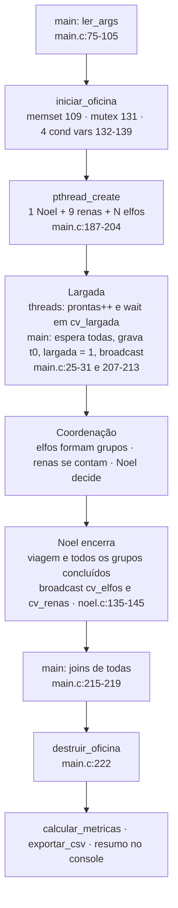
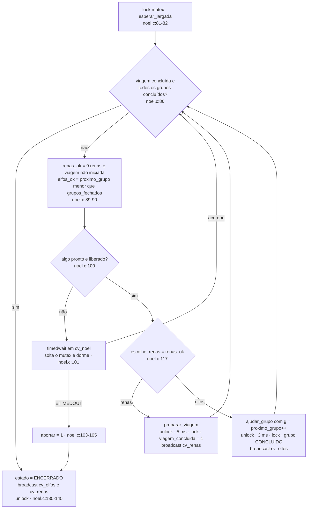
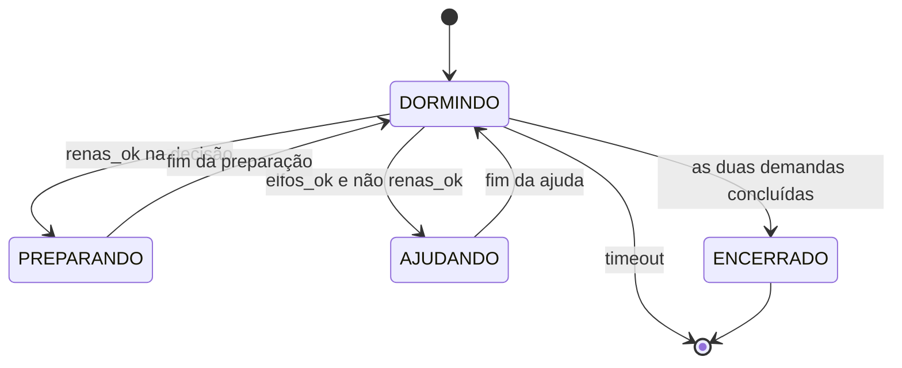
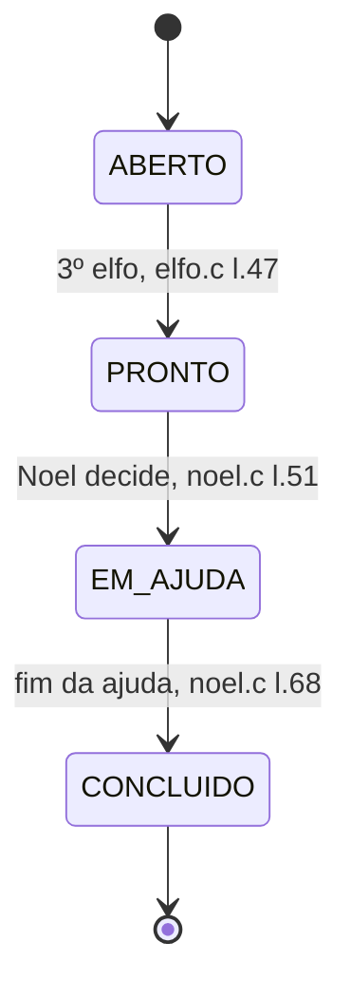
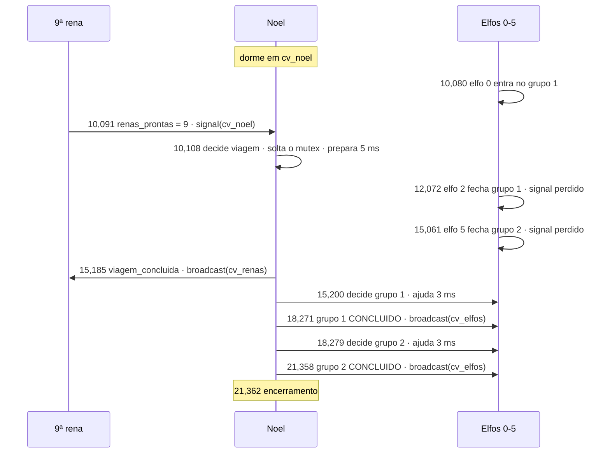

# Guia da Apresentação v4 (Papai Noel)

Roteiro de estudo e de fala para a **apresentação v4** do Tema 11, o Problema do Papai Noel em C11 com pthreads. Este guia está **sincronizado com os 31 slides** de `tema11_papai_noel/apresentacao/apresentacao_papai_noel.pptx`, gerado por `tema11_papai_noel/apresentacao/gerar_apresentacao.py`. Se os slides mudarem, este guia precisa mudar junto.

Índice do projeto: [[_Papai-Noel]]. O guia anterior, [[Guia Completo da Apresentação (Papai Noel)]], acompanha a **v3** (37 slides, `scripts/gerar_slides.py`, cujo `slides.pptx` não está mais na pasta). Ele continua útil como aprofundamento. Esta nota não repete tudo dele: foca na v4 e aponta para as notas detalhadas quando o assunto merece mais.

| Para aprofundar | Nota |
|---|---|
| Cada mecanismo (mutex e cada cond var) | [[Sincronização no Código (Papai Noel)]] |
| Fase a fase, cenários de chegada | [[Fluxo do Código e Sincronização (Papai Noel)]] |
| Regras, estados, linhas do tempo | [[Lógica e Fluxo (Papai Noel)]] |
| O que pode dar errado | [[Riscos de Sincronização (Papai Noel)]] |
| Respostas orais às 15 perguntas | [[Perguntas da Apresentação (Papai Noel)]] |
| Números e leitura dos gráficos | [[Testes e Gráficos (Papai Noel)]] |
| Cada arquivo de `src/` | [[Guia da Pasta src (Papai Noel)]] |
| Compilar, rodar, flags | [[Execução e Flags (Papai Noel)]] |

### Legenda de evidência

| Marca | Significado |
|---|---|
| **[CÓDIGO]** | lido em `tema11_papai_noel/src/` em 2026-10-28; `arquivo:linha` se refere a esse código |
| **[MEDIDO]** | número dos CSVs de `tema11_papai_noel/dados/` (rodada oficial de 2026-10-28) |
| **[VERIFICAÇÃO]** | execução feita em 2026-10-28 numa pasta temporária, **fora** da rodada oficial (binário recompilado de `src/`) |
| **[TEORIA]** | vale para qualquer programa concorrente (literatura de SO) |
| **[INTERPRETAÇÃO]** | leitura nossa dos dados; plausível, mas não medida diretamente |
| **[NÃO VERIFICADO]** | não foi possível confirmar com as fontes disponíveis |

---

## Sumário

1. Visão geral da apresentação
2. Roteiro slide a slide (31 slides)
3. Fundamentos teóricos
4. Funcionamento técnico de ponta a ponta
5. Banco de perguntas e respostas
6. Revisão final e preparação
7. Fontes, lacunas e pontos a confirmar

---

# 1. Visão geral da apresentação

## 1.1 Objetivo

Mostrar ao professor que o grupo **entende** a sincronização do problema, e não apenas que o programa funciona. Ao fim, ele deve conseguir responder sozinho: que mecanismos existem, onde nascem, quem espera, quem avisa, por que a prioridade vale e por que a ajuda não é interrompida.

## 1.2 O problema

Noel dorme na oficina e só acorda por dois motivos: um **grupo de exatamente três elfos** com um pedido, ou a chegada das **nove renas** para a viagem. Se as duas demandas estão prontas quando ele vai escolher, as **renas têm prioridade**. Nenhum elfo novo pode entrar num grupo já fechado, e uma ajuda iniciada não é interrompida. Na **versão finita** implementada, há uma viagem e um pedido por elfo; depois da viagem, Noel atende os grupos restantes e todos encerram.

O problema é difícil porque **três regras dependem da ordem das threads**, e quem decide essa ordem é o escalonador do SO:
1. grupo de exatamente 3, sem invasão;
2. viagem só com as 9 renas;
3. renas primeiro, sem interromper uma ajuda.

## 1.3 Ideia central e solução

> **Mensagem central (slide 2):** um mutex, quatro variáveis de condição e uma regra de decisão garantem as regras do Papai Noel.

- **1 `pthread_mutex_t`** protege toda a `struct Oficina` (estado compartilhado) [CÓDIGO `comum.h:82`].
- **4 `pthread_cond_t`** fazem as threads esperarem sem gastar CPU: `cv_largada`, `cv_noel`, `cv_elfos`, `cv_renas` [CÓDIGO `comum.h:83-86`].
- **Nenhum semáforo** e nenhuma `pthread_barrier` (`grep` por `sem_` e `pthread_barrier` em `src/` = 0) [VERIFICAÇÃO].
- **Fila de grupos com id**: o 3º elfo fecha o grupo e avança `grupo_aberto` na mesma seção crítica [CÓDIGO `elfo.c:41-53`].
- **Só Noel decide**, com o mutex, e testa as renas primeiro: `escolhe_renas = renas_ok` [CÓDIGO `noel.c:117`].

## 1.4 Linha narrativa e justificativa

A sequência segue a **pirâmide** (resposta primeiro, depois as provas) aberta por um **SCQA**:

| Seção (page tracker) | Slides | Pergunta que a seção responde |
|---|---|---|
| Abertura | 1–2 | Qual é a resposta em uma frase? |
| Fundamentos | 3–5 | Que vocabulário de SO preciso para entender a solução? |
| Problema | 6–7 | Quais regras dependem da ordem e por que isso é um problema de SO? |
| Solução | 8–9 | Como o programa está organizado e em que fases roda? |
| Sincronização | 10–18 | Como cada regra é garantida, linha a linha e em linhas do tempo reais? |
| Propriedades | 19–20 | A solução é boa? Há deadlock, starvation, espera ocupada? |
| Resultados | 21–26 | O que os experimentos mostram e o que **não** provam? |
| Conclusão | 27 | O que funciona, o que garante, o que falta |
| Apoio | 28–31 | Respostas rápidas para perguntas (mapa, semáforos, linhas, empate) |

**Por que essa ordem:** a sincronização só faz sentido depois do vocabulário (seção crítica, corrida, mutex × semáforo × cond var). A seção de sincronização vai do geral ao específico: inventário (10) → nascimento (11) → padrão de espera (12) → as três regras (13, 15, 16) → cenários e contraprova (17, 18). Os resultados vêm depois das propriedades porque os dados **ilustram** as garantias, não as substituem (slide 26).

**Tempo:** os 27 slides principais cabem em ~15–18 min de fala. [NÃO VERIFICADO] O tempo disponível não está documentado (a v3 citava 8 min numa nota). Se forem 8–10 min, use o plano curto da Parte 6.

## 1.5 Conceitos que você precisa dominar

1. Processo × thread; concorrência; seção crítica; condição de corrida; atomicidade.
2. Mutex × semáforo × variável de condição (dono, valor inicial, memória de avisos).
3. O padrão `lock → while (!pred) wait → age → unlock` e por que é `while`.
4. `signal` × `broadcast`; aviso "perdido" e por que ele não é bug aqui.
5. Prioridade **não preemptiva**: decidir só entre tarefas.
6. Deadlock (Coffman), starvation (e aging), espera ocupada.
7. Critérios de uma boa solução: exclusão mútua, progresso, espera limitada, sem hipótese de velocidade.
8. Métricas: vazão, espera, p95 (e por que o p95 de 3 amostras é o máximo), resposta às renas.
9. Diferença entre **observado nos testes** e **garantido pelo código**.

---

# 2. Roteiro slide a slide

> Em cada slide: **🎤 Fala** é o que dizer em voz alta (sugestão, adapte às suas palavras). **📘 Estudo** é material para você entender e **não** precisa ser falado.

---

## Slide 1 — Capa: "Problema do Papai Noel"

**A. Objetivo.** Apresentar-se (Felipe Prior Mulinari, único integrante) e plantar a frase-resumo: *como um mutex e quatro variáveis de condição coordenam Noel, 9 renas e N elfos em C11 com pthreads*.

**B. Conceitos.** Nenhum novo. O subtítulo já antecipa os dois mecanismos usados, o que ajuda a fixar desde o início que **não há semáforos**.

**C. Roteiro de fala.**
🎤 "Eu sou o Felipe Prior Mulinari. Meu tema é o Problema do Papai Noel, implementado em C11 com pthreads. A ideia que vou defender é simples: um mutex e quatro variáveis de condição bastam para coordenar o Noel, as nove renas e os elfos, respeitando todas as regras do enunciado. Vou começar pelo resumo."

**D. Elementos visuais.** A faixa verde lateral é só identidade. A linha "Implementação" diz onde está o código (`tema11_papai_noel/src`) e o ambiente (GCC 15.3.1, Fedora 43, confirmado em `dados/ambiente.txt`).

**E. Implementação.** `tema11_papai_noel/src/`: 7 arquivos `.c` e os headers.

**F. Perguntas possíveis.**
- *"Por que C11 e não C++ ou Java?"* O enunciado do tema pede C com pthreads [NÃO VERIFICADO: o enunciado completo não está no vault; o README cita "C11 + pthreads"]. O C expõe os mecanismos POSIX diretamente, sem abstrações.

**G. Erros a evitar.** Não diga "usamos semáforos" nem "usamos monitores" (a dupla mutex + cond var é o *padrão* de monitor, mas não há um construto de monitor na linguagem).

---

## Slide 2 — "Um mutex, quatro variáveis de condição e uma regra de decisão garantem as regras do Papai Noel"

**A. Objetivo.** Entregar a resposta inteira em 40 segundos: o problema (SCQA na linha de cima), as três razões (cartões) e a evidência (faixa vermelha). O professor deve sair deste slide sabendo **o que** vamos provar.

**B. Conceitos.**
- **SCQA:** Situação (threads compartilham memória e o SO escolhe a ordem) → Complicação (três regras dependem dessa ordem) → Pergunta (como coordenar sem corrida, sem deadlock, sem espera ocupada?) → a Resposta é o título.
- **Razão 1, atomicidade:** "testar e alterar" precisa ser indivisível; o mutex faz isso.
- **Razão 2, espera eficiente:** a cond var permite dormir até um predicado valer, sem laço que gasta CPU.
- **Razão 3, política:** a prioridade é uma **regra de decisão**, aplicada só pela thread Noel, sobre um estado lido com o mutex.

**C. Roteiro de fala.**
🎤 "Threads compartilham memória e quem decide a ordem em que elas rodam é o sistema operacional. No Papai Noel, três regras dependem dessa ordem: grupos de exatamente três elfos, viagem só com as nove renas, e renas primeiro sem interromper uma ajuda. A nossa resposta tem três partes. Primeiro, o mutex torna 'testar e alterar' indivisível: é assim que um quarto elfo nunca entra num grupo fechado. Segundo, as variáveis de condição deixam as threads dormirem até poderem seguir, sem gastar CPU. Terceiro, só o Noel decide, com o mutex, e testa as renas primeiro. Nos testes, foram 25 execuções válidas, sem violações. O teste de prioridade passou, e uma versão propositalmente errada gerou duas violações, que o programa detectou. Agora vou construir isso desde os fundamentos."

**D. Elementos visuais.** Três cartões paralelos, com o mesmo formato (Gestalt: similaridade = três razões do mesmo nível). A referência em fonte de código no rodapé de cada cartão aponta onde a razão vive no código. A faixa vermelha é o **único acento** do slide: a evidência.

**E. Implementação.** `elfo.c:41-53` (fechamento do grupo), `comum.h:83-86` (as 4 cond vars), `noel.c:89-90, 117` (leitura e decisão). Números de `dados/resumo.csv` (25 linhas `ok`, violações = 0), `dados/log_execucao.txt` (teste, ingênua, estresse).

**F. Perguntas possíveis.**
- *"25 execuções sem violação provam a correção?"* Não. Mostram que as regras valeram nas execuções observadas. A garantia vem do raciocínio sobre o código (slide 26).
- *"O que é a 'versão ingênua'?"* A mesma implementação com a flag `--ingenua`, que inverte a regra (`escolhe_renas = !elfos_ok`, `noel.c:117`). Serve para mostrar que o detector de violações funciona.

**G. Erros a evitar.**
- Dizer "a prioridade é garantida pelo mutex". O mutex só garante um retrato consistente; a prioridade vem da **ordem do teste** (slide 15).
- Dizer "não há corrida, os testes provam". A ausência de corrida foi verificada **por inspeção**; TSan e Helgrind não foram executados.

---

## Slide 3 — "O SO decide a ordem em que as threads rodam; sincronizar é impor as ordens que importam"

**A. Objetivo.** Responder às perguntas 1 e 2 do professor: o que é um problema de sincronização e qual a relação com o SO.

**B. Conceitos.**
- **Processo:** programa em execução, com espaço de endereçamento próprio. **Thread:** fluxo de execução dentro de um processo; as threads de um processo **compartilham** código, dados globais e heap, mas cada uma tem pilha e registradores próprios. [TEORIA]
- **Concorrência:** várias threads em andamento ao mesmo tempo, intercaladas num núcleo ou em paralelo em vários. **Paralelismo** é o caso particular de execução simultânea real. [TEORIA]
- **Escalonador:** parte do SO que escolhe qual thread pronta roda em cada núcleo e quando ela é interrompida (preempção). Como não controlamos essa escolha, o **entrelaçamento** das instruções muda a cada execução. [TEORIA]
- **Seção crítica:** trecho que acessa dado compartilhado e não pode ser executado por duas threads ao mesmo tempo.
- **Condição de corrida:** o resultado depende do entrelaçamento. Um programa concorrente só é correto se for correto para **todos** os entrelaçamentos possíveis, e por isso testar não basta.
- **Sincronização** = duas necessidades: (1) **exclusão mútua** nos dados; (2) **esperar e avisar** eventos ("o grupo foi atendido") sem gastar CPU.
- **Relação com o SO:** o SO cria e escalona as threads, e fornece os mecanismos de bloqueio. Quando uma thread bloqueia num mutex ou numa cond var, o SO a tira da fila de prontos e a acorda depois. No Linux, o mutex da glibc usa a chamada de sistema **futex**: sem disputa, tudo acontece em espaço de usuário; com disputa, o kernel põe a thread para dormir. [TEORIA; não medido no trabalho]

**C. Roteiro de fala.**
🎤 "O nosso programa é um processo com várias threads: uma do Noel, nove das renas e N dos elfos. Todas leem e escrevem a mesma estrutura, a Oficina. Quem decide quando cada thread roda, e quando ela é pausada, é o escalonador do sistema operacional. Ele pode pausar uma thread entre duas instruções quaisquer. Um problema de sincronização aparece quando a correção depende dessa ordem. Resolver é garantir duas coisas: exclusão mútua, para que só uma thread mexa nos dados por vez, e uma forma de esperar e avisar eventos sem ficar gastando CPU."

**D. Elementos visuais.** À esquerda, o retângulo verde é **um processo** (`./simulacao`); dentro dele, a memória compartilhada (a `struct Oficina`) e três caixas de threads com setas apontando para ela: todas acessam o mesmo estado. À direita, quatro definições; a última, **Sincronização**, está em vermelho porque é a síntese das outras três.

**E. Implementação.** A `struct Oficina` está em `comum.h:79-123`; as threads são criadas em `main.c:187-204`. Pontos onde o SO tira a thread da CPU: `clock_nanosleep` (`tempo.c:48`), `pthread_cond_wait` (ex.: `rena.c:37`), `pthread_cond_timedwait` (`noel.c:101`).

**F. Perguntas possíveis.**
- *"Threads e processos sincronizam do mesmo jeito?"* Os conceitos são os mesmos. Entre processos, a memória não é compartilhada por padrão: é preciso memória compartilhada (`shm_open`/`mmap`) e mecanismos marcados como compartilháveis (`PTHREAD_PROCESS_SHARED`, ou `sem_init` com `pshared ≠ 0`), ou mecanismos do kernel (pipes, semáforos nomeados). Aqui o mutex usa atributos padrão, privados ao processo.
- *"Com um único núcleo ainda haveria corrida?"* Sim. A preempção pode interromper uma thread no meio de `ler → somar → gravar`. Paralelismo real só aumenta a chance.
- *"Por que o SO é necessário para sincronizar?"* Para bloquear sem espera ocupada: só o SO pode tirar uma thread da fila de prontos e recolocá-la quando um evento ocorre.

**G. Erros a evitar.**
- Confundir concorrência com paralelismo.
- Dizer que threads de um processo têm "memória separada". Só a pilha é própria; o heap e os globais são compartilhados.
- Dizer que o futex foi medido ou observado no trabalho; isso é conhecimento sobre a glibc.

---

## Slide 4 — "Um if com contador falha porque testar e alterar são passos que outra thread pode intercalar"

**A. Objetivo.** Responder à pergunta 4: a diferença entre um `if` com contador e um mutex. Mostrar **concretamente** uma condição de corrida.

**B. Conceitos.**
- `renas_prontas++` não é uma instrução: vira **ler → somar → gravar**. Se duas renas leem 7 antes de qualquer uma gravar, ambas gravam 8: **atualização perdida** (*lost update*). [TEORIA]
- **Verificar e depois agir** (*check-then-act*): `if (n < 3) { membros[n] = id; n++; }`. Dois elfos podem ver `n == 2`, ambos passam no `if` e escrevem em `membros[2]`, formando um "grupo" de 4.
- **Lock caseiro com flag** (`while (ocupado); ocupado = 1;`) falha pelo mesmo motivo: testar a flag e atribuir também são passos separados. E ainda é **espera ocupada**.
- O mutex resolve porque o par "testar e alterar" acontece **inteiro** enquanto a thread segura o lock; a outra thread fica bloqueada em `pthread_mutex_lock`. Por dentro, o mutex usa uma instrução atômica do hardware (comparar e trocar). [TEORIA]

**C. Roteiro de fala.**
🎤 "Vejam o contador de renas. `renas_prontas++` parece uma linha, mas são três passos: ler, somar e gravar. Se a rena A lê 7 e, antes de gravar, a rena B também lê 7, as duas gravam 8. Chegaram duas renas e o contador subiu uma. Com as nove presentes, ele para em oito e o Noel nunca prepara a viagem. Com o mutex, a rena B fica bloqueada até a A terminar, lê 8 e grava 9. O mesmo vale para os elfos: sem mutex, dois elfos veriam vaga no grupo e formariam um grupo de quatro. O problema não é o `if`; é o intervalo entre testar e alterar."

**D. Elementos visuais.**
- **Tabela esquerda** (sem mutex): cada linha é um instante. A coluna "memória" mostra o valor real; a última linha, em vermelho, é a perda.
- **Tabela direita** (com mutex): a rena B tenta o lock e bloqueia; só continua depois do `unlock` da A.
- **Código** `rena.c:23` e `28`: o lock e o `++` estão na mesma seção crítica.
- **Faixa vermelha:** generaliza para o elfo e para o lock caseiro.

**E. Implementação.**
```c
// rena.c:23, 28
pthread_mutex_lock(&o->mutex);
...
o->renas_prontas++;
```
No elfo, o `if` existe (`elfo.c:36`), mas **dentro** do mutex adquirido em `elfo.c:27` e sem soltá-lo até o `pthread_cond_wait` de `elfo.c:58`.

**F. Perguntas possíveis.**
- *"Se o `if` do elfo está dentro do mutex, ele serve para quê?"* É uma **asserção defensiva**: com o código atual nunca dispara, porque quem fecha o grupo já avança `grupo_aberto`. Se a lógica mudasse e um elfo visse um grupo fechado, contaria uma violação em vez de corromper o grupo.
- *"Um `volatile` resolveria?"* Não. `volatile` só impede o compilador de guardar o valor em registrador; não torna `++` atômico nem cria exclusão mútua.
- *"E operações atômicas (`stdatomic.h`)?"* Resolveriam um contador isolado, mas não a decisão composta de Noel (ler renas **e** elfos e decidir). Por isso usamos mutex. O projeto não usa atômicos.

**G. Erros a evitar.**
- Dizer que "o `if` é o problema". O problema é o `if` **fora** de uma seção crítica.
- Dizer que a corrida "só acontece com vários núcleos". A preempção basta.

---

## Slide 5 — "Mutex dá exclusão, semáforo conta e variável de condição espera um predicado: usamos mutex e condição"

**A. Objetivo.** Responder às perguntas 3 e 10: o que são mutex e semáforo, e qual deles a implementação usa.

**B. Conceitos.**
- **Mutex:** cadeado **com dono**. Só quem travou destrava. Começa **destravado**; não tem valor numérico. Serve para exclusão mútua.
- **Semáforo:** contador inteiro com `wait` (P: decrementa; bloqueia se for 0) e `post` (V: incrementa e libera alguém). **Não tem dono**: qualquer thread pode dar `post`. **Lembra** avisos no contador. O valor inicial define o comportamento (1 = tranca; 0 = espera por aviso; N = N recursos).
- **Variável de condição:** fila de espera associada a um **predicado** sobre dados protegidos por um mutex. `wait` solta o mutex e dorme **atomicamente**; `signal` acorda pelo menos uma; `broadcast` acorda todas. **Não guarda aviso**: se ninguém está esperando, o aviso se perde, e por isso a thread sempre testa o predicado antes de dormir.
- **Por que mutex + cond var aqui:** Noel precisa avaliar uma **condição composta** ("9 renas **ou** um grupo pronto") e escolher entre elas. Com mutex + cond var, ele lê `renas_ok` e `elfos_ok` na mesma seção crítica. Com semáforos (solução clássica de Downey, `santaSem`), Noel acorda e ainda precisa ler contadores protegidos para saber quem o chamou.

**C. Roteiro de fala.**
🎤 "Três mecanismos. O mutex é um cadeado com dono: serve para exclusão mútua e começa destravado. O semáforo é um contador: o `wait` decrementa e bloqueia no zero, o `post` incrementa. Ele não tem dono e lembra avisos. A variável de condição é uma fila onde a thread dorme até um predicado valer. Ela não lembra avisos, então sempre trabalha junto com um mutex e com um teste do estado. No projeto usamos um mutex e quatro variáveis de condição. Não há nenhum semáforo: procuramos `sem_` no código e não aparece nada. Escolhemos assim porque o Noel precisa olhar as duas demandas ao mesmo tempo para decidir."

**D. Elementos visuais.** Tabela com linhas paralelas (para quê, operações, valor inicial, dono, memória de avisos). A última linha, **No projeto**, está destacada em rosa: é a resposta direta à pergunta 10.

**E. Implementação.** `comum.h:82-86` declara os mecanismos; `main.c:131-139` os inicializa. Não há `sem_t`, `sem_init`, `pthread_barrier` nem `stdatomic.h` em `src/`.

**F. Perguntas possíveis.**
- *"Semáforo com valor 1 é igual a mutex?"* Funciona como exclusão mútua, mas sem dono: uma thread que não deu `wait` pode dar `post`. O mutex detecta mais erros (com o tipo `ERRORCHECK`) e permite herança de prioridade.
- *"Variável de condição sozinha resolve?"* Não. `pthread_cond_wait(&cv, &mutex)` exige o mutex travado, e o predicado é um dado protegido por ele.
- *"Monitor?"* Mutex + cond vars é a forma de implementar um monitor em C. Não chamamos assim no código.

**G. Erros a evitar.**
- Dizer que a cond var "tem valor inicial 0". Ela não tem valor; o que tem valor são os **predicados** (slide 10).
- Dizer que o semáforo "tem dono".

---

## Slide 6 — "Noel atende duas demandas, e três das regras dependem da ordem entre as threads"

**A. Objetivo.** Apresentar o problema e as regras da versão implementada, destacando as três que exigem sincronização.

**B. Conceitos.**
- **Atores:** N elfos (o elfo *i* chega em 10 + *i* ms), agrupados em trios numa **fila FIFO**; 9 renas, que chegam juntas em R ms (5, 10 ou 30 na matriz); Noel, uma thread que decide.
- **Durações simuladas:** ajuda = 3 ms por grupo; preparação da viagem = 5 ms (padrões de `--ajuda-ms` e `--preparo-ms`, `main.c:77-78`).
- **Regras** (enunciado, conferidas no README):
  1. Noel dorme até haver um grupo de 3 elfos ou as 9 renas.
  2. **Exatamente 3** por ajuda; um 4º não entra num grupo já fechado. *(sincronização)*
  3. **Viagem só com as 9 renas.** *(sincronização)*
  4. **Renas primeiro** quando as duas demandas estão prontas na decisão, **sem interromper** uma ajuda iniciada. *(sincronização)*
  5. Versão finita: 1 viagem, 1 pedido por elfo; depois da viagem, os grupos restantes.
  6. Fim: todos encerram quando as duas demandas terminam.

**C. Roteiro de fala.**
🎤 "O Noel dorme e acorda por dois motivos. Os elfos chegam um a cada milissegundo e se juntam em grupos de três, que entram numa fila. As nove renas chegam juntas. Cada ajuda leva três milissegundos e a preparação da viagem, cinco. Destaquei três regras em vermelho porque elas só valem com sincronização correta: o grupo tem exatamente três e ninguém invade, a viagem só sai com as nove renas, e as renas têm prioridade sem interromper uma ajuda. Na nossa versão há uma viagem e um pedido por elfo, e o programa encerra quando as duas demandas terminam."

**D. Elementos visuais.** O diagrama tem fluxo: elfos → grupos de 3 → Noel ← 9 renas. As cores dos rótulos de duração (azul = ajuda, laranja = preparação) são as **mesmas** dos gráficos G4 e das linhas do tempo dos slides 16 a 18: a mesma categoria tem a mesma cor em todo o deck. Os círculos vermelhos numeram as regras de sincronização.

**E. Implementação.** Padrões em `ler_args` (`main.c:77-78`): `elfo0_ms = 10`, `ajuda_ms = 3`, `preparo_ms = 5`. `--elfos` precisa ser múltiplo de 3 entre 3 e 300 (`main.c:98`). Os sleeps (`dormir_ate_ms`, `tempo.c:43-50`) só simulam durações.

**F. Perguntas possíveis.**
- *"Por que o número de elfos precisa ser múltiplo de 3?"* Na versão finita, um elfo que sobrasse nunca formaria grupo e nunca seria atendido; o programa não encerraria normalmente. A validação evita esse caso (`main.c:98`).
- *"Os tempos são reais?"* São simulados com `clock_nanosleep` absoluto. Medimos a coordenação em cima desses tempos fixos.

**G. Erros a evitar.**
- Dizer que "renas sempre vêm antes". A prioridade só vale **na decisão**, com as duas demandas no estado lido. Se as renas chegam durante uma ajuda, a ajuda termina primeiro (slide 16).
- Dizer que "o quarto elfo é rejeitado". Ele não é rejeitado: entra no **próximo** grupo.

---

## Slide 7 — "O problema é um escalonador em miniatura: um recurso único, clientes com prioridade, sem preempção"

**A. Objetivo.** Responder à pergunta 5: a relação do problema com a convivência de threads e processos no SO.

**B. Conceitos.**
- Noel = **recurso único e disputado** (como uma CPU ou um dispositivo).
- Elfos e renas = **clientes** com prioridades diferentes.
- Grupo de 3 = **lote** de requisições (agrupar E/S para amortizar custo).
- Renas antes = **escalonamento por prioridade**.
- Não interromper uma ajuda = **escalonamento não preemptivo**: decide-se só ao fim do *burst*.
- Noel dormindo = thread **bloqueada**, fora da fila de prontos do SO.
- Renas voltando sempre = risco de **starvation**; a mitigação clássica é **aging** (aumentar a prioridade de quem espera muito).

**C. Roteiro de fala.**
🎤 "Este problema é um escalonador em miniatura. O Noel é um recurso único, como uma CPU. Elfos e renas são clientes com prioridades diferentes. O grupo de três é um lote. A prioridade das renas é escalonamento por prioridade, e não interromper uma ajuda é escalonamento não preemptivo. Se as renas voltassem sempre, os elfos poderiam passar fome, e a solução clássica seria o aging. Um cuidado: o Noel não é o escalonador do SO. O SO continua escalonando todas as threads; o Noel é só uma delas, que escolhe a próxima tarefa."

**D. Elementos visuais.** Tabela de três colunas: o conceito no problema, o equivalente no SO e onde aparece no código. A faixa vermelha é o **limite da analogia**.

**E. Implementação.** `thread_noel` (`noel.c:76-147`); a decisão `escolhe_renas = renas_ok` (`noel.c:117`) só acontece no topo do laço (`noel.c:85`); a espera é `pthread_cond_timedwait` (`noel.c:101`).

**F. Perguntas possíveis.**
- *"Noel é preemptivo ou não?"* Não preemptivo. A decisão acontece entre tarefas, nunca durante uma.
- *"Onde há starvation no SO real?"* Em escalonadores de prioridade estática; o Linux mitiga com fatias de tempo e ajustes de prioridade. [TEORIA]

**G. Erros a evitar.** Levar a analogia longe demais ("Noel escalona as threads"). Ele escolhe **tarefas**; quem escalona threads é o SO.

---

## Slide 8 — "Cada personagem é uma thread, e todas compartilham uma única struct Oficina protegida pelo mutex"

**A. Objetivo.** Dar o mapa mínimo do código: quem é quem e onde está o estado compartilhado. Não é preciso explicar cada campo.

**B. Conceitos.**
- **Estado compartilhado centralizado:** tudo o que as threads precisam ver está numa `struct Oficina`, passada por ponteiro a cada thread.
- **Lock único:** um mutex para todo o estado. Isso simplifica o raciocínio e elimina deadlock por ordem de locks, ao custo de serializar o acesso (aceitável com 3 a 12 elfos).
- **Exceções de leitura sem lock:** `o->cfg` e `o->t0`. `cfg` é preenchido antes de `pthread_create` (que cria uma relação *happens-before* com a nova thread). `t0` é gravado pela main **com o mutex** antes de `largada = 1`, e cada thread só o lê depois de ver `largada == 1` com o mesmo mutex. Nenhum dos dois muda depois. [CÓDIGO; análise em [[Riscos de Sincronização (Papai Noel)]]]

**C. Roteiro de fala.**
🎤 "A main cria uma thread para o Noel, nove para as renas e uma por elfo. Todas recebem um ponteiro para a mesma estrutura, a Oficina, que guarda o mutex, as quatro variáveis de condição, os contadores, a fila de grupos e o estado do Noel. Cada arquivo tem um papel: o `main.c` prepara e encerra, o `noel.c` decide, o `elfo.c` e o `rena.c` são os clientes. A regra que vale para o código todo: todo campo que muda só é lido ou escrito com o mutex travado."

**D. Elementos visuais.** Setas da main para as três caixas de thread (criação) e das threads para a Oficina (acesso compartilhado). Na Oficina, "mutex + 4 cond vars" está em vermelho: é o que protege e coordena o resto. A tabela à direita é o mapa de arquivos.

**E. Implementação.**

| Arquivo | Funções principais |
|---|---|
| `main.c` | `ler_args` (75-105), `iniciar_oficina` (107-142), `esperar_largada` (25-31), `registrar` (33-47), `main` (163-265) |
| `noel.c` | `preparar_viagem` (19-42), `ajudar_grupo` (45-74), `thread_noel` (76-147) |
| `elfo.c` | `thread_elfo` (15-61) |
| `rena.c` | `thread_rena` (12-40) |
| `tempo.c` | `agora`, `somar_ms`, `ms_desde_inicio`, `dormir_ate_ms` |
| `metricas.c`, `csv.c` | métricas e exportação, executadas **depois** dos joins |
| `comum.h` | tipos, `Oficina` (79-123), constantes `NUM_RENAS = 9`, `TAM_GRUPO = 3` |

**F. Perguntas possíveis.**
- *"Um mutex só não é gargalo?"* Com 22 threads e seções críticas de microssegundos, não: a resposta às renas fica em ~20 µs. Com milhares de threads, valeria separar locks (um para renas, um para elfos), com cuidado com a ordem de aquisição para não criar deadlock.
- *"Por que os eventos ficam em memória?"* Para não fazer E/S dentro da seção crítica, o que distorceria os tempos. Eles são exportados para CSV só depois dos joins.

**G. Erros a evitar.** Dizer que "cada thread tem sua cópia da Oficina". É **uma** Oficina, declarada na `main` (`Oficina o;`), e todas recebem o endereço dela.

---

## Slide 9 — "A execução tem quatro fases, e só a terceira aplica a política do problema"

**A. Objetivo.** Mostrar o fluxo de ponta a ponta antes de mergulhar na sincronização.

**B. Conceitos.**
- **Preparar:** `memset` zera a Oficina; init do mutex e das 4 cond vars; criação das 1 + 9 + N threads, **todas antes de qualquer join**.
- **Largar (barreira caseira):** cada thread trava o mutex, incrementa `threads_prontas`, faz `broadcast` em `cv_largada` e espera `largada == 1`. A main espera `threads_prontas == total_threads`, grava `t0`, faz `largada = 1` e `broadcast`. Assim todos os tempos partem do mesmo `t0`.
- **Coordenar:** elfos formam grupos, renas se contam, Noel decide e executa tarefas.
- **Encerrar:** Noel sai do laço quando as duas demandas terminam, faz broadcast em `cv_elfos` e `cv_renas`; a main faz join de todas, destrói os mecanismos e só então calcula métricas e grava CSVs.
- **Sleeps não sincronizam:** `clock_nanosleep` com `TIMER_ABSTIME` só simula chegada e duração. Nenhuma decisão depende deles.

**C. Roteiro de fala.**
🎤 "A execução tem quatro fases. Na preparação, a main zera a estrutura, inicializa o mutex e as variáveis de condição e cria todas as threads. Na largada, cada thread avisa que está pronta e espera; quando todas estão prontas, a main marca o instante zero e solta todo mundo de uma vez. Isso é uma barreira feita à mão, com contador e variável de condição. Na coordenação acontece o problema propriamente dito. No encerramento, o Noel sai do laço, acorda quem ainda estiver esperando, a main faz o join de todas as threads e só depois calcula as métricas. Os sleeps só simulam o tempo das tarefas; nenhuma coordenação depende deles."

**D. Elementos visuais.** Quatro chevrons em sequência (fluxo da esquerda para a direita). O 3º, **Coordenar**, está em vermelho porque é onde está a política; é o assunto dos slides 10 a 18. Abaixo de cada fase, as linhas do código.

**E. Implementação.**
```c
// main.c:25-31 — cada thread
o->threads_prontas++;
pthread_cond_broadcast(&o->cv_largada); /* avisa a main */
while (!o->largada)
    pthread_cond_wait(&o->cv_largada, &o->mutex);

// main.c:207-213 — a main
pthread_mutex_lock(&o.mutex);
while (o.threads_prontas < o.total_threads)
    pthread_cond_wait(&o.cv_largada, &o.mutex);
o.t0 = agora();
o.largada = 1;
pthread_cond_broadcast(&o.cv_largada);
pthread_mutex_unlock(&o.mutex);
```

**F. Perguntas possíveis.**
- *"Por que `broadcast` e não `signal` em `main.c:28`?"* Na `cv_largada` esperam **várias** threads além da main. Um `signal` poderia acordar outra thread em vez da main; essa thread veria `largada == 0` e voltaria a dormir, e a main nunca acordaria. Com `broadcast`, a main certamente acorda.
- *"Por que não `pthread_barrier`?"* A barreira caseira permite que a main grave `t0` **dentro** da mesma seção crítica que libera as threads, e reaproveita o mutex que já protege tudo. [INTERPRETAÇÃO: a decisão não está registrada além do README]
- *"Por que criar todas as threads antes do primeiro join?"* Um join antes da criação das outras serializaria a execução (a main ficaria parada esperando uma thread que nunca recebe largada).

**G. Erros a evitar.** Dizer que os sleeps "fazem as threads esperarem a vez". Eles só simulam o tempo; quem coordena são as cond vars.

---

## Slide 10 — "Um mutex e quatro variáveis de condição, nenhum semáforo, coordenam o programa inteiro"

**A. Objetivo.** Ser o slide de referência para "quais mecanismos, onde nascem, com que valor, quem espera, quem avisa" (perguntas 10 e 11).

**B. Conceitos.**
- Cada cond var tem **um papel único** e um predicado próprio:
  - `cv_largada`: sinal de início comum (predicados `largada`, `threads_prontas`).
  - `cv_noel`: "há trabalho para Noel" (`renas_ok || elfos_ok`). É a única que usa `signal`, porque tem **um único consumidor**.
  - `cv_elfos`: "o grupo deste elfo foi concluído" (`grupos[g].estado == GRUPO_CONCLUIDO`).
  - `cv_renas`: "a viagem foi concluída" (`viagem_concluida`).
- **Valor inicial:** o mutex começa **destravado e sem dono**. Cond vars **não têm valor**, começam com a fila vazia. Os predicados começam zerados pelo `memset` (`main.c:109`), e os grupos começam `GRUPO_ABERTO` porque `GRUPO_ABERTO = 0` e o vetor vem de `calloc` (`main.c:116`).
- `cv_noel` recebe um atributo: o relógio `CLOCK_MONOTONIC`, para o prazo do `timedwait` usar o mesmo relógio de `t0`.

**C. Roteiro de fala.**
🎤 "Este é o inventário completo. Um mutex, inicializado na linha 131 da main, começa destravado. Quatro variáveis de condição: a da largada, a do Noel, a dos elfos e a das renas. Variável de condição não tem valor: começa com a fila vazia. O que tem valor inicial são as variáveis que ela observa, e todas começam em zero pelo `memset`. A `cv_noel` é a única em que se usa `signal`, porque só o Noel espera nela; nas outras usamos `broadcast`, porque há várias threads esperando. Não há nenhum semáforo."

**D. Elementos visuais.** Tabela de 6 colunas, lida linha a linha. O `mutex` em vermelho na primeira coluna é o acento: tudo depende dele. A faixa vermelha corrige o erro mais comum: "a cond var começa em 0".

**E. Implementação.**

| Mecanismo | Declaração | Init | Espera | Aviso |
|---|---|---|---|---|
| `mutex` | `comum.h:82` | `main.c:131` | `lock` em todos os arquivos | `unlock` |
| `cv_largada` | `comum.h:83` | `main.c:132` | `main.c:30` (threads), `209` (main) | `broadcast` `main.c:28`, `212` |
| `cv_noel` | `comum.h:84` | `main.c:136-140` | `noel.c:101` (`timedwait`) | `signal` `rena.c:33`, `elfo.c:53` |
| `cv_elfos` | `comum.h:85` | `main.c:133` | `elfo.c:58` | `broadcast` `noel.c:73`, `143` |
| `cv_renas` | `comum.h:86` | `main.c:134` | `rena.c:37` | `broadcast` `noel.c:41`, `144` |

Todos são destruídos em `destruir_oficina` (`main.c:144-151`), chamada em `main.c:222`, **depois** dos joins.

**F. Perguntas possíveis.**
- *"Por que `broadcast` em `cv_elfos` se só um grupo termina?"* Porque os três elfos do grupo esperam nela, e também elfos de outros grupos. O `broadcast` acorda todos; cada um reavalia o **próprio** predicado e quem não é do grupo concluído volta a dormir. Uma melhoria seria uma cond var por grupo.
- *"E se fosse `signal` em `cv_renas`?"* Só uma rena acordaria por aviso; as outras oito ficariam presas até o broadcast final do encerramento (`noel.c:144`). O programa terminaria, mas por acaso.

**G. Erros a evitar.**
- Trocar os papéis ("a `cv_noel` libera as renas"). Quem libera as renas é o `broadcast` em `cv_renas`.
- Dizer que `signal` acorda "exatamente uma" thread. A POSIX diz "pelo menos uma".

---

## Slide 11 — "O mutex nasce destravado em main.c:131, antes de qualquer thread existir"

**A. Objetivo.** Responder de forma exata: "como o mutex começa e qual linha o inicializa?" (pergunta 9) e "qual o valor inicial de cada mecanismo?" (pergunta 11).

**B. Conceitos.**
- `pthread_mutex_init(&o->mutex, NULL)`: o 1º argumento é o endereço do mutex, o 2º são os atributos. `NULL` = padrão: tipo `PTHREAD_MUTEX_DEFAULT` (não recursivo, sem verificação de erro), privado ao processo.
- **O `memset` não inicializa o mutex** pela POSIX; o que vale é a chamada da linha 131. Usar um mutex não inicializado é comportamento indefinido. O código **não** usa `PTHREAD_MUTEX_INITIALIZER` (inicialização estática).
- **`CLOCK_MONOTONIC`** em `cv_noel`: o prazo `limite = t0 + timeout_ms` (`noel.c:83`) é calculado com `CLOCK_MONOTONIC` (`tempo.c:17`). Se a cond var usasse o relógio padrão (`CLOCK_REALTIME`), o prazo seria interpretado noutro relógio: o timeout dispararia na hora ou nunca. O relógio monotônico também não volta se a hora do sistema for ajustada.
- **Ordem no tempo:** init (131) → `pthread_create` (187) → … → joins (215-219) → `destroy` (222). Nada usa o mutex antes de existir, nem depois de destruído.

**C. Roteiro de fala.**
🎤 "O mutex é inicializado na função `iniciar_oficina`, linha 131 do `main.c`, com `pthread_mutex_init` e atributos nulos, ou seja, padrão. Ele começa destravado e sem dono. Isso acontece antes de criarmos qualquer thread, na linha 187, e ele só é destruído na 222, depois de todos os joins. Antes disso, o `memset` da linha 109 zera todos os predicados. A `cv_noel` recebe o relógio monotônico, para que o prazo do timeout seja medido no mesmo relógio do instante zero."

**D. Elementos visuais.** Bloco de código real (lido de `src/`), com destaque em amarelo nas linhas 109, 131, 138 e 139. Os círculos numerados à direita explicam cada destaque; o 2º, sobre o mutex, é vermelho (a resposta principal). A faixa de baixo mostra a ordem no tempo.

**E. Implementação.**
```c
// main.c:107-109, 131-140
static int iniciar_oficina(Oficina *o, const Config *c)
{
    memset(o, 0, sizeof *o);
    ...
    pthread_mutex_init(&o->mutex, NULL);
    pthread_cond_init(&o->cv_largada, NULL);
    pthread_cond_init(&o->cv_elfos, NULL);
    pthread_cond_init(&o->cv_renas, NULL);
    /* cv_noel usa o relógio monotônico, para o timeout de segurança. */
    pthread_condattr_t at;
    pthread_condattr_init(&at);
    pthread_condattr_setclock(&at, CLOCK_MONOTONIC);
    pthread_cond_init(&o->cv_noel, &at);
    pthread_condattr_destroy(&at);
```

**F. Perguntas possíveis.**
- *"O que aconteceria se uma thread usasse o mutex antes da linha 131?"* Comportamento indefinido. Não acontece porque as threads só são criadas depois (`main.c:187-204`).
- *"Os retornos dessas funções são verificados?"* **Não.** É um defeito de robustez conhecido. Com atributos padrão a falha é improvável, mas a boa prática é conferir (slide 19).
- *"Pode destruir o atributo `at` logo depois de inicializar a cond var?"* Sim: o atributo só é lido durante o `pthread_cond_init`.

**G. Erros a evitar.**
- Dizer "o mutex começa em 1" (isso é semáforo) ou "começa travado".
- Dizer que o `memset` inicializa o mutex.

---

## Slide 12 — "Toda espera segue o mesmo padrão: testar em while e dormir soltando o mutex"

**A. Objetivo.** Responder à pergunta "por que uma thread bloqueia e o que a faz voltar?" (pergunta 14) e fixar o padrão que todas as esperas do código seguem.

**B. Conceitos.**
- **Padrão canônico:** `lock(m); while (!pred) cond_wait(&cv, &m); /* age */ unlock(m);`.
- `pthread_cond_wait` **solta o mutex e dorme atomicamente**. Isso elimina a janela "testei, ainda não dormi, e o aviso veio nesse meio": nenhuma thread consegue mudar o estado entre o teste e o início do sono, porque o mutex só é liberado quando a thread já está na fila.
- Ao acordar, a thread **retoma o mutex** antes de `cond_wait` retornar e **testa de novo** (por isso `while`):
  - **acordar espúrio:** a POSIX permite que `wait` retorne sem aviso;
  - **broadcast:** em `cv_elfos`, elfos de outros grupos acordam e precisam voltar a dormir;
  - **outra thread pode ter mudado o estado** entre o aviso e a reaquisição.
- **Bloquear no mutex ≠ esperar condição:** quem está em `pthread_mutex_lock` quer acesso exclusivo e segue assim que o dono soltar (µs). Quem está em `cond_wait` **soltou** o mutex e espera um evento (ms).
- **O aviso não carrega informação.** Quem decide é o estado relido com o mutex.

**C. Roteiro de fala.**
🎤 "Toda espera no nosso código segue o mesmo padrão. A thread trava o mutex e testa a condição num `while`. Se ainda não pode seguir, chama `pthread_cond_wait`, que solta o mutex e dorme, numa única operação. Quando outra thread muda o estado, ela avisa com `signal` ou `broadcast`. A thread acorda, retoma o mutex e testa de novo. Por que `while` e não `if`? Porque ela pode acordar sem motivo, ou acordar com um `broadcast` que era para outro grupo. Notem a diferença: esperar o mutex é querer entrar e dura microssegundos; esperar a condição é esperar um evento, sem segurar nada."

**D. Elementos visuais.** O fluxo vertical à esquerda é o ciclo; a caixa vermelha (`cond_wait`) é o ponto central, onde o mutex é solto. A seta de retorno, à direita do fluxo, volta de "acorda e retoma o mutex" para o `while`. À direita, o código real da rena e a tabela "lock × cond_wait".

**E. Implementação.**

| Quem | Onde espera | Predicado para continuar | Quem libera |
|---|---|---|---|
| threads | `main.c:29-30` | `largada == 1` | main, `main.c:212` |
| main | `main.c:208-209` | `threads_prontas == total_threads` | cada thread, `main.c:28` |
| Noel | `noel.c:100-101` | `renas_ok \|\| elfos_ok` (ou prazo) | 9ª rena `rena.c:33`; 3º elfo `elfo.c:53`; kernel no timeout |
| elfo | `elfo.c:57-58` | seu grupo `CONCLUIDO` ou `abortar` | Noel `noel.c:73`, `143` |
| rena | `rena.c:36-37` | `viagem_concluida` ou `abortar` | Noel `noel.c:41`, `144` |

**F. Perguntas possíveis.**
- *"E se o `signal` acontecer antes de a thread começar a esperar?"* Ele se perde, mas isso não é problema: o **estado** já mudou e a thread testa o predicado antes de dormir. Exemplo real no slide 16.
- *"Por que o Noel usa `timedwait` e os outros `wait`?"* O Noel é quem tem o timeout de segurança: se nada acontecer em 2000 ms, ele marca `abortar` e acorda todos. Os outros saem pelo `abortar` no predicado.
- *"Precisa segurar o mutex para dar `signal`?"* A POSIX não exige, mas o código sempre avisa **com** o mutex e **depois** de alterar o estado. Isso evita que o aviso chegue antes do estado.

**G. Erros a evitar.**
- Dizer que a thread "acorda e segue". Ela acorda, **retoma o mutex** e **testa de novo**.
- Dizer que `cond_wait` "segura o mutex enquanto dorme".

---

## Slide 13 — "O 3º elfo fecha o grupo na mesma seção crítica, por isso um 4º elfo nunca entra"

**A. Objetivo.** Responder: "como a solução impede que um quarto elfo entre num grupo já iniciado?"

**B. Conceitos.**
- **Fila de grupos com id** em vez de um contador global de elfos esperando. Os grupos são um vetor `grupos[]` usado como FIFO por três índices:
  - `grupo_aberto`: o grupo que aceita novos elfos;
  - `grupos_fechados`: quantos já têm 3 membros;
  - `proximo_grupo`: o próximo a ser atendido por Noel.
  - `elfos_ok ⇔ proximo_grupo < grupos_fechados` (`noel.c:90`).
- **Estados de um grupo:** `ABERTO → PRONTO → EM_AJUDA → CONCLUIDO`. O 3º elfo faz ABERTO → PRONTO; Noel faz PRONTO → EM_AJUDA e EM_AJUDA → CONCLUIDO.
- **O ponto-chave:** inscrição (`membros[n++] = id`), fechamento (`estado = PRONTO`), contagem (`grupos_fechados++`) e avanço (`grupo_aberto++`) acontecem **sem soltar o mutex**. Não existe instante em que outro elfo veja o grupo cheio e ainda aberto.
- No **último** grupo, `grupo_aberto` não avança (`elfo.c:50`), para não sair do vetor. Como `--elfos` é múltiplo de 3, ninguém tenta entrar depois.

**C. Roteiro de fala.**
🎤 "Os elfos não usam um contador solto; usam uma fila de grupos com número. Cada elfo entra no grupo que está aberto. Quem ocupa o terceiro lugar faz quatro coisas sem soltar o mutex: inscreve-se, marca o grupo como pronto, conta mais um grupo fechado e avança o índice do grupo aberto. Depois avisa o Noel. Como tudo isso é uma única seção crítica, o elfo três, quando conseguir o mutex, já encontra o índice apontando para o grupo dois. Na tabela, o elfo dois fecha o grupo zero e o 'aberto' passa de 0 para 1 na mesma linha."

**D. Elementos visuais.** O código real de `elfo.c`, com as linhas da inscrição e do fechamento em amarelo. A tabela à direita simula 6 elfos; a linha do elfo 2, em rosa, é o momento do fechamento, e o "1" vermelho na coluna "aberto" é o avanço. A faixa vermelha resume o argumento.

**E. Implementação.**
```c
// elfo.c:27, 34-36, 41, 45-53
pthread_mutex_lock(&o->mutex);
int g = o->grupo_aberto;
Grupo *gr = &o->grupos[g];
if (gr->estado != GRUPO_ABERTO || gr->n >= TAM_GRUPO) { ... } // defensivo
gr->membros[gr->n++] = id;
if (gr->n == TAM_GRUPO) {
    gr->estado = GRUPO_PRONTO;
    gr->t_pronto = o->t_pedido[id];
    o->grupos_fechados++;
    if (o->grupo_aberto + 1 < o->n_grupos)
        o->grupo_aberto++;
    registrar(o, PART_ELFO, id, EV_GRUPO_PRONTO, g + 1);
    pthread_cond_signal(&o->cv_noel);
}
// elfo.c:57-58: espera o próprio grupo ser concluído
```
Do lado do Noel: só grupos entre `proximo_grupo` e `grupos_fechados` são atendidos (`noel.c:90`), e o grupo escolhido é `g = o->proximo_grupo++` (`noel.c:128`), FIFO.

**F. Perguntas possíveis.**
- *"E se dois elfos chegarem no mesmo instante?"* Eles disputam o mutex; um entra primeiro, o outro bloqueia no `lock` (`elfo.c:27`). Quando o segundo entra, lê o estado já atualizado.
- *"Um elfo de um grupo em ajuda pode ser 'roubado'?"* Não: o grupo em ajuda está `EM_AJUDA` (`noel.c:51`), e `proximo_grupo` já passou dele (`noel.c:128`).
- *"Por que o 3º elfo usa `signal` e não `broadcast` em `cv_noel`?"* Só o Noel espera nessa cond var.
- *"E se o número de elfos não fosse múltiplo de 3?"* O validador recusa (`main.c:98`). Se não recusasse, os elfos que sobrassem nunca formariam grupo e o Noel nunca concluiria todos os grupos; sairia só pelo timeout.

**G. Erros a evitar.**
- Dizer que "o 4º elfo espera o grupo terminar". Ele entra **no grupo seguinte** e espera a vez desse grupo.
- Dizer que o `if` da linha 36 "barra o 4º elfo". Por construção ele nunca dispara; é defensivo.

---

## Slide 14 — "A 9ª rena acorda Noel; ao fim da preparação, um único broadcast libera as nove"

**A. Objetivo.** Mostrar a sequência real "contar → acordar → decidir → preparar → liberar" das renas, com tempos da rodada oficial.

**B. Conceitos.**
- Cada rena trava o mutex, incrementa `renas_prontas` e **só a 9ª** grava `t_nona` e dá `signal(cv_noel)`. As oito primeiras não avisam: o Noel não precisa acordar nove vezes.
- Todas as renas (inclusive a 9ª) esperam em `cv_renas` até `viagem_concluida`.
- O Noel acorda, retoma o mutex, vê `renas_ok = 1` e decide a viagem. `preparar_viagem` marca `viagem_iniciada = 1`, solta o mutex, dorme 5 ms, retoma o mutex, marca `viagem_concluida = 1` e faz **um** `broadcast(cv_renas)`, que acorda as 9.
- **Resposta às renas** = `t_ini_preparo − t_nona`: o custo de acordar Noel (o `signal` mais a reaquisição do mutex).

**C. Roteiro de fala.**
🎤 "Esta é a sequência real da execução de referência. As renas chegam, cada uma conta mais um e dorme esperando a viagem. A nona rena, além de contar, grava o instante e acorda o Noel com um `signal`; foi aos 10,091 milissegundos. O Noel acorda, vê as nove renas e decide a viagem aos 10,108: dezessete microssegundos depois. Ele solta o mutex, prepara por cinco milissegundos, retoma o mutex, marca a viagem como concluída e faz um único `broadcast`, que acorda as nove renas de uma vez."

**D. Elementos visuais.** Diagrama em raias (renas 1–8, 9ª rena, Noel). A caixa roxa é a 9ª rena (mesma cor das marcas de 9ª rena nos gráficos); a seta roxa diagonal é o `signal` acordando o Noel. A caixa laranja é a preparação; a verde à direita é o `broadcast`, com setas subindo para as raias das renas. Embaixo, o código de `rena.c`.

**E. Implementação.**
```c
// rena.c:28, 30-33
o->renas_prontas++;
if (o->renas_prontas == NUM_RENAS) {
    o->t_nona = ms_desde_inicio(o);
    registrar(o, PART_RENA, a->id, EV_NONA_RENA, 0);
    pthread_cond_signal(&o->cv_noel);
}
// rena.c:36-37: while (!viagem_concluida && !abortar) cond_wait(cv_renas)
// noel.c:37, 41: viagem_concluida = 1; broadcast(cv_renas)
```
Tempos: `dados/eventos.csv`, `E06_R10_rep1`: 9ª rena 10,091 ms; decisão 10,108 ms; fim da preparação 15,185 ms [MEDIDO]. Resposta às renas nessa execução: 0,017 ms; média da configuração: 18 µs [MEDIDO].

**F. Perguntas possíveis.**
- *"Qual rena é a 9ª?"* A que adquire o mutex por último. Depende do escalonador (nesta execução, a rena de id 3). Não importa para a correção.
- *"Nesta execução o elfo 0 chegou antes da 9ª rena (10,080 contra 10,091). Isso não muda a decisão?"* Não: o elfo 0 sozinho não forma grupo. Quando o Noel decide, só as renas estão prontas.
- *"Por que a rena não sai logo depois de se contar?"* Pela regra: ela participa da viagem e só termina quando a viagem acaba. É isso que a espera em `cv_renas` representa.

**G. Erros a evitar.** Dizer que "cada rena acorda o Noel". Só a nona avisa.

---

## Slide 15 — "Noel decide sozinho, com o mutex, e testa as renas antes da fila de elfos"

**A. Objetivo.** Responder: "como a prioridade das renas é garantida?" (pergunta específica e pergunta 15 da nota de perguntas).

**B. Conceitos.**
- **Laço do Noel** (com o mutex): (1) terminou tudo? encerra; (2) calcula `renas_ok` e `elfos_ok`; (3) nada pronto → `timedwait` e volta; (4) decide: renas primeiro; senão, o grupo mais antigo; (5) executa a tarefa e volta ao topo.
- `renas_ok = (renas_prontas == 9) && !viagem_iniciada` → a viagem só sai com 9 renas e só uma vez.
- `elfos_ok = proximo_grupo < grupos_fechados` → há grupo fechado na fila.
- `escolhe_renas = renas_ok` (no modo normal). Se as duas são verdadeiras, a viagem vence.
- **Duas razões para a prioridade valer:** (1) **só o Noel decide**, e ele lê as duas demandas e decide **na mesma seção crítica**, então ninguém muda o estado entre ler e decidir; (2) a **ordem do teste** coloca as renas primeiro.
- **Ponto sutil:** "pronto" significa "pronto **no estado lido com o mutex**". Uma rena bloqueada no `lock` (`rena.c:23`) quando o Noel decide ainda não chegou para o programa. Escolher um grupo nesse momento **não** é violação (slide 31).

**C. Roteiro de fala.**
🎤 "Só a thread do Noel decide. Ela trava o mutex, testa se terminou tudo e calcula duas condições: renas prontas, ou seja, nove renas e viagem ainda não iniciada; e elfos prontos, ou seja, há grupo fechado na fila. Se nada está pronto, ela dorme. Se algo está, ela decide, e testa as renas primeiro. Como a leitura e a decisão acontecem com o mutex travado, nenhuma outra thread muda o estado no meio. A prioridade vem da ordem desse teste, não do mutex: o mutex só garante que o Noel decide sobre um retrato consistente."

**D. Elementos visuais.** Fluxograma à esquerda com a caixa final em vermelho (a decisão); a seta de retorno ("após a tarefa") volta ao topo do laço. À direita, o código real com destaque nas linhas 89, 90, 117 e 128.

**E. Implementação.**
```c
// noel.c:86-90, 100-101, 117, 123-131
if (o->viagem_concluida && o->grupos_concluidos == o->n_grupos)
    break;
int renas_ok = o->renas_prontas == NUM_RENAS && !o->viagem_iniciada;
int elfos_ok = o->proximo_grupo < o->grupos_fechados;
if (!liberado || (!renas_ok && !elfos_ok)) {
    int rc = pthread_cond_timedwait(&o->cv_noel, &o->mutex, &limite);
    ...
    continue;
}
int escolhe_renas = c->ingenua ? !elfos_ok : renas_ok;
if (escolhe_renas) { ...; preparar_viagem(o); }
else { int g = o->proximo_grupo++; ...; ajudar_grupo(o, g); }
```
`liberado` só importa no modo `--teste-prioridade` (`noel.c:94-98`); no modo normal é sempre 1.

**F. Perguntas possíveis.**
- *"Por que `continue` depois do `timedwait`?"* Para reavaliar **tudo** desde o topo: término, `renas_ok` e `elfos_ok`. O aviso não diz quem acordou o Noel.
- *"E se o `timedwait` retornasse um erro diferente de `ETIMEDOUT`?"* O `continue` repetiria a chamada sem dormir: seria espera ocupada. Com o prazo sempre válido isso não acontece, mas é um risco teórico registrado em [[Riscos de Sincronização (Papai Noel)]].
- *"Por que `!viagem_iniciada` em `renas_ok`?"* Para que a viagem aconteça uma vez só (versão finita): depois de iniciada, as renas não contam mais como demanda.

**G. Erros a evitar.**
- Dizer "o mutex garante a prioridade". A versão ingênua usa o mesmo mutex e viola a regra (slide 18).
- Dizer "o Noel verifica as renas continuamente". Ele verifica **só no topo do laço**.

---

## Slide 16 — "A ajuda não é interrompida: a rena que chega durante ela só é vista no topo do laço"

**A. Objetivo.** Responder à segunda metade da pergunta sobre prioridade: "sem interromper uma ajuda já iniciada". Mostrar o cenário mais difícil, com dados.

**B. Conceitos.**
- **Prioridade não preemptiva:** a decisão acontece entre tarefas. Durante a ajuda, o Noel solta o mutex (`noel.c:60`), dorme 3 ms (`noel.c:61`) e retoma o mutex (`noel.c:62`). Nesse intervalo ele **não olha nada**.
- Enquanto isso, elfos e renas continuam chegando e gravando o estado (eles precisam do mutex, que está livre).
- **Aviso perdido sem erro:** a 9ª rena dá `signal(cv_noel)`, mas o Noel não está em `cv_noel`; o aviso se perde. O **estado** (`renas_prontas = 9`) fica gravado. Ao voltar ao topo, o Noel relê o estado e vê as renas.
- **Por que ninguém começa outra ajuda nesse intervalo:** só a thread Noel executa `ajudar_grupo`/`preparar_viagem`; elfos e renas só se inscrevem e avisam. O grupo em ajuda está `EM_AJUDA` e saiu da fila.

**C. Roteiro de fala.**
🎤 "E se as renas chegarem no meio de uma ajuda? Neste teste, as renas chegaram aos 13 milissegundos, com o Noel ajudando o grupo 1. Durante a ajuda, o Noel soltou o mutex e só dormiu; ele não olha nada. A nona rena se contou e deu `signal`, mas ninguém estava esperando na `cv_noel`, então o aviso se perdeu. Isso não é bug: o contador ficou em nove. Quando a ajuda terminou, aos 15,388, o Noel voltou ao topo do laço, viu as renas e também o grupo 2, que tinha ficado pronto. As duas demandas estavam prontas, e a viagem venceu. A ajuda não foi interrompida, e a prioridade valeu na decisão seguinte."

**D. Elementos visuais.**
- Código `noel.c:58-62` com o trio `unlock → dormir → lock` em destaque.
- **Linha do tempo** do Noel: azul = ajuda ao grupo 1 (12,334–15,388), laranja = viagem (15,398–20,470), azul = ajuda ao grupo 2 (20,485–23,558).
- Marcas: roxa = 9ª rena (13,116), **dentro** da faixa azul; verde = grupo 2 pronto (15,083); vermelha = decisão (15,398), logo depois do fim da ajuda.
- A faixa vermelha conta a história em números.

**E. Implementação.**
```c
// noel.c:58-62
double inicio = gr->t_inicio;

pthread_mutex_unlock(&o->mutex);
dormir_ate_ms(o, inicio + o->cfg->ajuda_ms); /* simula a ajuda */
pthread_mutex_lock(&o->mutex);
```
Dados: [VERIFICAÇÃO] `./simulacao --elfos 6 --renas-ms 13` em 2026-10-28, fora da matriz oficial: grupo 1 pronto 12,271; decisão grupo 1 12,334; 9ª rena 13,116; grupo 2 pronto 15,083; fim da ajuda 1 15,388; decisão viagem 15,398 (com disputa: 1); fim da preparação 20,470; grupo 2 20,485–23,558; status `ok`, 0 violações. A nota [[Fluxo do Código e Sincronização (Papai Noel)]] (seção 5.4) tem outra execução do mesmo cenário, com tempos alguns µs diferentes e a mesma ordem.

**F. Perguntas possíveis.**
- *"Isso não é prioridade 'fraca'? As renas esperaram 2,3 ms."* É a regra pedida: não interromper uma ajuda iniciada. A resposta às renas nessa execução foi 2,281 ms porque a 9ª rena chegou com o Noel ocupado. A prioridade é aplicada **no próximo ponto de decisão**.
- *"O Noel solta o mutex na ajuda; outra thread não pode alterar o grupo?"* Nenhuma outra thread altera um grupo `EM_AJUDA`. Ao voltar, o Noel só mexe no grupo `g` e depois reavalia tudo no topo.
- *"Por que o Noel solta o mutex na ajuda?"* Para não bloquear elfos e renas por 3 ms. Se segurasse o mutex dormindo, as chegadas ficariam paradas no `lock`, e os tempos medidos ficariam distorcidos.

**G. Erros a evitar.**
- Dizer que "a rena interrompe o Noel" ou que "o Noel percebe a rena na hora".
- Dizer que o aviso perdido é um bug. É inofensivo **porque** o estado é relido antes de dormir.
- Apresentar esses números como da rodada oficial. São de uma **verificação** extra.

---

## Slide 17 — "Antes, junto ou depois: o horário das renas muda quem espera, nunca as regras"

**A. Objetivo.** Mostrar com dados oficiais os três cenários da matriz e ligar a sincronização ao gráfico G2.

**B. Conceitos.**
- Com 6 elfos, o grupo 1 fecha em ≈12 ms (o elfo 2 chega em 10 + 2) e o grupo 2 em ≈15 ms.
- **Antes (5 ms):** a viagem acontece de 5 a 10 ms, sem disputa. Os grupos encontram o Noel livre (ou quase): o p95 da espera é 2,10 ms, basicamente o tempo de o 1º elfo esperar os outros dois.
- **Junto (10 ms):** a viagem (10,1–15,2 ms) cai em cima da formação do grupo 1. O grupo 1 espera a viagem inteira: p95 = 5,20 ms. É o **custo visível da prioridade**.
- **Depois (30 ms):** os grupos são atendidos de imediato; o Noel fica ocioso de ≈18 a 30 ms esperando as renas. p95 = 2,11 ms.
- Nas três: mesmas regras, nenhuma violação. Muda **quem espera**.

**C. Roteiro de fala.**
🎤 "Os três cenários da matriz, com dados reais da primeira repetição. Quando as renas chegam antes, a viagem sai sozinha e os elfos não esperam por ela. Quando chegam depois, os elfos são atendidos primeiro e o Noel fica parado esperando as renas. O caso interessante é o do meio: as renas chegam junto, a viagem começa aos 10 milissegundos e o primeiro grupo fecha aos 12, no meio da viagem. Ele espera a viagem acabar, e o p95 da espera sobe de 2,1 para 5,2 milissegundos. As regras são as mesmas nos três casos; o que muda é quem paga a espera."

**D. Elementos visuais.** Três linhas do tempo na mesma escala (4–36 ms). Laranja = viagem, azul = ajudas (g1, g2), roxo = 9ª rena, verde = grupo pronto. À direita de cada linha, a conclusão e o p95; a linha "Junto" está em negrito e com o texto em vermelho (o acento do slide).

**E. Implementação.** Dados de `dados/eventos.csv` (repetição 1 de `E06_R05`, `E06_R10`, `E06_R30`) [MEDIDO]:

| Cenário | 9ª rena | Viagem | Grupo 1 | Grupo 2 | Fim |
|---|---|---|---|---|---|
| antes | 5,119 | 5,136–10,208 | 12,102–15,174 | 15,182–18,261 | 18,265 |
| junto | 10,091 | 10,108–15,185 | 15,200–18,271 | 18,279–21,358 | 21,362 |
| depois | 30,109 | 30,154–35,234 | 12,109–15,180 | 15,188–18,266 | 35,254 |

p95 médio das 5 repetições: 2,10 / 5,20 / 2,11 ms [MEDIDO, `tabela_esperas.csv`].

**F. Perguntas possíveis.**
- *"No caso 'antes', o grupo 2 fica pronto com o Noel ajudando o grupo 1. Ele dorme?"* Não. Ao terminar a ajuda 1, o Noel volta ao topo, `elfos_ok` já é 1 e ele decide o grupo 2 sem passar por `cv_noel` (15,174 → 15,182).
- *"Por que no 'junto' não há disputa na decisão?"* Quando o Noel decide (10,108), só as renas estão prontas; o grupo 1 fecha em 12,07. Por isso `decisoes_com_disputa = 0` na matriz inteira (slide 26).

**G. Erros a evitar.** Dizer que no caso "junto" "as renas e os elfos chegaram ao mesmo tempo e as renas venceram a disputa". Não houve disputa: o grupo ainda não estava fechado.

---

## Slide 18 — "Com os mesmos mecanismos, só a regra de decisão separa a versão correta da ingênua"

**A. Objetivo.** Provar, com uma contraprova, que a prioridade vem da **regra**, e que o programa detecta quando ela é violada.

**B. Conceitos.**
- **`--teste-prioridade`:** o Noel só é "liberado" quando renas **e** grupo estão prontos (`noel.c:94-98`); até lá, ele espera em `cv_noel` (sem sleep). Isso **força** a disputa que a matriz não produz.
- **`--ingenua`:** inverte a regra, `escolhe_renas = !elfos_ok` (elfos primeiro).
- **Detector:** `if (!escolhe_renas && renas_ok) violacoes_prioridade++;` (`noel.c:118-119`).
- Mesmo cenário (6 elfos, renas em 30 ms):
  - **Correta:** 1ª decisão = viagem (30,473 ms, 18 µs depois da 9ª rena), depois g1 e g2. 0 violações. `RESULTADO: PASSOU`, código de saída 0.
  - **Ingênua:** g1, g2 e só então a viagem (36,250 ms). 2 violações (as duas decisões por elfos com as renas prontas). Resposta às renas = 6,145 ms. `RESULTADO: FALHOU`, código 1.

**C. Roteiro de fala.**
🎤 "Para provar que a prioridade vem da regra, rodamos o mesmo cenário duas vezes. Com a flag de teste, o Noel só começa quando as duas demandas estão prontas, então há disputa de verdade. Na versão correta, a primeira decisão foi a viagem, 18 microssegundos depois da nona rena, e não houve violação. Na versão ingênua, que só inverte a linha 117, o Noel atendeu os dois grupos antes e as renas esperaram mais de 6 milissegundos. O programa contou duas violações. Os mecanismos são idênticos; o que muda é a regra. E o detector funciona."

**D. Elementos visuais.** Duas linhas do tempo na mesma escala; as marcas verdes (g1/g2 pronto) e roxa (9ª rena) estão nos mesmos lugares nas duas, o que mostra que o cenário é o mesmo. Muda só a **ordem das barras**. A tabela compara os resultados; os valores da ingênua estão em vermelho. Código da linha 117 embaixo.

**E. Implementação.** `dados/teste_prioridade/` e `dados/ingenua/` (`eventos.csv`, `resumo.csv`, `saida.txt`) [MEDIDO]. `main.c:239-254` imprime as verificações do teste: disputa na 1ª decisão, 1ª decisão = renas, 6/6 elfos, 0 violações.

**F. Perguntas possíveis.**
- *"Por que precisaram de um modo de teste?"* Na matriz, nenhuma decisão teve disputa (`com disputa: 0` em todo o `log_execucao.txt`). Sem forçar, a regra de prioridade nunca seria exercitada.
- *"O modo de teste não altera o comportamento que vocês querem testar?"* Ele só **atrasa** o Noel até as duas demandas estarem prontas; a decisão em si é a mesma linha 117. [INTERPRETAÇÃO] É um teste da regra de decisão, não do tempo de resposta.
- *"Por que o p95 da espera no teste é 25,8 ms?"* Porque os grupos ficaram prontos em 12 e 15 ms e o Noel foi segurado até 30 ms. Não é comparável com a matriz.

- *"A ingênua terminou antes (41,33 × 41,93 ms) e os elfos esperaram menos. Ela não é melhor?"* Não: é mais "rápida" justamente porque viola a regra. **Desempenho não mede correção**; por isso as violações são contadas à parte. [MEDIDO, `resumo.csv` dos dois testes]

**G. Erros a evitar.** Dizer que a ingênua "tem um bug de sincronização". Ela é sincronizada corretamente; a **política** está errada.

**H. Leitura guiada.** Este é o único gráfico que testa a prioridade numa disputa. Como ler as duas linhas do tempo e por que o desempenho engana: seção 8 de [[Interpretação dos Gráficos (Papai Noel)]].

---

## Slide 19 — "A solução atende aos critérios clássicos; o ponto fraco é a robustez, não a sincronização"

**A. Objetivo.** Responder à pergunta 6: princípios de uma boa solução, quais atendemos, o que poderia ser melhor.

**B. Conceitos.**
- **Critérios clássicos** (para a seção crítica): **exclusão mútua** (uma thread por vez); **progresso** (se ninguém está na seção crítica e alguém quer entrar, a escolha não é adiada para sempre); **espera limitada** (há um limite para quantas vezes outros passam na frente); **sem hipótese de velocidade** (correção independe de tempos). [TEORIA]
- Acrescentam-se: sem espera ocupada, sem deadlock.
- **Robustez parcial:** os retornos de `pthread_mutex_init`, `pthread_cond_init` e `pthread_condattr_setclock` não são verificados (`main.c:131-139`); se `pthread_create` falha no meio (`main.c:187-204`), a main retorna sem joins.
- **Desempenho:** o mutex único serializa tudo; o `broadcast` em `cv_elfos` acorda elfos de outros grupos. Bom para N pequeno.

**C. Roteiro de fala.**
🎤 "Pelos critérios clássicos: exclusão mútua, sim, porque todo estado mutável só é tocado com o mutex. Progresso, sim: se há algo pronto, o Noel decide. Espera limitada, sim na versão finita: os grupos são atendidos em fila e há no máximo uma viagem de cinco milissegundos. Não dependemos de velocidade, porque toda espera é por condição. Não há espera ocupada nem deadlock. O ponto fraco é a robustez: não conferimos o retorno das funções de inicialização, e uma falha no `pthread_create` sai sem fazer join. Como melhorias, verificar esses retornos, usar uma variável de condição por grupo e pôr um prazo na espera da largada."

**D. Elementos visuais.** Tabela com uma linha por critério; a linha **Robustez**, em rosa com "parcial" em vermelho, é o acento: a fraqueza assumida.

**E. Implementação.** Progresso: `noel.c:100-132`. FIFO: `noel.c:128`. Esperas: `elfo.c:57-58`, `rena.c:36-37`, `noel.c:101`, `main.c:29-30`, `208-209`. Robustez: `main.c:131-139`, `187-204`. Espera da largada sem prazo: `main.c:208-209`.

**F. Perguntas possíveis.**
- *"Como a espera da largada poderia travar?"* Se uma thread morresse antes de chamar `esperar_largada`, a main esperaria para sempre (`main.c:208`). Com o código atual isso não acontece. [RISCO TEÓRICO]
- *"Como separar os locks?"* Um mutex para as renas e outro para os elfos. Mas o Noel precisa ler os dois ao mesmo tempo para decidir: teria de travar os dois **sempre na mesma ordem**, ou a ordem inconsistente criaria espera circular (deadlock).
- *"O que é 'sem hipótese de velocidade' no código?"* Nenhuma decisão depende de "a rena com certeza chega antes". Os sleeps definem o cenário, mas a correção vale para qualquer ordem.

**G. Erros a evitar.** Esconder a robustez parcial. Assumir a fraqueza mostra domínio.

---

## Slide 20 — "Não há deadlock nem starvation na versão finita; uma versão contínua precisaria de aging"

**A. Objetivo.** Responder à pergunta 7: o que são deadlock e starvation e se aparecem; incluir espera ocupada e corrida.

**B. Conceitos.**
- **Deadlock:** um conjunto de threads espera umas pelas outras para sempre. Exige as **4 condições de Coffman** juntas: exclusão mútua, posse e espera, não preempção e **espera circular**. Aqui não há espera circular: existe um único mutex, nenhuma thread trava duas vezes, e quem faz `cond_wait` solta o mutex. Também não há "deadlock de lógica": todo predicado tem alguém que o torna verdadeiro e avisa.
- **Starvation:** uma thread nunca progride porque outras sempre passam na frente. Na versão finita: só uma viagem de 5 ms; grupos atendidos em FIFO. Numa versão contínua, com renas sempre voltando, `escolhe_renas = renas_ok` poderia deixar elfos esperando indefinidamente. Mitigações: **aging**, cota (ao menos um grupo entre viagens) ou limite de viagens seguidas.
- **Espera ocupada:** testar uma condição em laço, consumindo CPU. Aqui, toda espera é bloqueante (cond var); os sleeps simulam durações.
- **Corrida:** descartada **por inspeção** (todo acesso mutável com o mutex). **Não** verificada por ferramenta: ThreadSanitizer e Helgrind não estavam instalados.
- **Timeout:** rede de segurança de 2000 ms. Nunca disparou em 25 + 300 execuções. Limitação: ele não cobre um mutex nunca liberado (o `timedwait` precisa readquirir o mutex para retornar).

**C. Roteiro de fala.**
🎤 "Deadlock é quando threads ficam esperando umas pelas outras para sempre. Precisa das quatro condições de Coffman, incluindo a espera circular, e aqui ela não existe: há um único mutex, e quem espera numa condição solta o mutex. Starvation é quando alguém nunca é atendido. Na versão finita não acontece: há uma única viagem e os grupos são atendidos em fila. Mas, se as renas voltassem sempre, a prioridade absoluta poderia deixar os elfos esperando para sempre; aí precisaríamos de aging. Também não há espera ocupada. Quanto à corrida, a análise do código a descarta, mas não rodamos ferramentas como o ThreadSanitizer. O timeout é só uma rede de segurança; nunca disparou."

**D. Elementos visuais.** Três colunas paralelas (MECE: três riscos distintos), cada uma com definição, análise e um veredito em caixa neutra. A faixa vermelha trata o timeout.

**E. Implementação.** FIFO: `noel.c:128`. Timeout: `noel.c:101-106` (`ETIMEDOUT` → `abortar = 1`, evento `timeout`, `break`); broadcasts finais `noel.c:143-144`; `abortar` nos predicados `elfo.c:57`, `rena.c:36`. Teste do timeout com `--timeout-ms 5`: status `timeout`, 0/6 pedidos, sem travar [MEDIDO, `dados/piloto/teste_timeout/`].

**F. Perguntas possíveis.**
- *"O timeout não é admitir que pode haver deadlock?"* Não. É uma rede de segurança para gravar `timeout` em vez de travar se algo inesperado acontecer.
- *"O mutex do pthread é justo (FIFO)?"* A POSIX não garante. Na teoria, uma thread poderia perder a disputa várias vezes seguidas; com 22 threads e seções críticas de µs, é irrelevante. [RISCO TEÓRICO]
- *"Como seria o aging aqui?"* Ex.: se um grupo espera mais que X ms, ele passa a vencer as renas na próxima decisão. Trocaria a linha 117 por uma regra com idade.

**G. Erros a evitar.**
- Dizer "não há corrida, comprovado". É por inspeção.
- Dizer que starvation "não existe no problema". Não existe **na versão finita**.

---

## Slide 21 — "25 execuções em 5 configurações isolam o efeito do nº de elfos e o do horário das renas"

**A. Objetivo.** Explicar o método antes dos gráficos (início da pergunta 8).

**B. Conceitos.**
- **Matriz:** 5 configurações × 5 repetições = 25 execuções, intercaladas por repetição. Referência: 6 elfos, renas em 10 ms. Conjunto 1 (coluna 10 ms): 3, 6, 12 elfos → G1. Conjunto 2 (linha 6 elfos): renas em 5, 10, 30 ms → G2.
- **Sementes** 11, 22, 33, 44, 55 são só o **id da repetição**: o programa não usa aleatoriedade. A variação vem do escalonador e da latência dos timers do SO.
- **Métricas** (`metricas.c`):
  - **Vazão** = `concluidos / (T_ms / 1000)` pedidos/s; T vai de `t0` ao encerramento do Noel.
  - **Espera do elfo** = `t_inicio_ajuda − t_pedido` (o pedido é gravado em `elfo.c:32`, o início em `noel.c:56`).
  - **p95** = posição ⌈0,95·n⌉ (base 1) das esperas ordenadas (`metricas.c:23`). Com n = 3 ou 6, **o p95 é o máximo**.
  - **Resposta às renas** = `t_ini_preparo − t_nona` (`noel.c:27` − `rena.c:31`).
- **Testes extras:** `--teste-prioridade` (PASSOU), `--ingenua` (2 violações), estresse 300/300 `ok` (3/10, 12/5, 12/30 × 100), timeout com 5 ms (status `timeout`, sem travar), piloto de 15 execuções (que levou ao timeout de 2000 ms, ≈56× o maior T).

**C. Roteiro de fala.**
🎤 "Montamos uma matriz com cinco configurações e cinco repetições cada, 25 execuções. A coluna das renas em 10 milissegundos varia o número de elfos e alimenta o G1. A linha dos 6 elfos varia o horário das renas e alimenta o G2. As sementes só identificam a repetição: o programa não tem aleatoriedade, a variação vem do sistema operacional. Medimos vazão, espera dos elfos, o p95 dessa espera e a resposta às renas. Além da matriz, rodamos o teste de prioridade, a versão ingênua, 300 execuções de estresse e um teste do timeout."

**D. Elementos visuais.** Grade 3×3 (elfos × renas): só as 5 células usadas estão preenchidas; a referência está em vermelho. A tabela de métricas traz as definições exatas.

**E. Implementação.** `scripts/run_experimentos.sh` (compila, piloto, matriz, teste, ingênua, estresse); `src/metricas.c:17-27` (p95), `29-81` (métricas e status); `scripts/graficos.py` (G1–G4 e `tabela_esperas.csv`).

**F. Perguntas possíveis.**
- *"Por que só 5 repetições?"* É o que o enunciado pede [NÃO VERIFICADO: o enunciado não está no vault; a nota [[Testes e Gráficos (Papai Noel)]] afirma isso], e a variação observada é muito menor que as diferenças entre configurações.
- *"Por que p95 e não média?"* O p95 mostra a cauda: quem espera mais. Com poucas amostras, porém, ele vira o máximo, e isso deve ser dito.

**G. Erros a evitar.** Chamar a semente de "semente aleatória". Ela não alimenta nenhum gerador.

---

## Slide 22 — G1: "Mais elfos diluem o custo fixo inicial: a vazão sobe de 163 para 436 pedidos/s"

**A. Objetivo.** Ler o G1: quantidade de elfos × vazão.

**B. Conceitos.**
- **Eixo X:** número de elfos (3, 6, 12). **Eixo Y:** pedidos de elfos atendidos por segundo. Ponto = média de 5 repetições; barra = mín–máx (menor que o marcador).
- **Por quê:** existe um custo fixo de ≈15 ms (10 ms até o primeiro elfo + 5 ms de viagem). Depois, a fila atende um grupo a cada 3 ms. Modelo: T ≈ 15 + 3·(N/3) ms → vazão prevista = N/T = 167, 286, 444 pedidos/s. Medido: 163,4; 280,9; 436,1 (≈2% abaixo, latência dos sleeps). [INTERPRETAÇÃO: o modelo é uma conta nossa sobre o cenário]
- **Limite teórico:** 3 elfos a cada 3 ms = 1000 pedidos/s; a vazão se aproxima disso com N grande, porque o custo fixo fica diluído.

**C. Roteiro de fala.**
🎤 "No G1, as renas estão fixas em 10 milissegundos e variamos os elfos. A vazão vai de 163 para 281 e para 436 pedidos por segundo. Isso acontece porque há um custo fixo de uns 15 milissegundos no começo: os elfos só chegam aos 10 e a viagem ocupa 5. Depois disso, o Noel atende um grupo atrás do outro, a cada 3 milissegundos. Quanto mais elfos, mais esse custo fixo se dilui. A variação entre repetições é menor que o próprio marcador."

**D. Elementos visuais.** PNG real (`graficos/G1_vazao_elfos.png`) com rótulos diretos nos pontos. Painel de leitura (fixo, variou, eixos, por quê) e uma faixa vermelha com previsto × medido.

**E. Implementação.** `dados/tabela_esperas.csv`: `vazao_media_pedidos_s` 163,38 / 280,94 / 436,15; mín–máx 159,97–164,31 / 280,24–281,31 / 435,41–436,95 [MEDIDO].

**F. Perguntas possíveis.**
- *"A vazão cresceria sem limite?"* Não: o teto é a capacidade do Noel (3 elfos / 3 ms).
- *"Por que ligar os pontos com linha?"* Elfos é uma variável numérica ordenada; a linha só guia o olho. (No G2, com categorias, os pontos não são ligados.)
- *"E com muito mais elfos?"* 601 pedidos/s com 24 e 744 com 48, perto da conta N/(15+N)·1000 e tendendo a 1000/s. [CONFIRMADO 2026-10-28, 1 execução cada, fora da matriz]
- *"Se uma execução travasse, onde apareceria?"* Não no ponto: `graficos.py` usa só execuções `ok`. Apareceria como n < 5 no título e `taxa_validas` < 1. Por isso, conferir 25/25 `ok` antes de ler a curva.

**G. Erros a evitar.** Dizer que "mais threads deixam o programa mais rápido por paralelismo". O ganho vem de **diluir o custo fixo**; o Noel continua atendendo um grupo por vez.

**H. Leitura guiada.** Elementos do gráfico, conta prevista × medida, relação com a fila FIFO e o que o G1 **não** prova (a vazão é ditada pelo cenário; a ingênua teria vazão parecida): seção 4 de [[Interpretação dos Gráficos (Papai Noel)]].

---

## Slide 23 — G2: "Só com as renas junto os elfos pagam a prioridade: p95 de 2,1 para 5,2 ms"

**A. Objetivo.** Ler o G2: cenário de chegada das renas × p95 da espera dos elfos, com a resposta às renas à parte.

**B. Conceitos.**
- **Painel esquerdo:** p95 da espera dos elfos (6 elfos) por cenário: antes 2,10; junto 5,20; depois 2,11 ms. São **categorias**, por isso não há linha ligando os pontos.
- **Painel direito:** resposta às renas em **µs**: ≈20, 18 e 21 µs em média; barras mín–máx de ~8 a 45 µs.
- **Por quê:** só no caso "junto" a viagem (10–15 ms) se sobrepõe à formação do grupo 1 (≈12 ms). Nos outros casos, quando um grupo fecha, o Noel está livre.
- **Hipótese:** a diferença (~3 ms) é muito maior que a variação entre repetições (< 0,1 ms no p95).

**C. Roteiro de fala.**
🎤 "No G2, fixamos 6 elfos e mudamos o horário das renas. À esquerda, o p95 da espera dos elfos: 2,1 milissegundos com as renas antes ou depois, e 5,2 quando chegam junto. É o preço visível da prioridade: o primeiro grupo fecha durante a viagem e espera ela acabar. À direita, a resposta às renas: em torno de 20 microssegundos em qualquer cenário. As renas quase não esperam; quem paga são os elfos do primeiro grupo."

**D. Elementos visuais.** PNG real (`graficos/G2_p95_renas.png`). Laranja = elfos, roxo = renas, como no próprio gráfico. Atenção às unidades diferentes (ms × µs).

**E. Implementação.** `espera_p95_ms_media_execucoes` 2,104 / 5,204 / 2,112; `resposta_renas_media_ms` 0,0202 / 0,0184 / 0,0206 [MEDIDO]. A resposta mede o caminho `signal` (`rena.c:33`) → Noel acorda → retoma o mutex → `t_ini_preparo` (`noel.c:27`).

**F. Perguntas possíveis.**
- *"As barras do painel direito são grandes. A medida é ruim?"* Estão em microssegundos: de 8 a 45 µs. É ruído de escalonamento, desprezível frente aos 5 ms da preparação.
- *"O p95 de 6 amostras é confiável?"* É o máximo da execução. Mostramos a média dos 5 máximos e a faixa mín–máx.

- *"Esse gráfico prova a prioridade às renas?"* Não. Mostra o **custo** dela no caso "junto". Na matriz não houve disputa; o painel direito mede só a latência de acordar o Noel (as três faixas se sobrepõem). A prioridade é testada no slide 18.
- *"Os 2,1 ms são custo de sincronização?"* Não: é o elfo 0 esperando os colegas formarem o grupo (chega em 10, o grupo fecha em 12). O último elfo do grupo espera só ~0,025 ms. [MEDIDO, `E06_R05_rep1`]

**G. Erros a evitar.** Ler o painel direito na escala do esquerdo (µs × ms). Concluir que um cenário atende as renas mais rápido: as diferenças estão dentro do ruído.

**H. Leitura guiada.** Tabela do que o Noel faz quando cada grupo fecha, nos três casos, e o que o painel direito pode e não pode dizer: seção 5 de [[Interpretação dos Gráficos (Papai Noel)]].

---

## Slide 24 — G3: "Os dois grupos esperam o mesmo (5,12 × 5,20 ms): o atraso da viagem se propaga sem crescer"

**A. Objetivo.** Ler o G3: grupo de elfos atendido × p95 da espera dos membros (referência).

**B. Conceitos.**
- **Eixo X:** grupo 1 e grupo 2 (ordem de atendimento). **Eixo Y:** p95 da espera dos 3 membros. Pontos cinza = cada execução; verde = média dos 5, com barra mín–máx; n = 15 amostras por grupo.
- **Resultado:** grupo 1 = 5,12 ms; grupo 2 = 5,20 ms: praticamente iguais.
- **Por quê:** o grupo 1 espera o fim da viagem (≈15,2 ms); o grupo 2 fica pronto em ≈15,06 ms e espera o fim da ajuda ao grupo 1 (≈18,3 ms). Como os grupos chegam a cada 3 ms e cada ajuda dura 3 ms, o atraso inicial **passa adiante sem acumular**.
- **Expectativa intuitiva** ("o 2º grupo espera mais") **não se confirmou**. Com 12 elfos, vale verificar se isso se mantém. [NÃO VERIFICADO para mais grupos: o G3 só usa a referência]

**C. Roteiro de fala.**
🎤 "No G3, olhamos cada grupo da configuração de referência. A expectativa intuitiva era que o segundo grupo esperasse mais, por estar mais atrás na fila. Não foi o que aconteceu: 5,12 contra 5,20 milissegundos. O primeiro grupo espera a viagem; o segundo espera a ajuda ao primeiro. Como os grupos chegam a cada 3 milissegundos e cada ajuda dura 3, o atraso passa de um para o outro sem crescer."

**D. Elementos visuais.** PNG real (`graficos/G3_p95_grupo.png`); as anotações no gráfico informam n = 15. O painel à direita e a faixa vermelha destacam a hipótese não confirmada.

**E. Implementação.** Cálculo em `gerar_apresentacao.py` a partir de `dados/espera_elfos.csv`: máximo da espera por grupo e por execução `E06_R10`, depois a média das 5 execuções [MEDIDO].

**F. Perguntas possíveis.**
- *"Se a ajuda durasse 4 ms, o grupo 2 esperaria mais?"* Sim: com 12 elfos e `--ajuda-ms 4`, as maiores esperas foram 5,10 / 6,25 / 7,34 / 8,43 ms nos grupos 1 a 4, ~1,1 ms a mais por grupo. Com `--ajuda-ms 2`, o grupo 2 espera **menos** (4,22 × 5,14 ms). [CONFIRMADO 2026-10-28, fora da matriz]
- *"Por que o grupo 2 espera um pouco mais (0,08 ms)?"* Pequenos atrasos de acordar e retomar o mutex se somam. [INTERPRETAÇÃO]

**G. Erros a evitar.** Esconder que a expectativa falhou. Dizer isso mostra que o grupo interpretou o dado em vez de forçá-lo.

**H. Leitura guiada.** Por que taxa de chegada = taxa de atendimento mantém a espera estável, o teste de sensibilidade completo e de onde vêm os 0,08 ms: seção 6 de [[Interpretação dos Gráficos (Papai Noel)]].

---

## Slide 25 — G4: "Na linha do tempo, os grupos ficam prontos durante a viagem e esperam sem interrompê-la"

**A. Objetivo.** Ler o G4: estados do Noel ao longo do tempo, com grupos prontos e a chegada da 9ª rena, na execução de referência.

**B. Conceitos.**
- **Linha Noel:** cinza = dormindo/esperando; laranja = preparando a viagem (5 ms); azul = ajudando um grupo (3 ms).
- **Linhas dos grupos:** hachura verde = pronto e esperando o Noel; azul claro = em ajuda; traços = chegada de cada elfo.
- **Marcas:** roxo sólido = 9ª rena (10,09 ms); verde tracejado = grupo pronto (12,07 e 15,06 ms).
- **Leitura:** os dois grupos ficam prontos **durante** a viagem e esperam; nenhuma faixa laranja é cortada por uma azul. Depois da viagem, o Noel fica ocupado sem pausa até 21,36 ms.

**C. Roteiro de fala.**
🎤 "O G4 é a linha do tempo da execução de referência. A nona rena chega aos 10,09 e o Noel prepara a viagem até os 15,19. O grupo 1 fica pronto aos 12,07 e o grupo 2 aos 15,06, os dois durante a viagem. As faixas hachuradas são eles esperando. A preparação não é interrompida: a faixa laranja vai até o fim. Depois, o Noel atende os dois grupos em sequência, sem parar."

**D. Elementos visuais.** PNG real (`graficos/G4_linha_tempo.png`), trecho de 8 a 23 ms. Painel explicando as cores. É a mesma execução do slide 14.

**E. Implementação.** `dados/eventos.csv`, `E06_R10_rep1` [MEDIDO]; a cor do estado vem do campo `estado_noel` gravado em cada evento (`registrar`, `main.c:33-47`).

**F. Perguntas possíveis.**
- *"Antes de 8 ms o que acontece?"* O Noel só dorme: nenhuma demanda existe.
- *"Este gráfico prova a prioridade?"* Ele mostra a **não interrupção**. A prioridade numa disputa real aparece no slide 18 (teste) e no slide 16 (verificação).

**G. Erros a evitar.** Dizer que o G4 mostra uma disputa: nesta execução, quando o Noel decidiu a viagem, nenhum grupo estava pronto.

**H. Leitura guiada.** Tabela evento a evento da execução, por que o `signal` do 3º elfo "se perde" sem prejuízo (avisar × registrar) e o que mudaria se o Noel segurasse o mutex: seção 7 de [[Interpretação dos Gráficos (Papai Noel)]].

---

## Slide 26 — "Os testes mostram que as regras valeram nas execuções; a garantia vem da análise do código"

**A. Objetivo.** Separar com honestidade o que foi **observado**, o que é **garantido por construção** e os **limites da evidência** (pergunta 8, interpretação).

**B. Conceitos.**
- **Observado:** 25/25 ok, 0 violações; teste PASSOU; ingênua 2 violações (o detector funciona); estresse 300/300; timeout nunca disparou.
- **Garantido por construção:** grupo de 3 sem invasão; viagem só com 9 renas, uma vez; renas primeiro sobre o estado lido; tarefa iniciada não interrompida; todos terminam.
- **Limites:**
  - na matriz, **0 decisões com disputa** (`log_execucao.txt`): a prioridade só foi exercitada pelos testes dedicados;
  - algumas checagens nunca disparam por construção (`noel.c:111`, `48`, `21`, `elfo.c:36`): "0 violações" nelas não prova nada sozinho;
  - TSan e Helgrind não foram executados;
  - quem "chega primeiro" num empate depende do escalonador (slide 31).
- **Princípio:** testes mostram a presença de erros, não a ausência (Dijkstra). [TEORIA]

**C. Roteiro de fala.**
🎤 "É importante separar o que observamos do que garantimos. Nos dados, todas as execuções foram válidas e a versão errada foi detectada. Mas isso só diz que as regras valeram nas execuções que rodamos. A garantia vem do código: o grupo fecha numa seção crítica, a viagem exige nove renas, a decisão lê tudo com o mutex e testa as renas primeiro. E há limites: na matriz nunca houve disputa na decisão, então a prioridade só foi testada pelos testes dedicados, e não rodamos ferramentas de detecção de corrida. Testes mostram a presença de erros, não a ausência."

**D. Elementos visuais.** Três colunas; as duas primeiras em verde (o que temos), a terceira em vermelho (os limites, o acento).

**E. Implementação.** `dados/log_execucao.txt` (`com disputa: 0` em todas as linhas da matriz); detectores em `noel.c:111-119`, `elfo.c:36-39`, `metricas.c:35-41`.

**F. Perguntas possíveis.**
- *"Os resultados provam que a solução está correta?"* Não. Ver acima.
- *"Por que não rodaram TSan?"* As bibliotecas não estavam instaladas na máquina (`[CONFIRMADO 2026-10-28]` no índice). Seria um próximo passo (`gcc -fsanitize=thread`).

**G. Erros a evitar.** Usar "provamos" para dados experimentais.

---

## Slide 27 — Conclusão: "Um estado consistente e uma regra de decisão resolvem o problema; robustez e justiça contínua são os próximos passos"

**A. Objetivo.** Sintetizar funcionamento, garantias e limitações; abrir para perguntas.

**B. Conceitos.** Síntese dos slides 2–26. **Mensagem final:** sincronizar não é só travar; é proteger o estado, esperar pelo predicado certo e decidir sobre um retrato consistente. A prioridade vem da regra; os mecanismos garantem que ela seja aplicada.

**C. Roteiro de fala.**
🎤 "Resumindo. Um mutex protege toda a Oficina; quatro variáveis de condição fazem as threads esperarem sem gastar CPU; a fila de grupos impede a invasão; e só o Noel decide, renas primeiro. Isso garante grupos de três, viagem só com nove renas, prioridade sem interromper a ajuda, sem deadlock e sem espera ocupada. Como melhorias: verificar os retornos das funções de inicialização, usar uma variável de condição por grupo, pôr prazo na largada e, numa versão contínua, aging. Obrigado; ficamos à disposição para perguntas."

**D. Elementos visuais.** Três colunas (como funciona / o que garante / limitações); a terceira em vermelho. A caixa de baixo é a frase final.

**E. Implementação.** Ver slides anteriores.

**F. Perguntas possíveis.** Qualquer uma; use o slide 28 para navegar.

**G. Erros a evitar.** Fechar dizendo "não tem nenhum problema". Há limitações conhecidas e assumidas.

---

## Slide 28 — Apoio: "Cada pergunta do professor tem um slide de resposta"

**A. Objetivo.** Navegação durante as perguntas.
**B. Conceitos.** Mapa pergunta → slides.
**C. Fala.** Não se apresenta; use para pular ao slide certo ("posso voltar ao slide 13?").
**D. Visual.** Tabela de duas colunas: as 8 perguntas originais e as 6 específicas.
**E. Implementação.** —
**F. Perguntas.** —
**G. Erros a evitar.** Ler a tabela em voz alta.

---

## Slide 29 — Apoio: "Mutex começa sem valor; semáforo começa com um número que muda o comportamento"

**A. Objetivo.** Responder às perguntas sobre semáforos (diferença de inicialização; "e se o valor inicial fosse diferente?") **sem fingir** que o código os usa.

**B. Conceitos.**
- `pthread_mutex_init(&m, attr)`: sem valor; sempre começa livre. Os atributos definem tipo, compartilhamento e protocolo de prioridade.
- `sem_init(&s, pshared, valor)`: `pshared = 0` → entre threads do processo; `≠ 0` → entre processos (com memória compartilhada). `valor` é o contador inicial: 1 → tranca; 0 → a primeira espera bloqueia até um `post`; N → N threads ao mesmo tempo.
- **Solução clássica de Downey** (não é o nosso código): `mutex = 1` (com 0, ninguém entra; com 2, perde a exclusão); `santaSem = 0` (com 1, Noel acorda sem demanda); `reindeerSem = 0` (com > 0, renas saem antes da preparação); `elfTex = 1` (com 0, nenhum elfo entra; com 2, dois grupos se formam em paralelo).
- **No nosso código**, a "memória" de avisos fica nos **predicados**, zerados pelo `memset`. Exemplo: com `renas_prontas` começando em 1, a 8ª rena faria `renas_ok` valer e a viagem sairia com 8 renas.

**C. Roteiro de fala.**
🎤 "Não usamos semáforos, mas posso responder pensando na solução clássica. O mutex não tem valor inicial: sempre começa livre. O semáforo começa com um número, e esse número muda tudo. Se o semáforo em que o Noel dorme começasse em 1, ele acordaria sem nenhuma demanda. Se a tranca começasse em 0, ninguém entraria. No nosso código, o equivalente seria iniciar errado um predicado: com o contador de renas começando em 1, a viagem sairia com oito."

**D. Visual.** À esquerda, o nosso código e o `sem_init` hipotético (com o comentário "não existe no projeto"). À direita, a tabela da solução clássica, com o título deixando claro que não é o nosso código.

**E. Implementação.** `main.c:109` (memset), `131` (mutex); `noel.c:89` (`renas_ok`).

**F. Perguntas possíveis.**
- *"E na cond var, um valor inicial errado faria diferença?"* A cond var não tem valor. O que pode estar errado é o predicado; por exemplo, `largada = 1` desde o início faria as threads começarem antes de `t0` ser gravado, e os tempos ficariam errados.

**G. Erros a evitar.** Atribuir `santaSem`, `elfTex` etc. ao nosso código.

---

## Slide 30 — Apoio: "Linhas que travam, esperam e avisam, arquivo por arquivo"

**A. Objetivo.** Responder rápido a "quais linhas adquirem, liberam, esperam ou sinalizam".

**B. Conceitos.** A regra seguida em todo o código: alterar o estado com o mutex; avisar **depois** de alterar; testar o predicado antes de dormir.

**C. Fala.** Usar só se perguntarem; aponte a linha e diga o que acontece nela.

**D. Visual.** Tabela arquivo × papel.

**E. Implementação.** [CÓDIGO]

| Arquivo | lock / unlock | espera | avisa |
|---|---|---|---|
| `main.c` | `207` / `213` (main) | `29-30` (threads), `208-209` (main) | `broadcast` `28`, `212` |
| `noel.c` | `81` / `145`; par `31↔33` (viagem), `60↔62` (ajuda) | `100-101` (`timedwait` `cv_noel`) | `broadcast` `41`, `73`, `143-144` |
| `elfo.c` | `21` / `23` (largada); `27` / `29`·`38`·`59` | `57-58` (`cv_elfos`) | `signal` `53` |
| `rena.c` | `17` / `19` (largada); `23` / `25`·`38` | `36-37` (`cv_renas`) | `signal` `33` |

Observação: o `cond_wait` também solta e retoma o mutex internamente; essas liberações não aparecem como `unlock` explícito.

**F. Perguntas possíveis.**
- *"Todo `lock` tem `unlock` em todo caminho?"* Sim: no elfo, as três saídas (`29`, `38`, `59`); na rena, `25` e `38`; no Noel, `145`, mais os pares em torno de cada sleep.

**G. Erros a evitar.** Esquecer o par `60↔62`: ele explica por que elfos e renas trabalham durante a ajuda.

---

## Slide 31 — Apoio: "Num empate real de chegada, quem pega o mutex primeiro define o que Noel enxerga"

**A. Objetivo.** Responder a "e se chegarem exatamente juntos?" com dados, sem afirmar mais do que se sabe.

**B. Conceitos.**
- Com `--renas-ms 12`, as renas e o 3º elfo (elfo 2, chegada em 12 ms) acordam no mesmo instante e disputam o mutex.
- Se a 9ª rena entra antes do 3º elfo, o Noel vê as duas demandas na decisão e a viagem vence. Se o 3º elfo entra antes e o Noel decide antes de a 9ª rena conseguir o mutex, para o programa a rena **ainda não chegou**: o grupo é atendido, e a viagem vence na decisão seguinte.
- A POSIX não garante ordem FIFO no mutex: quem entra é decidido pelo escalonador.

**C. Roteiro de fala.**
🎤 "Se a nona rena e o terceiro elfo acordam no mesmo instante, quem 'chegou primeiro' é quem conseguiu o mutex primeiro, e isso é o escalonador que decide. Em 30 execuções, a primeira decisão foi a viagem em 12 e o grupo em 18. Em todas, nenhuma violação: quando o grupo vem primeiro, a nona rena ainda estava na fila do mutex, e para o programa ela não tinha chegado. A prioridade vale sobre o estado registrado, não sobre o instante físico em que a thread acordou."

**D. Visual.** Duas barras (12/30 e 18/30) e três tópicos.

**E. Implementação.** [VERIFICAÇÃO] 30 × `./simulacao --elfos 6 --renas-ms 12` em 2026-10-28: 12 com 1ª decisão = viagem, 18 com 1ª decisão = grupo 1; 30/30 `ok`, 0 violações. A nota [[Fluxo do Código e Sincronização (Papai Noel)]] registra outra rodada com 8/22. A **proporção varia**; a ausência de violação, não.

**F. Perguntas possíveis.**
- *"Então a prioridade depende de sorte?"* A **regra** não: com as duas demandas no estado lido, a viagem sempre vence. O que depende do escalonador é **quando** cada demanda passa a existir no estado.

**G. Erros a evitar.** Apresentar "12/30" como propriedade estável da solução.

---

# 3. Fundamentos teóricos

Esta parte consolida os conceitos, do básico ao específico, para você não depender só das explicações distribuídas pelos slides. [TEORIA, com exemplos do projeto]

## 3.1 Processos, threads e o papel do SO

- **Processo:** programa em execução com espaço de endereçamento próprio (código, dados, heap, pilha), descritores de arquivo e ao menos uma thread.
- **Thread:** unidade escalonável dentro do processo. Compartilha código, globais e heap; tem pilha, registradores e contador de programa próprios.
- **Escalonador:** escolhe qual thread pronta usa cada núcleo. Com **preempção**, pode interromper uma thread a qualquer momento (fim da fatia de tempo, interrupção). Estados típicos: pronta, executando, bloqueada.
- **Bloquear** = sair da fila de prontas até um evento. Esperar num mutex ou numa cond var bloqueia; um laço `while (!x);` **não** bloqueia (gasta CPU).
- **No projeto:** 1 processo, 1 + 9 + N threads (até 310 com 300 elfos). As threads bloqueiam em `pthread_mutex_lock`, `pthread_cond_wait`, `pthread_cond_timedwait` e `clock_nanosleep`.

## 3.2 Concorrência, entrelaçamento e atomicidade

- **Concorrência:** execução intercalada ou paralela de várias threads. **Paralelismo:** execução simultânea real, em vários núcleos.
- **Entrelaçamento:** a ordem global das instruções das threads. Ela é escolhida pelo escalonador e muda a cada execução.
- **Atomicidade:** uma operação é atômica se nenhuma outra thread pode observar um estado intermediário dela. `x++` não é atômico (ler, somar, gravar).
- **Consequência:** um programa concorrente precisa ser correto para **todos** os entrelaçamentos. Testes exercitam alguns; o raciocínio cobre todos.

## 3.3 Seção crítica e condição de corrida

- **Seção crítica:** trecho que acessa estado compartilhado mutável.
- **Condição de corrida:** o resultado depende do entrelaçamento. Tipos: *lost update* (`renas_prontas++` duplo) e *check-then-act* (o `if (n < 3)` do elfo).
- **Corrida de dados** (*data race*, C11): dois acessos à mesma posição, ao menos um de escrita, sem sincronização entre eles. É comportamento indefinido em C11.
- **No projeto:** a regra "todo campo mutável da `Oficina` só com o mutex" elimina corridas de dados (por inspeção).

## 3.4 Mutex

- Operações: `lock` (bloqueia se outro tem o lock), `unlock` (só o dono).
- Propriedades: dono; não recursivo no tipo padrão (travar duas vezes na mesma thread = deadlock ou erro, conforme o tipo).
- Implementação no Linux: futex, ou seja, uma operação atômica em espaço de usuário e uma chamada de sistema só quando há disputa. [TEORIA]
- **No projeto:** `main.c:131`, atributos padrão, um para tudo.

## 3.5 Semáforo

- Contador inteiro não negativo; `wait`/P e `post`/V; sem dono; lembra avisos.
- Usos: tranca (valor 1), sinalização de evento (valor 0), contagem de recursos (valor N).
- **No projeto:** não usado. Útil para responder sobre a solução clássica (slide 29).

## 3.6 Variável de condição

- Fila de espera associada a um mutex e a um **predicado** sobre dados protegidos por ele.
- `wait(cv, m)`: exige `m` travado; solta `m` e dorme atomicamente; ao acordar, retoma `m`.
- `signal`: acorda pelo menos uma; `broadcast`: acorda todas. Sem threads esperando, o aviso se perde.
- **Padrão obrigatório:** `while (!pred) wait`.
- `timedwait`: como `wait`, com prazo absoluto no relógio configurado na cond var.
- **No projeto:** 4 cond vars, cada uma com um predicado e um papel (slide 10).

## 3.7 Esperar e avisar: o aviso perdido

- O aviso não carrega informação; o estado carrega. Por isso: alterar o estado → avisar → quem espera relê o estado.
- Aviso "perdido" só é bug quando a thread **dorme sem testar** o estado antes, ou quando o estado é alterado **fora** do mutex.
- **No projeto:** os `signal` em `cv_noel` se perdem sempre que o Noel está ocupado; não há erro porque ele testa `renas_ok`/`elfos_ok` antes de dormir (slide 16).

## 3.8 Critérios de uma boa solução

| Critério | Pergunta | No projeto |
|---|---|---|
| Exclusão mútua | duas threads podem estar na seção crítica juntas? | não: um mutex |
| Progresso | se há trabalho, alguém o faz? | sim: Noel decide se algo está pronto |
| Espera limitada | há limite para ser ultrapassado? | sim na versão finita: FIFO + 1 viagem |
| Sem hipótese de velocidade | a correção depende de tempos? | não: esperas por predicado |
| Sem espera ocupada | alguém gira gastando CPU? | não |
| Sem deadlock / livelock | o sistema pode parar ou girar sem progredir? | não |

## 3.9 Deadlock, starvation, livelock e espera ocupada

- **Deadlock:** espera circular permanente. Condições de Coffman: exclusão mútua, posse e espera, não preempção, espera circular. Quebrar qualquer uma basta; aqui não há espera circular.
- **Starvation:** espera indefinida porque outros sempre passam na frente; típico de prioridade estática. Mitigação: aging, cotas.
- **Livelock:** threads ativas que reagem umas às outras sem progredir. Não ocorre aqui, porque ninguém "desiste e tenta de novo" em laço.
- **Espera ocupada:** laço de teste sem bloquear. O único risco teórico é o `continue` após um erro hipotético do `timedwait` diferente de `ETIMEDOUT` (`noel.c:107`).

## 3.10 Prioridade preemptiva × não preemptiva

- **Preemptiva:** uma demanda mais prioritária interrompe a tarefa em curso.
- **Não preemptiva:** a prioridade só vale no próximo ponto de decisão.
- **No projeto:** não preemptiva por exigência do enunciado ("não interromper uma ajuda já iniciada"); implementada por **só decidir no topo do laço**.

## 3.11 Medição: relógios, vazão e percentis

- `CLOCK_MONOTONIC`: não volta no tempo nem sofre ajustes de NTP; adequado para medir intervalos. `CLOCK_REALTIME`: hora do sistema, pode ser ajustada.
- **Vazão:** trabalho concluído por unidade de tempo.
- **Percentil p:** valor abaixo do qual estão p% das amostras. Com poucas amostras, p95 = máximo.
- **Observação × garantia:** medições mostram comportamento em execuções; não provam ausência de erros.

---
# 4. Funcionamento técnico de ponta a ponta

Do `main()` ao último `pthread_join`. Referências [CÓDIGO]; tempos de exemplo [MEDIDO] em `E06_R10_rep1`.

## 4.1 Componentes e responsabilidades

| Componente | Responsabilidade | Estado que escreve (sempre com o mutex) |
|---|---|---|
| `main` | argumentos, init, criação, largada, joins, destroy, métricas, CSV | `t0`, `largada` |
| Noel (`thread_noel`) | decidir, preparar a viagem, ajudar grupos, encerrar | `estado`, `viagem_*`, `proximo_grupo`, `grupos[g].estado` (PRONTO→EM_AJUDA→CONCLUIDO), `grupos_concluidos`, `abortar`, contadores de decisão e violação |
| Rena (`thread_rena`) | chegar, contar-se, avisar se for a 9ª, esperar a viagem | `renas_prontas`, `t_nona` |
| Elfo (`thread_elfo`) | chegar, entrar no grupo aberto, fechar se for o 3º, esperar o grupo | `t_pedido`, `grupos[g].membros/n/estado` (ABERTO→PRONTO), `grupos_fechados`, `grupo_aberto` |
| `registrar` | gravar eventos em memória (chamada com o mutex) | `eventos[]`, `n_eventos` |
| `metricas.c`, `csv.c` | calcular e exportar, **depois** dos joins (sem concorrência) | — |

## 4.2 Fluxo completo



## 4.3 O laço do Noel



## 4.4 Estados



O Noel **nunca** passa direto de AJUDANDO para PREPARANDO: volta a DORMINDO (no sentido de "sem tarefa"), reavalia e só então decide. É por isso que a prioridade vale entre tarefas.



## 4.5 Sequência real: renas junto com os elfos (referência)



## 4.6 Comunicação e compartilhamento de estado

- **Um único canal:** a `struct Oficina`. Não há filas de mensagens, pipes nem variáveis globais fora dela.
- **Dados → decisão:** elfos e renas **escrevem** contadores e estados; o Noel **lê** e decide. O aviso (`signal`/`broadcast`) só diz "olhe de novo".
- **Exclusão:** um único mutex, sem lock aninhado. Funções que "entram e saem com o mutex adquirido" (`preparar_viagem`, `ajudar_grupo`, `esperar_largada`, `registrar`) nunca o travam de novo.
- **Leituras sem lock:** só `cfg` e `t0`, imutáveis depois da largada (seção 2, slide 8).

## 4.7 Condições de erro e limitações

| Situação | Comportamento | Base |
|---|---|---|
| Nada acontece por `timeout_ms` (padrão 2000) | Noel marca `abortar`, grava `timeout`, faz broadcast; elfos e renas saem pelo predicado; status `timeout`, código 2 | `noel.c:101-106`, `143-144`; testado com 5 ms |
| `--timeout-ms` só vale com o Noel ocioso | não limita a duração total (`--ajuda-ms 100 --timeout-ms 50` → T = 215 ms, `ok`) | [CONFIRMADO 2026-10-28] no índice |
| No timeout, threads em sleep de chegada | não são interrompidas; o processo termina quando elas acordam | índice do projeto |
| Falha de `pthread_*_init` | não detectada (retorno ignorado) | `main.c:131-139` |
| Falha de `pthread_create` no meio | `main` retorna 1 sem joins | `main.c:187-204` |
| `--out` inexistente | a simulação roda, mas sai com código 1 sem gravar CSVs | índice do projeto |
| Violação de regra | status `violacao`, código 2 | `metricas.c:75-80`, `main.c:255-256` |

## 4.8 Teoria × código

| Conceito | Onde se manifesta |
|---|---|
| Seção crítica | todo trecho entre `lock` e `unlock` (slide 30) |
| Exclusão mútua | `pthread_mutex_lock(&o->mutex)` em todos os arquivos |
| Espera por condição | `while (!pred) pthread_cond_wait(...)` (`elfo.c:57-58`, `rena.c:36-37`, `main.c:29-30`, `208-209`) |
| Espera com prazo | `pthread_cond_timedwait` + `CLOCK_MONOTONIC` (`noel.c:101`, `main.c:136-139`) |
| Barreira | contador + cond var (`main.c:25-31`, `207-213`) |
| Prioridade não preemptiva | decisão só no topo do laço (`noel.c:85-132`) |
| FIFO | `proximo_grupo++` (`noel.c:128`); `grupo_aberto` só cresce (`elfo.c:50-51`) |
| Rede de segurança | `abortar` + broadcasts finais (`noel.c:103`, `143-144`) |
| Invariantes | contadores de violação (`noel.c:21`, `48`, `111`, `118`; `elfo.c:36`; `metricas.c:35-41`) |

---

# 5. Banco de perguntas e respostas

As perguntas **originais** do professor estão com o enunciado preservado (conforme registrado no pedido do grupo e em [[Perguntas da Apresentação (Papai Noel)]]). As **complementares** estão marcadas com ➕. Respostas orais mais longas estão na nota de perguntas; aqui o foco é o raciocínio e o slide.

## 5.1 Conceitos de sincronização e SO

**P1 (original). O que é um problema de sincronização?** → slides 3, 4
- **Resposta:** é quando várias threads compartilham dados ou recursos e a correção depende da ordem em que executam. Resolver exige exclusão mútua nos dados e uma forma correta de esperar e avisar eventos, sem desperdiçar CPU e sem travar.
- **Raciocínio:** o escalonador escolhe o entrelaçamento; o programa precisa ser correto para todos. Exemplo: `renas_prontas++` sem lock perde atualizações.

**P2 (original). Como problemas de sincronização se relacionam com o Sistema Operacional?** → slides 3, 7
- **Resposta:** o SO cria e escalona as threads e decide quando cada uma é interrompida; é isso que cria as corridas. O SO e a biblioteca de threads também fornecem os mecanismos (mutex, cond var) e tiram de circulação as threads bloqueadas, evitando espera ocupada.
- **Raciocínio:** sem preempção e paralelismo não haveria intercalação; sem o SO, não haveria como bloquear sem gastar CPU.

**P3 (original). O que são mutex e semáforo?** → slides 5, 29
- **Resposta:** o mutex é um cadeado com dono, para exclusão mútua; começa destravado. O semáforo é um contador com `wait`/`post`, sem dono, que lembra avisos e cujo valor inicial define o comportamento. Usamos mutex + variáveis de condição; nenhum semáforo.

**P4 (original). Qual é a diferença entre utilizar apenas um `if` e um contador e utilizar um mutex?** → slides 4, 13
- **Resposta:** o `if` testa e depois altera, e entre os dois outra thread pode fazer o mesmo teste. O mutex torna o par indivisível. No código, o elfo testa a vaga e se inscreve dentro do mutex; é isso que impede o 4º elfo.

**P5 (original). Como o Problema do Papai Noel se relaciona à convivência entre threads e processos?** → slide 7
- **Resposta:** Noel é um recurso único disputado; elfos e renas são clientes com prioridades diferentes; o grupo é um lote; não interromper a ajuda é escalonamento não preemptivo; renas voltando sempre seria starvation, resolvida com aging. Os mesmos conceitos valem para processos, mas eles precisariam de memória compartilhada.

## 5.2 Mecanismos no código

**(original) Como o mutex começa e qual linha o inicializa?** → slide 11
- `main.c:131`, `pthread_mutex_init(&o->mutex, NULL)`: destravado, sem dono, atributos padrão, antes de qualquer `pthread_create` (187). Destruído em `main.c:222`, depois dos joins.

**(original) A implementação utiliza mutex, semáforo ou ambos?** → slides 5, 10
- Só mutex (1) e variáveis de condição (4). Nenhum `sem_t`, nenhuma `pthread_barrier`.

**(original) Qual é o valor inicial de cada mecanismo?** → slides 10, 11, 29
- Mutex: destravado. Cond vars: sem valor, fila vazia (`cv_noel` com `CLOCK_MONOTONIC`). Predicados: zerados pelo `memset` (`main.c:109`); grupos `ABERTO` pelo `calloc` (`main.c:116`); `total_threads = 1 + 9 + N` (`main.c:112`); `estado = NOEL_DORMINDO` (`main.c:113`).

**(original) O que acontece quando uma thread espera e o que permite que ela continue?** → slides 12, 30
- Ela bloqueia no `lock` (até o dono soltar) ou, com o predicado falso, em `cond_wait` (solta o mutex e dorme). Continua quando outra thread muda o estado e avisa (ou no timeout do Noel); ao acordar, retoma o mutex e testa o predicado de novo.

**(original) Como a prioridade das renas é garantida?** → slides 15, 16, 18
- Só o Noel decide, lendo as duas demandas com o mutex, e testa as renas primeiro (`noel.c:117`). Durante uma tarefa ele não decide; a rena que chega é vista no topo do laço. Teste: PASSOU; ingênua: 2 violações detectadas.

**(original) Como a solução impede que um quarto elfo entre em um grupo já iniciado?** → slide 13
- O 3º elfo inscreve-se, marca PRONTO, conta o grupo e avança `grupo_aberto` sem soltar o mutex; o próximo elfo já cai no grupo seguinte.

## 5.3 Propriedades

**P6 (original). Quais princípios garantem uma boa solução? Nossa solução atende a quais deles? Poderia ser melhor?** → slides 19, 27
- Exclusão mútua, progresso, espera limitada, sem hipótese de velocidade, sem espera ocupada, sem deadlock: atendidos (espera limitada na versão finita). Robustez: parcial. Melhorias: verificar retornos, cond var por grupo, prazo na largada, aging numa versão contínua, rodar TSan.

**P7 (original). O que são starvation e deadlock? Eles aparecem no problema?** → slide 20
- Deadlock: espera circular permanente; não ocorre (um mutex, ninguém segura um lock esperando outro). Starvation: espera indefinida; não ocorre na versão finita (1 viagem, FIFO), mas poderia ocorrer numa versão contínua com prioridade absoluta às renas.

## 5.4 Resultados

**P8 (original). Como apresentar os gráficos e interpretar os resultados?** → slides 21–26
- Para cada gráfico: o que ficou fixo, o que variou, quantas execuções, a tendência, a parte do código que a explica, se a diferença supera a variação. G1: vazão 163 → 281 → 436 (custo fixo diluído). G2: p95 2,1 → 5,2 ms só com as renas junto; renas em ~20 µs. G3: grupos esperam o mesmo (5,12 × 5,20 ms). G4: grupos prontos durante a viagem, sem interrompê-la. E sempre: os dados mostram, não provam.

## 5.5 Complementares (➕ não são do professor)

| ➕ Pergunta | Resposta curta | Slide |
|---|---|---|
| Por que `while` e não `if` antes do `wait`? | acordar espúrio, `broadcast` para outros grupos, estado mudado entre aviso e reaquisição | 12 |
| Por que `signal` em `cv_noel` e `broadcast` nas outras? | `cv_noel` tem um consumidor; nas outras há várias threads esperando | 10 |
| O que acontece se o aviso chega antes de a thread esperar? | se perde, mas o estado fica; a thread testa antes de dormir | 12, 16 |
| Por que o Noel solta o mutex durante a ajuda? | para não bloquear as chegadas por 3 ms e não distorcer os tempos | 16 |
| Outra thread pode começar outra ajuda enquanto o Noel dorme? | não: só a thread Noel executa tarefas; o grupo está `EM_AJUDA` | 16 |
| Por que `CLOCK_MONOTONIC` na `cv_noel`? | o prazo vem de `t0`, medido nesse relógio; não sofre ajuste de hora | 11 |
| Por que `broadcast` na largada das threads (`main.c:28`)? | um `signal` poderia acordar outra thread e não a main | 9 |
| O mutex único é gargalo? | não com 22 threads; com milhares, separar locks com ordem fixa | 8, 19 |
| O que é `--teste-prioridade`? | segura o Noel até as duas demandas estarem prontas, forçando a disputa | 18 |
| Por que não houve disputa na matriz? | quando o Noel decide, só uma demanda está pronta nos cenários escolhidos | 17, 26 |
| E se renas e elfo chegarem exatamente juntos? | quem pega o mutex primeiro define o que o Noel vê; 0 violações | 31 |
| O timeout é admitir deadlock? | não: é rede de segurança; nunca disparou | 20 |
| O p95 de 3 amostras faz sentido? | com n = 3, é o máximo; por isso mostramos pontos e n | 21, 24 |
| A utilização de 32% com renas em 30 ms é ruim? | não indica ineficiência: o Noel espera as renas, que chegam tarde | 17 |
| O que muda numa versão contínua? | laços nas threads, várias viagens; precisaria de aging ou cota para os elfos | 20 |
| Por que `t_pedido` é gravado depois do lock? | é quando o pedido entra no estado; a disputa pelo mutex (µs) fica fora da espera medida | 21 |

---

# 6. Revisão final e preparação

## 6.1 Pontos essenciais (decorar o sentido, não o texto)

1. **1 mutex + 4 cond vars, nenhum semáforo.** Mutex nasce em `main.c:131`, destravado.
2. **Padrão de espera:** `lock → while (!pred) wait → age → unlock`; o `wait` solta o mutex atomicamente.
3. **Grupo de 3:** fechamento e avanço de `grupo_aberto` na mesma seção crítica.
4. **Prioridade:** só o Noel decide, com o mutex, `renas_ok` primeiro; vale entre tarefas.
5. **Não interrupção:** durante a tarefa o Noel só dorme; o aviso perdido não importa porque o estado fica.
6. **Propriedades:** sem deadlock (sem espera circular), sem starvation na versão finita, sem espera ocupada; robustez parcial.
7. **Resultados:** 25/25 ok; G1 163 → 436; G2 2,1 → 5,2 ms e renas em ~20 µs; G3 iguais; G4 sem interrupção; teste PASSOU, ingênua 2 violações.
8. **Honestidade:** dados mostram, código garante; matriz sem disputa; TSan não rodado.

## 6.2 Saber explicar sem consultar

- Desenhar o laço do Noel (seção 4.3) num quadro.
- Encenar com 6 elfos a tabela do slide 13.
- Explicar a linha do tempo do slide 16 (renas durante a ajuda).
- Dizer o predicado de cada cond var e quem a sinaliza.
- Ler qualquer um dos 4 gráficos com o roteiro "fixo → variou → tendência → por quê → variação".

## 6.3 Perguntas difíceis (treine estas)

1. "Se eu trocar o `while` por `if` em `elfo.c:57`, o que quebra?" → um elfo do grupo 2 acordado pelo `broadcast` do fim da ajuda ao grupo 1 (ou por um acordar espúrio) não testaria de novo e terminaria **antes** de o próprio grupo ser atendido. As métricas não acusariam, porque o Noel conta `atendimentos` pelo grupo, não pela thread. Isso mostra que essa regra é garantida pelo `while`, não pelo detector. [INTERPRETAÇÃO; não executado]
2. "Se a 9ª rena desse o `signal` **antes** de `renas_prontas++`, na mesma seção crítica?" → Nada quebraria: o Noel só volta do `timedwait` depois de **retomar o mutex**, e a rena só o solta depois do `++` (no `cond_wait` da linha 37). O erro real seria avisar **fora** do mutex antes de alterar o estado: o Noel poderia acordar, ler 8, voltar a dormir, e o aviso estaria perdido; só o timeout o acordaria. Por isso o código altera e avisa com o mutex.
3. "E se o Noel segurasse o mutex durante a ajuda?" → Correção mantida, mas chegadas bloqueadas por 3 ms; tempos distorcidos; nenhum ganho.
4. "Mostre que não há deadlock." → Coffman: falta espera circular (1 mutex, sem lock aninhado; `wait` solta o mutex); todo predicado tem quem o torna verdadeiro e avisa (tabela do slide 12).
5. "Por que o detector de 'decisão durante a ajuda' nunca dispara?" → `ajuda_em_curso` é zerada antes de `ajudar_grupo`/`preparar_viagem` retornarem e só o Noel decide. É asserção defensiva.
6. "Como seria com semáforos?" → Downey: `santaSem` (0), `reindeerSem` (0), `elfTex` (1), `mutex` (1) e contadores; o Noel acordaria e leria os contadores para decidir. Slide 29.

## 6.4 Erros a evitar durante a apresentação

- "Usamos semáforos." / "A cond var começa em 0."
- "O mutex garante a prioridade."
- "As renas interrompem o Noel."
- "Os testes provam que não há corrida."
- "O 4º elfo é rejeitado." (ele vai para o próximo grupo)
- "Signal acorda exatamente uma thread." (pelo menos uma)
- Ler o painel de µs do G2 como ms.
- Apresentar os dados de `--renas-ms 13` e `--renas-ms 12` como rodada oficial.

## 6.5 Checklist de preparação

- [ ] Confirmar o tempo disponível. Plano curto (≈8–10 min): 1, 2, 6, 10, 11, 13, 15, 16, 18, 20, 22, 23, 26, 27; o resto vira apoio.
- [ ] Abrir o `.pptx` no computador da apresentação e conferir as fontes (Cambria/Calibri/Courier New; no Linux, Caladea/Carlito/Liberation Mono).
- [ ] Ter `src/` aberto num editor para mostrar linhas se pedirem.
- [ ] Opcional: deixar compilado o `simulacao` para uma demonstração ao vivo do `--teste-prioridade` e do `--ingenua` (≈40 ms cada).
- [ ] Ensaiar as 6 perguntas difíceis em voz alta.

## 6.6 Como demonstrar domínio sem decorar

- Explique **por que** cada linha está ali ("se esta linha estivesse fora do mutex, aconteceria…").
- Use contrafactuais: "e se fosse `if`?", "e se fosse `signal`?", "e se o Noel não soltasse o mutex?".
- Aponte limites antes que o professor aponte (robustez, matriz sem disputa, TSan).
- Use os números como **evidência**, não como prova.
- Se não souber, diga o que sabe e onde verificaria ("isso está em `noel.c`, na decisão; posso abrir").

---

# 7. Fontes, lacunas e pontos a confirmar

**Fontes usadas:** `tema11_papai_noel/src/` (todo o código lido em 2026-10-28); `dados/` (`resumo.csv`, `eventos.csv`, `espera_elfos.csv`, `tabela_esperas.csv`, `log_execucao.txt`, `teste_prioridade/`, `ingenua/`, `estresse/`, `piloto/`, `ambiente.txt`); `graficos/G1`–`G4`; `README.md`; notas do vault listadas no topo; o próprio `apresentacao_papai_noel.pptx`.

**Verificações feitas para esta versão** [VERIFICAÇÃO 2026-10-28, binário recompilado de `src/` sem warnings, saída numa pasta temporária]:
- `--renas-ms 13` (renas durante a ajuda): ordem e tempos do slide 16.
- 30 × `--renas-ms 12` (empate natural): 12 viagem / 18 grupo, 30/30 `ok`, 0 violações (slide 31).
- `grep` por `sem_` e `pthread_barrier` em `src/`: 0 ocorrências.

**Lacunas e pontos a confirmar:**
- [NÃO VERIFICADO] O **enunciado oficial** do professor (com a lista exata dos gráficos e o número de repetições) não está no vault; as regras foram conferidas pelo README e pelo texto colado pelo grupo.
- [NÃO VERIFICADO] O **tempo da apresentação**.
- Os números de `--renas-ms 12` variam entre rodadas (esta: 12/18; a nota de fluxo: 8/22).
- TSan e Helgrind não foram executados: a ausência de corridas é por inspeção.
- O `slides.pptx` da v3 não está mais em `tema11_papai_noel/` (só `backup/slides_v1.pptx` e `slides_v2.pptx`); o `scripts/gerar_slides.py` (v3) ainda pode regenerá-lo.
