# Mapa de Perguntas por Slide (Papai Noel)

Cola rápida da apresentação v4 (`apresentacao/apresentacao_papai_noel.pptx`): **o que explicar** em cada slide e **quais perguntas** ele precisa responder. As perguntas **do professor** estão em negrito; as outras são as que ele provavelmente fará em seguida. Fala completa, respostas e erros a evitar: [[Guia da Apresentação v4 (Papai Noel)]]. Respostas orais longas: [[Perguntas da Apresentação (Papai Noel)]]. Leitura de cada gráfico (slides 16–18, 22–25): [[Interpretação dos Gráficos (Papai Noel)]].

Índice: [[_Papai-Noel]].

> Extraído do roteiro v4 em 2026-10-28 [CONFIRMADO 2026-10-28]. Se os slides mudarem, regenere este mapa a partir do guia.

## Fluxo da apresentação

Cada caixa é um slide: o título curto e a pergunta que ele responde. As setas seguem a ordem da fala.

```mermaid
flowchart TD
    subgraph AB["Abertura: qual é a resposta?"]
        S1["1 · Capa<br/>Quem sou e qual é o tema"]
        S2["2 · Resumo<br/>O que vou provar em 40 s?"]
    end
    subgraph FU["Fundamentos: que vocabulário preciso?"]
        S3["3 · SO e ordem das threads<br/>❓ P1 O que é sincronização?<br/>❓ P2 Relação com o SO?"]
        S4["4 · if com contador falha<br/>❓ P4 if + contador × mutex?"]
        S5["5 · Mutex, semáforo, cond var<br/>❓ P3 O que são mutex e semáforo?<br/>❓ Usa mutex, semáforo ou ambos?"]
    end
    subgraph PR["Problema: por que é de SO?"]
        S6["6 · As regras<br/>Quais regras dependem da ordem?"]
        S7["7 · Escalonador em miniatura<br/>❓ P5 Relação com threads e processos?"]
    end
    subgraph SO["Solução: como está organizado?"]
        S8["8 · Threads e struct Oficina<br/>Quem é quem e onde está o estado?"]
        S9["9 · Quatro fases<br/>Qual é o fluxo de ponta a ponta?"]
    end
    subgraph SI["Sincronização: como cada regra é garantida?"]
        S10["10 · 1 mutex + 4 cond vars<br/>❓ Quais mecanismos e valor inicial?"]
        S11["11 · Mutex nasce destravado<br/>❓ Como o mutex começa e em que linha?"]
        S12["12 · Padrão while + wait<br/>❓ Por que bloqueia e o que a faz voltar?"]
        S13["13 · 3º elfo fecha o grupo<br/>❓ Como impede o 4º elfo?"]
        S14["14 · 9ª rena acorda Noel<br/>Como as renas são contadas e liberadas?"]
        S15["15 · Noel testa renas primeiro<br/>❓ Como a prioridade é garantida?"]
        S16["16 · Ajuda não é interrompida<br/>❓ Prioridade sem interromper a ajuda?"]
        S17["17 · Antes, junto, depois<br/>O horário das renas muda as regras?"]
        S18["18 · Correta × ingênua<br/>A prioridade vem mesmo da regra?"]
    end
    subgraph PP["Propriedades: a solução é boa?"]
        S19["19 · Critérios clássicos<br/>❓ P6 Princípios atendidos? Poderia ser melhor?"]
        S20["20 · Deadlock e starvation<br/>❓ P7 O que são? Aparecem?"]
    end
    subgraph RE["Resultados: o que os dados mostram?"]
        S21["21 · Método: 25 execuções<br/>❓ P8 Como foram medidos?"]
        S22["22 · G1 vazão<br/>Mais elfos, mais vazão: por quê?"]
        S23["23 · G2 espera dos elfos<br/>Quando os elfos pagam a prioridade?"]
        S24["24 · G3 por grupo<br/>O atraso cresce entre grupos?"]
        S25["25 · G4 linha do tempo<br/>Os grupos interrompem a viagem?"]
        S26["26 · O que os testes provam<br/>❓ P8 Como interpretar? Provam correção?"]
    end
    subgraph CO["Conclusão"]
        S27["27 · Conclusão<br/>O que funciona, garante e falta"]
    end
    subgraph AP["Apoio: só se perguntarem"]
        S28["28 · Mapa pergunta → slide"]
        S29["29 · Valor inicial de semáforo<br/>❓ E se o valor inicial fosse outro?"]
        S30["30 · Linhas de lock, wait, signal<br/>❓ Quais linhas travam e avisam?"]
        S31["31 · Empate de chegada<br/>E se chegarem exatamente juntos?"]
    end

    S1 --> S2 --> S3 --> S4 --> S5 --> S6 --> S7 --> S8 --> S9
    S9 --> S10 --> S11 --> S12 --> S13 --> S14 --> S15 --> S16 --> S17 --> S18
    S18 --> S19 --> S20 --> S21 --> S22 --> S23 --> S24 --> S25 --> S26 --> S27
    S27 -. perguntas .-> S28
    S28 -.-> S29
    S28 -.-> S30
    S28 -.-> S31
```

## As perguntas do professor e onde respondê-las

| Pergunta do professor | Slides |
|---|---|
| P1. O que é um problema de sincronização? | 3, 4 |
| P2. Como se relaciona com o Sistema Operacional? | 3, 7 |
| P3. O que são mutex e semáforo? | 5, 29 |
| P4. Diferença entre `if` + contador e mutex? | 4, 13 |
| P5. Relação com a convivência entre threads e processos? | 7 |
| P6. Princípios de uma boa solução; quais atendemos; poderia ser melhor? | 19, 27 |
| P7. O que são starvation e deadlock? Aparecem? | 20 |
| P8. Como apresentar e interpretar os gráficos? | 21–26 |
| Usa mutex, semáforo ou ambos? | 5, 10 |
| Como o mutex começa e qual linha o inicializa? | 11 |
| Valor inicial de cada mecanismo? | 10, 11, 29 |
| O que acontece quando uma thread espera e o que a faz continuar? | 12, 30 |
| Como a prioridade das renas é garantida? | 15, 16, 18 |
| Como impede um 4º elfo num grupo já iniciado? | 13 |

## Slide a slide

| Slide | O que explicar | Perguntas que você deve saber responder |
|---|---|---|
| 1 · Capa | Quem é você e a frase-resumo: 1 mutex + 4 cond vars coordenam Noel, 9 renas e N elfos | Por que C11 e não C++/Java? |
| 2 · Resumo | O problema, as 3 razões (atomicidade, espera eficiente, regra de decisão) e a evidência | 25 execuções sem violação provam a correção? · O que é a versão ingênua? |
| 3 · SO e ordem | O SO escolhe a ordem; sincronizar é impor as ordens que importam | **P1** · **P2** · Threads e processos sincronizam igual? · Com 1 núcleo ainda há corrida? · Por que o SO é necessário? |
| 4 · `if` falha | Testar e alterar são dois passos; outra thread pode entrar entre eles | **P4** · Se o `if` do elfo está no mutex, serve para quê? · `volatile` resolveria? · E `stdatomic.h`? |
| 5 · Mecanismos | Mutex = exclusão; semáforo = contador; cond var = esperar um predicado. Usamos mutex + cond var | **P3** · **Mutex, semáforo ou ambos?** · Semáforo com valor 1 = mutex? · Cond var sozinha resolve? · É monitor? |
| 6 · Regras | As duas demandas do Noel e as 3 regras que dependem da ordem | Por que os elfos precisam ser múltiplo de 3? · Os tempos são reais? |
| 7 · Escalonador | Noel é recurso único; clientes com prioridade; não preemptivo | **P5** · Noel é preemptivo? · Onde há starvation num SO real? |
| 8 · Oficina | Cada personagem é uma thread; todo o estado numa struct protegida por um mutex | Um mutex só não é gargalo? · Por que os eventos ficam em memória? |
| 9 · Fases | Criar → largada → simulação com a política → encerrar e medir | Por que `broadcast` na largada? · Por que não `pthread_barrier`? · Por que criar todas antes do join? |
| 10 · Inventário | Os 5 mecanismos: quem espera em cada um, quem avisa, valor inicial | **Valor inicial de cada mecanismo?** · Por que `broadcast` em `cv_elfos`? · E se fosse `signal` em `cv_renas`? |
| 11 · Mutex nasce | `pthread_mutex_init` destravado em `main.c`, antes de qualquer thread | **Como o mutex começa e em que linha?** · E se usassem antes? · Os retornos são verificados? (não) · Pode destruir o atributo logo depois? |
| 12 · Padrão de espera | `while` (predicado falso) `wait`: dorme soltando o mutex e retesta ao acordar | **Por que bloqueia e o que a faz voltar?** · E se o `signal` vier antes do `wait`? · Por que Noel usa `timedwait`? · Precisa do mutex para `signal`? |
| 13 · Grupo de 3 | O 3º elfo fecha o grupo e abre o próximo na mesma seção crítica | **Como impede o 4º elfo?** · **P4** (exemplo concreto) · Dois elfos no mesmo instante? · Elfo pode ser roubado? · Por que `signal` em `cv_noel`? |
| 14 · Renas | Contar → 9ª acorda Noel → preparar → um `broadcast` libera as 9 | Qual rena é a 9ª? · O elfo chegou antes da 9ª rena: isso muda a decisão? · Por que a rena não sai logo? |
| 15 · Decisão | Só Noel decide, com o mutex, e testa as renas antes dos elfos | **Como a prioridade é garantida?** · Por que `continue` após o `timedwait`? · E um erro diferente de `ETIMEDOUT`? · Por que `!viagem_iniciada`? |
| 16 · Sem interromper | A rena que chega durante a ajuda só é vista no topo do laço | **Prioridade sem interromper a ajuda?** · Não é prioridade fraca? · Por que Noel solta o mutex na ajuda e ninguém mexe no grupo? |
| 17 · Cenários | Antes, junto, depois: muda quem espera, nunca as regras | No "antes", Noel dorme com o grupo 2 pronto? · Por que no "junto" não há disputa? |
| 18 · Contraprova | Mesmo código, regra invertida (`--ingenua`): 2 violações detectadas | **Como a prioridade é garantida?** (prova) · Por que um modo de teste? · Ele não altera o comportamento? · Por que o p95 é 25,8 ms? · A ingênua terminou antes: não é melhor? |
| 19 · Critérios | Exclusão, progresso, espera limitada, sem espera ocupada: atendidos; robustez parcial | **P6** · Como a largada poderia travar? · Como separar os locks? · O que é "sem hipótese de velocidade"? |
| 20 · Deadlock/starvation | Não há deadlock (1 mutex); não há starvation na versão finita; contínua precisaria de aging | **P7** · O timeout admite deadlock? · O mutex é FIFO? · Como seria o aging? |
| 21 · Método | 25 execuções, 5 configurações, o que fica fixo e o que varia | **P8** · Por que só 5 repetições? · Por que p95 e não média? |
| 22 · G1 | Vazão 163 → 436 pedidos/s: custo fixo diluído | A vazão cresceria sem limite? · Por que ligar os pontos? · Mais threads = paralelismo? · Se uma execução travasse, onde apareceria? |
| 23 · G2 | p95 dos elfos sobe de 2,1 para 5,2 ms só com as renas junto | As barras de erro são grandes: a medida é ruim? · p95 de 6 amostras é confiável? · **Isso prova a prioridade?** (não: na matriz não houve disputa) · Os 2,1 ms são custo de sincronização? |
| 24 · G3 | Os grupos esperam igual (5,12 × 5,20 ms): o atraso não cresce | Com ajuda de 4 ms o grupo 2 esperaria mais? (sim, +1,1 ms por grupo, medido) · Por que o grupo 2 espera 0,08 ms a mais? |
| 25 · G4 | Linha do tempo: grupos prontos durante a viagem esperam sem interrompê-la | O que acontece antes de 8 ms? · Este gráfico prova a prioridade? · E se tirássemos o mutex? |
| 26 · Limites | Observado × garantido por construção × limites da evidência | **P8** · Os resultados provam a correção? · Por que não rodaram TSan? |
| 27 · Conclusão | O que funciona, o que é garantido, o que falta (robustez, aging) | **P6** (o que poderia melhorar) |
| 28 · Apoio | Mapa pergunta → slide, para navegar | — |
| 29 · Apoio | Mutex não tem valor; semáforo começa num número que muda o comportamento | **P3** · E se o valor inicial do semáforo fosse diferente? · Na cond var faria diferença? |
| 30 · Apoio | As linhas de `lock`, `unlock`, `wait`, `signal` por arquivo | **O que faz a thread esperar e continuar?** · Todo `lock` tem `unlock` em todo caminho? |
| 31 · Apoio | Empate real: quem pega o mutex primeiro define o que Noel vê | A prioridade depende de sorte? |
