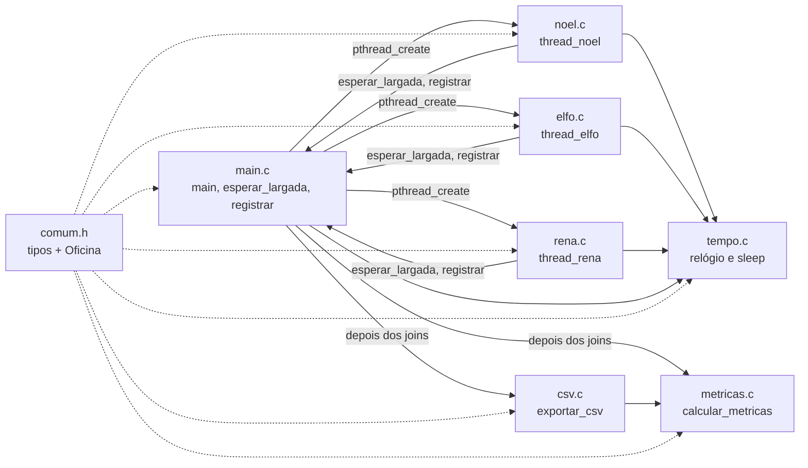

# Guia da Pasta src (Papai Noel)

Guia de estudo da pasta `tema11_papai_noel/src/`, arquivo por arquivo. Para cada arquivo: **(A)** a responsabilidade, **(B)** os blocos importantes, **(C)** a relação com o Problema do Papai Noel e **(D)** o que falharia se o bloco estivesse errado, fosse removido ou rodasse fora de ordem. Índice: [[_Papai-Noel]].

- Como compilar, rodar e usar cada flag: [[Execução e Flags (Papai Noel)]].
- A sincronização vista **fase a fase**, com linhas do tempo: [[Fluxo do Código e Sincronização (Papai Noel)]].
- A sincronização vista **mecanismo a mecanismo** (mutex e cada cond var): [[Sincronização no Código (Papai Noel)]].
- As regras do problema e os estados: [[Lógica e Fluxo (Papai Noel)]].

> Lido no código em 2026-10-28 [CONFIRMADO 2026-10-28]. As referências `arquivo:linha` são de `tema11_papai_noel/src/`. Se o código mudar, confira os números de novo. Esta nota não altera o código: apenas descreve o que existe.

## 1. Visão geral

| Item | O que existe |
|---|---|
| Linguagem | C11 (`-std=c11`) com POSIX Threads (`pthread.h`) |
| Arquivos | 7 `.c` (`main`, `noel`, `elfo`, `rena`, `tempo`, `metricas`, `csv`) e 8 `.h` (os 7 correspondentes, mais `comum.h`) |
| Ponto de entrada | `main()` em `main.c:163` |
| Binário | `src/simulacao`: artefato da compilação, **não** é código-fonte (pode ser apagado e recompilado) |
| Build | não há `Makefile` nem `CMakeLists.txt`: um único comando `gcc` (ver [[Execução e Flags (Papai Noel)]]) |
| Configuração | só pela linha de comando. Não há variáveis de ambiente (`getenv`), arquivo de configuração nem aleatoriedade (`rand`): verificado com `grep` [CONFIRMADO 2026-10-28] |
| Sincronização | 1 `pthread_mutex_t` + 4 `pthread_cond_t`. Não há semáforos, barreiras POSIX nem atômicos |

**Ideia central da arquitetura.** Todo o estado compartilhado fica numa única struct, a `Oficina` (`comum.h:79-123`), protegida por um único mutex. A `main` cria essa struct, cria as threads e passa `&o` para todas. As threads **não conversam diretamente**: cada uma altera campos da `Oficina` com o mutex e avisa quem estiver esperando por meio de uma variável de condição. Os resultados (eventos, tempos) também ficam na `Oficina` e só são processados e gravados em disco **depois** que todas as threads terminam.

## 2. Mapa dos arquivos

Os links abaixo são relativos à pasta real `Problema_Papai-Noel/vault/`. Funcionam no GitHub e em editores como o VS Code; no Obsidian, arquivos `.c` fora do cofre podem não abrir.

| Arquivo | Responsabilidade | Roda em que fase | Concorrente? |
|---|---|---|---|
| [`comum.h`](../tema11_papai_noel/src/comum.h) | Constantes, enums, `Config`, `Grupo`, `Evento`, `Oficina`; protótipos de `esperar_largada` e `registrar` | (tipos) | define o estado compartilhado |
| [`main.c`](../tema11_papai_noel/src/main.c) | Argumentos, inicialização, criação das threads, sinal de início, joins, destruição, métricas, CSV, código de saída. Também define `esperar_largada` e `registrar` | do início ao fim | sim, na largada; depois dos joins, não |
| [`noel.c`](../tema11_papai_noel/src/noel.c) | Thread do Noel: laço de decisão, prioridade, ajuda, preparação, timeout, encerramento | depois da largada | sim |
| [`elfo.c`](../tema11_papai_noel/src/elfo.c) | Thread de um elfo: chegada, inscrição no grupo aberto, fechamento do grupo, espera pela ajuda | depois da largada | sim |
| [`rena.c`](../tema11_papai_noel/src/rena.c) | Thread de uma rena: chegada, contagem, aviso da 9ª, espera pela viagem | depois da largada | sim |
| [`tempo.c`](../tema11_papai_noel/src/tempo.c) / `tempo.h` | Relógio `CLOCK_MONOTONIC`, aritmética de `timespec`, sleep absoluto | em todas as threads | funções sem estado próprio |
| [`metricas.c`](../tema11_papai_noel/src/metricas.c) / `metricas.h` | Invariantes finais, vazão, esperas, p95, resposta às renas, utilização, status | depois dos joins | **não** |
| [`csv.c`](../tema11_papai_noel/src/csv.c) / `csv.h` | Nome da execução e do conjunto; gravação de `resumo.csv`, `eventos.csv`, `espera_elfos.csv` | depois dos joins | **não** |
| `noel.h`, `elfo.h`, `rena.h` | Protótipo da função de thread e, em `elfo.h`/`rena.h`, o argumento (`ArgElfo`, `ArgRena`) | (tipos) | — |

## 3. Dependências entre módulos



- **Todo `.c` inclui `comum.h` primeiro** (comentário em `comum.h:4-6`). Isso é necessário porque `comum.h:11` define `_POSIX_C_SOURCE 200809L`, e essa macro precisa valer antes de qualquer cabeçalho do sistema; sem ela, `clock_nanosleep`, `CLOCK_MONOTONIC` e `pthread_condattr_setclock` podem não ser declarados.
- **Dependência "de volta" para a `main.c`:** `esperar_largada` e `registrar` estão **definidas** em `main.c:25-47`, mas **declaradas** em `comum.h:126-130`. Por isso `noel.c`, `elfo.c` e `rena.c` as chamam sem incluir `main.c`. O linker resolve os símbolos ao juntar todos os `.o`, e é por isso que a compilação usa `*.c`.
- `csv.h` inclui `metricas.h` porque `exportar_csv` recebe uma `Metricas`.
- `metricas.c` e `csv.c` **não** usam mutex: só são chamados depois dos joins (`main.c:225-228`), quando já não existe concorrência.

## 4. Estruturas de dados essenciais

### 4.1 `Config`: os parâmetros da execução (`comum.h:54-66`)

Preenchida **uma vez** por `ler_args` (`main.c:75-105`) antes de qualquer thread existir e **nunca mais alterada**. Por isso as threads podem lê-la sem mutex (`o->cfg->renas_ms` em `rena.c:21`, por exemplo). Cada campo corresponde a uma flag: veja a tabela em [[Execução e Flags (Papai Noel)]].

### 4.2 `Oficina`: o estado compartilhado (`comum.h:79-123`)

O comentário de `comum.h:78` é a regra do projeto: *"Todos os campos são protegidos por `mutex`"*. Os campos, por grupo:

| Grupo de campos | Campos | Quem escreve | Para quê |
|---|---|---|---|
| Mecanismos | `mutex`, `cv_largada`, `cv_noel`, `cv_elfos`, `cv_renas` | `main` (init/destroy) | sincronização |
| Largada | `total_threads`, `threads_prontas`, `largada`, `t0` | threads (`threads_prontas++`), `main` (`largada`, `t0`) | sinal de início comum |
| Grupos | `grupos[]`, `n_grupos`, `grupo_aberto`, `grupos_fechados`, `proximo_grupo`, `grupos_concluidos` | elfos (inscrição e fechamento), Noel (atendimento) | a **fila de grupos** |
| Por elfo | `t_pedido[]`, `t_inicio_ajuda[]`, `grupo_do_elfo[]`, `atendimentos[]` | elfo (`t_pedido`, `grupo_do_elfo`), Noel (`t_inicio_ajuda`, `atendimentos`) | métricas e invariantes |
| Renas | `renas_prontas`, `t_nona`, `viagem_iniciada`, `viagem_concluida`, `t_ini_preparo`, `t_fim_preparo` | renas (`renas_prontas`, `t_nona`), Noel (o resto) | a viagem única |
| Noel | `estado`, `noel_liberado`, `ajuda_em_curso`, `ocupado_ms`, `t_encerramento`, `abortar`, `decisoes`, `decisoes_com_disputa`, `primeira_decisao` | Noel | decisão, timeout, teste de prioridade |
| Invariantes | `violacoes_prioridade`, `violacoes_regras` | Noel, elfos, `calcular_metricas` | verificação em tempo de execução |
| Eventos | `eventos[]`, `n_eventos`, `cap_eventos`, `eventos_perdidos` | todos, via `registrar` | linha do tempo exportada depois |

A `Oficina` é uma **variável local da `main`** (`Oficina o;`, `main.c:171`). Isso é seguro porque a `main` só sai depois de todos os `pthread_join`. Os vetores (`grupos`, `t_pedido` etc.) são alocados com `malloc`/`calloc` em `iniciar_oficina`, porque o tamanho depende de `--elfos`.

### 4.3 `Grupo` e a fila de grupos (`comum.h:69-76`)

```c
typedef enum { GRUPO_ABERTO = 0, GRUPO_PRONTO, GRUPO_EM_AJUDA, GRUPO_CONCLUIDO } EstadoGrupo;
typedef struct {
    int membros[TAM_GRUPO];   // ids dos 3 elfos
    int n;                    // membros já inscritos
    EstadoGrupo estado;
    double t_pronto, t_inicio, t_fim;
} Grupo;
```

O vetor `grupos[0..n_grupos-1]` funciona como uma **fila FIFO** controlada por três índices:

| Índice | Significado | Quem avança | Onde |
|---|---|---|---|
| `grupo_aberto` | grupo que recebe novos elfos | o 3º elfo do grupo | `elfo.c:50-51` |
| `grupos_fechados` | quantos grupos já têm 3 membros | o 3º elfo do grupo | `elfo.c:49` |
| `proximo_grupo` | próximo grupo a ser atendido | Noel, ao decidir | `noel.c:128` |

"Há grupo esperando" é a expressão `proximo_grupo < grupos_fechados` (`noel.c:90`). O passo a passo da formação está em [[Lógica e Fluxo (Papai Noel)#Elfos: exemplo passo a passo da formação de grupos]].

**Por que existe:** com um contador simples de "elfos esperando", o 4º elfo poderia entrar num grupo que acabou de ficar com 3 membros (invasão), ou Noel poderia atender um grupo pela metade. Com grupos numerados, cada elfo pertence a **um** grupo para sempre, e o grupo é fechado na mesma seção crítica em que recebe o 3º membro.

### 4.4 `Evento` (`comum.h:43-51`) e os enums

Cada `Evento` guarda o instante (ms desde `t0`), quem gerou, o tipo de evento, o **estado de Noel logo após o evento** e o grupo. Os eventos vão para um vetor em memória com capacidade `4·elfos + 2·9 + 16` (`main.c:114`). Uma execução normal gera cerca de `2,33·elfos + 14` eventos, bem abaixo do limite; se o vetor encher, `eventos_perdidos++` e o status vira `violacao` (`metricas.c:77`).

`EstadoNoel` (`comum.h:21-26`): `DORMINDO`, `AJUDANDO`, `PREPARANDO`, `ENCERRADO`. Os nomes em texto usados no CSV estão em `csv.c:13-17`, na **mesma ordem** dos enums. Se alguém reordenasse um enum sem mudar o vetor de nomes, o CSV passaria a mostrar rótulos errados.

### 4.5 `ArgElfo` e `ArgRena` (`elfo.h:7-10`, `rena.h:7-10`)

Cada thread recebe um ponteiro para **o seu próprio** argumento (`{&o, id}`), guardado nos vetores `arg_elfos[]` e `arg_renas[]` da `main` (`main.c:179-180`, `192`, `199`).

- **Por que um vetor e não uma variável única:** se a `main` reutilizasse uma única struct no laço, a próxima iteração sobrescreveria o `id` antes de a thread anterior lê-lo, e duas threads poderiam ficar com o mesmo id.
- **Por que continua válido:** os vetores vivem até o fim da `main`, que só termina depois dos joins.

## 5. Arquivo por arquivo

### 5.1 `comum.h`

**A. Responsabilidade.** Define o vocabulário comum a todos os módulos: constantes do problema, enums de estado, a `Config`, o `Grupo`, o `Evento` e a `Oficina`. Não tem código executável.

**B. Blocos importantes.**

| Bloco | Linhas | O que faz |
|---|---|---|
| `_POSIX_C_SOURCE 200809L` | 11 | habilita as funções POSIX de tempo e de cond var com relógio |
| `NUM_RENAS 9`, `TAM_GRUPO 3`, `MAX_ELFOS 300` | 16-18 | as regras numéricas do problema e o limite de segurança |
| `struct Oficina` | 79-123 | o estado compartilhado (seção 4.2) |
| protótipos de `esperar_largada` e `registrar` | 125-130 | ambos **exigem o mutex adquirido** (está escrito no comentário; o código não verifica isso em tempo de execução) |

**C. Relação com o problema.** "9 renas" e "grupos de exatamente 3" são `NUM_RENAS` e `TAM_GRUPO`; todo o resto do código usa essas constantes, nunca o número literal.

**D. Possíveis falhas.** Sem o `#define` da linha 11 vindo antes dos cabeçalhos do sistema, a compilação pode falhar (função não declarada) ou gerar avisos de declaração implícita. Mudar `TAM_GRUPO` exigiria rever a validação de `--elfos` (múltiplo de 3), que usa a mesma constante (`main.c:98`), mas o problema perderia o sentido.

### 5.2 `tempo.c` / `tempo.h`

**A. Responsabilidade.** Medir o tempo com `CLOCK_MONOTONIC` e **simular durações** (chegada, ajuda, preparação). O comentário de `tempo.c:4-6` deixa claro: *nenhuma sincronização depende destes sleeps*.

**B. Blocos importantes.**

| Função | Linhas | O que faz | Usada por |
|---|---|---|---|
| `agora()` | 14-19 | lê `CLOCK_MONOTONIC` | todos os tempos; `t0` em `main.c:210` |
| `somar_ms(t, ms)` | 21-31 | soma milissegundos (fracionários) a um `timespec`, normalizando `tv_nsec` | `dormir_ate_ms`, prazo do timeout (`noel.c:83`) |
| `diff_ms(a, b)` | 33-36 | `b − a` em ms | `ms_desde_inicio` |
| `ms_desde_inicio(o)` | 38-41 | ms desde `t0` | todo registro de tempo |
| `dormir_ate_ms(o, ms)` | 43-50 | dorme **até o instante absoluto** `t0 + ms` com `clock_nanosleep(..., TIMER_ABSTIME, ...)`, repetindo se interrompido (`EINTR`) | chegada de elfos e renas, ajuda e preparação |

**Por que sleep absoluto:** com um sleep relativo ("durma 3 ms"), cada atraso do escalonador se somaria ao próximo. Com o absoluto ("durma até t0 + 13 ms"), o elfo 3 chega sempre perto de 13 ms, qualquer que tenha sido o atraso anterior. Na ajuda, Noel dorme até `inicio + ajuda_ms` (`noel.c:61`), em que `inicio` é o instante real em que a ajuda começou.

**C. Relação com o problema.** O enunciado fala em "chegar", "ajudar" e "preparar o trenó", e essas ações levam tempo. Aqui elas viram sleeps com duração controlada por flags (`--elfo0-ms`, `--renas-ms`, `--ajuda-ms`, `--preparo-ms`).

**D. Possíveis falhas.**
- Se um sleep fosse usado **para sincronizar** (por exemplo, "Noel dorme 1 ms e olha de novo"), haveria espera ocupada disfarçada e dependência de tempo. Isso não acontece: a coordenação é feita só por cond vars.
- `clock_nanosleep` devolve o código de erro **diretamente** (não devolve −1 com `errno`), por isso a comparação com `EINTR` em `tempo.c:48` está correta. Com `nanosleep` comum, o teste teria de ser diferente.
- Trocar `CLOCK_MONOTONIC` por `CLOCK_REALTIME` só em um lugar faria `t0` e os prazos usarem relógios diferentes: sleeps e timeout errados. Veja `cv_noel` em [[Sincronização no Código (Papai Noel)]].

### 5.3 `main.c`

**A. Responsabilidade.** Orquestra a execução: lê e valida os argumentos, monta a `Oficina`, cria todas as threads, dá o sinal de início, espera todas terminarem, destrói os mecanismos e, já sem concorrência, calcula as métricas, grava os CSVs e devolve o código de saída. Também hospeda duas funções usadas por todas as threads.

**B. Blocos importantes.**

**`esperar_largada` (`main.c:25-31`).** Chamada por toda thread logo no início, **com o mutex adquirido** (`noel.c:81-82`, `elfo.c:21-22`, `rena.c:17-18`). Incrementa `threads_prontas`, faz `broadcast` em `cv_largada` para avisar a `main` e dorme em `cv_largada` até `largada == 1`. Junto com o bloco de largada da `main`, forma uma **barreira feita à mão**: ninguém começa antes de todos estarem prontos. Se faltasse o `broadcast` da linha 28, a `main` nunca saberia que as threads estão prontas e esperaria para sempre (essa espera não tem timeout). O porquê de ser `broadcast`, e não `signal`, está em [[Sincronização no Código (Papai Noel)]].

**`registrar` (`main.c:33-47`).** Acrescenta um `Evento` ao vetor em memória, com o tempo atual e o estado de Noel. Exige o mutex porque altera `n_eventos` (um contador compartilhado) e lê `o->estado`. Se duas threads registrassem ao mesmo tempo sem o mutex, as duas poderiam ler o mesmo `n_eventos` e gravar na mesma posição: um evento sumiria. Todas as chamadas no código acontecem dentro de seções críticas. Gravar em memória, e não direto no arquivo, evita que E/S de disco atrapalhe a medição.

**`ler_int` e `ler_args` (`main.c:65-105`).** Convertem e validam os argumentos. `ler_int` aceita só inteiros de 0 a 1 000 000, sem texto sobrando (`"10abc"` é rejeitado). `ler_args` aplica os padrões (`main.c:77-78`), reconhece cada flag e, no fim, valida `--elfos`, `--renas-ms` e `--timeout-ms`. Detalhes de cada flag, mensagens e códigos: [[Execução e Flags (Papai Noel)]].

**`iniciar_oficina` (`main.c:107-142`).** Executada **antes** de qualquer thread existir.
1. `memset` zera a struct: todos os contadores e flags começam em 0, e `largada = 0`, `renas_prontas = 0`, `abortar = 0` etc. são os **valores iniciais dos predicados**.
2. Calcula `n_grupos = elfos / 3`, `total_threads = 1 + 9 + elfos` e a capacidade do vetor de eventos.
3. Aloca os vetores. `grupos` e `atendimentos` usam `calloc`, então cada grupo nasce com `n = 0` e `estado = GRUPO_ABERTO` (que vale 0). Os tempos por elfo começam em −1, que significa "sem valor".
4. Inicializa o mutex e as 4 cond vars (`main.c:131-140`). Só `cv_noel` recebe um atributo, para usar `CLOCK_MONOTONIC` no timeout.

Os retornos de `pthread_mutex_init`/`pthread_cond_init` não são verificados (ver [[Riscos de Sincronização (Papai Noel)]]).

**Criação das threads (`main.c:177-204`).** Cria 1 Noel, 9 renas (ids 1..9) e N elfos (ids 0..N−1), **todas antes de qualquer join**. Se um `pthread_create` falhar, a `main` imprime o erro e retorna 1 sem fazer join das que já existem: o processo termina e elas morrem junto.

**Sinal de início (`main.c:206-213`).**

```c
pthread_mutex_lock(&o.mutex);
while (o.threads_prontas < o.total_threads)       // espera todas se anunciarem
    pthread_cond_wait(&o.cv_largada, &o.mutex);
o.t0 = agora();                                    // o relógio da medição começa aqui
o.largada = 1;
pthread_cond_broadcast(&o.cv_largada);             // solta todas ao mesmo tempo
pthread_mutex_unlock(&o.mutex);
```

Separa a **preparação** (criar threads, que leva um tempo variável) da **medição**. Todas as chegadas são relativas a `t0`, e por isso a ordem de criação das threads não altera os instantes de chegada.

**Joins e destruição (`main.c:215-222`).** Espera Noel, as renas e os elfos terminarem e só então destrói os mecanismos (`destruir_oficina`, `main.c:144-151`). Destruir antes dos joins seria comportamento indefinido: alguma thread ainda poderia estar usando o mutex.

**Pós-processamento e código de saída (`main.c:224-264`).** `calcular_metricas`, `montar_id`, `exportar_csv` e a linha de resumo no console, impressa **fora** da medição. Com `--teste-prioridade`, imprime 4 verificações e o resultado (seção 6 de [[Execução e Flags (Papai Noel)]]). Por fim, libera a memória.

**C. Relação com o problema.** A `main` não participa do problema em si; ela é o "palco". A versão **finita** do problema aparece aqui: há N elfos com um pedido cada, uma única viagem, e o programa termina quando tudo foi atendido.

**D. Possíveis falhas.**

| Se... | Consequência |
|---|---|
| os mecanismos fossem inicializados depois do `pthread_create` | uma thread poderia travar um mutex ainda não inicializado (comportamento indefinido) |
| `t0` fosse gravado antes de todas as threads estarem prontas | as primeiras chegadas aconteceriam antes de algumas threads existirem; os tempos medidos incluiriam o custo de criação |
| a `main` destruísse os mecanismos antes dos joins | comportamento indefinido |
| o CSV fosse escrito durante a execução, pelas threads | E/S de disco dentro das seções críticas, distorcendo os tempos e alongando o tempo com o mutex |
| `arg_elfos` fosse uma única variável reutilizada | ids repetidos ou trocados entre threads |

### 5.4 `noel.c`

**A. Responsabilidade.** A thread do Papai Noel. É **a única que decide** o que fazer: dorme enquanto não há trabalho, escolhe entre viagem e grupo de elfos aplicando a prioridade, executa a tarefa sem ser interrompida, encerra quando tudo terminou ou aborta no timeout. É o arquivo mais importante para a apresentação.

**B. Blocos importantes.**

**B1. Início (`noel.c:81-83`).** Trava o mutex, espera a largada e calcula o **prazo absoluto** do timeout (`t0 + timeout_ms`). A partir daqui, Noel segura o mutex o tempo todo, **exceto** quando está dormindo em `cv_noel` ou simulando uma tarefa.

**B2. Condição de término (`noel.c:86-87`).**

```c
if (o->viagem_concluida && o->grupos_concluidos == o->n_grupos)
    break;
```

Fica **no topo** do laço, antes de qualquer espera. Assim, Noel nunca dorme quando já não há nada a fazer. Se o teste ficasse depois da espera, Noel adormeceria após a última tarefa e só sairia pelo timeout, com status `timeout`.

**B3. Leitura do estado: os predicados (`noel.c:89-90`).**

```c
int renas_ok = o->renas_prontas == NUM_RENAS && !o->viagem_iniciada;
int elfos_ok = o->proximo_grupo < o->grupos_fechados;
```

Esses dois valores são o **retrato** do estado no momento da decisão, lido com o mutex. `!viagem_iniciada` impede uma segunda viagem. `elfos_ok` significa "há um grupo fechado ainda não atendido".

**B4. Modo de teste de prioridade (`noel.c:94-98`).** Só com `--teste-prioridade`: Noel não é "liberado" até que `renas_ok && elfos_ok` aconteçam ao mesmo tempo. Uma vez liberado, `noel_liberado = 1` e o comportamento volta ao normal. Serve para **forçar** a disputa que, no modo normal, depende do escalonamento. Não usa sleep: Noel continua esperando na cond var.

**B5. Espera (`noel.c:100-108`).** Se não foi liberado ou se nada está pronto, chama `pthread_cond_timedwait(&o->cv_noel, &o->mutex, &limite)`: solta o mutex e dorme, numa operação atômica, até receber um aviso ou até o prazo. Ao voltar:
- `ETIMEDOUT` → `abortar = 1`, registra `timeout` e sai do laço;
- qualquer outro retorno → `continue`, que volta ao topo e **reavalia tudo**. Isso cobre o aviso verdadeiro, o despertar espúrio e o caso em que o estado mudou de novo antes de Noel readquirir o mutex.

**B6. Decisão (`noel.c:111-132`).** Ainda com o mutex, isto é, na **mesma seção crítica** em que os predicados foram lidos:

```c
if (o->ajuda_em_curso) o->violacoes_regras++;        // defensivo: nunca dispara por construção
o->decisoes++;
if (renas_ok && elfos_ok) o->decisoes_com_disputa++; // as duas demandas prontas
int escolhe_renas = c->ingenua ? !elfos_ok : renas_ok;   // A PRIORIDADE
if (!escolhe_renas && renas_ok) o->violacoes_prioridade++;
...
if (escolhe_renas) { ...; preparar_viagem(o); }
else { int g = o->proximo_grupo++; ...; ajudar_grupo(o, g); }
```

- **Prioridade:** na versão normal, `escolhe_renas = renas_ok`. Se as renas estão prontas, a fila de elfos nem é consultada.
- **FIFO entre grupos:** `g = proximo_grupo++` sempre pega o grupo mais antigo.
- **Medição embutida:** `decisoes_com_disputa` conta as vezes em que as duas demandas estavam prontas; `violacoes_prioridade` conta escolhas de elfos com as renas prontas, o que só acontece com `--ingenua`.

**B7. `preparar_viagem` (`noel.c:19-42`) e `ajudar_grupo` (`noel.c:45-74`).** Têm a mesma estrutura em três partes:

| Parte | `preparar_viagem` | `ajudar_grupo` |
|---|---|---|
| 1. Com o mutex: marca o início | `viagem_iniciada = 1`, estado `PREPARANDO`, `t_ini_preparo` (24-28) | grupo `EM_AJUDA`, estado `AJUDANDO`, `t_inicio_ajuda` dos 3 elfos (51-57) |
| 2. **Sem** o mutex: simula a duração | `unlock` → dorme até `inicio + preparo_ms` → `lock` (31-33) | `unlock` → dorme até `inicio + ajuda_ms` → `lock` (60-62) |
| 3. Com o mutex: conclui e libera | `viagem_concluida = 1`, estado `DORMINDO`, `broadcast(cv_renas)` (35-41) | `atendimentos[e]++`, grupo `CONCLUIDO`, `grupos_concluidos++`, `broadcast(cv_elfos)` (64-73) |

As duas funções **entram e saem com o mutex adquirido** (comentários em `noel.c:18` e `44`), e por isso não chamam `lock` no início. Marcar `viagem_iniciada`/`EM_AJUDA` **antes** de soltar o mutex garante que nenhuma reavaliação posterior escolha a mesma tarefa duas vezes. Soltar o mutex durante a simulação permite que elfos e renas continuem chegando e se registrando enquanto Noel trabalha.

**B8. Encerramento (`noel.c:135-146`).** Grava o estado `ENCERRADO` e o instante final (ou só o instante, no timeout), faz `broadcast` em `cv_elfos` e `cv_renas` e solta o mutex. Os broadcasts são uma **rede de segurança**: no término normal todos já foram liberados; no timeout, eles acordam quem ainda espera, e o predicado dessas esperas inclui `!abortar`.

**C. Relação com o problema.**

| Regra | Bloco |
|---|---|
| Noel dorme até ser acordado | B5 |
| Atende grupos de exatamente 3 | B3 (`elfos_ok` só conta grupos fechados) + B7 |
| Prepara a viagem só com as 9 renas | B3 (`renas_ok`) |
| Renas têm prioridade | B6 (`escolhe_renas = renas_ok`) |
| Uma ajuda já iniciada não é interrompida | B7: Noel está dormindo e não olha nada; só reavalia ao voltar ao topo do laço |
| Uma única viagem | B3 (`!viagem_iniciada`) |
| Depois da viagem, atende os grupos restantes | o laço continua até B2 ser verdadeiro |

**D. Possíveis falhas.**

| Se... | Consequência |
|---|---|
| a decisão fosse feita **depois** de soltar o mutex (ler, soltar, decidir) | "check-then-act": a 9ª rena poderia chegar entre a leitura e a decisão, e Noel escolheria elfos com as renas prontas |
| `escolhe_renas` fosse `!elfos_ok` | é exatamente a política `--ingenua`: violação de prioridade, demonstrada com 2 violações |
| `viagem_iniciada = 1` fosse marcado só depois do sleep | ao voltar, Noel ainda veria `renas_ok` e poderia preparar a viagem de novo |
| `proximo_grupo++` não existisse | o mesmo grupo seria atendido para sempre |
| o `while`/`continue` virasse um `if` sem reavaliação | depois de um despertar espúrio, Noel decidiria com predicados velhos |
| Noel dormisse **segurando** o mutex | nenhuma rena ou elfo conseguiria se registrar durante a tarefa; chegadas atrasadas e medições erradas |
| faltasse o `broadcast(cv_renas)` em `noel.c:41` | as renas só sairiam no broadcast final; o programa não travaria, mas o comportamento estaria errado |
| faltassem os broadcasts finais | num timeout, elfos e renas que esperam o fim da tarefa ficariam bloqueados para sempre, e os joins nunca terminariam |

### 5.5 `elfo.c`

**A. Responsabilidade.** Uma thread por elfo, com um único pedido (versão finita). O elfo chega, entra no grupo aberto, fecha o grupo se for o 3º e espera até Noel concluir a ajuda do **seu** grupo.

**B. Blocos importantes.**

| Bloco | Linhas | O que faz |
|---|---|---|
| Largada | 21-23 | lock → `esperar_largada` → unlock |
| Chegada | 25 | dorme **sem o mutex** até `t0 + elfo0_ms + id` (elfo *i* chega em 10 + *i* ms, por padrão) |
| Abandono no timeout | 27-31 | se `abortar` já está ligado, sai sem se inscrever |
| Pedido | 32 | `t_pedido[id]` = agora; é o início da espera medida |
| Escolha do grupo | 34-40 | usa **sempre** `grupos[grupo_aberto]`; se esse grupo não estiver aberto com vaga, conta "invasão" e sai (checagem defensiva) |
| Inscrição | 41-43 | `membros[n++] = id`, `grupo_do_elfo[id] = g`, registra a chegada |
| Fechamento pelo 3º | 45-54 | estado `PRONTO`, `t_pronto`, `grupos_fechados++`, avança `grupo_aberto` (se não for o último grupo), registra e faz `signal(cv_noel)` |
| Espera pela ajuda | 57-59 | `while (estado != CONCLUIDO && !abortar) wait(cv_elfos)` e unlock |

**C. Relação com o problema.** "Os elfos procuram Noel em grupos de exatamente 3" é implementado pelas linhas 45-54: só o 3º membro torna o grupo visível para Noel (`grupos_fechados++`). "O elfo espera ser ajudado" são as linhas 57-58.

**Ponto-chave para a apresentação:** inscrição, fechamento e avanço de `grupo_aberto` acontecem **na mesma seção crítica**. Não existe instante em que outro elfo veja o grupo com 3 membros e ainda aberto. É isso que impede a invasão, e não a checagem da linha 36, que é só uma rede de segurança.

**D. Possíveis falhas.**

| Se... | Consequência |
|---|---|
| a inscrição fosse feita sem o mutex | dois elfos leriam `n == 2` e escreveriam em `membros[2]`; grupo com 4 elfos ou elfo perdido |
| `grupo_aberto++` acontecesse numa seção crítica separada | janela em que o 4º elfo entra no grupo já cheio (invasão) |
| o `signal` fosse movido para antes de `grupos_fechados++` | **nada muda**, desde que os dois fiquem na mesma seção crítica: Noel acorda, mas só volta do `wait` depois de readquirir o mutex, e nesse momento o elfo já incrementou e soltou o mutex |
| o `signal` fosse feito numa seção crítica **separada e anterior** à mudança de estado | Noel poderia acordar, ver `elfos_ok = 0` e voltar a dormir. O aviso se perderia, e o grupo só seria visto num próximo despertar (ou nunca, terminando em `timeout`) |
| a espera fosse `if` em vez de `while` | o broadcast do fim do grupo 1 acordaria os elfos do grupo 2, que iriam embora sem ajuda |
| o elfo esperasse em `cv_noel` | Noel e elfos disputariam a mesma fila de avisos, e um `signal` destinado a Noel poderia acordar um elfo |

**Detalhe de medição:** `t_pedido` é gravado **depois** de o elfo conseguir o mutex (`elfo.c:32`), não no instante em que ele acorda do sleep. O tempo bloqueado em `pthread_mutex_lock` não entra na espera medida. São microssegundos, mas vale saber se perguntarem "de onde até onde a espera é medida".

### 5.6 `rena.c`

**A. Responsabilidade.** Uma thread por rena (9 no total). A rena chega em `renas_ms`, conta-se, e a 9ª acorda Noel. Todas esperam a preparação terminar.

**B. Blocos importantes.**

| Bloco | Linhas | O que faz |
|---|---|---|
| Largada | 17-19 | igual ao elfo |
| Chegada | 21 | as 9 dormem até o **mesmo** instante `t0 + renas_ms`, o que força a disputa entre elas pelo mutex |
| Abandono no timeout | 23-27 | sai se `abortar` |
| Contagem | 28-29 | `renas_prontas++` e registra a chegada |
| 9ª rena | 30-34 | grava `t_nona`, registra `nona_rena` e faz `signal(cv_noel)` |
| Espera pela viagem | 36-38 | `while (!viagem_concluida && !abortar) wait(cv_renas)` e unlock |

**C. Relação com o problema.** "Noel só prepara o trenó quando as 9 renas voltaram" corresponde à contagem (28) e ao predicado `renas_prontas == NUM_RENAS` em `noel.c:89`. "A última rena acorda Noel" corresponde ao `signal` da linha 33, que só a 9ª executa.

**D. Possíveis falhas.**

| Se... | Consequência |
|---|---|
| `renas_prontas++` sem o mutex | atualização perdida: o contador pararia em 8, Noel nunca prepararia a viagem e a execução acabaria em `timeout` |
| todas as renas fizessem `signal` | inofensivo (Noel reavaliaria e voltaria a dormir), mas inútil |
| nenhuma rena fizesse `signal` | se Noel estivesse dormindo sem trabalho, só acordaria por outro aviso ou pelo timeout |
| `t_nona` fosse gravado fora do mutex | a métrica "resposta às renas" poderia ler um valor incompleto |

### 5.7 `metricas.c` / `metricas.h`

**A. Responsabilidade.** Transformar o que ficou gravado na `Oficina` em números e em um **status** (`ok`, `timeout`, `violacao`). Roda **depois** dos joins: não usa mutex nem precisa.

**B. Blocos importantes.**

| Bloco | Linhas | Cálculo |
|---|---|---|
| Invariantes finais | 35-41 | só sem timeout: cada elfo deve ter `atendimentos == 1` (0 ou 2+ conta violação) e a viagem deve ter sido concluída |
| T | 43 | `t_encerramento` (ms desde `t0`) |
| Concluídos e vazão | 45-49 | elfos com `atendimentos >= 1`; vazão = `concluidos / (T_ms / 1000)` pedidos/s |
| Esperas | 51-68 | `t_inicio_ajuda − t_pedido` de quem teve a ajuda iniciada; média, máximo, p95 |
| `percentil95` | 17-27 | ordena e pega a posição ⌈0,95·n⌉ (base 1), calculada em inteiros como `(95n + 99) / 100` |
| Resposta às renas | 70 | `t_ini_preparo − t_nona` (−1 se a viagem não começou) |
| Utilização | 71 | `ocupado_ms / T_ms` |
| Status | 75-80 | `timeout` se abortou; `violacao` se houve violação ou evento perdido; senão `ok` |

**C. Relação com o problema.** Os invariantes finais conferem as regras "cada elfo é atendido exatamente uma vez" e "a viagem acontece". O resto são as métricas pedidas pelo enunciado (vazão, espera, p95, resposta às renas).

**D. Possíveis falhas.** Rodar estas funções antes dos joins leria dados ainda em uso pelas threads (corrida). Com n = 3 ou 6 amostras, ⌈0,95·n⌉ = n, então **o p95 é o máximo**; isso não é um erro, é consequência da definição. A interpretação está em [[Testes e Gráficos (Papai Noel)#Métricas: definições exatas]].

### 5.8 `csv.c` / `csv.h`

**A. Responsabilidade.** Dar nome à execução e gravar os três CSVs. Roda depois dos joins.

**B. Blocos importantes.**

| Bloco | Linhas | O que faz |
|---|---|---|
| Tabelas de nomes | 13-17 | texto de cada enum, **na mesma ordem** de `comum.h` |
| `montar_id` | 19-40 | `configuracao` = `E%02d_R%02d` (ex.: `E06_R10`); `conjunto` = `referencia`, `1`, `2`, `teste`, `ingenua`, `teste_ingenua` ou `fora`; `execucao` = prefixo + configuração + `_rep<K>` |
| `abrir` | 43-56 | abre `<out>/<nome>` em **modo de acréscimo** (`"a"`); se o arquivo estava vazio, marca `novo` para escrever o cabeçalho |
| `campo_ms` | 59-65 | escreve o valor com 3 casas, ou `N/A` se for negativo (sem amostra) |
| `exportar_csv` | 67-128 | uma linha em `resumo.csv`, todos os eventos em `eventos.csv`, uma linha por elfo em `espera_elfos.csv` |

**C. Relação com o problema.** Nenhuma regra do problema: é a camada de saída do experimento. O `conjunto` é deduzido dos parâmetros, e por isso `--elfos 6 --renas-ms 10` sempre vira `referencia`.

**D. Possíveis falhas e cuidados.**
- **Acréscimo:** rodar duas vezes na mesma pasta acumula linhas. É por isso que `run_experimentos.sh` apaga os CSVs antes de começar. Testes manuais na pasta `dados/` **contaminam** os gráficos.
- **A pasta não é criada:** se `--out` aponta para uma pasta inexistente, `fopen` falha, a função retorna −1 e o programa sai com código 1, embora a simulação tenha rodado. Verificado [CONFIRMADO 2026-10-28].
- Os nomes de `configuracao`/`execucao` não incluem as durações (`--ajuda-ms` etc.) nem os modos. Duas execuções com durações diferentes e o mesmo `--rep` ficam com o mesmo nome. [PROVÁVEL 2026-10-28, por leitura do `montar_id`]

## 6. As checagens de invariante

O programa **conta** violações em tempo de execução em vez de abortar. Algumas checagens são defensivas e, por construção, nunca disparam. A análise completa está em [[Riscos de Sincronização (Papai Noel)]].

| Contador | Onde | Detecta | Pode disparar? |
|---|---|---|---|
| `violacoes_prioridade` | `noel.c:118-119` | escolher elfos com as 9 renas prontas | só com `--ingenua` |
| `violacoes_regras` | `noel.c:21-22` | viagem com menos de 9 renas | não, por construção (`renas_ok` exige 9) |
| `violacoes_regras` | `noel.c:48-49` | grupo atendido sem 3 elfos ou fora do estado `PRONTO` | não, por construção |
| `violacoes_regras` | `noel.c:111-112` | decisão com uma ajuda em curso | não: só Noel decide, e ele não decide enquanto trabalha |
| `violacoes_regras` | `elfo.c:36-40` | invasão de grupo fechado | não, por construção (seção 5.5) |
| `violacoes_regras` | `metricas.c:36-40` | elfo atendido 0 ou 2+ vezes; viagem não concluída | só se houvesse erro de lógica |
| `eventos_perdidos` | `main.c:36-38` | vetor de eventos cheio | não com a capacidade atual |

> Zero violações nas execuções **não prova** correção: mostra que as regras valeram nas execuções observadas. A garantia vem da análise do código.

## 7. Divergências entre a documentação e o código

> [!warning] Lido no código e executado em 2026-10-28
> - [CONFIRMADO 2026-10-28] O README diz que o padrão de `--out` é `dados/`, mas o caminho é **relativo ao diretório atual**. Rodando de dentro de `src/` sem `--out`, o programa procura `src/dados/`, que não existe, e sai com código 1. Por isso os exemplos usam `--out ../dados/`.
> - [CONFIRMADO 2026-10-28] O README chama o `--timeout-ms` de "timeout de segurança". Ele só é verificado enquanto Noel **espera** em `cv_noel`: não é um limite de duração total. Com `--ajuda-ms 100 --timeout-ms 50`, a execução durou 215 ms e terminou com status `ok`.
> - [CONFIRMADO 2026-10-28] No timeout, as threads que ainda estão no sleep de chegada **não são interrompidas**. Com `--renas-ms 3000`, o status foi `timeout` em T = 2000 ms, mas o processo levou 3,0 s, porque os joins esperam as renas acordarem em 3000 ms e verem `abortar`.
> - O comentário de uso no topo de `main.c:9-10` não lista `--ajuda-ms`, `--preparo-ms` e `--elfo0-ms`; o texto de `--help` (`main.c:49-63`) lista.
