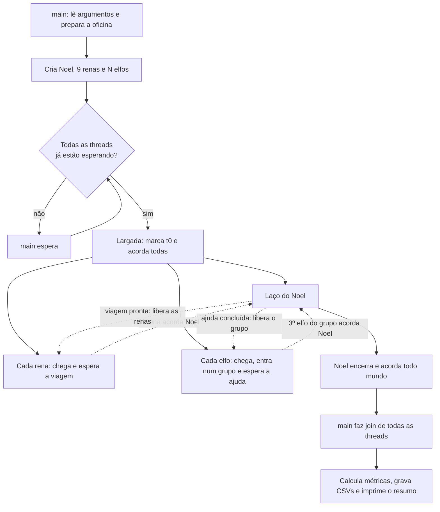
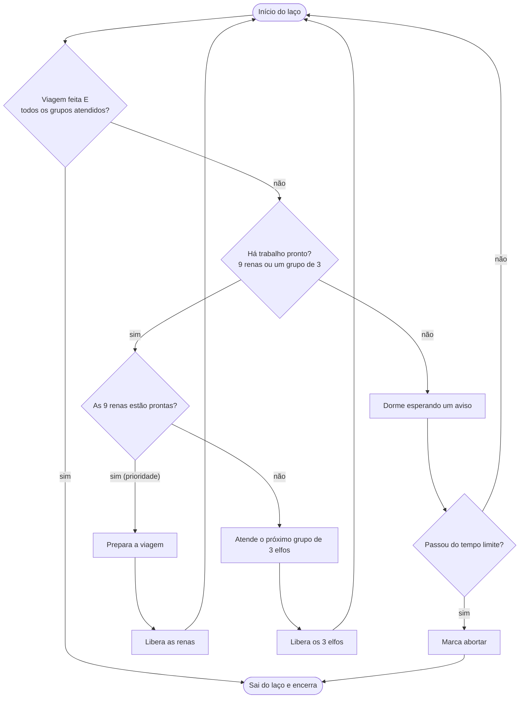
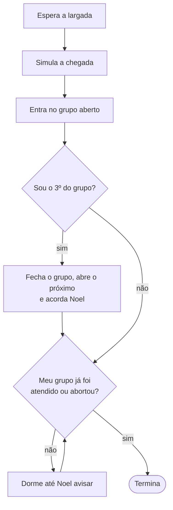
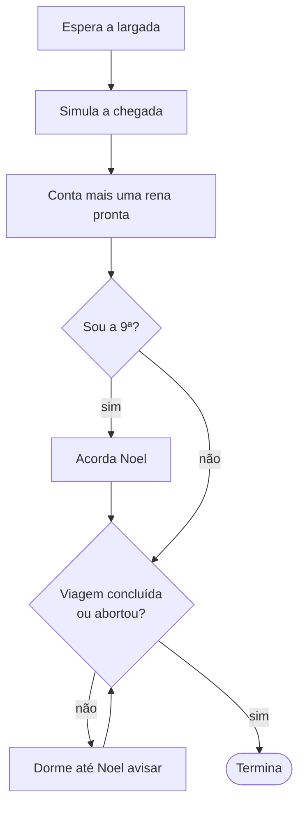

# Laços do Código (Papai Noel)

A **lógica** dos laços do programa, sem entrar em linhas de código: quem repete o quê, o que faz cada laço girar de novo e o que o faz parar. Para o passo a passo com `arquivo:linha`, veja [[Fluxo do Código e Sincronização (Papai Noel)]]. Para os mecanismos (mutex e cond vars), veja [[Sincronização no Código (Papai Noel)]].

Índice: [[_Papai-Noel]].

> Lido no código de `tema11_papai_noel/src/` em 2026-10-28 [CONFIRMADO 2026-10-28].

## Visão geral

Só existe **um laço de verdade que decide coisas**: o do Noel. Os outros laços são esperas: cada thread fica parada até a condição dela virar verdadeira.

## O laço do Noel

Um laço infinito (`for (;;)`) que, a cada volta, olha o estado e escolhe **uma** coisa: sair, dormir ou trabalhar. Depois de qualquer trabalho ele volta ao topo e reavalia tudo de novo.

Pontos da lógica:

- **Renas primeiro**: se as duas demandas estão prontas na mesma volta, a viagem ganha. A versão `--ingenua` inverte isso, para mostrar a violação.
- Ao acordar, Noel **não confia no aviso**: volta ao topo e confere de novo. Por isso um aviso extra ou falso não causa erro.
- Uma ajuda ou preparação nunca é interrompida: só depois de terminar ele volta ao topo e pode escolher as renas.
- O laço termina quando as **duas** demandas acabaram, ou pelo **timeout** de segurança.

## O laço de espera de cada elfo

O elfo não repete trabalho: chega uma vez, entra no grupo aberto e fica num laço de espera até o grupo dele ser atendido.

O grupo fecha **no mesmo instante** em que o 3º elfo entra, então o 4º elfo já cai no grupo seguinte: ninguém invade um grupo em atendimento.

## O laço de espera de cada rena

## Por que todo laço de espera é um `while`

Todas as esperas seguem o mesmo padrão: **enquanto a condição não for verdadeira, durma**. Ao acordar, a thread testa de novo antes de seguir. Isso cobre dois casos:

- **Acordar sem motivo** (despertar espúrio): o teste falha e ela volta a dormir.
- **Aviso para outro**: Noel acorda todos os elfos com um único aviso, mas só os do grupo concluído saem; os outros voltam a dormir.

A barreira de largada da `main` usa o mesmo padrão: a `main` dorme enquanto nem todas as threads estão prontas, e cada thread dorme enquanto a largada não foi dada.
