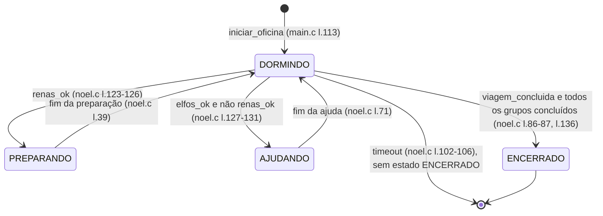
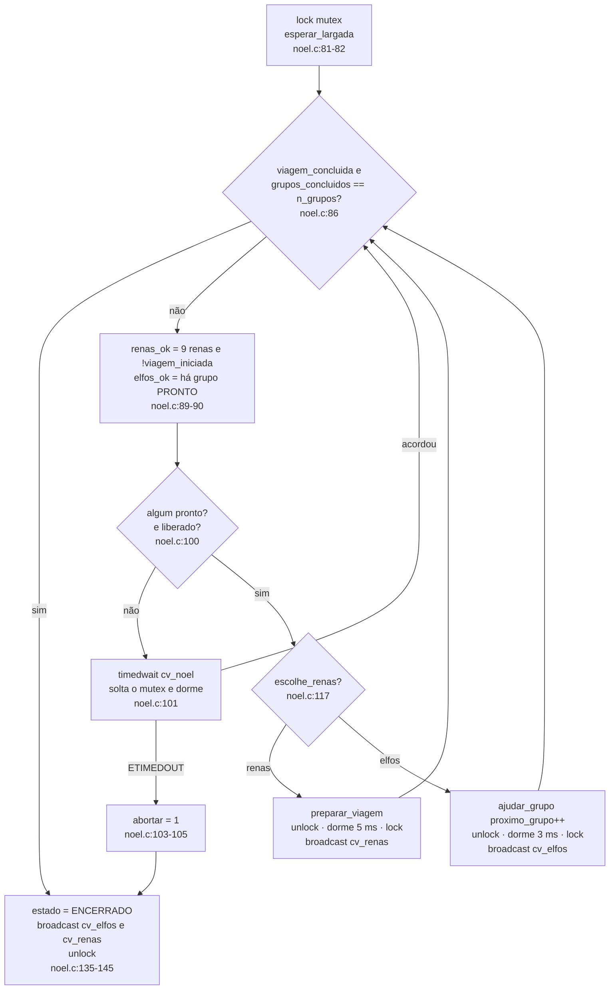

# Lógica e Fluxo (Papai Noel)

Como o problema funciona do início ao fim e como o código implementa cada regra. Os mecanismos (mutex, variáveis de condição) estão detalhados em [[Sincronização no Código (Papai Noel)]]. Aqui o foco é **o que acontece e em que ordem**. O papel de cada arquivo de `src/` está em [[Guia da Pasta src (Papai Noel)]], e cenários extras (renas durante a ajuda, empate natural) em [[Fluxo do Código e Sincronização (Papai Noel)]]. Voltar ao índice: [[_Papai-Noel]].

## As regras e onde cada uma está no código

| Regra | Como o código garante | Onde |
|---|---|---|
| Noel espera pelos eventos | Dorme em `cv_noel` enquanto não há renas completas nem grupo pronto | `noel.c:100-108` |
| Grupos de exatamente 3 | O 3º elfo muda o grupo para `GRUPO_PRONTO`; Noel só atende grupos `PRONTO` | `elfo.c:45-54`, `noel.c:90` |
| Ninguém entra em grupo fechado | O elfo usa sempre `grupos[grupo_aberto]`, e quem fecha o grupo avança `grupo_aberto` na mesma seção crítica | `elfo.c:34-41`, `elfo.c:50-51` |
| Viagem só com 9 renas | `renas_ok` exige `renas_prontas == NUM_RENAS` | `noel.c:89` |
| Renas têm prioridade | `escolhe_renas = renas_ok` é testado antes da fila de elfos | `noel.c:117`, `noel.c:123` |
| Ajuda não é interrompida | Só a thread Noel decide, e ela fica dormindo durante a ajuda, sem olhar nada | `noel.c:60-62` |
| Uma viagem, um pedido por elfo | `viagem_iniciada` bloqueia uma 2ª viagem; cada thread elfo executa uma vez | `noel.c:89`, `elfo.c:15-61` |
| Depois da viagem, os grupos restantes | O laço continua enquanto `grupos_concluidos < n_grupos` | `noel.c:86-87` |
| Fim só com tudo concluído | Noel sai do laço quando `viagem_concluida && grupos_concluidos == n_grupos`; a main faz join de todos | `noel.c:86-87`, `main.c:215-219` |

## Quem são os participantes

- **main** (`main.c:163-265`): inicializa os mecanismos, cria as 1 + 9 + N threads, dá o **sinal de início** (grava `t0`), faz os joins, destrói os mecanismos e exporta os CSVs.
- **Noel** (`thread_noel`, `noel.c:76-147`): o laço de decisão. Usa `preparar_viagem` (`noel.c:19-42`) e `ajudar_grupo` (`noel.c:45-74`).
- **Rena** (`thread_rena`, `rena.c:12-40`): chega em `renas_ms`, conta-se e, se for a 9ª, acorda Noel. Depois espera a viagem terminar.
- **Elfo** (`thread_elfo`, `elfo.c:15-61`): chega em `10 + id` ms, entra no grupo aberto, fecha o grupo se for o 3º e espera seu grupo ser concluído.

Todas recebem um ponteiro para a mesma `Oficina` (`comum.h:79-123`), a struct com **todo** o estado compartilhado.

## Estados de Noel

O campo `o->estado` (`comum.h:109`) assume os valores de `EstadoNoel` (`comum.h:21-26`). Cada evento gravado leva o estado de Noel logo após ele.



"DORMINDO" quer dizer apenas "sem tarefa". Noel pode estar **bloqueado** em `cv_noel` ou **reavaliando** as condições com o mutex. Ele **nunca** passa direto de AJUDANDO para PREPARANDO: sempre volta a DORMINDO, reavalia e só então decide. É por isso que a prioridade vale **entre** tarefas, nunca **durante** uma.

## Estados de um grupo de elfos

`EstadoGrupo` (`comum.h:69`): `ABERTO → PRONTO → EM_AJUDA → CONCLUIDO`.

| Transição | Quem faz | Linha |
|---|---|---|
| ABERTO → PRONTO | o 3º elfo que se inscreve | `elfo.c:47` |
| PRONTO → EM_AJUDA | Noel, ao decidir pelo grupo | `noel.c:51` |
| EM_AJUDA → CONCLUIDO | Noel, ao terminar a ajuda | `noel.c:68` |

Os grupos são um **vetor** (`o->grupos`) usado como **fila FIFO** por três índices:

```
grupos:        [ g0 ][ g1 ][ g2 ][ g3 ]
                 ^           ^     ^
       proximo_grupo   grupos_fechados  grupo_aberto
   (próximo a atender)  (qtde já fechada)  (recebe novos elfos)

elfos_ok  ⇔  proximo_grupo < grupos_fechados     (noel.c:90)
```

## O laço de Noel em uma figura



## Sequência completa de uma execução

1. **Preparação** (`main.c:171-204`): `iniciar_oficina` zera a struct, inicializa o mutex e as 4 cond vars e cria as threads. Cada thread trava o mutex, incrementa `threads_prontas` e dorme em `cv_largada` (`main.c:25-31`).
2. **Largada** (`main.c:207-213`): a main espera `threads_prontas == total_threads`, grava `t0`, faz `largada = 1` e broadcast. A partir daqui o relógio conta.
3. **Chegadas**: renas e elfos soltam o mutex e dormem até o instante de chegada (`rena.c:21`, `elfo.c:25`). Noel continua no laço e, sem trabalho, dorme em `cv_noel`.
4. **Eventos que acordam Noel**: a 9ª rena (`rena.c:30-34`) e o 3º elfo de cada grupo (`elfo.c:45-54`) mudam o estado e chamam `pthread_cond_signal(&o->cv_noel)`.
5. **Decisão** (`noel.c:110-132`), com o mutex: renas primeiro; caso contrário, o grupo mais antigo.
6. **Trabalho** (`noel.c:31-33` ou `60-62`): Noel solta o mutex, dorme 5 ms ou 3 ms e trava o mutex de novo. Enquanto isso, elfos e renas continuam chegando e se registrando.
7. **Fim de cada tarefa**: Noel marca CONCLUIDO ou `viagem_concluida` e faz broadcast para liberar quem esperava.
8. **Encerramento** (`noel.c:135-145`): quando as duas demandas acabam, Noel sai e faz broadcast em todas as filas. Elfos e renas já liberados terminam. A main faz os joins (`main.c:215-219`), destrói os mecanismos (`main.c:222`) e só então calcula as métricas e grava os CSVs.

## Linhas do tempo reais (6 elfos)

Os dados vêm de `dados/eventos.csv`, repetição 1 de cada configuração (ms desde o sinal de início). [CONFIRMADO 2026-10-28]

### Renas **junto** (10 ms): referência, com disputa

```
t (ms)  evento                                 estado de Noel
10,080  elfo 0 chega (grupo 1)                 dormindo
10,091  9ª rena chega → signal(cv_noel)        dormindo
10,108  DECISÃO: viagem                        preparando
11,070  elfo 1 chega                           preparando
12,072  elfo 2 chega → grupo 1 PRONTO          preparando   ← grupo espera
13–15   elfos 3, 4, 5 → grupo 2 PRONTO (15,061) preparando  ← 2 grupos na fila
15,185  fim da preparação → broadcast renas    dormindo
15,200  DECISÃO: grupo 1                       ajudando
18,271  fim da ajuda 1 → broadcast elfos
18,279  DECISÃO: grupo 2                       ajudando
21,358  fim da ajuda 2
21,362  encerramento                           encerrado
```

Nesta execução o **elfo 0 chegou antes da 9ª rena** (10,080 contra 10,091 ms). As threads competem pelo mutex, e a ordem real varia de uma execução para outra. Isso não altera a decisão: quando Noel decide, em 10,108 ms, só as renas estão prontas.

### Renas **antes** (5 ms)

```
5,119   9ª rena → 5,136 DECISÃO: viagem → 10,208 fim
12,078  grupo 1 PRONTO → 12,102 ajuda (Noel livre: espera ≈ 0)
15,078  grupo 2 PRONTO → 15,182 ajuda (logo após o fim da ajuda 1, em 15,174)
18,265  encerramento
```

### Renas **depois** (30 ms)

```
12,082  grupo 1 PRONTO → 12,109 ajuda
15,077  grupo 2 PRONTO → 15,188 ajuda → 18,266 fim
30,109  9ª rena → 30,154 DECISÃO: viagem → 35,234 fim
35,254  encerramento   (Noel ficou ~12 ms dormindo esperando as renas)
```

### Renas e grupos prontos **no mesmo instante de decisão** (`--teste-prioridade`)

Neste modo Noel só é "liberado" quando as duas demandas estão prontas (`noel.c:94-98`). Os grupos ficam prontos em 12,060 e 15,059 ms, e a 9ª rena chega em 30,455 ms. A primeira decisão, em 30,473 ms, é a **viagem**; depois vêm o grupo 1 e o grupo 2. Na versão `--ingenua`, com a mesma situação, Noel escolheu os elfos duas vezes (2 violações). Ver [[Testes e Gráficos (Papai Noel)]].

## O que deve acontecer em cada cenário

| Situação no momento da decisão | Decisão correta | Por quê no código |
|---|---|---|
| Só renas completas | viagem | `renas_ok = 1`, `elfos_ok = 0` |
| Só grupo(s) pronto(s) | grupo mais antigo | `escolhe_renas = renas_ok = 0`; `g = proximo_grupo++` |
| Renas completas **e** grupo pronto | **viagem** | `escolhe_renas = renas_ok` vem antes (`noel.c:117`) |
| Nada pronto | dormir | `noel.c:100-101` |
| Renas completam **durante** uma ajuda | termina a ajuda e depois prepara a viagem | Noel só reavalia ao voltar ao topo do laço |
| Viagem já feita | só grupos | `renas_ok` exige `!viagem_iniciada` |
| Tudo concluído | encerrar | `noel.c:86-87` |
| Nada acontece por 2000 ms | `timeout` | `noel.c:101-106` |

> **Ponto sutil.** "Prontos no momento da decisão" quer dizer prontos **no estado que Noel lê com o mutex** (`noel.c:89-90`). Se a 9ª rena está bloqueada no `pthread_mutex_lock` (`rena.c:23`) enquanto Noel decide por um grupo, ela ainda **não** está pronta para o programa, e isso não é violação. A ordem é definida por quem adquire o mutex primeiro.

## Elfos: exemplo passo a passo da formação de grupos

Com 6 elfos, `n_grupos = 2` e `grupo_aberto = 0`:

| Elfo | Ação (com o mutex) | `grupos[0].n` | `grupos[1].n` | `grupo_aberto` | `grupos_fechados` |
|---|---|---|---|---|---|
| 0 | entra em g0 | 1 | 0 | 0 | 0 |
| 1 | entra em g0 | 2 | 0 | 0 | 0 |
| 2 | entra em g0 → **PRONTO**, signal Noel | 3 | 0 | **1** | **1** |
| 3 | entra em g1 (g0 já não é o aberto) | 3 | 1 | 1 | 1 |
| 4 | entra em g1 | 3 | 2 | 1 | 1 |
| 5 | entra em g1 → **PRONTO**, signal Noel | 3 | 3 | 1 (último grupo: não avança, `elfo.c:50`) | 2 |

Como o elfo 2 faz `n = 3`, `estado = PRONTO` e `grupo_aberto++` **sem soltar o mutex**, não existe instante em que o elfo 3 veja g0 com 3 membros e ainda aberto.
