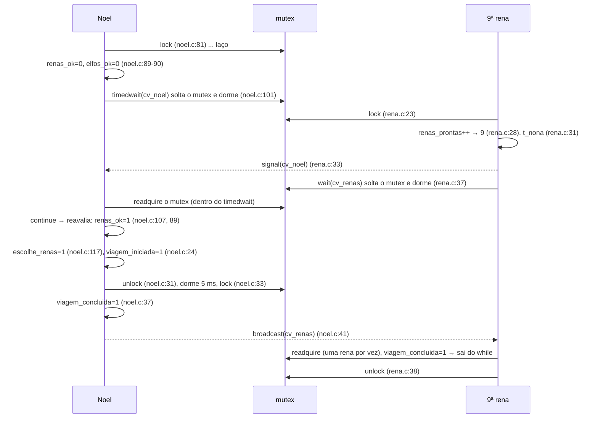
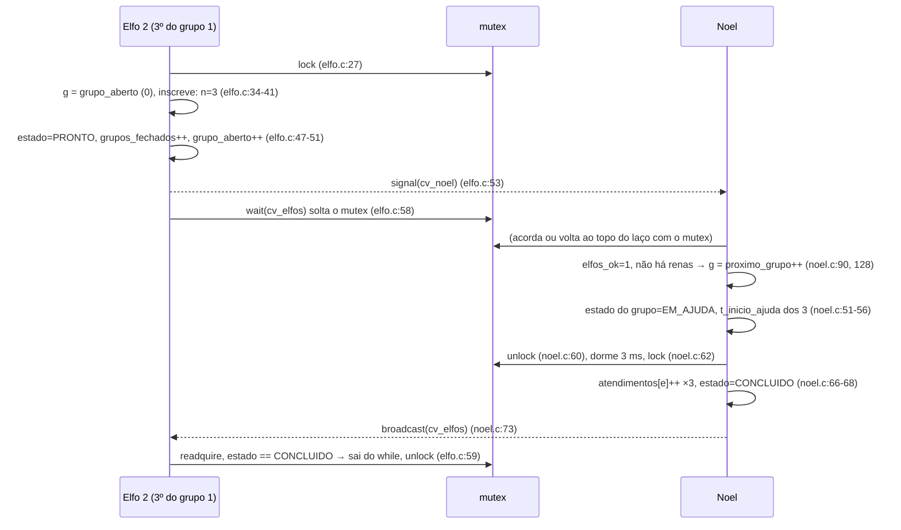

	# Sincronização no Código (Papai Noel)

Esta é a nota central para a apresentação. Mostra **quais mecanismos existem de verdade**, onde nascem, quem espera, quem libera e em que ordem tudo acontece. Ela complementa a [[Lógica e Fluxo (Papai Noel)]] (o quê e quando) e alimenta as [[Perguntas da Apresentação (Papai Noel)]]. Os riscos estão em [[Riscos de Sincronização (Papai Noel)]]. A mesma sincronização vista **fase a fase**, com os cenários de chegada das renas, está em [[Fluxo do Código e Sincronização (Papai Noel)]].

> Todas as referências `arquivo:linha` são de `tema11_papai_noel/src/`, conferidas em 2026-10-28. Se o código mudar, confira os números de linha de novo.

## 1. O que existe (e o que não existe)

| Mecanismo | Tipo (POSIX) | Declarado | Inicializado | Papel |
|---|---|---|---|---|
| `mutex` | `pthread_mutex_t` | `comum.h:82` | `main.c:131` | Protege **todo** o estado da `Oficina` |
| `cv_largada` | `pthread_cond_t` | `comum.h:83` | `main.c:132` | Sinal de início comum (main ↔ threads) |
| `cv_noel` | `pthread_cond_t` com relógio monotônico | `comum.h:84` | `main.c:136-140` | Noel dorme até haver tarefa; timeout de segurança |
| `cv_elfos` | `pthread_cond_t` | `comum.h:85` | `main.c:133` | Elfos esperam o fim da ajuda do seu grupo |
| `cv_renas` | `pthread_cond_t` | `comum.h:86` | `main.c:134` | Renas esperam o fim da preparação |

**Não existem**: semáforos (`sem_t`, `sem_init`, `sem_wait`, `sem_post`), `pthread_barrier_t`, spinlocks, variáveis atômicas ou `volatile`. Verificado com `grep -rn "sem_\|semaphore\|barrier\|pthread_spin\|atomic\|volatile" src/`, que não encontrou nada. [CONFIRMADO 2026-10-28]

- **Biblioteca:** POSIX Threads, `#include <pthread.h>` (`comum.h:13`), compilada com `-pthread`. `_POSIX_C_SOURCE 200809L` (`comum.h:11`) habilita `pthread_condattr_setclock`, `CLOCK_MONOTONIC` e `clock_nanosleep`.
- **Onde vive o estado:** uma única `Oficina o;`, variável local de `main` (`main.c:171`). Todas as threads recebem `&o` no `pthread_create` (`main.c:187-204`). Ela continua válida o tempo todo porque `main` só sai de cena depois dos joins.
- **Regra do projeto:** "Todos os campos são protegidos por `mutex`" (`comum.h:78`). A exceção prática é o que **não muda** depois da largada: `cfg` (configuração) e `t0`. Por isso as threads podem ler esses dois sem o lock, por exemplo em `dormir_ate_ms` (`tempo.c:43-50`).

## 2. Mutex

### 2.1 O que é e que problema resolve

Um **mutex** (*mutual exclusion*) é um cadeado com dono. Num dado instante, no máximo uma thread o possui. O trecho entre `lock` e `unlock` é a **seção crítica**: ali a thread lê e altera dados compartilhados sem que outra thread veja um estado pela metade. Ele resolve a **condição de corrida**: duas threads fazendo "ler → calcular → escrever" sobre a mesma variável e uma apagando o resultado da outra.

### 2.2 Declaração e inicialização

```c
// comum.h:79-82 — o mutex é um campo da struct compartilhada
typedef struct {
    const Config *cfg;

    pthread_mutex_t mutex;
```

```c
// main.c:107-110 e 131 — dentro de iniciar_oficina(), chamada em main.c:172
static int iniciar_oficina(Oficina *o, const Config *c)
{
    memset(o, 0, sizeof *o);          // 109: zera a struct inteira (contadores e flags começam em 0)
    o->cfg = c;
    ...
    pthread_mutex_init(&o->mutex, NULL);   // 131: AQUI o mutex passa a existir
```

**A linha que inicializa o mutex é `main.c:131`.** Seus argumentos:

| Argumento | Valor | Significado |
|---|---|---|
| 1º | `&o->mutex` | endereço do mutex a inicializar (o campo da `Oficina`) |
| 2º | `NULL` | **atributos padrão**: tipo `PTHREAD_MUTEX_DEFAULT`, sem herança de prioridade, privado ao processo. Não é recursivo e não faz verificação de erros. |

- **Estado inicial:** **destravado e sem dono**. A primeira thread que chamar `pthread_mutex_lock` entra imediatamente.
- O `memset` da linha 109 **não** é a inicialização. A POSIX só garante um mutex válido depois de `pthread_mutex_init` ou do inicializador estático `PTHREAD_MUTEX_INITIALIZER`, e **este código não usa o inicializador estático**. Na glibc, um mutex zerado coincide com o inicializador, mas o programa não depende disso.
- O valor de retorno de `pthread_mutex_init` **não é verificado** (ver [[Riscos de Sincronização (Papai Noel)]]).
- A inicialização acontece **antes** de qualquer `pthread_create` (`main.c:172` vem antes de `main.c:187`). Isso é obrigatório: nenhuma thread pode usar o mutex antes dele existir.
- **Destruição:** `pthread_mutex_destroy(&o->mutex)` em `main.c:150`, chamada em `main.c:222`, **depois** de todos os joins (`main.c:215-219`). Destruir um mutex que alguma thread ainda usa tem comportamento indefinido.

### 2.3 Como é adquirido e liberado: todas as seções críticas

| Thread | Trava | Libera | O que faz dentro |
|---|---|---|---|
| main | `main.c:207` | `main.c:213` | espera todas as threads ficarem prontas, grava `t0`, `largada = 1` |
| Noel | `noel.c:81` | `noel.c:145` | o laço inteiro de decisão (o mutex fica com Noel **exceto** nos trechos abaixo) |
| Noel (preparação) | volta a travar em `noel.c:33` | solta em `noel.c:31` | solta o mutex só para **dormir 5 ms** |
| Noel (ajuda) | volta a travar em `noel.c:62` | solta em `noel.c:60` | solta o mutex só para **dormir 3 ms** |
| Rena | `rena.c:17` | `rena.c:19` | anunciar-se e esperar a largada |
| Rena | `rena.c:23` | `rena.c:25` ou `rena.c:38` | `renas_prontas++`, avisar Noel, esperar a viagem |
| Elfo | `elfo.c:21` | `elfo.c:23` | anunciar-se e esperar a largada |
| Elfo | `elfo.c:27` | `elfo.c:29`, `38` ou `59` | inscrever-se, fechar o grupo se for o 3º, esperar o fim da ajuda |

Além disso, **toda chamada `pthread_cond_wait`/`timedwait` solta o mutex enquanto dorme e o readquire antes de retornar** (seção 4). Por isso "o mutex fica com Noel durante o laço" vale apenas para os momentos em que Noel está executando.

Todo caminho que trava também libera. No elfo, por exemplo, há três saídas e as três chamam unlock: `elfo.c:29` (timeout), `elfo.c:38` (invasão detectada) e `elfo.c:59` (caminho normal).

### 2.4 Que dados ele protege

| Dado | Quem escreve | Quem lê |
|---|---|---|
| `threads_prontas`, `largada` | threads (`main.c:27`), main (`main.c:211`) | main (`main.c:208`), threads (`main.c:29`) |
| `renas_prontas`, `t_nona` | renas (`rena.c:28`, `31`) | Noel (`noel.c:89`, `21`) |
| `grupos[g].n`, `.membros`, `.estado` | elfos (`elfo.c:41`, `47`), Noel (`noel.c:51`, `68`) | elfos (`elfo.c:36`, `57`), Noel (`noel.c:48`) |
| `grupo_aberto`, `grupos_fechados` | elfos (`elfo.c:49-51`) | elfos (`elfo.c:34`), Noel (`noel.c:90`) |
| `proximo_grupo`, `grupos_concluidos` | Noel (`noel.c:128`, `69`) | Noel (`noel.c:86`, `90`) |
| `viagem_iniciada`, `viagem_concluida` | Noel (`noel.c:24`, `37`) | Noel (`noel.c:86`, `89`), renas (`rena.c:36`) |
| `abortar` | Noel (`noel.c:103`) | elfos (`elfo.c:28`, `57`), renas (`rena.c:24`, `36`) |
| `estado`, contadores de violação, `eventos[]` | Noel, elfos, renas (via `registrar`) | export depois dos joins |

`registrar()` (`main.c:33-47`) escreve em `eventos[n_eventos++]`. Ela **exige** o mutex adquirido (`comum.h:128`), e todas as chamadas no código acontecem dentro de uma seção crítica.

### 2.5 O que acontece quando duas threads tentam travar ao mesmo tempo

Uma consegue e a outra **bloqueia** dentro de `pthread_mutex_lock`: ela não gasta CPU e o sistema operacional a tira da fila de execução. Quando a dona chama `unlock`, uma das threads em espera é acordada e tenta de novo. **A POSIX não garante ordem FIFO.** Exemplo real: na referência (E06_R10_rep1), as 9 renas e o elfo 0 acordam quase juntos, por volta de 10 ms, e disputam o mutex. O elfo 0 se registrou em 10,080 ms, **antes** da 9ª rena (10,091 ms). Em outra execução a ordem pode mudar.

### 2.6 Quem pode travar e destravar (regras do pthread)

- Só a thread que travou (a **dona**) pode destravar. No tipo padrão, destravar um mutex que você não possui tem **comportamento indefinido**. O código respeita isso: todo `unlock` está na mesma função que fez o `lock`, ou na continuação da mesma thread (Noel trava em `noel.c:81` e libera em `noel.c:145`).
- Travar de novo o mesmo mutex na mesma thread é **deadlock ou comportamento indefinido**, porque ele não é recursivo. `preparar_viagem` e `ajudar_grupo` **entram com o mutex já adquirido** (comentários em `noel.c:18` e `noel.c:44`) e por isso não chamam `lock` no início. Se chamassem, Noel travaria nele mesmo.
- `pthread_cond_wait` exige que a thread chamadora **possua** o mutex passado, e todas as chamadas do código cumprem essa regra.

### 2.7 O que daria errado sem o mutex ou com uso incorreto

| Erro | Consequência neste programa |
|---|---|
| Tirar o lock de `rena.c:23` | `renas_prontas++` vira "ler, somar, gravar". Duas renas leem 7 e ambas gravam 8, e o contador **nunca chega a 9**. Noel nunca prepara a viagem e o episódio termina em **timeout**. |
| Tirar o lock de `elfo.c:27` | Dois elfos leem `gr->n == 2` e ambos escrevem em `membros[2]`, com `n` indo para 4. Isso é **invasão** e um grupo com o número errado de elfos, exatamente o que a regra proíbe. |
| Noel ler `renas_ok`/`elfos_ok` sem o lock | Ele decidiria com um retrato velho ("check-then-act"): veria só elfos prontos, e a 9ª rena chegaria entre a leitura e a decisão. |
| **Esquecer um unlock** (por exemplo, apagar o `elfo.c:38`) | Todas as outras threads ficam bloqueadas para sempre no `lock`. **Nem o timeout salva**: para retornar com `ETIMEDOUT`, o `pthread_cond_timedwait` de Noel (`noel.c:101`) precisa **readquirir o mutex**, e ele nunca fica livre. O programa trava. |
| Dormir **segurando** o mutex (apagar `noel.c:31`/`33`) | Durante os 5 ms nenhum elfo ou rena consegue se registrar. Não chega a ser deadlock, mas os tempos de chegada ficariam errados, e é má prática: um mutex deve ser segurado pelo menor tempo possível. |

### 2.8 Por dentro do mutex: como várias threads "dividem" a mesma chave

"Várias threads no mesmo mutex" **não** quer dizer várias threads com a chave ao mesmo tempo. Quer dizer várias threads **disputando a mesma chave**: só uma ganha por vez, e as outras esperam numa fila. O mutex é **um único objeto** (`o->mutex`, `comum.h:82`) e todas as threads recebem um ponteiro para a mesma `Oficina`.

**Como o Linux/glibc implementa** (simplificado) [TEORIA, não medido no trabalho]. O mutex guarda um número:

| Valor | Significado |
|---|---|
| 0 | livre: a chave está no gancho |
| 1 | travado, ninguém esperando |
| 2 | travado **e há threads esperando** |

| Operação | O que acontece |
|---|---|
| `lock` | a thread tenta trocar 0 por 1 com uma **instrução atômica do processador** (*compare-and-swap*). O hardware garante que só **uma** consegue, mesmo que todas tentem no mesmo instante, em núcleos diferentes. Quem perde marca "2" e pede ao kernel para dormir (chamada `futex`); o kernel a põe numa **fila ligada àquele endereço** e a tira da CPU |
| `unlock` | volta o valor para 0; se havia gente esperando, pede ao kernel para **acordar uma**. A acordada tenta de novo. **Sem garantia de ordem**: a POSIX não promete FIFO |
| sem disputa | `lock` e `unlock` resolvem em espaço de usuário, sem chamar o kernel. Por isso o mutex é barato quando ninguém disputa |

**Duas filas diferentes. Não confunda:**

| Onde espera | Esperando o quê | Duração típica aqui | Exemplo |
|---|---|---|---|
| **Fila do mutex** (dentro do `lock`) | **a chave** ficar livre | microssegundos | as 9 renas às 10 ms |
| **Fila da variável de condição** (dentro do `cond_wait`) | **um evento** (`signal`/`broadcast`) | milissegundos | renas esperando a viagem, elfos esperando a ajuda |

Elas se encadeiam. Um `broadcast(cv_renas)` tira as 9 renas da fila da variável de condição e as põe na **fila do mutex**, porque o `cond_wait` só retorna com a chave na mão. Elas acordam juntas, mas **saem uma de cada vez**.

**Estados de uma thread neste programa:**

```
              lock() conseguiu
  [rodando, SEM chave] ─────────────► [rodando, COM chave]  ← seção crítica (µs)
        ▲    │                              │        │
        │    │ lock() falhou                │        │ cond_wait()
        │    ▼                              │        ▼  (solta a chave e dorme)
        │ [bloqueada na fila do mutex] ─────┘   [dormindo na fila da cond var]
        │      (chave liberou → tenta de novo)          │
        │                                               │ signal/broadcast
        │                                               ▼
        │                                  [fila do mutex] → pega a chave → volta COM chave
        │
        └── sleeps de chegada/ajuda/preparação: [dormindo SEM chave, sem fila nenhuma]
```

**Bloqueada não gasta CPU.** O escalonador só distribui CPU entre as threads **prontas**. Uma thread bloqueada (no mutex, numa variável de condição ou num sleep) sai da fila de execução e só ocupa memória. O custo é dormir e acordar: uma ida ao kernel e uma troca de contexto, da ordem de **microssegundos**. É o que aparece como os ~20 µs de resposta às renas no G2.

| Espera esperada | Melhor estratégia | Porquê |
|---|---|---|
| nanossegundos | girar (spinlock) | dormir e acordar custaria mais que a própria espera |
| microssegundos ou mais | **bloquear** (mutex e variável de condição) | girar desperdiçaria CPU o tempo todo |

Aqui as esperas são de **milissegundos**, então bloquear é claramente o certo. Medições (renas em fila, uso de CPU, trocas de contexto) em [[Evidências nos Dados (Papai Noel)]], evidências 1 e 3.

### 2.9 O Noel não fica com a chave nem "monitora"

O Noel **dorme** em `cv_noel` (`noel.c:101`). O `pthread_cond_timedwait` **solta o mutex e dorme num passo só**, e ao acordar **retoma o mutex antes de retornar**. Quem "monitora" são os outros: **quem muda o estado avisa**. A 9ª rena (`rena.c:28-33`) e o 3º elfo (`elfo.c:45-53`) alteram o estado com o mutex e fazem `signal(cv_noel)`.

O Noel segura o mutex **só nos instantes de decisão e de anotação** (microssegundos). Antes de cada ajuda ou preparação, ele o solta (`noel.c:31`, `60`). Na execução de referência, do `signal` da 9ª rena (10,091 ms) à decisão do Noel (10,108 ms) passam **17 µs**: não é um atraso programado, é o custo do SO para acordá-lo e devolver a chave. A tabela trecho a trecho está em [[Evidências nos Dados (Papai Noel)]], evidência 2.

**E se o aviso chegar quando ele está trabalhando?** O `signal` não encontra ninguém em `cv_noel` e **se perde**, mas o estado (`grupos_fechados++`, `renas_prontas`) já foi gravado. Ao terminar a tarefa, o Noel volta ao topo do laço e **testa o estado antes de dormir** (`noel.c:85-100`). Como testar e dormir acontecem com o mutex, nenhuma thread consegue mudar o estado e avisar "no meio": é isso que impede o aviso perdido.

**Analogia:**
- A chave fica num gancho. Quem mexe no quadro de avisos (os contadores) pega a chave e devolve.
- O Noel, ao dormir, **devolve a chave** e deixa um recado: "me chame se o quadro mudar".
- Quem completa uma demanda escreve no quadro e bate na porta.
- O Noel acorda, espera a chave ficar livre, lê o quadro e decide.

## 3. Semáforos: não são usados

**A implementação não usa semáforos.** Quem cumpre o papel de coordenação que, numa solução clássica (Downey, *The Little Book of Semaphores*), caberia aos semáforos são os **predicados sobre o estado + variáveis de condição**:

| Na solução clássica com semáforos | Neste código |
|---|---|
| contadores `elves`/`reindeer` protegidos por um semáforo-mutex (valor inicial 1) | `grupos[g].n`, `renas_prontas`, protegidos por `pthread_mutex_t` |
| `santaSem` (inicial 0): Noel dá `wait`; a 9ª rena ou o 3º elfo dá `signal` | `cv_noel` + predicados `renas_ok`/`elfos_ok` (`noel.c:89-101`) |
| `reindeerSem` (inicial 0): Noel dá `signal` 9 vezes | `cv_renas` + `viagem_concluida`, com **um** broadcast (`noel.c:41`) |
| `elfTex` (inicial 1): "catraca" que barra o 4º elfo até o grupo ser atendido | **fila de grupos com id**: o 4º elfo não espera, entra direto no próximo grupo (`elfo.c:34`, `50-51`) |

Diferença de comportamento importante: na solução clássica com `elfTex`, o 4º elfo **fica parado** até o grupo atual ser atendido. Aqui ele **forma o próximo grupo** imediatamente, e vários grupos prontos podem esperar na fila. As duas versões respeitam a regra de não invadir.

Como seriam os semáforos (para responder ao professor): `sem_init(&s, 0, valor)`. O 2º argumento `0` quer dizer compartilhado entre threads do mesmo processo, e o 3º é o **valor inicial do contador**. `sem_wait` decrementa e bloqueia se o valor for 0; `sem_post` incrementa e acorda um esperando. O semáforo **guarda** os avisos no contador. Uma variável de condição **não guarda nada**, por isso precisa de um predicado.

### 3.1 E spinlock, rwlock ou variável atômica?

Também não existem no código (seção 1). A decisão de não usar semáforos está registrada no índice ([[_Papai-Noel]], **Decisões**). Para os outros três, o que segue é **análise técnica a partir do código**: não há registro de decisão.

O motivo comum é que **o problema pede "esperar até uma condição sobre várias variáveis ficar verdadeira"**. O Noel espera "9 renas **ou** um grupo pronto"; cada elfo espera "o **meu** grupo terminou". Mutex mais variável de condição expressa isso diretamente; cada alternativa resolve só um pedaço e ainda precisaria de um mutex.

| Ferramenta | Resolve | Por que não aqui | Onde ela seria a certa |
|---|---|---|---|
| **Mutex + variável de condição** (usado) | exclusão mútua em várias variáveis + dormir até um predicado | — | — |
| **Semáforo** | contar fichas; esperar uma ficha | uma thread não dorme em **dois** semáforos ao mesmo tempo ("renas OU elfos"); a decisão de prioridade ainda exige ler os dois contadores com um mutex; o valor inicial errado muda o comportamento; `sem_timedwait` usa `CLOCK_REALTIME`, e o código usa `CLOCK_MONOTONIC` (`main.c:136-140`) | pool de recursos idênticos ("5 vagas no buffer") |
| **Spinlock** | trava sem dormir, girando | esperas de **milissegundos** viram espera ocupada; com 16 threads e 12 CPUs, quem gira atrapalha quem tem trabalho; `pthread_cond_wait` só aceita `pthread_mutex_t` | seções de nanossegundos em multicore, onde não se pode dormir (kernel) |
| **rwlock** | vários leitores em paralelo | quase todo acesso aqui é **escrita** (`++`, inscrição, fechar grupo, marcar viagem); o único leitor puro é o Noel, sozinho; não funciona com variável de condição | dados muito lidos e pouco alterados (tabela de configuração) |
| **Atômico** (`stdatomic.h`) | uma variável indivisível | o 3º elfo altera **quatro** variáveis num passo só (`elfo.c:41-51`): atômicos protegem cada uma, não o conjunto, e outra thread veria o grupo "cheio, mas ainda aberto"; atômico também não faz ninguém dormir | contadores e flags isolados (estatísticas, flag "parar") |

> **"Mas daria para fazer com semáforos?"** Dá: a solução clássica do Papai Noel usa semáforos. Mas ela também tem um mutex para os contadores, e a prioridade continua sendo um `if` sobre contadores protegidos. A diferença é de **clareza**, não de possibilidade.

## 4. Variáveis de condição

### 4.0 O que é e o padrão usado em todas

Uma **variável de condição** é uma fila de espera associada a um mutex. Ela **não tem valor nem memória**: serve para dormir até que *alguém avise que o estado mudou*. O padrão obrigatório, que o código segue em todas as esperas, é:

```c
pthread_mutex_lock(&m);
while (!predicado)                  // reavalia SEMPRE ao acordar
    pthread_cond_wait(&cv, &m);     // atomicamente: solta m e dorme; ao acordar, retrava m
/* aqui o predicado é verdadeiro E o mutex está com esta thread */
pthread_mutex_unlock(&m);
```

E do lado de quem avisa:

```c
pthread_mutex_lock(&m);
altera_estado();                    // torna o predicado verdadeiro
pthread_cond_signal(&cv);           // ou broadcast
pthread_mutex_unlock(&m);
```

Por que `while` e não `if`: a thread pode acordar sem que o predicado seja verdadeiro. Isso acontece por **acordar espúrio**, permitido pela POSIX, ou porque outra thread pegou o mutex antes e mudou o estado de novo. Todas as esperas do código estão em laço: `main.c:29`, `main.c:208`, `elfo.c:57`, `rena.c:36`. No Noel, o laço é o `for (;;)` com `continue` (`noel.c:107`).

**Sem estado inicial a configurar:** uma cond var recém-inicializada simplesmente não tem ninguém esperando. O "estado inicial" que importa é o das **variáveis do predicado**, todas zeradas pelo `memset` de `main.c:109` (`largada = 0`, `renas_prontas = 0`, `viagem_concluida = 0`, `abortar = 0`, `n = 0` e `estado = GRUPO_ABERTO = 0` em cada grupo via `calloc`, `main.c:116`).

### 4.1 `cv_largada`: sinal de início comum (uma barreira feita à mão)

| Pergunta | Resposta no código |
|---|---|
| 1. Onde é criada? | `pthread_cond_init(&o->cv_largada, NULL)` em `main.c:132` (atributos padrão) |
| 2. Estado inicial | ninguém esperando; `largada = 0` e `threads_prontas = 0` (memset `main.c:109`); `total_threads = 1 + 9 + N` (`main.c:112`) |
| 3. O que faz esperar? | **Threads:** `while (!o->largada)` (`main.c:29-30`). **Main:** `while (o.threads_prontas < o.total_threads)` (`main.c:208-209`) |
| 4. O que permite prosseguir? | Threads: `largada == 1`. Main: todas as threads terem se anunciado. |
| 5. Quem altera o estado? | cada thread faz `threads_prontas++` (`main.c:27`); a main faz `largada = 1` (`main.c:211`) |
| 6. Quem notifica? | cada thread faz `broadcast` (`main.c:28`) para acordar a main; a main faz `broadcast` (`main.c:212`) para soltar todas |
| 7. Por que foi usada? | Separar **preparação** (criar threads) de **medição**: `t0` só é gravado com todas prontas (`main.c:210`) |
| 8. O que poderia dar errado? | Ver abaixo |

```c
// main.c:25-31 — chamada por Noel (noel.c:82), renas (rena.c:18) e elfos (elfo.c:22) COM o mutex
void esperar_largada(Oficina *o)
{
    o->threads_prontas++;                     // "cheguei"
    pthread_cond_broadcast(&o->cv_largada);   // avisa a main
    while (!o->largada)
        pthread_cond_wait(&o->cv_largada, &o->mutex);
}
```

**Ponto de prova:** esta cond var tem **dois predicados diferentes** (o da main e o das threads) sobre a **mesma fila**. Por isso os avisos precisam ser `broadcast`. Com `signal` na linha 28, o aviso poderia acordar outra *thread trabalhadora* em vez da main. Ela reavaliaria `largada`, veria 0 e voltaria a dormir, e a main não seria acordada. Se isso acontecesse no último aviso, a main dormiria **para sempre**, porque aqui não há timeout. Isso é uma barreira (como `pthread_barrier_wait`) construída com mutex, contador e cond var.

### 4.2 `cv_noel`: onde Noel dorme

| Pergunta | Resposta no código |
|---|---|
| 1. Onde é criada? | `main.c:136-140`: atributo com relógio monotônico (detalhes abaixo) |
| 2. Estado inicial | ninguém esperando; `renas_prontas = 0`, `grupos_fechados = 0`, `proximo_grupo = 0` |
| 3. O que faz esperar? | `!liberado || (!renas_ok && !elfos_ok)` (`noel.c:100`): não há nada pronto, ou o modo de teste ainda não liberou |
| 4. O que permite prosseguir? | `renas_ok` (9 renas e viagem não iniciada, `noel.c:89`) ou `elfos_ok` (há grupo fechado não atendido, `noel.c:90`); ou o **timeout** |
| 5. Quem altera o estado? | renas: `renas_prontas++` (`rena.c:28`); elfos: `grupos_fechados++` (`elfo.c:49`) |
| 6. Quem notifica? | a **9ª rena**: `pthread_cond_signal(&o->cv_noel)` (`rena.c:33`); o **3º elfo** de cada grupo (`elfo.c:53`) |
| 7. Por que foi usada? | Noel não pode ficar em espera ocupada; ele precisa dormir até existir trabalho, e esse "trabalho" é um predicado composto (renas **ou** elfos) |
| 8. O que poderia dar errado? | relógio errado no timeout; trocar `while`/`continue` por uma checagem única; usar `signal` se houvesse mais de um Noel |

```c
// main.c:136-140 — inicialização com atributo
pthread_condattr_t at;
pthread_condattr_init(&at);                       // atributos padrão
pthread_condattr_setclock(&at, CLOCK_MONOTONIC);  // o timeout será medido no relógio monotônico
pthread_cond_init(&o->cv_noel, &at);              // cria a cond var com esse relógio
pthread_condattr_destroy(&at);                    // o atributo pode ser descartado após o init
```

```c
// noel.c:83 e 100-107 — a espera
struct timespec limite = somar_ms(o->t0, c->timeout_ms);   // prazo ABSOLUTO = t0 + 2000 ms
...
if (!liberado || (!renas_ok && !elfos_ok)) {
    int rc = pthread_cond_timedwait(&o->cv_noel, &o->mutex, &limite);
    if (rc == ETIMEDOUT) {          // passou do prazo: aborta o episódio
        o->abortar = 1;
        registrar(o, PART_NOEL, 0, EV_TIMEOUT, 0);
        break;
    }
    continue;                       // acordou (aviso ou espúrio): reavalia tudo
}
```

- **Por que o relógio monotônico:** `limite` é calculado a partir de `t0`, que vem de `CLOCK_MONOTONIC` (`tempo.c:17`). Com o relógio padrão (`CLOCK_REALTIME`), o prazo seria interpretado num relógio diferente, e o timeout dispararia na hora ou só daqui a décadas. O monotônico também não muda se alguém acertar o relógio do sistema.
- **Por que `signal` basta:** **só Noel** espera em `cv_noel`. Com mais de um consumidor seria preciso `broadcast` ou uma cond var por tipo.
- **E se o aviso chegar com Noel ocupado?** Quando Noel está ajudando ou preparando, ele **não está** na fila de `cv_noel`, e o `signal` do 3º elfo não acorda ninguém: o aviso "se perde". **Isso não é um bug**, porque o *estado* (`grupos_fechados++`) ficou gravado. Antes de dormir de novo, Noel volta ao topo do laço e reavalia `renas_ok`/`elfos_ok` (`noel.c:89-90`) com o mutex. Exemplo real na referência: o grupo 2 ficou pronto em 15,061 ms, com Noel preparando a viagem. Noel terminou em 15,185 ms, viu o grupo 1 na fila e o atendeu em 15,200 ms. Depois, sem dormir, atendeu o grupo 2 em 18,279 ms.

### 4.3 `cv_elfos`: elfos esperam o fim da ajuda

| Pergunta | Resposta no código |
|---|---|
| 1. Onde é criada? | `pthread_cond_init(&o->cv_elfos, NULL)` em `main.c:133` |
| 2. Estado inicial | ninguém esperando; cada grupo com `estado = GRUPO_ABERTO` (0, `calloc` em `main.c:116`) |
| 3. O que faz esperar? | `gr->estado != GRUPO_CONCLUIDO && !o->abortar` (`elfo.c:57-58`) |
| 4. O que permite prosseguir? | Noel marcar o **seu** grupo como `GRUPO_CONCLUIDO`, ou o timeout |
| 5. Quem altera o estado? | **só Noel**: `gr->estado = GRUPO_CONCLUIDO` (`noel.c:68`) |
| 6. Quem notifica? | Noel: `pthread_cond_broadcast(&o->cv_elfos)` ao fim de cada ajuda (`noel.c:73`) e no encerramento (`noel.c:143`) |
| 7. Por que foi usada? | O elfo não pode ir embora antes de ser ajudado, e não pode girar perguntando "já acabou?" |
| 8. O que poderia dar errado? | ver abaixo |

**Por que `broadcast` e não `signal`:** os elfos de **todos** os grupos dormem na **mesma** `cv_elfos`. Ao terminar o grupo 1, um `signal` acordaria **um** elfo qualquer, talvez do grupo 2, que reavaliaria, veria seu grupo não concluído e voltaria a dormir. Os 3 elfos do grupo 1 continuariam dormindo. O programa não travaria, porque o broadcast final de `noel.c:143` acaba liberando todos, mas os elfos sairiam atrasados. O `broadcast` acorda todos, cada um testa **o seu** grupo e só os do grupo concluído seguem. O custo são algumas acordadas inúteis (*thundering herd*), aceitável com no máximo 12 elfos.

### 4.4 `cv_renas`: renas esperam a viagem

| Pergunta | Resposta no código |
|---|---|
| 1. Onde é criada? | `pthread_cond_init(&o->cv_renas, NULL)` em `main.c:134` |
| 2. Estado inicial | ninguém esperando; `viagem_concluida = 0` |
| 3. O que faz esperar? | `!o->viagem_concluida && !o->abortar` (`rena.c:36-37`) |
| 4. O que permite prosseguir? | `viagem_concluida = 1` ou timeout |
| 5. Quem altera o estado? | Noel, em `noel.c:37` |
| 6. Quem notifica? | Noel: `broadcast` em `noel.c:41` (fim da preparação) e `noel.c:144` (encerramento) |
| 7. Por que foi usada? | As 9 renas precisam ficar "atreladas" até a preparação acabar |
| 8. O que poderia dar errado? | com `signal`, só 1 das 9 sairia na hora; as outras 8 só sairiam no broadcast final |

### 4.5 Destruição

`destruir_oficina` (`main.c:144-151`) destrói as 4 cond vars e o mutex, e é chamada em `main.c:222`, **depois** dos joins. Destruir uma cond var com alguém esperando nela tem comportamento indefinido; depois dos joins, garantidamente não há ninguém.

## 5. Como os mecanismos trabalham juntos

### 5.1 Responsabilidades: não confundir

| | Mutex | Variável de condição |
|---|---|---|
| Responde a | "**quem** pode mexer no estado agora?" | "**quando** vale a pena olhar de novo?" |
| Guarda informação? | Não; protege as variáveis que guardam | **Não**; o "sinal" some se ninguém estiver esperando |
| Onde está a verdade | nas variáveis (`renas_prontas`, `grupos[g].estado`, ...) | nas mesmas variáveis, testadas no `while` |
| Usado sozinho | serve para exclusão mútua, mas não para esperar um evento (só com laço de lock/unlock = **espera ocupada**) | **errado**: sem mutex e sem predicado, há corrida e aviso perdido |

O mutex protege o **estado**. A cond var coordena a **espera por uma mudança desse estado**. A decisão de Noel não se baseia no "sinal recebido", e sim no **estado lido com o mutex**. Por isso o código continua correto mesmo quando um `signal` é perdido ou quando Noel acorda espuriamente.

### 5.2 Sequência real: a 9ª rena acorda Noel e é liberada



Passo a passo, com o código real:

1. **Noel adquire o mutex** (`noel.c:81`) e, no laço, lê o estado compartilhado (`noel.c:89-90`).
2. **Nada pronto:** `pthread_cond_timedwait` (`noel.c:101`) **solta o mutex e põe Noel para dormir numa única operação atômica**. Não existe janela entre "soltar" e "dormir" em que um aviso possa escapar.
3. **A rena adquire o mutex** (`rena.c:23`), **altera o estado** (`renas_prontas++`, `rena.c:28`) e, por ser a 9ª, **sinaliza** (`rena.c:33`).
4. **A rena espera** em `cv_renas` (`rena.c:37`), o que solta o mutex.
5. **Noel acorda e readquire o mutex** antes de `timedwait` retornar.
6. **O estado é verificado de novo:** `continue` (`noel.c:107`) volta ao topo, e `renas_ok` agora é 1.
7. **A execução prossegue com segurança:** a decisão (`noel.c:117`) e a marcação `viagem_iniciada = 1` (`noel.c:24`) acontecem **na mesma seção crítica** da leitura. Só então Noel solta o mutex para simular a preparação.
8. No fim, Noel **altera o estado** (`viagem_concluida = 1`) e faz **broadcast** (`noel.c:41`). Cada rena readquire o mutex, **uma de cada vez**, reavalia `rena.c:36` e sai.

### 5.3 Sequência real: o 3º elfo fecha o grupo e é atendido



### 5.4 O que acontece em ordens diferentes

| Ordem | O que o código faz | Resultado |
|---|---|---|
| O 3º elfo sinaliza enquanto Noel **prepara** a viagem | o `signal` não acorda ninguém, mas `grupos_fechados` fica gravado | Noel vê o grupo ao voltar ao topo do laço (exemplo real em 4.2) |
| A 9ª rena **e** o 3º elfo sinalizam antes de Noel rodar | dois avisos, Noel acorda uma vez | lê os dois prontos e escolhe **renas** (`noel.c:117`); é a **disputa** do `--teste-prioridade` |
| A 9ª rena está **bloqueada no lock** enquanto Noel decide por um grupo | para o programa a rena ainda não chegou | Noel ajuda o grupo; ao terminar, prepara a viagem. **Não é violação** |
| Noel acorda espuriamente | `continue` reavalia | volta a dormir |
| Outra thread pega o mutex entre o aviso e o despertar de Noel | por exemplo, outro elfo se inscreve no próximo grupo | Noel reavalia com o estado mais novo; nada se perde |
| Um elfo do grupo 2 acorda com o broadcast do grupo 1 | testa o **seu** grupo (`elfo.c:57`) | volta a dormir |
| Um elfo chega depois de o timeout disparar | `abortar == 1` (`elfo.c:28`) | sai sem se inscrever |

## 6. Prioridade sem interromper a ajuda

```c
// noel.c:117 e 123-132
int escolhe_renas = c->ingenua ? !elfos_ok : renas_ok;   // versão correta: renas_ok
...
if (escolhe_renas) {
    o->estado = NOEL_PREPARANDO;
    registrar(o, PART_NOEL, 0, EV_DECISAO, 0);
    preparar_viagem(o);
} else {
    int g = o->proximo_grupo++;
    ...
    ajudar_grupo(o, g);
}
```

- A **prioridade** vem da ordem do teste: se `renas_ok`, a viagem é escolhida antes de olhar a fila de elfos.
- A **não interrupção** vem de dois fatos. (1) **Só a thread Noel decide**: elfos e renas apenas alteram contadores e avisam. (2) Durante a ajuda, Noel está dentro de `dormir_ate_ms` (`noel.c:61`), sem ler nada. A 9ª rena pode chegar no meio da ajuda, incrementar o contador e dar `signal`, mas ninguém está ouvindo. Noel só reavalia ao voltar ao topo do laço.
- A flag `ingenua` (`noel.c:117`) existe **só** para demonstrar o erro: inverte a regra (elfos primeiro), e o próprio programa conta a violação em `noel.c:118-119`.

## 7. Encerramento e timeout

```c
// noel.c:86-87 — condição de término normal
if (o->viagem_concluida && o->grupos_concluidos == o->n_grupos)
    break;
// noel.c:135-145 — depois do laço
if (!o->abortar) { o->estado = NOEL_ENCERRADO; ...; registrar(..., EV_ENCERRAMENTO, 0); }
pthread_cond_broadcast(&o->cv_elfos);    // ninguém pode ficar bloqueado
pthread_cond_broadcast(&o->cv_renas);
pthread_mutex_unlock(&o->mutex);
```

- **Normal:** quando Noel sai, todos os elfos e todas as renas já foram liberados pelos broadcasts de cada tarefa. Os broadcasts finais são uma rede de segurança.
- **Timeout:** `abortar = 1` e os broadcasts finais acordam quem espera em `cv_elfos`/`cv_renas`, cujos predicados incluem `!abortar`. Quem ainda estava dormindo na chegada acorda depois, vê `abortar` (`elfo.c:28`, `rena.c:24`) e sai. A main faz os joins normalmente. Testado com `--timeout-ms 5`: status `timeout`, 0/6 pedidos, sem travar [CONFIRMADO 2026-10-28].
- **Limitação do timeout:** ele só é verificado enquanto Noel **espera** em `cv_noel`. Ele não protege contra um mutex que nunca é liberado (2.7) nem contra a espera da main em `main.c:208`, que não tem prazo.
