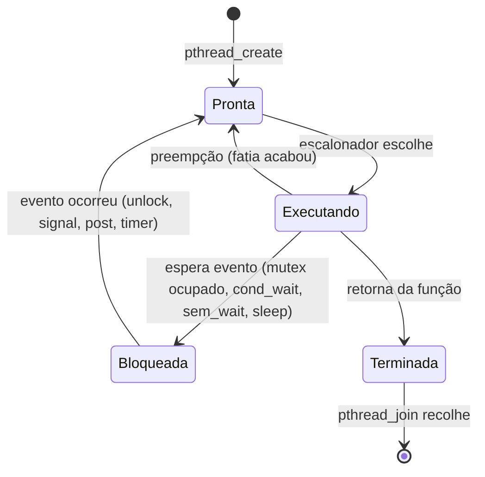
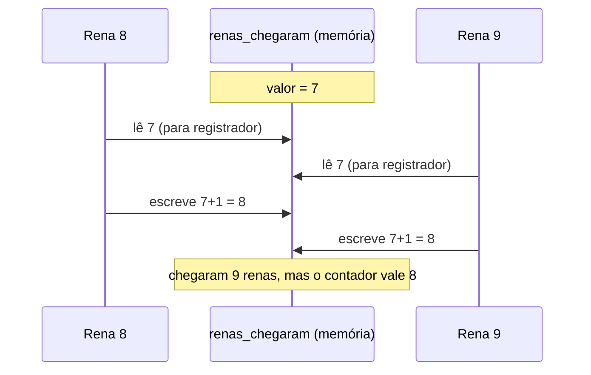
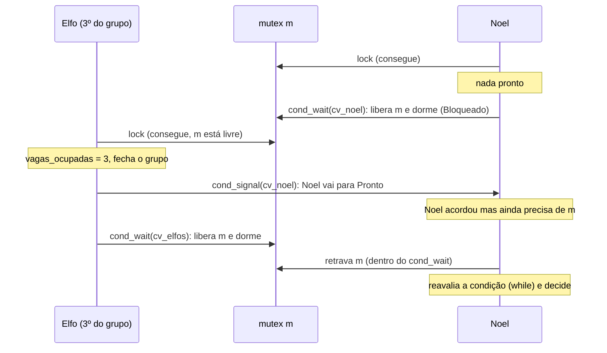
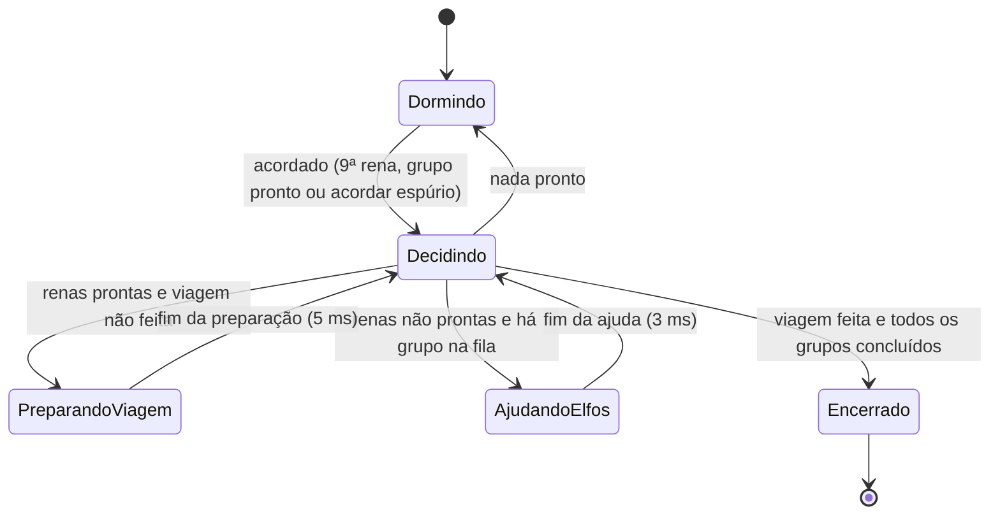

# Guia de Estudo Teórico (Papai Noel)
### Sistemas Operacionais · Engenharia de Software · Centro Universitário FAG

> Material para **entender** (não decorar) concorrência, sincronização e o Problema do Papai Noel, e para defender a solução do grupo na apresentação.

---

## Como usar este guia

O guia vai do básico ao avançado. Os capítulos 1 a 5 são a base teórica, os capítulos 6 a 9 aplicam a teoria ao problema, os capítulos 10 e 11 tratam de experimentos e testes, e o capítulo 12 é a preparação para as perguntas do professor. Se faltar tempo, leia pelo menos os capítulos 3, 5, 6, 7, 9 e 12.

### Legenda: de onde vem cada afirmação

Ao longo do texto, as afirmações são marcadas para você saber o quanto pode confiar nelas:

| Marca | Significado |
|---|---|
| **[TEORIA]** | Vale para qualquer implementação correta; vem da literatura de SO. |
| **[IMPLEMENTAÇÃO]** | Depende de como o código foi escrito. Este guia usa uma **implementação de referência** (capítulo 6.9). **Confira no código real do grupo** e ajuste o que for diferente. |
| **[HIPÓTESE]** | Expectativa calculada com os tempos nominais da ficha (10 ms, 1 ms, 3 ms, 5 ms). **Não é resultado medido.** Os valores reais serão um pouco diferentes. |
| **[MEDIDO]** | Só pode vir dos CSVs das 25 execuções. Este guia não inventa nenhum número medido; onde aparecer `⟨preencher⟩`, coloque o valor do seu CSV. |

> ⚠️ O código do grupo não foi fornecido na elaboração deste guia. Tudo que é marcado como [IMPLEMENTAÇÃO] descreve uma solução correta possível, não necessariamente a de vocês.

---

## Sumário

1. [Fundamentos de concorrência, processos e threads](#1-fundamentos-de-concorrência-processos-e-threads)
2. [Problemas de sincronização e sua relação com o SO](#2-problemas-de-sincronização-e-sua-relação-com-o-so)
3. [Seção crítica, condição de corrida, atomicidade e dados compartilhados](#3-seção-crítica-condição-de-corrida-atomicidade-e-dados-compartilhados)
4. [Mutex, semáforos e variáveis de condição](#4-mutex-semáforos-e-variáveis-de-condição)
5. [Por que um `if` e um contador não substituem sincronização](#5-por-que-um-if-e-um-contador-não-substituem-sincronização)
6. [Modelagem completa do Problema do Papai Noel](#6-modelagem-completa-do-problema-do-papai-noel)
7. [Prioridade das renas e grupos de três elfos](#7-prioridade-das-renas-e-grupos-de-três-elfos)
8. [Princípios de uma boa solução](#8-princípios-de-uma-boa-solução)
9. [Starvation, deadlock, espera ocupada e outras falhas](#9-starvation-deadlock-espera-ocupada-e-outras-falhas)
10. [Métricas, experimentos e os quatro gráficos](#10-métricas-experimentos-e-os-quatro-gráficos)
11. [Testes funcionais e validação](#11-testes-funcionais-e-validação)
12. [Preparação para a apresentação](#12-preparação-para-a-apresentação)
13. [Referências](#13-referências)

---

# 1. Fundamentos de concorrência, processos e threads

## 1.1 Concorrência e paralelismo

**Definição [TEORIA].** *Concorrência* é a existência de várias tarefas cujos tempos de vida se sobrepõem: todas começaram e nenhuma terminou. *Paralelismo* é a execução de várias tarefas **no mesmo instante físico**, em núcleos diferentes.

**Intuição.** Um cozinheiro preparando três pratos alternando entre eles é concorrência. Três cozinheiros, cada um num prato ao mesmo tempo, é paralelismo.

**Funcionamento.** Com um único núcleo, o SO cria a ilusão de simultaneidade alternando rapidamente entre tarefas (intercalação). Com vários núcleos, as tarefas podem de fato rodar juntas. Um programa concorrente pode ou não rodar em paralelo: concorrência é uma propriedade da **estrutura** do programa; paralelismo, da **execução** no hardware.

**Exemplo.** Um navegador baixa uma imagem enquanto você rola a página. São duas atividades concorrentes, mesmo que a CPU tenha um só núcleo.

**No Papai Noel.** Noel, 9 renas e N elfos são atividades concorrentes: cada um tem seu próprio fluxo (chegar, esperar, ser atendido, terminar), e esses fluxos se sobrepõem no tempo.

**O que pode dar errado.** Achar que os problemas de sincronização só existem em máquinas multicore. **Errado:** basta que o SO possa interromper uma thread no meio de uma operação e passar outra na frente. O paralelismo aumenta a frequência dos erros, mas a causa é a **intercalação imprevisível**.

**Como explicar oralmente.**
> "Concorrência é ter várias tarefas em andamento no mesmo período; paralelismo é executá-las literalmente ao mesmo tempo em núcleos diferentes. Para sincronização, o que importa é a concorrência: mesmo com um núcleo só, o SO pode trocar de thread no meio de uma operação, e isso já basta para dar problema."

**Pergunta de aprofundamento.** *"Se eu rodar o programa de vocês fixado em um único núcleo (`taskset -c 0`), os problemas de sincronização somem?"*
**Resposta:** Não. A preempção continua existindo: o SO pode tirar uma rena da CPU entre a leitura e a escrita do contador e executar outra rena. O erro fica mais raro, mas continua possível. Por isso a correção precisa ser garantida pelo mecanismo de sincronização, não pela sorte do escalonamento.

---

## 1.2 Processo

**Definição [TEORIA].** Um *processo* é um programa em execução. O SO associa a ele um espaço de endereçamento próprio (código, dados, heap, pilhas), recursos (arquivos abertos, sockets), um identificador (PID) e pelo menos uma thread de execução.

**Intuição.** Um processo é uma empresa com prédio próprio: ninguém de fora entra sem autorização.

**Funcionamento.** A unidade de gerenciamento de memória (MMU), configurada pelo SO, garante que um processo não leia nem escreva na memória de outro. Para colaborar, processos precisam de **IPC** (*Inter-Process Communication*): pipes, sockets, filas de mensagens ou memória compartilhada explícita (`shm_open` + `mmap`).

**No Papai Noel.** Se cada elfo fosse um processo, o contador do grupo não poderia ser uma variável global comum: teria de morar numa região de memória compartilhada criada explicitamente, e os semáforos/mutexes teriam de ser configurados para uso entre processos (`sem_init(&s, 1, v)` ou `PTHREAD_PROCESS_SHARED`). A atividade usa **threads** justamente para evitar essa camada.

**Pergunta de aprofundamento.** *"Por que a atividade não usou processos?"*
**Resposta:** Porque processos têm memória isolada. Compartilhar o estado (contadores, estado do Noel) exigiria IPC e objetos de sincronização configurados para uso entre processos. Com threads, o estado compartilhado é simplesmente memória do mesmo processo, o que é mais simples e mais barato. O enunciado diz isso explicitamente.

---

## 1.3 Thread

**Definição [TEORIA].** Uma *thread* é uma linha de execução dentro de um processo. Cada thread tem seus próprios **registradores**, **contador de programa** (qual instrução executa) e **pilha** (variáveis locais). Todas as threads de um processo **compartilham** o código, as variáveis globais, o heap e os arquivos abertos.

**Intuição.** Funcionários da mesma empresa: dividem prédio, armários e documentos, mas cada um tem sua mesa e sua tarefa atual.

```
┌──────────────────────── Processo "simulacao" ────────────────────────┐
│  COMPARTILHADO: globais, heap, arquivos                              │
│     renas_chegaram   vagas_ocupadas   grupo_aberto   viagem_feita    │
│                                                                      │
│  ┌─ Thread Noel ─┐  ┌─ Thread Rena 3 ─┐  ┌─ Thread Elfo 5 ─┐  ...    │
│  │ pilha própria │  │ pilha própria   │  │ pilha própria   │         │
│  │ registradores │  │ registradores   │  │ registradores   │         │
│  │ PC próprio    │  │ PC próprio      │  │ PC próprio      │         │
│  └───────────────┘  └─────────────────┘  └─────────────────┘         │
└──────────────────────────────────────────────────────────────────────┘
```

**Funcionamento.** Em C com pthreads: `pthread_create` cria a thread e ela começa a executar a função indicada; `pthread_join` faz quem chamou esperar a thread terminar e recolhe seus recursos. No Linux, cada thread é uma entidade escalonável pelo kernel (modelo 1:1).

**No Papai Noel.** 1 thread Noel + 9 threads rena + N threads elfo. A atividade exige threads **reais**: "uma sequência de funções executadas por uma única thread não atende à atividade". Todas devem ser criadas antes de qualquer `pthread_join`; caso contrário, você estaria executando uma de cada vez e não haveria concorrência.

**O que pode dar errado.** Variáveis locais da pilha não são compartilhadas, **a menos** que você passe um ponteiro para elas. Erro clássico: passar `&i` do laço de criação para todas as threads. Todas leem o mesmo `i`, que muda enquanto elas começam. Solução: passar um ponteiro para uma posição própria de um vetor de argumentos (`&args[i]`).

**Pergunta de aprofundamento.** *"O que uma thread tem de próprio e o que ela compartilha? Por que isso importa aqui?"*
**Resposta:** Próprio: pilha, registradores, contador de programa. Compartilhado: globais, heap, arquivos. Importa porque os contadores de renas e elfos e o estado do Noel são compartilhados. É exatamente aí que precisamos de sincronização. As variáveis locais de cada thread (como `meu_grupo` de um elfo) não precisam de proteção.

---

## 1.4 Escalonamento, estados e preempção

**Definição [TEORIA].** O *escalonador* é a parte do SO que decide qual thread pronta usa cada núcleo e por quanto tempo. *Preempção* é o SO retirar uma thread da CPU sem que ela peça, por exemplo porque sua fatia de tempo acabou ou porque uma de maior prioridade ficou pronta.



**Funcionamento.** Os dois pontos essenciais para sincronização:

1. **A preempção pode ocorrer entre quaisquer duas instruções de máquina.** Uma linha de C como `contador++` costuma virar três instruções (ler, somar, escrever). O SO pode trocar de thread entre elas.
2. **Uma thread bloqueada não consome CPU.** Ela sai da fila de prontas e só volta quando o evento ocorre. É isso que a atividade chama de *espera bloqueante*.

**No Papai Noel.** Quando Noel não tem nada para fazer, deve ficar **Bloqueado** numa variável de condição, e não em `while (nada_pronto) {}`, que o manteria em **Executando** queimando CPU (espera ocupada, proibida no enunciado).

---

## 1.5 Por que a ordem de execução muda entre execuções

**[TEORIA]** A ordem real em que as threads executam depende de fatores fora do controle do programa:

- quantos núcleos estão livres naquele instante;
- outros processos na máquina;
- interrupções de hardware (rede, disco, timer);
- a duração real de cada `nanosleep`: o SO acorda a thread **no mínimo** no tempo pedido, quase sempre um pouco depois;
- decisões internas do escalonador.

Por isso o mesmo programa, com a mesma entrada, produz **intercalações diferentes** a cada execução. Consequências:

- Um bug de concorrência pode aparecer uma vez a cada mil execuções. **Testes que passam não provam correção.**
- A atividade exige 5 repetições mesmo sem aleatoriedade: o próprio escalonamento é fonte de variação.

**Como explicar oralmente.**
> "A ordem em que as threads rodam não é definida pelo programa, é decidida pelo escalonador a cada momento. Por isso a mesma execução pode ter intercalações diferentes, e um erro de sincronização pode aparecer só de vez em quando. A solução precisa estar correta para qualquer ordem possível, não só para as que observamos."

---

# 2. Problemas de sincronização e sua relação com o SO

## 2.1 O que é um problema de sincronização

**Definição [TEORIA].** Um problema de sincronização é a necessidade de **coordenar threads ou processos concorrentes que compartilham recursos ou dependem de eventos uns dos outros**, de forma que o resultado seja correto **em qualquer intercalação** que o SO produza.

Há duas formas fundamentais:

| Forma | O que exige | Exemplo no Papai Noel |
|---|---|---|
| **Exclusão mútua** | No máximo uma thread por vez manipula um dado compartilhado. | Duas renas não podem incrementar `renas_chegaram` ao mesmo tempo. |
| **Sincronização de condição (ou ordem)** | Uma thread só prossegue depois que algo acontece. | Noel só prepara a viagem depois da 9ª rena; um elfo só termina depois da ajuda ao seu grupo. |

**Intuição.** Um cruzamento de trânsito. Exclusão mútua: dois carros não podem ocupar o centro ao mesmo tempo. Condição: o carro espera o sinal abrir. O semáforo de trânsito não deixa as coisas "em ordem fixa", ele coordena quem passa conforme a situação.

**Ponto central.** O problema **não** é colocar as tarefas numa sequência fixa. Ninguém controla quando cada rena ou elfo chega. É preciso **coordenar o acesso ao estado compartilhado e as esperas** para que as regras valham qualquer que seja a ordem das chegadas e do escalonamento.

## 2.2 Relação com o Sistema Operacional

**[TEORIA]** A ligação acontece em quatro níveis:

1. **O SO cria o problema.** O escalonador com preempção e os múltiplos núcleos produzem intercalações imprevisíveis.
2. **O SO fornece as ferramentas.** Mutex, semáforo e variável de condição são primitivas oferecidas pelo SO e pela biblioteca do sistema (glibc/pthreads). No Linux, são implementadas sobre o **futex** (*fast userspace mutex*): sem disputa, travar e destravar é uma instrução atômica no espaço de usuário, sem chamar o kernel. Com disputa, a thread faz a chamada de sistema `futex` e o kernel a coloca para dormir e a acorda depois.
3. **Só o SO pode bloquear e acordar threads.** "Dormir sem gastar CPU" significa sair da fila de prontas do escalonador. Isso é um serviço do kernel.
4. **O próprio kernel é um programa concorrente.** Filas de processos, tabelas de arquivos, buffers de rede e drivers são acessados por vários núcleos e por rotinas de interrupção ao mesmo tempo. O kernel usa spinlocks, mutexes, semáforos e RCU internamente. Os problemas clássicos (produtor-consumidor, leitores-escritores etc.) modelam situações reais dentro do SO.

## 2.3 O Papai Noel entre os problemas clássicos

**[TEORIA]** Os problemas clássicos (produtor-consumidor, leitores-escritores, jantar dos filósofos, barbeiro dorminhoco) são modelos reduzidos de situações reais. O Problema do Papai Noel foi proposto por John Trono (1994) e é discutido no livro de Downey, *The Little Book of Semaphores*. Ele combina várias dificuldades num só problema:

- **agrupamento:** atender exatamente 3 elfos de uma vez;
- **barreira:** esperar as 9 renas;
- **prioridade entre dois tipos de cliente;**
- **um servidor único e serial** (Noel).

A versão da atividade é **finita** (uma viagem, um pedido por elfo) e adiciona regras explícitas: grupos fechados, não interrupção, encerramento. Isso a diferencia da versão clássica, em que renas e elfos repetem o ciclo para sempre.

---

# 3. Seção crítica, condição de corrida, atomicidade e dados compartilhados

## 3.1 Dados compartilhados

**Definição [TEORIA].** Um dado é compartilhado quando mais de uma thread pode acessá-lo. Em C, isso inclui variáveis globais, `static`, memória do heap acessível por várias threads e qualquer variável cujo endereço foi passado a outra thread.

**No Papai Noel [IMPLEMENTAÇÃO].** Na implementação de referência (6.9), os dados compartilhados são:

| Variável | Quem escreve | Quem lê |
|---|---|---|
| `renas_chegaram` | renas | renas (para saber se é a 9ª) e Noel |
| `viagem_feita` | Noel | Noel e renas |
| `grupo_aberto`, `vagas_ocupadas` | elfos | elfos e Noel |
| `proximo_a_atender`, `grupo_em_ajuda`, `grupos_concluidos` | Noel | Noel e elfos |
| contadores de violações e registros de eventos | Noel, elfos, renas | thread principal, depois dos joins |

O que **não** é compartilhado: `meu_grupo` e `t_pedido` de cada elfo enquanto ficam em variáveis locais ou em estruturas por thread.

## 3.2 Seção crítica

**Definição [TEORIA].** *Seção crítica* é o trecho de código que acessa dados compartilhados de um jeito que gera conflito se for executado por duas threads ao mesmo tempo. Basta que pelo menos uma das threads **escreva**.

**Intuição.** O provador de uma loja: só cabe um por vez. A seção crítica não é o dado em si, é o *trecho de código* que usa o dado.

**No Papai Noel.** Seções críticas típicas:
- o elfo entrando no grupo: ler `vagas_ocupadas`, incrementar, verificar se é o 3º, fechar o grupo;
- a rena chegando: incrementar `renas_chegaram` e verificar se é a 9ª;
- Noel decidindo: ler o estado das renas **e** dos grupos e escolher.

**Regra prática.** A seção crítica deve ser **curta**. Noel **não** deve segurar o mutex enquanto simula os 3 ms de ajuda ou os 5 ms de preparação; senão todas as chegadas ficam travadas sem necessidade.

## 3.3 Condição de corrida (race condition) e data race

**Definição [TEORIA].**
- *Condição de corrida:* o resultado do programa depende da ordem relativa em que as threads executam, e alguma ordem produz resultado errado.
- *Data race* (termo técnico do padrão C11): duas threads acessam a mesma posição de memória ao mesmo tempo, pelo menos uma escreve e não há sincronização entre elas. **Em C11, um data race é comportamento indefinido**: o compilador pode otimizar assumindo que ele não existe, e o programa pode fazer qualquer coisa.

Os dois conceitos se sobrepõem, mas não são iguais. É possível ter condição de corrida **sem** data race. Exemplo: cada acesso individual é protegido, mas o "testar e depois agir" é feito em duas seções críticas separadas, e outra thread age no meio.

**Exemplo prático.** Duas renas incrementando o contador:



**Consequência no Papai Noel.** O contador nunca chega a 9, Noel nunca prepara a viagem, as renas ficam esperando para sempre e o programa só termina pelo timeout. Esse é um *lost update* (atualização perdida).

**Como evitar.** Toda leitura e escrita dessas variáveis acontece com o mesmo mutex travado.

## 3.4 Atomicidade

**Definição [TEORIA].** Uma operação é *atômica* quando, para as outras threads, ela acontece por inteiro ou não acontece: ninguém consegue observar um estado intermediário.

**Funcionamento interno.** `contador++` em C costuma virar algo como:

```asm
mov  eax, [contador]   ; 1. lê da memória
add  eax, 1            ; 2. soma no registrador
mov  [contador], eax   ; 3. escreve de volta
```

A preempção ou outro núcleo pode intervir entre 1 e 3. Mesmo que o compilador gere uma única instrução (`add [contador], 1`), em multicore ela **não** é atômica sem o prefixo `lock`, porque internamente também lê, modifica e escreve.

O hardware oferece instruções atômicas, como *test-and-set*, *compare-and-swap* (CAS) e *fetch-and-add*. Em C11, `<stdatomic.h>` dá acesso a elas (`atomic_fetch_add`). **Os mutexes são construídos sobre essas instruções.**

**Por que atomics não bastam no Papai Noel.** Um `atomic_int` resolve o incremento isolado de `renas_chegaram`. Mas a decisão do Noel precisa ver **várias variáveis de forma consistente ao mesmo tempo**: "as renas estão prontas?" **e** "há grupo pronto?". Uma variável atômica protege uma operação; um **invariante entre várias variáveis** exige uma seção crítica protegida por mutex. Além disso, atomics não oferecem um jeito de *dormir até uma condição ficar verdadeira*. Isso é papel da variável de condição.

## 3.5 Visibilidade e reordenação de memória

**[TEORIA]** Mesmo sem preempção no meio, um valor escrito por uma thread pode não ser visto imediatamente por outra: o compilador pode guardar a variável num registrador, e a CPU pode reordenar leituras e escritas. `pthread_mutex_lock` e `unlock` funcionam como **barreiras de memória**: tudo que uma thread escreveu antes do `unlock` fica visível para a próxima que fizer `lock` no mesmo mutex. Uma variável `int` comum, ou mesmo `volatile`, **não** dá essa garantia entre threads.

**Pergunta de aprofundamento.** *"Se eu marcar o contador como `volatile`, resolve?"*
**Resposta:** Não. `volatile` só impede o compilador de guardar o valor em registrador ou eliminar acessos. Ele não torna o incremento atômico e não ordena a memória entre núcleos. O lost update continua possível.

---

# 4. Mutex, semáforos e variáveis de condição

## 4.1 Mutex

**Definição [TEORIA].** Um *mutex* (de *mutual exclusion*) é uma trava com dois estados, livre ou travado, que garante que no máximo uma thread por vez execute a seção crítica protegida. O mutex tem **dono**: quem travou é quem deve destravar.

**Intuição.** A chave única do banheiro de um posto: quem está com a chave entra; os outros esperam na fila; ao sair, devolve a chave.

**Funcionamento interno.**
- `pthread_mutex_lock(&m)`: se `m` está livre, marca como travado (por uma instrução atômica) e segue. Se está travado, a thread é **bloqueada** pelo SO.
- `pthread_mutex_unlock(&m)`: libera `m` e, se houver threads esperando, o SO acorda uma delas para disputar a trava.
- No Linux (futex), sem disputa nada disso chama o kernel: é só uma operação atômica.
- Destravar um mutex que você não travou é **comportamento indefinido** para o tipo padrão (o tipo `PTHREAD_MUTEX_ERRORCHECK` retorna erro).
- O mutex **não garante ordem de chegada**: quando é liberado, qualquer thread que esteja esperando pode ganhar.

**Exemplo prático.**
```c
pthread_mutex_lock(&m);
renas_chegaram++;              // seção crítica
bool sou_a_nona = (renas_chegaram == 9);
pthread_mutex_unlock(&m);
```

**No Papai Noel.** Um mutex único `m` protege todo o estado compartilhado. Isso torna a decisão do Noel consistente: enquanto ele avalia renas e grupos com `m` travado, ninguém altera nada.

**O que pode dar errado.** Esquecer o `unlock` num caminho de retorno, o que trava todos os outros. Travar o mesmo mutex duas vezes na mesma thread, o que causa autodeadlock com o tipo padrão. Segurar o mutex durante operações longas, como `nanosleep` de 3 ms.

## 4.2 Semáforo

**Definição [TEORIA].** Um *semáforo* (Dijkstra, década de 1960) é um **contador inteiro não negativo** com duas operações atômicas:
- `sem_wait(&s)` (P, ou *down*): se o valor é maior que 0, decrementa e segue; se é 0, bloqueia até ficar positivo.
- `sem_post(&s)` (V, ou *up*): incrementa e, se houver alguém bloqueado, acorda um.

**Tipos.**
- **Binário:** valor 0 ou 1. Usado para exclusão mútua ou como sinal de "aconteceu".
- **Contador:** valor de 0 a N. Representa N unidades de um recurso (vagas, itens num buffer).

**Diferença crucial em relação ao mutex: não tem dono.** Uma thread pode fazer `sem_post` e outra fazer `sem_wait`. Por isso o semáforo serve para **sinalizar eventos entre threads diferentes**. Em compensação, nada impede um `post` indevido, que "cria" uma permissão que não deveria existir.

**Memória do semáforo.** O valor guarda os `post`s que ninguém consumiu ainda. Se uma rena faz `sem_post` antes de o Noel chegar ao `sem_wait`, o sinal **não se perde**: fica no contador. Isso contrasta com a variável de condição (4.3).

**Exemplo no Papai Noel (solução estilo Downey).** É comum ver:
- `sem_t santaSem` (inicia em 0): a 9ª rena ou o 3º elfo fazem `post` para acordar o Noel;
- `sem_t renaSem` (inicia em 0): o Noel faz 9 `post`s para liberar as renas;
- `sem_t elfTex` (inicia em 1): uma "catraca" que impede o 4º elfo de entrar enquanto o grupo atual não foi atendido.

`sem_init(&s, 0, valor_inicial)`: o segundo argumento `0` indica uso entre threads do mesmo processo. O **valor inicial** precisa ser documentado no relatório, porque o enunciado exige.

## 4.3 Variável de condição

**Definição [TEORIA].** Uma *variável de condição* (`pthread_cond_t`) permite que uma thread **durma até que uma condição sobre o estado compartilhado se torne verdadeira**. Ela é sempre usada junto com um mutex que protege esse estado.

**Funcionamento interno.**
- `pthread_cond_wait(&cv, &m)`: deve ser chamado com `m` travado. **Atomicamente** libera `m` e bloqueia a thread. Ao ser acordada, a thread **trava `m` de novo** antes de retornar.
- `pthread_cond_signal(&cv)`: acorda **pelo menos uma** thread esperando em `cv`.
- `pthread_cond_broadcast(&cv)`: acorda **todas** as threads esperando em `cv`.
- A variável de condição **não tem memória**: um `signal` sem ninguém esperando simplesmente se perde. Por isso a condição real está **no estado** (as variáveis), não no sinal.

**Padrão obrigatório:**
```c
pthread_mutex_lock(&m);
while (!condicao)                 // WHILE, nunca IF
    pthread_cond_wait(&cv, &m);
/* aqui a condição é verdadeira e m está travado */
pthread_mutex_unlock(&m);
```

**Por que `while` e não `if`:**
1. **Acordar espúrio:** o padrão POSIX permite que `cond_wait` retorne sem que ninguém tenha sinalizado.
2. **Roubo de condição:** entre o sinal e o momento em que a thread acordada retrava o mutex, outra thread pode entrar e mudar o estado.
3. **Variável de condição compartilhada:** com `broadcast`, threads esperando por condições diferentes acordam juntas, e cada uma precisa verificar se a *sua* condição vale.

**No Papai Noel [IMPLEMENTAÇÃO].** Na referência: `cv_noel` (só o Noel espera), `cv_elfos` (elfos de grupos diferentes esperam) e `cv_renas` (renas esperam a viagem). Como elfos de grupos diferentes esperam na mesma `cv_elfos`, o Noel usa `broadcast`. Com `signal`, poderia acordar um elfo do grupo errado, que voltaria a dormir, enquanto o elfo certo continuaria dormindo.

## 4.4 Comparação direta

| | Mutex | Semáforo | Variável de condição |
|---|---|---|---|
| O que é | Trava livre/travado | Contador ≥ 0 | Fila de espera associada a uma condição |
| Dono | Sim | Não | Não se aplica |
| Guarda sinais não consumidos | Não se aplica | **Sim** (no contador) | **Não**: sinal sem ninguém esperando se perde |
| Uso principal | Exclusão mútua | Contar recursos, sinalizar eventos | Esperar condição arbitrária sobre o estado |
| Precisa de mutex junto | — | Não | **Sim, sempre** |
| Exemplo no Noel | Proteger contadores e decisão | Acordar Noel, catraca dos elfos | "Durma até renas==9 ou grupo pronto" |

**Quando usar cada um.**
- **Mutex:** sempre que houver estado compartilhado modificado por mais de uma thread.
- **Semáforo:** quando o problema é naturalmente uma contagem ("N vagas") ou um sinal de evento entre threads diferentes.
- **Variável de condição:** quando a condição de espera é uma expressão sobre várias variáveis, como "renas prontas **ou** grupo pronto **ou** fim". Esse é o caso do Noel.

**Semáforo de valor 1 versus mutex.** Parecem iguais, mas o mutex tem dono (dá para detectar uso errado), costuma ter otimizações específicas e documenta a intenção "isto é exclusão mútua". O semáforo binário é mais flexível e por isso mais fácil de usar errado.

## 4.5 O que acontece quando uma thread disputa, bloqueia e acorda



Passo a passo:
1. **Disputa:** várias threads chamam `lock`; uma ganha, as outras são bloqueadas.
2. **Bloqueio:** a thread sai da fila de prontas; não consome CPU.
3. **Acordar:** um `unlock`/`signal`/`post` faz o SO mover a thread para Pronta. Ela **ainda não está executando**: precisa ser escalonada e, no caso do `cond_wait`, retravar o mutex.
4. **Reavaliação:** por isso a condição é sempre testada de novo depois de acordar.

## 4.6 Barreira de início

**[TEORIA]** Uma *barreira* faz N threads esperarem até que todas cheguem a um ponto. O enunciado exige um **sinal de início comum** para separar a preparação (criar threads) da medição. Pode ser feito com `pthread_barrier_wait` ou com uma variável de condição e uma flag `iniciado`. A thread principal registra `t0` e libera todos; os atrasos de chegada (10 ms, 5 ms etc.) passam a ser contados a partir de `t0`.

---

# 5. Por que um `if` e um contador não substituem sincronização

## 5.1 A tentativa ingênua

A ideia parece razoável: "conto quantas threads estão na seção crítica e só entro se o contador for zero".

```c
int dentro = 0;   // compartilhado

void entrar(void) {
    if (dentro == 0) {      // (1) testa
        dentro++;           // (2) marca que entrou
        secao_critica();
        dentro--;           // (3) sai
    }
}
```

## 5.2 A falha passo a passo

| Instante | Thread A | Thread B | `dentro` |
|---|---|---|---|
| t1 | lê `dentro` → 0; teste verdadeiro | | 0 |
| t2 | *preemptada pelo SO* | | 0 |
| t3 | | lê `dentro` → 0; teste verdadeiro | 0 |
| t4 | | `dentro++` → 1 | 1 |
| t5 | `dentro++` (lê 1, escreve 2) | | 2 |
| t6 | **dentro da seção crítica** | **dentro da seção crítica** | 2 ❌ |

As duas threads **observaram o mesmo valor (0)** antes de qualquer uma mudar o contador. O problema é que **testar e agir são dois passos separados**, e outra thread pode agir entre eles. Isso se chama *check-then-act* (verificar e depois agir), e é a condição de corrida mais comum.

## 5.3 Os três defeitos do `if` com contador

1. **Teste e alteração não são atômicos:** duas threads passam pelo teste (5.2).
2. **O próprio `dentro++` não é atômico:** dois incrementos simultâneos podem virar um (3.3, lost update). O contador deixa de representar a realidade.
3. **O que fazer quando o teste falha?** No código acima, a thread simplesmente **desiste**, o que não atende "permitir o progresso dos participantes". Se trocar o `if` por `while (dentro != 0) {}`, temos **espera ocupada**: gasta CPU e ainda tem a falha 1, porque entre sair do `while` e incrementar outra thread pode entrar.

Somam-se ainda os problemas de visibilidade de memória (3.5): sem barreira, uma thread pode nem enxergar a escrita da outra a tempo.

## 5.4 O que o mutex faz de diferente

| Aspecto | `if` + contador | Mutex |
|---|---|---|
| Testar e marcar "ocupado" | Dois passos interrompíveis | **Uma operação atômica** de hardware (CAS/test-and-set) |
| Quando está ocupado | Desiste ou gira em laço | **Bloqueia** no SO, sem gastar CPU |
| Liberação | Ninguém é avisado | O SO acorda quem espera |
| Visibilidade de memória | Não garantida | Garantida (barreira de memória) |
| Em C11 | Data race: comportamento indefinido | Sem data race |

## 5.5 Quando um contador é correto

**[TEORIA]** Contadores são úteis e aparecem em quase toda solução. O que não se pode é usá-los **sozinhos como mecanismo de proteção**. Um contador é correto quando:
- **todas** as leituras e escritas dele acontecem **com o mesmo mutex travado**; e
- qualquer decisão tomada com base nele ("sou o 3º?", "chegou a 9ª?") acontece **na mesma seção crítica** em que ele foi lido.

Ou quando ele é um `atomic` e a decisão depende **só dele** e do resultado da própria operação atômica, por exemplo `if (atomic_fetch_add(&renas, 1) == 8)`. Mesmo assim, para *esperar* uma condição ainda é preciso um mecanismo bloqueante.

## 5.6 Aplicando ao Papai Noel

**(a) Contador de elfos no grupo, sem mutex.**

| Instante | Elfo 3 | Elfo 4 | `vagas_ocupadas` |
|---|---|---|---|
| t1 | lê 2 | | 2 |
| t2 | | lê 2 | 2 |
| t3 | escreve 3 → "sou o 3º, fecho o grupo" | | 3 |
| t4 | | escreve 3 → "sou o 3º, fecho o grupo" | 3 |

Resultado: dois elfos acham que fecharam o grupo. Dependendo do código, surge um grupo com **4 elfos** (viola "exatamente três") ou dois grupos "prontos" com elfos faltando. É exatamente a **invasão de grupo** que a regra proíbe.

**(b) Contador de renas.** Lost update (3.3): o contador para em 8, a viagem nunca acontece e o programa trava até o timeout.

**(c) Estado do Noel e decisão de prioridade.** Imagine que o Noel lê `grupos_prontos > 0`, é preemptado, a 9ª rena chega e incrementa o contador, e então o Noel lê `renas_chegaram` (já 9, ou ainda 8, conforme o momento) e decide com base numa "fotografia" misturada de dois instantes diferentes. Ele pode escolher os elfos com as renas já prontas: **violação de prioridade**. Com o mutex, a decisão é tomada sobre uma fotografia consistente: ninguém altera nada enquanto o Noel avalia.

**Como explicar oralmente.**
> "Um `if` com contador separa o teste da ação. Entre eles, o SO pode trocar de thread, e duas threads podem ver o mesmo valor e entrar juntas. Além disso, o próprio incremento não é atômico, então o contador pode perder atualizações. O mutex resolve porque testar e marcar a trava é uma única operação atômica do hardware, e quem não consegue entrar é bloqueado pelo SO, sem gastar CPU. No nosso caso, sem mutex, dois elfos poderiam se achar o terceiro do grupo, ou o contador de renas poderia parar em oito e a viagem nunca acontecer."

---

# 6. Modelagem completa do Problema do Papai Noel

## 6.1 Regras da versão da atividade

| # | Regra | Tipo de propriedade |
|---|---|---|
| R1 | Noel ajuda **exatamente 3 elfos** por atendimento | Segurança |
| R2 | Novos elfos **não entram** num grupo já fechado ou em atendimento | Segurança |
| R3 | A viagem só é preparada **depois das 9 renas** | Segurança |
| R4 | Se renas e grupo de elfos estão prontos **no momento da decisão**, escolher **as renas** | Segurança (prioridade) |
| R5 | Uma ajuda já iniciada **não é interrompida** | Segurança |
| R6 | **Uma** viagem; **um** pedido por elfo | Segurança e escopo |
| R7 | Depois da viagem, atender os grupos restantes | Vivacidade |
| R8 | Encerrar somente quando as duas demandas terminarem; ninguém fica preso | Vivacidade e encerramento |

## 6.2 Atores concorrentes

| Ator | Quantidade | Ciclo de vida |
|---|---|---|
| **Noel** | 1 | Dorme → acorda → decide → prepara viagem ou ajuda grupo → repete → encerra |
| **Rena** | 9 | Chega (em 5, 10 ou 30 ms) → registra chegada → espera a viagem ser preparada → termina |
| **Elfo** | 3, 6 ou 12 | Chega (10 + i ms) → entra no grupo aberto → espera o atendimento do seu grupo → termina |
| **Thread principal** | 1 | Cria todos → dá o sinal de início → faz os joins → calcula métricas → exporta CSV |

## 6.3 Estados do Noel



**Transições proibidas** (cada uma viola uma regra):

| Transição proibida | Regra violada |
|---|---|
| AjudandoElfos → PreparandoViagem sem terminar a ajuda | R5 (interrupção) |
| Decidindo → AjudandoElfos com renas prontas e viagem não feita | R4 (prioridade) |
| Decidindo → PreparandoViagem com menos de 9 renas | R3 |
| PreparandoViagem uma segunda vez | R6 |
| Encerrado com grupo pendente ou viagem não feita | R8 |

## 6.4 Dados compartilhados e valores iniciais [IMPLEMENTAÇÃO]

| Variável | Valor inicial | Significado |
|---|---|---|
| `renas_chegaram` | 0 | Quantas renas já chegaram (0..9) |
| `viagem_feita` | `false` | Se a preparação da viagem terminou |
| `grupo_aberto` | 0 | Id do grupo que está recebendo elfos agora |
| `vagas_ocupadas` | 0 | Quantos elfos já estão no grupo aberto (0..2; ao chegar o 3º o grupo fecha e volta a 0) |
| `proximo_a_atender` | 0 | Id do próximo grupo fechado a ser atendido (fila FIFO) |
| `grupo_em_ajuda` | −1 | Id do grupo sendo ajudado (−1 = nenhum) |
| `grupos_concluidos` | 0 | Quantos grupos já terminaram (ids 0..k−1) |
| `total_grupos` | N/3 | Constante |
| `m` | destravado | Mutex que protege **tudo** acima |
| `cv_noel`, `cv_elfos`, `cv_renas` | — | Variáveis de condição |

Quantidades derivadas:
- **renas prontas** ⇔ `renas_chegaram == 9 && !viagem_feita`
- **há grupo pronto** ⇔ `proximo_a_atender < grupo_aberto` (há grupos fechados ainda não iniciados)

## 6.5 Condições que habilitam cada tarefa

| Tarefa do Noel | Habilitada quando |
|---|---|
| Preparar viagem | `renas_chegaram == 9 && !viagem_feita` |
| Ajudar grupo `g` | `g == proximo_a_atender && g < grupo_aberto`, **e** renas não prontas |
| Dormir | nenhuma das anteriores e ainda há trabalho por vir |
| Encerrar | `viagem_feita && grupos_concluidos == total_grupos` |

## 6.6 Eventos que acordam o Noel

1. A **9ª rena** chega: ela faz `signal(cv_noel)`.
2. Um **grupo fecha** (chega o 3º elfo): esse elfo faz `signal(cv_noel)`.
3. **Acordar espúrio:** permitido pela norma; o `while` trata.

Quando o Noel termina uma tarefa, ele **não precisa ser acordado**: está acordado e simplesmente reavalia o estado no laço. Esse ponto é importante para entender por que nenhum evento se perde (6.10).

## 6.7 Invariantes

Um *invariante* é uma afirmação que deve ser verdadeira **sempre que ninguém está no meio de uma seção crítica**, ou seja, sempre que o mutex está livre.

| Id | Invariante |
|---|---|
| I1 | 0 ≤ `renas_chegaram` ≤ 9 |
| I2 | 0 ≤ `vagas_ocupadas` ≤ 2 |
| I3 | Todo grupo atendido tem exatamente 3 elfos (cada id de grupo recebe exatamente 3 elfos) |
| I4 | `viagem_feita` ⇒ a preparação começou com `renas_chegaram == 9` |
| I5 | A preparação da viagem acontece no máximo uma vez |
| I6 | No máximo uma tarefa do Noel por vez (ou ajuda, ou preparação) |
| I7 | Cada elfo é atendido exatamente uma vez |
| I8 | Nenhuma decisão escolhe elfos com renas prontas (violações de prioridade = 0) |
| I9 | `grupos_concluidos ≤ proximo_a_atender ≤ grupo_aberto` |
| I10 | Ao encerrar: `viagem_feita` e `grupos_concluidos == total_grupos` |

## 6.8 Pronto, decidir, iniciar e terminar são instantes diferentes

Confundir esses momentos é a fonte mais comum de erro de raciocínio e de medição.

**Para um grupo de elfos:**

```
 elfo chega ─► entra no grupo ─► grupo PRONTO ─► Noel DECIDE ─► INÍCIO da ajuda ─► FIM da ajuda ─► elfos liberados
 (t_pedido)                     (3º elfo chega)  (com m travado)  (t_inicio_grupo)   (+3 ms)
 |<──────────────── espera W do elfo ─────────────────────────────>|
```

| Instante | O que significa |
|---|---|
| **Pronto** | O 3º elfo entrou; o grupo está fechado e na fila. Nenhum elfo novo entra nele. |
| **Decisão** | O Noel, com o mutex travado, avalia o estado e escolhe atender esse grupo. |
| **Início** | O Noel marca `grupo_em_ajuda = g` e registra o tempo. A partir daqui a ajuda é **não interrompível**. |
| **Fim** | Passaram os 3 ms; o Noel incrementa `grupos_concluidos` e acorda os elfos. |

Um grupo pode estar **pronto** muito antes da **decisão**, porque o Noel estava ocupado. Na implementação de referência, decisão e início acontecem na mesma seção crítica, então coincidem.

**Para as renas:**

| Instante | O que significa |
|---|---|
| **9ª chegada** | `renas_chegaram` passa a 9 (registra `t_nona_rena`). Renas prontas. |
| **Decisão** | O Noel vê renas prontas e as escolhe (prioridade). |
| **Início da preparação** | Registra `t_inicio_preparacao`. **Resposta às renas = início − 9ª chegada.** |
| **Fim da preparação** | 5 ms depois; `viagem_feita = true`; broadcast para as renas. |

## 6.9 Implementação de referência (pseudocódigo C) [IMPLEMENTAÇÃO]

> Esta é **uma** solução correta, escrita para estudo. Compare com o código do grupo: os nomes podem mudar, mas cada ponto marcado com ★ precisa ter um equivalente.

```c
/* ===== Estado compartilhado: TUDO protegido por m ===== */
pthread_mutex_t m        = PTHREAD_MUTEX_INITIALIZER;
pthread_cond_t  cv_noel  = PTHREAD_COND_INITIALIZER;  // só o Noel espera aqui
pthread_cond_t  cv_elfos = PTHREAD_COND_INITIALIZER;  // elfos de vários grupos esperam aqui
pthread_cond_t  cv_renas = PTHREAD_COND_INITIALIZER;  // renas esperam a viagem

int  renas_chegaram = 0;
bool viagem_feita = false;
int  grupo_aberto = 0, vagas_ocupadas = 0;
int  proximo_a_atender = 0, grupo_em_ajuda = -1, grupos_concluidos = 0;
int  total_grupos;            // N / 3
int  violacoes_prioridade = 0;

/* ===== RENA ===== */
void *rena(void *arg) {
    aguarda_inicio_comum();                      // barreira de início
    dorme_ate(t0 + chegada_renas_ms);            // simula chegada (NÃO é sincronização)
    pthread_mutex_lock(&m);
    renas_chegaram++;                            // ★ incremento protegido
    if (renas_chegaram == 9) {                   // ★ teste na MESMA seção crítica
        t_nona_rena = agora();
        log_evento(NONA_RENA);
        pthread_cond_signal(&cv_noel);           // acorda o Noel (se estiver dormindo)
    }
    while (!viagem_feita)                        // ★ while, não if
        pthread_cond_wait(&cv_renas, &m);
    pthread_mutex_unlock(&m);
    return NULL;
}

/* ===== ELFO ===== */
void *elfo(void *arg) {
    Elfo *e = arg;
    aguarda_inicio_comum();
    dorme_ate(t0 + 10 + e->id);                  // elfo i chega em 10 + i ms
    pthread_mutex_lock(&m);
    e->t_pedido = agora();                       // ★ pedido registrado ANTES de obter o recurso
    e->grupo = grupo_aberto;                     // ★ "ficha": o grupo é decidido aqui, sob o mutex
    vagas_ocupadas++;
    if (vagas_ocupadas == 3) {                   // sou o 3º: fecho o grupo
        vagas_ocupadas = 0;
        grupo_aberto++;                          // ★ próximos elfos vão para o PRÓXIMO grupo
        t_grupo_pronto[e->grupo] = agora();
        log_evento(GRUPO_PRONTO, e->grupo);
        pthread_cond_signal(&cv_noel);
    }
    while (grupos_concluidos <= e->grupo)        // espera o FIM da ajuda ao seu grupo
        pthread_cond_wait(&cv_elfos, &m);
    pthread_mutex_unlock(&m);
    return NULL;   // espera W = t_inicio_grupo[e->grupo] - e->t_pedido (calculada após os joins)
}

/* ===== NOEL ===== */
void *noel(void *arg) {
    aguarda_inicio_comum();
    pthread_mutex_lock(&m);
    for (;;) {
        bool renas_prontas = (renas_chegaram == 9 && !viagem_feita);
        bool ha_grupo      = (proximo_a_atender < grupo_aberto);
        if (viagem_feita && grupos_concluidos == total_grupos)
            break;                                       // ★ encerramento: as duas demandas terminaram
        if (!renas_prontas && !ha_grupo) {
            log_estado(DORMINDO);
            pthread_cond_wait(&cv_noel, &m);             // libera m e dorme; ao voltar, reavalia
            continue;
        }
        /* ===== INSTANTE DA DECISÃO: m travado, o estado não muda aqui ===== */
        if (renas_prontas) {                             // ★ prioridade: renas testadas PRIMEIRO
            log_decisao(RENAS, renas_prontas, ha_grupo);
            t_inicio_preparacao = agora();
            log_estado(PREPARANDO);
            pthread_mutex_unlock(&m);                    // ★ não segura o mutex durante a tarefa
            simula_ms(5);
            pthread_mutex_lock(&m);
            viagem_feita = true;
            pthread_cond_broadcast(&cv_renas);           // libera as 9 renas
        } else {
            int g = proximo_a_atender++;                 // ★ FIFO entre grupos
            if (renas_chegaram == 9 && !viagem_feita)    // salvaguarda: nunca deveria ocorrer
                violacoes_prioridade++;
            log_decisao(ELFOS, renas_prontas, ha_grupo);
            grupo_em_ajuda = g;
            t_inicio_grupo[g] = agora();
            log_estado(AJUDANDO, g);
            pthread_mutex_unlock(&m);
            simula_ms(3);                                // ★ ajuda não interrompível
            pthread_mutex_lock(&m);
            grupo_em_ajuda = -1;
            grupos_concluidos++;
            pthread_cond_broadcast(&cv_elfos);           // ★ broadcast: há elfos de vários grupos na cv
        }
    }
    log_estado(ENCERRADO);
    pthread_mutex_unlock(&m);
    return NULL;
}
```

**Funções auxiliares.**
- `dorme_ate(t)`: `clock_nanosleep(CLOCK_MONOTONIC, TIMER_ABSTIME, ...)`. Usar tempo **absoluto** evita que atrasos se acumulem: o elfo 11 chega perto de 21 ms, não em 10 + a soma de 11 atrasos.
- `simula_ms(x)`: `nanosleep` de x ms. Representa trabalho, não sincronização.
- `agora()`: `clock_gettime(CLOCK_MONOTONIC, ...)`, convertido em ms com casas decimais.
- `log_evento`, `log_estado`, `log_decisao`: gravam num vetor em memória **com o mutex já travado**, junto com um **número de sequência** global. Nada de `printf` durante a medição.

**Por que cada ★ importa.**

| Ponto | Sem ele, o que acontece |
|---|---|
| Incremento e teste na mesma seção crítica | Lost update ou duas threads "sendo a 9ª" ou "sendo o 3º" |
| `while` em todo `cond_wait` | Acordar espúrio ou roubo de condição faz a thread seguir com a condição falsa |
| Ficha de grupo (`e->grupo = grupo_aberto`) | Elfos novos poderiam entrar num grupo já fechado |
| Renas testadas primeiro | Violação de prioridade |
| Destravar `m` durante a tarefa | Chegadas ficam bloqueadas sem necessidade; o tempo de pedido é registrado atrasado |
| `broadcast` em `cv_elfos` | O elfo certo pode não acordar (só um é acordado, e pode ser de outro grupo) |
| Condição de encerramento | O Noel dormiria para sempre depois do último grupo, ou encerraria cedo |

## 6.10 Como as regras são garantidas [IMPLEMENTAÇÃO]

**Grupo de exatamente 3, sem invasão (R1, R2).** Cada elfo, ao entrar, recebe a "ficha" `grupo_aberto` sob o mutex. Quando o 3º entra, `grupo_aberto` é incrementado **na mesma seção crítica**. Um elfo que chega depois recebe automaticamente o id do grupo seguinte. Não há como dois elfos serem "o 3º" (o teste é feito sob mutex) nem como um 4º elfo receber um id já fechado. É como uma fila de senhas: a senha de cada um é decidida no momento em que se pega o papel.

> Alternativa clássica (Downey): um semáforo `elfTex` com valor 1 funciona como catraca. O 1º e o 2º elfos devolvem a catraca; o 3º a segura até o Noel terminar de ajudar o grupo. Assim nenhum elfo novo sequer começa a entrar enquanto há um grupo em andamento. O efeito é o mesmo (grupos isolados), mas os elfos novos ficam presos na catraca em vez de já formarem o próximo grupo.

**Cada elfo atendido exatamente uma vez (I7).** Cada elfo pertence a exatamente um grupo (sua ficha). Cada grupo é retirado da fila exatamente uma vez (`proximo_a_atender++` sob mutex). O elfo só termina quando `grupos_concluidos > seu_grupo`.

**Viagem só com 9 renas e uma única vez (R3, R6).** O Noel só entra no ramo da viagem se `renas_chegaram == 9 && !viagem_feita`, testado sob mutex. Depois, `viagem_feita = true` torna o ramo impossível de novo.

**Prioridade (R4).** No instante da decisão, com o mutex travado, o Noel testa as renas **antes** dos elfos. Como ninguém altera o estado enquanto ele decide, se as renas estão prontas nesse instante elas são escolhidas.

**Não interrupção (R5).** Durante a ajuda, o Noel **não está esperando** em nenhuma variável de condição: está em `simula_ms(3)`. Se a 9ª rena chega e faz `signal(cv_noel)`, ninguém está esperando, e o sinal se perde. **E está tudo bem**: o fato "renas prontas" continua registrado em `renas_chegaram == 9`. Ao terminar a ajuda, o Noel volta ao topo do laço, reavalia o estado e vê as renas. Isso ilustra a regra de ouro das variáveis de condição: **a verdade está no estado, não no sinal.**

**Sem sinal perdido (lost wakeup) quando o Noel vai dormir.** O Noel só chama `cond_wait` depois de verificar, **com o mutex travado**, que nada está pronto. Uma rena ou elfo só altera o estado e sinaliza **com o mutex travado**. Como `cond_wait` libera o mutex e começa a esperar atomicamente, não existe uma janela em que o estado muda e o sinal é enviado entre o teste do Noel e o início da espera.

**Encerramento (R8).** Depois do último grupo e da viagem, a condição de saída do Noel fica verdadeira. Cada elfo sai quando seu grupo conclui; cada rena sai quando `viagem_feita`. Ninguém fica bloqueado, a thread principal faz todos os `pthread_join` e só então destrói o mutex e as variáveis de condição.

## 6.11 Cenários passo a passo

Os tempos abaixo são **nominais [HIPÓTESE]**: chegadas exatas, sem atraso do SO.

### Cenário A — Referência: 6 elfos, renas junto (10 ms)

| t (ms) | Evento | Estado do Noel |
|---|---|---|
| 0 | Sinal de início | Dormindo |
| 10 | Elfo 0 chega (grupo 0, vaga 1) | Dormindo |
| 10 | 9ª rena chega → `signal(cv_noel)` | acorda → **decide: renas** |
| 10 | Início da preparação (resposta às renas ≈ 0) | Preparando |
| 11 | Elfo 1 chega (grupo 0, vaga 2) | Preparando |
| 12 | Elfo 2 chega → **grupo 0 pronto** → signal (perdido, o Noel não está esperando) | Preparando |
| 13, 14 | Elfos 3 e 4 chegam (grupo 1) | Preparando |
| 15 | Fim da preparação; `viagem_feita`; renas liberadas | Decidindo |
| 15 | Elfo 5 chega → **grupo 1 pronto** | — |
| 15 | Noel decide: **grupo 0** (FIFO) | Ajudando g0 |
| 18 | Fim de g0; decide **grupo 1** | Ajudando g1 |
| 21 | Fim de g1; condição de encerramento verdadeira | Encerrado |

Espera dos elfos: grupo 0 → 5, 4 e 3 ms; grupo 1 (chegaram em 13, 14 e 15, início em 18) → 5, 4 e 3 ms.

> Observação: em 10 ms o elfo 0 e a 9ª rena chegam "juntos". Quem trava o mutex primeiro depende do escalonador (ver 10.9). Para a decisão do Noel isso não importa, porque o grupo 0 só fica pronto em 12 ms.

### Cenário B — Renas chegam durante uma ajuda

Exemplo didático: 6 elfos e renas em **13 ms** (fora da matriz; útil como teste extra).

| t (ms) | Evento |
|---|---|
| 12 | Grupo 0 pronto → Noel começa a ajudar g0 (até 15) |
| 13 | 9ª rena chega → `signal(cv_noel)` **perdido** (o Noel está ajudando, não esperando); `renas_chegaram == 9` fica registrado |
| 13–15 | **A ajuda não é interrompida (R5)** |
| 15 | Fim de g0. O elfo 5 chega por volta de 15 ms e fecha o grupo 1. O Noel reavalia: renas prontas → **escolhe as renas (R4)** |
| 15–20 | Preparação. Grupo 1 espera |
| 20–23 | Ajuda ao grupo 1 |

Resposta às renas ≈ 2 ms (de 13 a 15): a prioridade **não** significa atendimento imediato. Em 15 ms pode ou não haver empate com o grupo 1, conforme a ordem real das threads; nos dois casos as renas vêm primeiro.

### Cenário C — Ambos prontos antes da decisão (teste funcional)

Montado de propósito (11.4): o Noel só é liberado depois que as 9 renas chegaram **e** um grupo de elfos fechou. Na primeira decisão, `renas_prontas == true` e `ha_grupo == true` → a escolha deve ser **renas**. Depois, os grupos são atendidos em ordem e tudo encerra. É o **único cenário que exercita de verdade o desempate de prioridade** (ver 7.5).

### Cenário D — Encerramento

Depois da última ajuda: `grupos_concluidos == total_grupos` e `viagem_feita == true`. O Noel sai do laço e destrava o mutex. Os últimos elfos acordam pelo broadcast, veem `grupos_concluidos > seu_grupo` e terminam. A thread principal faz os joins (Noel, 9 renas, N elfos) e destrói `m`, `cv_noel`, `cv_elfos` e `cv_renas`.

## 6.12 Limitação: elfos que sobram

**[TEORIA]** Se N não fosse múltiplo de 3, o último grupo **nunca fecharia** e seus elfos esperariam para sempre. A matriz da atividade usa 3, 6 e 12 (todos múltiplos de 3), então o caso não ocorre. Mesmo assim, uma solução robusta deveria **validar o argumento** (rejeitar N que não seja múltiplo de 3) ou definir uma política: dispensar os que sobram ao final, ou atender um grupo incompleto quando não há mais chegadas, documentando que isso abre uma exceção à regra. **Citar essa limitação na apresentação mostra domínio do problema.**

---

# 7. Prioridade das renas e grupos de três elfos

## 7.1 Prioridade não é interrupção

**[TEORIA]** "Renas têm prioridade" significa: **quando o Noel vai escolher a próxima tarefa**, se as renas estão prontas, elas são escolhidas. **Não** significa que a chegada das renas interrompe o que o Noel está fazendo. Em termos de escalonamento, é uma política **com prioridade e sem preempção**:

| Política | Comportamento |
|---|---|
| Prioridade preemptiva | A chegada das renas interromperia a ajuda aos elfos (proibido por R5) |
| **Prioridade não preemptiva** (a da atividade) | A ajuda termina; na próxima decisão, as renas passam na frente |

Consequência: a **resposta às renas pode ser maior que zero**. No pior caso, as renas chegam logo depois de o Noel começar uma ajuda e esperam até 3 ms.

## 7.2 O que é o "instante da decisão"

O instante da decisão é o **ponto em que o Noel avalia o estado com o mutex travado e escolhe uma tarefa**. Ele precisa ser bem definido, porque a violação de prioridade é definida em relação a ele:

> **Violação de prioridade** = no instante da decisão, `renas prontas == verdadeiro` **e** a escolha foi **elfos**.

Não é violação:
- as renas chegarem **durante** uma ajuda e esperarem o fim dela (isso é R5);
- as renas chegarem **depois** que o Noel já decidiu atender um grupo, mesmo que microssegundos depois.

Como a decisão acontece com o mutex travado, uma rena que chega "no mesmo instante" ou entra antes da decisão (e é vista) ou depois (e não é). Não existe meio-termo. O mutex **transforma o tempo contínuo numa ordem total de eventos**.

## 7.3 Como evitar e como medir violações [IMPLEMENTAÇÃO]

**Evitar:** testar as renas antes dos elfos, na mesma seção crítica, sobre o estado lido sob o mutex.

**Medir de duas formas complementares:**
1. **Contador interno:** no ramo dos elfos, verificar de novo `renas_chegaram == 9 && !viagem_feita`. Na referência, isso é sempre falso por construção; funciona como **salvaguarda contra regressão** (se alguém mudar a ordem dos `if`s, o contador acusa).
2. **Verificação independente pelo log:** cada decisão grava `(seq, escolha, renas_prontas, ha_grupo)`. Depois da execução, um script confere que nenhuma linha tem `escolha=ELFOS` com `renas_prontas=1`. Também dá para checar pela ordem: se `NONA_RENA` tem número de sequência menor que uma decisão `ELFOS` e a viagem ainda não foi feita, houve violação.

Use o **número de sequência** (atribuído sob o mutex), e não o timestamp, para ordenar eventos: dois eventos podem ter o mesmo timestamp, mas nunca o mesmo número de sequência.

## 7.4 Como a prioridade afeta a espera dos elfos

A espera de um elfo pode ser decomposta em duas partes:

```
W = (t_grupo_pronto − t_pedido)      ← espera de FORMAÇÃO: aguardar os colegas do grupo
  + (t_inicio_grupo − t_grupo_pronto) ← espera pelo NOEL: ele estava ocupado com outra tarefa
```

- A **espera de formação** é estrutural. O 1º elfo de cada grupo espera mais, porque precisa dos outros dois. Com chegadas a cada 1 ms, ela vale cerca de 2, 1 e 0 ms.
- A **espera pelo Noel** é onde a prioridade e a não interrupção aparecem: se o Noel está preparando a viagem, o grupo pronto espera.

**Registrar `t_grupo_pronto` separadamente** permite explicar os gráficos: dá para mostrar que o aumento da espera no cenário "junto" vem da segunda parcela.

## 7.5 Observação importante: a matriz quase não exercita o desempate

**[HIPÓTESE]** Com os tempos nominais, nos três cenários de chegada das renas, **no instante em que a 9ª rena chega, nenhum grupo de elfos está pronto** e o Noel está livre:
- **antes (5 ms):** nenhum elfo chegou ainda;
- **junto (10 ms):** só o elfo 0 chegou; o primeiro grupo fecha em 12 ms;
- **depois (30 ms):** todos os grupos já foram atendidos.

Ou seja, na matriz **o caso "ambos prontos na decisão" praticamente não ocorre**. O custo que os elfos pagam no cenário "junto" vem de o Noel **já estar ocupado** com a viagem quando o grupo fica pronto (ocupação + não interrupção), **não** de um desempate em favor das renas.

Por isso:
- o **teste funcional** (cenário C) é indispensável: é ele que demonstra a regra de prioridade;
- a métrica "violações de prioridade = 0" na matriz é necessária, mas **fraca como evidência**, porque quase não houve oportunidade de violar;
- na apresentação, diga isso explicitamente. Mostra que vocês entendem o que os dados provam e o que não provam.

## 7.6 Justiça (fairness)

**Definição [TEORIA].** *Justiça* é a propriedade de que participantes equivalentes recebem tratamento equivalente, e de que ninguém é adiado indefinidamente.

**Respeitar a prioridade não garante justiça.** Prioridade é, por definição, tratamento desigual entre **tipos** (renas versus elfos). E mesmo **entre elfos** pode haver injustiça:
- se os grupos fossem atendidos fora de ordem (LIFO ou aleatório), um grupo poderia esperar mais que outros que ficaram prontos depois;
- dentro de um grupo, o 1º elfo sempre espera mais que o 3º (espera de formação). Isso é estrutural e não é injustiça do Noel.

**[IMPLEMENTAÇÃO]** A referência atende grupos em **ordem FIFO** (`proximo_a_atender++`), o que dá justiça entre grupos. O mutex em si **não** é FIFO, mas isso não afeta a ordem dos grupos, porque a ordem é definida pela ficha, não por quem pega o mutex primeiro. Pode afetar qual elfo fica com qual grupo quando dois chegam quase juntos, o que é aceitável.

## 7.7 E se as demandas fossem contínuas?

**[TEORIA]** Na versão clássica, as renas voltam de férias repetidamente e os elfos pedem ajuda várias vezes. Com prioridade estrita às renas:
- se as renas ficarem prontas com frequência suficiente para que, a cada decisão, elas estejam prontas, os elfos **nunca** são atendidos: **starvation**;
- na versão finita isso não acontece: há **uma** viagem, então os elfos são ultrapassados **no máximo uma vez**, e o atraso extra é limitado pela duração da preparação (5 ms).

Alternativas para uma versão contínua:

| Alternativa | Ideia | Custo |
|---|---|---|
| **Limite de K** | Após K viagens seguidas com elfos esperando, atender um grupo obrigatoriamente | Renas podem esperar uma ajuda (3 ms) |
| **Envelhecimento (aging)** | A prioridade de um grupo cresce com o tempo de espera; acima de um limite, ele passa as renas | Mais estado e parâmetro de ajuste |
| **Alternância** | Revezar entre tipos quando ambos estão prontos | Perde a prioridade estrita |
| **Prazo** | Cada grupo tem um prazo máximo; se estiver prestes a estourar, é atendido | Exige estimar tempos |

Todas trocam um pouco de prioridade por **espera limitada** dos elfos. É o compromisso clássico entre **prioridade e justiça**.

---

# 8. Princípios de uma boa solução

## 8.1 Segurança (safety) e vivacidade (liveness)

**Definição [TEORIA]** (termos introduzidos por Lamport, 1977):
- **Segurança:** "nada de ruim acontece". Exemplos: dois na seção crítica, grupo com 4 elfos, viagem com 8 renas. Uma violação de segurança acontece **num instante identificável**, e um único contraexemplo finito a demonstra.
- **Vivacidade:** "algo bom acaba acontecendo". Exemplos: todo elfo é atendido, o programa termina. Não dá para mostrar uma violação com um trecho finito de execução: um elfo que não foi atendido "ainda" pode ser atendido depois. Por isso deadlock e starvation são difíceis de demonstrar só com testes (o timeout é um **indício**, não uma prova).

**Intuição.** Segurança é "o carro não bate"; vivacidade é "o carro chega ao destino". Um carro parado na garagem nunca bate (segurança trivial), mas nunca chega (vivacidade violada). Uma boa solução precisa das duas: **um programa que trava satisfaz trivialmente quase toda propriedade de segurança.**

## 8.2 Os oito princípios aplicados

| Princípio | Tipo | Significado no problema | Exemplo de violação | Como garantir | Como verificar |
|---|---|---|---|---|---|
| **1. Exclusão mútua** | Segurança | Estado compartilhado acessado por uma thread por vez | Duas renas incrementam juntas → contador 8 | Mutex único em todo acesso | Revisão de código; ThreadSanitizer/Helgrind; contadores finais batem (`renas == 9`, elfos atendidos == N) |
| **2. Progresso** | Vivacidade | Se há tarefa pronta e o Noel está livre, ele age | Noel dorme com grupo pronto (sinal perdido) | Testar a condição sob mutex antes de dormir; estado persistente | Nenhum timeout; G4 sem Noel "dormindo" com grupo pronto |
| **3. Sem espera ocupada** | Eficiência | Quem espera fica bloqueado | `while (!pronto) {}` | `cond_wait`, `sem_wait` | Revisão de código; uso de CPU baixo durante as esperas (`top`, `time`) |
| **4. Sem deadlock** | Vivacidade | Nunca há um conjunto de threads esperando umas pelas outras para sempre | Noel trava `m` e espera semáforo que só é liberado por quem precisa de `m` | Um mutex só; não esperar em semáforo segurando mutex; `cond_wait` libera o mutex | Argumento (cap. 9); timeout nunca disparado; `gdb thread apply all bt` se travar |
| **5. Sem starvation (quando exigível)** | Vivacidade | Todo participante é atendido em tempo finito | Elfos nunca atendidos (versão contínua) | Versão finita + FIFO entre grupos; na contínua, aging/limite K | Todos os elfos concluídos; espera máxima limitada |
| **6. Prioridade respeitada** | Segurança | Renas escolhidas se prontas na decisão | Noel escolhe elfos com 9 renas prontas | Testar renas primeiro, sob mutex | Contador de violações + verificação pelo log + teste funcional |
| **7. Integridade dos dados** | Segurança | Invariantes I1–I10 sempre válidos | `vagas_ocupadas == 3` persistente; grupo de 4 | Seções críticas que levam o estado de um invariante válido a outro | Asserções dentro das seções críticas; checagem final |
| **8. Atendimento total e encerramento** | Vivacidade | Viagem feita, todos os elfos atendidos, joins concluídos, recursos destruídos | Noel encerra antes do último grupo; thread presa no `cond_wait` | Condição de saída explícita; broadcast ao concluir | `previstos == concluídos`; status ok; `pthread_join` retorna para todas |

## 8.3 Avaliação crítica da solução de referência

| Princípio | Situação | Base da afirmação |
|---|---|---|
| Exclusão mútua | ✅ | **Argumento:** todo acesso ao estado está entre `lock` e `unlock` do mesmo `m` |
| Progresso | ✅ | **Argumento:** o Noel só dorme se nada está pronto (testado sob `m`); toda mudança que habilita uma tarefa sinaliza sob `m` |
| Sem espera ocupada | ✅ | **Revisão de código:** só esperas bloqueantes |
| Sem deadlock | ✅ | **Argumento:** um único mutex (sem espera circular); `cond_wait` libera o mutex |
| Starvation | ✅ na versão finita; ⚠️ não se aplica à contínua | **Argumento:** uma única viagem limita a ultrapassagem dos elfos |
| Prioridade | ✅ | **Argumento + teste funcional** |
| Integridade | ✅ | **Argumento + asserções em execução** |
| Encerramento | ✅ se N múltiplo de 3; ⚠️ caso contrário | **Argumento + execuções**; limitação 6.12 |

**Compromissos e pontos de melhoria:**
- **Mutex global único:** simples e fácil de provar correto, mas serializa todas as chegadas. Com milhares de elfos, a disputa pelo mutex poderia virar gargalo. Com 12, é irrelevante.
- **Prioridade versus justiça:** a prioridade estrita é correta aqui, mas não escalaria para demandas contínuas (7.7).
- **Validação de entrada:** rejeitar N que não seja múltiplo de 3.
- **Robustez:** um timeout de segurança com flag de aborto e `broadcast` em todas as variáveis de condição, para nunca deixar o programa preso durante a coleta.

> **Testes não provam ausência de erros.** Eles podem revelar a presença de um bug, mas não garantir que ele não existe, porque cobrem só as intercalações que aconteceram. As garantias acima marcadas como "argumento" vêm do **raciocínio sobre o código**. Os testes e as execuções são **evidência adicional**, não prova.

---

# 9. Starvation, deadlock, espera ocupada e outras falhas

## 9.1 Deadlock (impasse)

**Definição [TEORIA].** *Deadlock* é a situação em que um conjunto de threads está bloqueado para sempre, cada uma esperando por um recurso ou evento que só outra thread do mesmo conjunto pode fornecer.

**As quatro condições de Coffman (1971).** O deadlock só é possível se as quatro valerem ao mesmo tempo:

| Condição | Significado | No problema |
|---|---|---|
| **Exclusão mútua** | O recurso não pode ser compartilhado | Mutex: vale |
| **Posse e espera** (*hold and wait*) | Segura um recurso enquanto espera outro | Evitada: `cond_wait` **libera** o mutex enquanto espera |
| **Não preempção** | Não se pode tomar o recurso à força | Vale |
| **Espera circular** | A espera B, B espera C, ..., que espera A | Impossível com **um único mutex** |

Basta quebrar **uma** condição para eliminar o deadlock. A referência quebra "espera circular" (um único lock) e "posse e espera" (as esperas longas são feitas com `cond_wait`, que solta o mutex).

**Como um deadlock apareceria numa implementação incorreta:**

*Exemplo 1 — dois mutexes em ordem invertida.*
```c
// Rena                          // Noel
lock(m_renas);                   lock(m_elfos);
lock(m_elfos);  // espera Noel   lock(m_renas);  // espera Rena → DEADLOCK
```
Correção: **ordem global de aquisição** (sempre `m_renas` antes de `m_elfos`) ou um só mutex.

*Exemplo 2 — esperar segurando o mutex.*
```c
// Noel                               // Elfo (3º)
lock(m);                              lock(m);   // bloqueia: Noel segura m
sem_wait(&grupo_pronto);  // dorme    ...
// segurando m!                       sem_post(&grupo_pronto);  // nunca chega aqui
```
O Noel espera o post, que só acontece se o elfo pegar `m`, que está com o Noel. Correção: nunca bloquear num semáforo segurando um mutex de que o sinalizador precise, ou usar variável de condição, que libera o mutex.

**Espera perpétua sem deadlock clássico: o sinal perdido (lost wakeup).**
```c
// Noel (ERRADO)                         // Elfo (3º)
lock(m); bool nada = !ha_grupo; unlock(m);
                                          lock(m); fecha grupo; signal(cv_noel); unlock(m);
lock(m); if (nada) cond_wait(cv_noel, m); // sinal já foi; dorme para sempre
```
O teste e a espera ficaram em seções críticas diferentes. Tecnicamente não há espera circular, mas o efeito é o mesmo: o sistema para. Correção: testar a condição e chamar `cond_wait` **na mesma seção crítica**, dentro de um `while`.

**Detectar que o sistema travou:**
- **Timeout de execução** (definido no piloto, com folga): se estourar, registrar `status=timeout` e o estado das variáveis.
- **Fotografia do estado no timeout:** renas chegadas, grupos fechados e concluídos, estado do Noel. Se há trabalho pronto e o Noel está "dormindo", é falha de progresso.
- **Depurador:** `gdb -p <pid>` e `thread apply all bt` mostram onde cada thread está bloqueada.

**Deadlock versus espera legítima.** Uma thread bloqueada **não** é sinal de deadlock por si só. A pergunta é: **existe algum evento futuro possível que a libere?**
- Elfo esperando o atendimento enquanto o Noel prepara a viagem → **legítimo**: o Noel vai terminar e atender.
- Noel dormindo em 11 ms com elfos ainda por chegar → **legítimo**: chegadas futuras vão acordá-lo.
- Noel dormindo com grupo pronto na fila e nenhuma chegada pendente → **falha**: nenhum evento futuro o acordará.

O enunciado lembra: **um timeout exige investigação e não prova deadlock.** Pode ser uma máquina sobrecarregada ou um limite de tempo curto demais.

## 9.2 Starvation (inanição)

**Definição [TEORIA].** *Starvation* é a situação em que uma thread fica adiada indefinidamente, embora o sistema como um todo continue progredindo (outras threads são atendidas).

**Diferença em relação ao deadlock:**

| | Deadlock | Starvation |
|---|---|---|
| O sistema progride? | Não (o conjunto envolvido para) | Sim, outros são atendidos |
| Causa típica | Espera circular | Política de prioridade ou escolha injusta |
| Exemplo | Rena e Noel esperando um ao outro | Elfos nunca atendidos porque as renas sempre estão prontas |

**Como a prioridade pode causar starvation.** Com chegadas contínuas de renas e prioridade estrita, em toda decisão as renas podem estar prontas e os elfos nunca passam (7.7).

**Por que a versão finita não tem starvation.** Existe **uma** viagem. Depois dela, a condição "renas prontas" fica falsa para sempre (`viagem_feita == true`). Logo, um grupo pronto pode ser ultrapassado **no máximo uma vez**. Com grupos em FIFO, a espera de qualquer grupo é limitada por: 5 ms (viagem) + 3 ms × (grupos à frente) + o tempo restante da tarefa em andamento. É uma **espera limitada** (*bounded waiting*).

**Espera longa versus starvation real.** O enunciado alerta: "espera alta em um teste finito indica desigualdade ou sobrecarga; sozinha não prova starvation". Starvation é uma afirmação sobre **o infinito** ("nunca será atendido"); um experimento finito só mostra que **demorou**. Para falar em starvation é preciso um **argumento**: mostrar que existe uma execução possível em que o participante é ultrapassado sem limite.

## 9.3 Espera ocupada (busy waiting)

**Definição [TEORIA].** Esperar testando repetidamente uma condição num laço, sem bloquear: `while (!pronto) { }`.

**Por que é ruim aqui:**
- consome um núcleo inteiro sem fazer trabalho útil, roubando CPU das threads que produziriam o evento esperado (em um núcleo só, pode atrasar o próprio evento);
- em C, sem atomics ou barreiras, o compilador pode até transformar o laço em infinito, porque assume que `pronto` não muda;
- distorce as medições.

**Quando é aceitável [TEORIA].** *Spinlocks* são usados dentro de kernels para seções críticas curtíssimas em multicore, onde bloquear (trocar de contexto) custaria mais que esperar alguns ciclos. Não é o caso desta atividade, que proíbe espera ocupada e `sleep` como substitutos de sincronização.

**Atenção:** `while (!pronto) usleep(100);` continua sendo espera por consulta (*polling*), só que mais lenta. Também é proibido.

## 9.4 Outras falhas comuns

| Falha | Causa | Sintoma no problema | Prevenção |
|---|---|---|---|
| `if` no lugar de `while` no `cond_wait` | Acordar espúrio ou roubo de condição | Elfo termina antes do seu grupo ser atendido | Sempre `while` |
| `signal` onde precisava de `broadcast` | Vários tipos de espera na mesma variável de condição | Elfo do grupo certo não acorda → timeout | `broadcast` em `cv_elfos` ou uma variável de condição por grupo |
| Dormir segurando o mutex | `simula_ms(3)` dentro da seção crítica | Chegadas atrasadas; tempos de pedido distorcidos | Destravar antes de simular |
| Destruir mutex ou variável de condição em uso | `pthread_mutex_destroy` antes dos joins | Comportamento indefinido, falhas aleatórias | Destruir só depois de todos os joins |
| `&i` compartilhado na criação das threads | Ponteiro para a variável do laço | Ids repetidos de elfos | Vetor de argumentos por thread |
| `printf` em cada evento | Mexe no tempo; `printf` tem lock interno | Medições infladas, ordem alterada | Gravar em memória, exportar depois |
| Inversão de prioridade (só citar) | Thread de baixa prioridade segura um lock de que a de alta precisa | Não ocorre aqui: não usamos prioridades do SO | Herança de prioridade (`PTHREAD_PRIO_INHERIT`) |

## 9.5 Resumo: deadlock e starvation aparecem no nosso problema?

| Fenômeno | Inerente ao problema? | Na solução de referência | Depende da implementação? |
|---|---|---|---|
| Deadlock | Não | Ausente (argumento 9.1) | **Sim:** dois locks em ordem errada, espera segurando lock ou sinal perdido o introduzem |
| Espera perpétua por sinal perdido | Não | Ausente (6.10) | **Sim** |
| Starvation | Na versão contínua com prioridade estrita, **sim** (risco) | Ausente na versão finita (espera limitada) | Parcialmente: também depende da ordem entre grupos (FIFO) |
| Espera alta dos elfos | Sim, por causa da prioridade e da ocupação do Noel | Presente e **limitada** | Os tempos dependem da carga e da escala |

---

# 10. Métricas, experimentos e os quatro gráficos

## 10.1 Matriz experimental

| Configuração | Elfos (A) | Renas (B) | Conjunto |
|---|---|---|---|
| C1 | 3 | junto (10 ms) | varia A |
| **C2 (referência)** | **6** | **junto (10 ms)** | **ambos** |
| C3 | 12 | junto (10 ms) | varia A |
| C4 | 6 | antes (5 ms) | varia B |
| C5 | 6 | depois (30 ms) | varia B |

5 configurações × 5 repetições = **25 execuções**. Sementes registradas (ex.: 11, 22, 33, 44, 55), mesmo sem aleatoriedade: o escalonamento já varia entre execuções.

**Fixos em todas:** elfos a partir de 10 ms com espaçamento de 1 ms, ajuda de 3 ms, preparação de 5 ms, mesma versão do programa, mesma máquina, mesma instrumentação e mesmo timeout. **Nunca variar dois fatores na mesma série.**

## 10.2 Métricas: definição e cálculo

| Métrica | Fórmula | Unidade | Observação |
|---|---|---|---|
| **Tempo total T** | fim do último trabalho − `t0` | ms (relatório), s (vazão) | Relógio monotônico; não incluir criação de threads |
| **Vazão V** | Q / T, com Q = elfos atendidos | pedidos/s | **Converter T para segundos:** 21 ms = 0,021 s |
| **Espera W do elfo** | `t_inicio_grupo − t_pedido` | ms | Não inclui os 3 ms da ajuda |
| **Média, p95 e máximo de W** | por execução | ms | Registrar n de amostras |
| **Resposta às renas** | `t_inicio_preparacao − t_nona_rena` | ms | Uma amostra por execução |
| **Violações de prioridade** | contagem | — | Esperado 0 |
| **Utilização do Noel** (opcional) | (tempo ajudando + preparando) / T × 100 | % | |

### Como calcular o p95

Ordene as n esperas e pegue a posição ⌈0,95·n⌉, contando a partir de 1. Num vetor indexado a partir de 0, use o índice ⌈0,95·n⌉ − 1.

| n (elfos) | ⌈0,95·n⌉ | O p95 é... |
|---|---|---|
| 3 | ⌈2,85⌉ = 3 | o 3º menor = **o máximo** |
| 6 | ⌈5,7⌉ = 6 | o 6º menor = **o máximo** |
| 12 | ⌈11,4⌉ = 12 | o 12º menor = **o máximo** |

> ⚠️ **Consequência importante:** com até 12 amostras por execução, **o p95 de cada execução é igual à espera máxima**. Ele só se separa do máximo a partir de n = 20, quando ⌈0,95·20⌉ = 19. Diga isso no relatório: é um efeito da amostra pequena, não um erro. A média dos cinco p95 (um por repetição) ainda é a métrica pedida.

**Por que p95 e não só a média?** A média esconde a cauda. Se 11 elfos esperam 1 ms e um espera 20 ms, a média fica em cerca de 2,6 ms, mas alguém esperou 20 ms. O p95 descreve "quanto espera quem tem azar", que é o que interessa para avaliar justiça e efeito da prioridade.

**Sem amostras:** use `N/A`, nunca 0.

### Resumir as cinco repetições

1. Calcular as métricas **por execução** (cada uma tem seu p95 e sua vazão).
2. Para cada configuração, resumir as **cinco** execuções: média, mínimo e máximo.
3. Nos gráficos G1 e G2, o ponto é a média e a barra vai do mínimo ao máximo observado. **Não é intervalo de confiança.**

## 10.3 Medir sem alterar o problema

- `clock_gettime(CLOCK_MONOTONIC, ...)`: imune a ajustes do relógio do sistema.
- Registrar o **pedido antes** de tentar o recurso, e a **autorização** quando todas as condições forem satisfeitas (o início da ajuda).
- Gravar em vetores pré-alocados (por thread, ou globais sob o mutex já travado); exportar o CSV **depois** dos joins.
- **Número de sequência** em cada evento, atribuído sob o mutex: dá uma ordem total confiável mesmo com timestamps iguais.
- Atrasos de chegada com `clock_nanosleep(..., TIMER_ABSTIME, ...)` a partir de `t0`, para não acumular erro.
- **Precisão do temporizador:** o Linux acorda threads com alguma folga (o *timer slack* padrão de threads comuns é da ordem de dezenas de microssegundos), e o escalonador adiciona latência. Um `nanosleep(3 ms)` dura sempre **um pouco mais** de 3 ms. Isso desloca todos os tempos, mas igualmente em todas as configurações.

## 10.4 Expectativas teóricas [HIPÓTESE]

Calculadas com tempos exatos (chegadas e durações nominais, latência zero). Servem para **formular as hipóteses** e **conferir se os dados fazem sentido**. **Não são resultados.**

| Config. | Linha do tempo nominal do Noel | T | Q | Vazão | Esperas (ms) | p95 = máx | Resposta às renas |
|---|---|---|---|---|---|---|---|
| C1: 3 elfos, junto | viagem 10–15; g0 15–18 | 18 ms | 3 | ≈ 167/s | 5, 4, 3 | 5 | ≈ 0 |
| **C2: 6 elfos, junto** | viagem 10–15; g0 15–18; g1 18–21 | 21 ms | 6 | ≈ 286/s | 5, 4, 3 / 5, 4, 3 | 5 | ≈ 0 |
| C3: 12 elfos, junto | viagem 10–15; g0..g3 de 15 a 27 | 27 ms | 12 | ≈ 444/s | 5, 4, 3 em cada grupo | 5 | ≈ 0 |
| C4: 6 elfos, antes | viagem 5–10; g0 12–15; g1 15–18 | 18 ms | 6 | ≈ 333/s | 2, 1, 0 / 2, 1, 0 | 2 | ≈ 0 |
| C5: 6 elfos, depois | g0 12–15; g1 15–18; viagem 30–35 | 35 ms | 6 | ≈ 171/s | 2, 1, 0 / 2, 1, 0 | 2 | ≈ 0 |

Cálculo de exemplo (C2): o grupo 1 tem elfos chegando em 13, 14 e 15 ms; a ajuda começa em 18 ms → esperas de 5, 4 e 3 ms. Vazão = 6 / 0,021 s ≈ 285,7 pedidos/s.

**Hipóteses que saem daí:**
- **H1 (fator A):** a vazão **aumenta** com o número de elfos, porque o custo fixo (os 10 ms antes da primeira chegada e os 5 ms da viagem) é diluído em mais pedidos. Ela tende a um **teto** de 3 elfos a cada 3 ms = **1000 pedidos/s**, porque o Noel é um servidor único e serial.
- **H2 (fator B):** a espera dos elfos é **maior quando as renas chegam junto**, porque o Noel está ocupado com a viagem quando o primeiro grupo fica pronto. Antes e depois, a viagem não se sobrepõe aos grupos.
- **H3:** a resposta às renas fica **próxima de zero** nos três cenários, porque o Noel está livre quando a 9ª rena chega.
- **H4 (G3):** os grupos da referência têm espera semelhante, porque a taxa de chegada (3 elfos a cada 3 ms) é igual à taxa de atendimento (1 grupo a cada 3 ms) e a fila não cresce.

**Desvios esperados nos dados reais:** tempos um pouco maiores (latência do SO); esperas de "0 ms" aparecendo como frações de ms (tempo para o Noel acordar); pequena variação entre repetições. Se os desvios forem grandes (por exemplo, esperas 10× maiores), investigue: sleep com mutex travado, `printf` no caminho, máquina carregada.

## 10.5 G1 — Quantidade de elfos × pedidos atendidos/s (renas junto)

| Item | Conteúdo |
|---|---|
| Eixo X | Número de elfos: 3, 6, 12 (quantidade ordenada → pontos, podendo ligar com linha) |
| Eixo Y | Vazão (pedidos de elfos atendidos/s) |
| Ponto e barra | Média das 5 vazões; barra do mínimo ao máximo |
| Fixo | Renas junto (10 ms) e todos os tempos |
| Execuções | 15 (3 configurações × 5) |

**Conclusões legítimas:** a tendência da vazão com N nesta carga; se há sinal de aproximação de um teto; se as diferenças superam a variação entre repetições (barras não sobrepostas).
**Conclusões não legítimas:** "a solução escala para N grande" (só testamos até 12); "o sistema é rápido" (a vazão é dominada pelos tempos simulados, não pela sincronização).
**Anomalias a investigar:** vazão caindo com N (gargalo inesperado ou T medido errado); barras enormes (interferência na máquina); vazão acima do teto teórico (erro de unidade, ms × s).

## 10.6 G2 — Chegada das renas × p95 da espera dos elfos (6 elfos)

| Item | Conteúdo |
|---|---|
| Eixo X | Antes / junto / depois. **Categorias:** usar barras ou pontos, **sem ligar com linha** |
| Eixo Y | p95 da espera dos elfos (ms) |
| Ponto e barra | Média dos 5 p95; barra do mínimo ao máximo |
| Junto | **Tempo de resposta às renas** por cenário (tabela ou segundo painel), como a ficha exige |
| Fixo | 6 elfos |
| Execuções | 15 |

**O que procurar:** se o pico está em "junto" (H2) e se a resposta às renas fica perto de zero (H3).
**Legítimo:** "nesta carga, a sobreposição entre a viagem e a formação dos grupos aumenta a espera dos elfos".
**Não legítimo:** "a prioridade causou a espera". Pela análise 7.5, nos cenários da matriz o custo vem da **ocupação do Noel** e da **não interrupção**, não de um desempate. Use a decomposição da espera (7.4) para sustentar essa explicação.
**Lembrete:** o p95 aqui é o máximo de cada execução (10.2).

## 10.7 G3 — Grupo atendido × p95 da espera de seus membros (referência)

| Item | Conteúdo |
|---|---|
| Eixo X | Grupo 1, grupo 2 (na referência há 2 grupos). Categorias ordenadas → barras ou pontos |
| Eixo Y | p95 da espera dos 3 membros (ms) |
| Por grupo | Resumir os 5 p95 (média e mín–máx); anotar **n = 3 por execução, 15 no total** |
| Fixo | Referência (6 elfos, renas junto) |

**O que procurar:** igualdade entre grupos (H4) e se algum grupo é sistematicamente prejudicado.
**Cuidado:** com 3 membros, o p95 de um grupo é sempre a espera do **1º elfo** do grupo, que inclui 2 ms de formação. Isso é estrutural, não injustiça do Noel.
**Anomalia:** grupos atendidos fora da ordem de prontidão (verificar FIFO pelo log); um grupo com espera muito maior sem explicação na linha do tempo.

## 10.8 G4 — Linha temporal do estado do Noel

| Item | Conteúdo |
|---|---|
| Eixo X | Tempo desde `t0` (ms) |
| Faixas | Dormindo, preparando viagem, ajudando g0, ajudando g1... (faixas horizontais, `broken_barh` no Matplotlib) |
| Marcações | Linhas verticais em cada **grupo pronto** e na **9ª rena** |
| Escolha | Uma execução **válida e com disputa** (a referência serve); dizer qual repetição e o trecho mostrado |

**O que o gráfico demonstra para essa execução:**
- não interrupção: a marca "grupo 0 pronto" (≈ 12 ms) cai **dentro** da faixa "preparando" e o grupo só é atendido depois;
- uma tarefa por vez: faixas sem sobreposição;
- ordem FIFO dos grupos;
- o Noel nunca dorme com trabalho pronto.

**O que ele não demonstra:** correção para todas as intercalações possíveis. Um gráfico de uma execução é um **exemplo observado**, não uma prova. Para ilustrar a prioridade, faça também a linha do tempo do **teste funcional** (renas e grupo prontos antes da primeira decisão).

## 10.9 Empates temporais e ordem artificial

No cenário "junto", o elfo 0 e as renas chegam em 10 ms. Quem pega o mutex primeiro?

- **Não há resposta fixa:** depende do escalonador. Ambas as ordens são válidas e a solução deve funcionar com qualquer uma.
- **O simulador não deve impor uma ordem artificial.** Evite: criar todas as renas antes e "torcer" para que acordem antes; usar sleeps relativos encadeados; fazer uma única thread "despachar" eventos em ordem.
- **Faça:** sinal de início comum, sleeps em tempo absoluto a partir de `t0` e registro da **ordem real** com número de sequência sob o mutex.
- **Quando quiser forçar uma ordem** (teste funcional), faça isso **explicitamente** com um portão de teste (11.4) e documente que é um cenário controlado, não parte da matriz.

## 10.10 Evidência experimental versus garantia formal

| | Evidência experimental | Garantia formal |
|---|---|---|
| Fonte | Execuções observadas (CSV, gráficos) | Argumento sobre o código (invariantes, condições de Coffman) |
| Alcance | Só as intercalações que ocorreram | Todas as intercalações possíveis |
| Serve para | Desempenho, plausibilidade, encontrar bugs | Segurança e vivacidade |
| Frase correta | "Em 25 execuções, nenhuma violação foi observada" | "Pela construção, nenhuma decisão pode escolher elfos com renas prontas" |

## 10.11 Modelo de texto para baixo de cada figura

> *"Figura X — [título]. Fixos: [parâmetros]. Variou: [fator]. Cada ponto resume 5 execuções (média, barras mín–máx). Observa-se [tendência], explicada por [mecanismo da solução: ex.: Noel ocupado com a viagem quando o grupo 0 fica pronto]. O resultado [confirma/não confirma] a hipótese H_. A diferença entre [cenários] é [maior/menor] que a variação entre repetições, portanto [a conclusão é sustentada / os dados não sustentam uma conclusão forte]. Execuções válidas: ⟨preencher⟩/5."*

Anexe a tabela com **média, p95 e máximo** da espera por configuração, mesmo que só o p95 apareça nos gráficos, e a **taxa de execuções válidas**.

---

# 11. Testes funcionais e validação

## 11.1 Três tipos de verificação

| Tipo | Pergunta | Exemplos |
|---|---|---|
| **Funcional** | As regras são cumpridas num cenário conhecido? | Teste de prioridade; contagem de elfos por grupo |
| **Concorrência** | Há corridas ou travamentos em intercalações variadas? | Rodar centenas de vezes; ThreadSanitizer; Helgrind; tempos de simulação perto de zero para aumentar a disputa |
| **Desempenho** | Como vazão e espera mudam com os fatores? | A matriz de 25 execuções e os gráficos |

Um programa pode passar no desempenho e falhar na concorrência. O enunciado manda **corrigir falhas antes de coletar a série principal**.

## 11.2 Instrumentos de verificação

- **Asserções dentro das seções críticas** (com o mutex travado): `assert(renas_chegaram <= 9)`, `assert(vagas_ocupadas <= 2)`, `assert(!viagem_feita)` antes de iniciar a preparação, `assert(grupo_em_ajuda == -1)` antes de iniciar uma tarefa.
- **Contadores finais** comparados com o esperado: elfos atendidos == N; grupos concluídos == N/3; viagens == 1; violações == 0.
- **Verificador do log (script Python sobre `eventos.csv`):**
  - cada `grupo_id` aparece com exatamente 3 elfos;
  - cada elfo aparece em exatamente um `inicio_ajuda`;
  - `inicio_preparacao` vem depois de `nona_rena` (pela sequência) e aparece uma única vez;
  - nenhuma decisão `ELFOS` com `renas_prontas = 1`;
  - nenhum par de tarefas do Noel sobreposto;
  - entre `inicio_ajuda(g)` e `fim_ajuda(g)` não há outra tarefa (não interrupção).
- **Ferramentas:** `gcc -fsanitize=thread -g -O1` (ThreadSanitizer) ou `valgrind --tool=helgrind ./simulacao ...` detectam data races. Use em testes, não na coleta de tempos (elas deixam o programa muito mais lento).

## 11.3 Tabela de testes

| # | Cenário | Configuração | O que verificar | Esperado |
|---|---|---|---|---|
| T1 | Só 3 elfos | N=3, renas 10 ms | 1 grupo, 1 viagem, encerra | Viagem antes do grupo (o grupo fecha em 12 ms, com o Noel ocupado) |
| T2 | 6 elfos | N=6, referência | 2 grupos, FIFO | g0 antes de g1 |
| T3 | 12 elfos | N=12 | 4 grupos, cada um com 3 | Nenhum grupo com 2 ou 4 |
| T4 | Renas antes | 5 ms | Viagem 5–10 sem disputa | Grupos depois, espera só de formação |
| T5 | Renas junto | 10 ms | Grupo 0 espera o fim da viagem | Início de g0 ≥ fim da preparação |
| T6 | Renas depois | 30 ms | Grupos atendidos antes | Viagem por último; encerra após ela |
| T7 | **Ambos prontos antes da decisão** | Portão de teste (11.4) | **1ª decisão = renas** | Violações = 0; todos atendidos |
| T8 | Renas durante a ajuda | ex.: renas 13 ms | Ajuda não interrompida | Preparação começa ≥ fim da ajuda em andamento; resposta > 0 |
| T9 | Grupos esperando durante a viagem | referência | Grupos prontos durante "preparando" | Atendidos depois, em FIFO |
| T10 | Encerramento | todos | Joins retornam, sem timeout | status ok; previstos == concluídos |
| T11 | Estresse | ajuda e viagem ≈ 0 ms, 500 execuções | Nenhuma asserção falha, nenhum timeout | 100% válidas |
| T12 | Entrada inválida | N=4 | Rejeição ou política documentada | Não trava |

## 11.4 Teste funcional de prioridade: como montar

**Objetivo:** garantir que, na primeira decisão do Noel, **as 9 renas e pelo menos um grupo estejam prontos**.

**Desenho [IMPLEMENTAÇÃO]:**
1. Um modo `--teste-prioridade` adiciona um **portão** que o Noel precisa atravessar antes de entrar no laço principal:
   ```c
   // Noel, antes do laço (só no modo de teste)
   lock(m);
   while (!(renas_chegaram == 9 && proximo_a_atender < grupo_aberto))
       cond_wait(&cv_noel, &m);   // espera bloqueante até as DUAS condições valerem
   // segue para o laço normal, ainda com m travado
   ```
2. Renas e elfos chegam normalmente (ou todos de uma vez). O Noel só faz a primeira decisão quando **ambos** estão prontos.
3. **Verificar:**
   - 1ª decisão registrada = `RENAS` com `renas_prontas=1, ha_grupo=1`;
   - a viagem acontece exatamente uma vez;
   - os grupos são atendidos depois, em ordem;
   - todos os elfos são atendidos e o programa encerra;
   - violações = 0.
4. Para testar **não interrupção** junto, use também T8.

O portão força um cenário; ele **não** faz parte da solução nem da matriz. Documente isso no README e no relatório.

## 11.5 Erros a detectar e como

| Erro | Detecção |
|---|---|
| Grupo com 2 ou com 4 elfos | Verificador do log (contagem por `grupo_id`); asserção `vagas_ocupadas <= 2` |
| Elfo atendido duas vezes | Verificador do log; contador final > N |
| Viagem antes da 9ª rena | Asserção no início da preparação; ordem de sequência no log |
| Prioridade ignorada | Contador de violações + log de decisões + T7 |
| Thread bloqueada para sempre | Timeout + fotografia do estado; `gdb thread apply all bt` |
| Encerramento prematuro | previstos ≠ concluídos; join retorna com trabalho pendente |
| Ajuda interrompida | Log: tarefa iniciada entre `inicio_ajuda` e `fim_ajuda` de outro grupo |

## 11.6 Interpretando resultados e falhas

- Apresente a **taxa de execuções válidas** junto com os resultados (ex.: "25/25 válidas" ou "24/25, uma com timeout").
- **Falhas são dados:** registre timeout, regra violada ou trabalho incompleto no CSV. **Não** substitua por nova execução sem registrar, e **não** trate amostras incompletas como espera zero.
- Uma execução com falha deve ser **investigada** (o que estava bloqueado e por quê) e excluída das estatísticas de desempenho **de forma documentada**.

---

# 12. Preparação para a apresentação

## 12.1 Roteiro de 8 minutos

| Tempo | Parte | Conteúdo |
|---|---|---|
| ~1 min | Problema | Atores, regras R1–R8, por que é sincronização |
| ~2 min | Solução | Mutex único + 3 variáveis de condição; ficha de grupo; decisão com renas primeiro; liberar mutex durante a tarefa; **ordem problemática da solução ingênua** |
| ~2 min | Demonstração | Rodar a referência e o teste de prioridade; mostrar o log e a verificação das regras |
| ~3 min | Resultados | G1–G4, hipóteses, tabela de esperas, taxa de válidas, limitações |

Todos devem falar e conhecer o código completo.

## 12.2 Ordem problemática da solução ingênua (obrigatória na apresentação)

**Opção 1 — Invasão de grupo (sem mutex no contador de elfos):**
```
t1  Elfo 3 lê vagas_ocupadas = 2
t2  SO troca → Elfo 4 lê vagas_ocupadas = 2
t3  Elfo 3 escreve 3 → "sou o 3º", fecha o grupo, avisa o Noel
t4  Elfo 4 escreve 3 → "sou o 3º", fecha o grupo de novo, avisa o Noel
→ quatro elfos no mesmo grupo, ou um grupo fantasma: viola R1/R2
```

**Opção 2 — Violação de prioridade (decisão sem fotografia consistente):**
```
t1  Noel lê "há grupo pronto" = sim
t2  SO troca → 9ª rena incrementa renas_chegaram para 9
t3  Noel lê "renas prontas" com valor antigo/em cache (8), ou usa uma variável lida antes de t2
t4  Noel escolhe os ELFOS com as 9 renas já prontas → viola R4
```

**Opção 3 — Sinal perdido (Noel dorme para sempre):** ver 9.1. O teste e o `cond_wait` em seções críticas separadas.

Mostre como a solução evita cada uma: teste e ação na mesma seção crítica; decisão com o mutex travado; `while` + estado persistente.

---

## 12.3 Pergunta 1 — O que é um problema de sincronização?

**A. Resposta para a apresentação**
> "Um problema de sincronização surge quando várias threads ou processos executam ao mesmo tempo e compartilham dados ou dependem de eventos uns dos outros. Como o SO decide a ordem de execução e pode interromper uma thread a qualquer momento, o resultado pode mudar conforme a intercalação. Sincronizar é garantir que o resultado seja correto em qualquer ordem. Isso tem duas partes: exclusão mútua, para que só uma thread mexa no dado compartilhado por vez, e coordenação de condição, para que uma thread espere até que algo aconteça. No nosso problema, as renas e os elfos alteram contadores compartilhados, e o Noel precisa esperar até haver nove renas ou um grupo de três elfos."

**B. Entenda de verdade**
- "Executam ao mesmo tempo" = concorrência (cap. 1.1), não necessariamente paralelismo.
- "O SO pode interromper" = preempção entre instruções de máquina (1.4); por isso `x++` não é seguro (3.4).
- "Correto em qualquer ordem" é o critério. Não basta funcionar nos testes (1.5, 8.3).
- Exclusão mútua versus condição: são necessidades diferentes, atendidas por mecanismos diferentes (mutex versus variável de condição ou semáforo, 4.4).

**C. Exemplo aplicado**
Duas renas chegam quase juntas e fazem `renas_chegaram++`. Sem sincronização, as duas leem 7 e escrevem 8. O contador nunca chega a 9 e a viagem nunca acontece (3.3).

**D. Possíveis questionamentos**
1. *"Não bastaria executar as tarefas em ordem?"* Não. Não existe uma ordem a impor: as chegadas são independentes e o escalonador intercala as threads livremente. O que se controla é o **acesso ao estado compartilhado** e as **esperas**, para que as regras valham em qualquer ordem.
2. *"Com um núcleo só o problema existe?"* Sim. A preempção pode ocorrer entre a leitura e a escrita do contador. O paralelismo só torna o erro mais frequente.
3. *"Qual a diferença entre race condition e data race?"* Data race é o acesso simultâneo sem sincronização com pelo menos uma escrita (comportamento indefinido em C11). Race condition é o resultado depender da ordem, e pode existir mesmo sem data race, por exemplo um check-then-act feito em duas seções críticas separadas.

---

## 12.4 Pergunta 2 — Como problemas de sincronização se relacionam com o SO?

**A. Resposta para a apresentação**
> "Eles nascem do próprio funcionamento do SO. O escalonador pode trocar de thread a qualquer instrução, e em processadores multicore as threads rodam de fato ao mesmo tempo. Ao mesmo tempo, é o SO que oferece as ferramentas para resolver: mutex, semáforo e variável de condição. No Linux, elas usam o futex: sem disputa, a trava é resolvida com uma instrução atômica no espaço de usuário; com disputa, o kernel coloca a thread para dormir e a acorda depois, sem gastar CPU. E o próprio kernel é um programa concorrente: filas de processos, buffers e drivers são acessados por vários núcleos e por interrupções, então ele também usa esses mecanismos internamente."

**B. Entenda de verdade**
- Escalonador e preempção: 1.4.
- Bloquear e acordar exige o kernel, porque é ele que controla a fila de prontas: 2.2.
- Futex: caminho rápido em espaço de usuário, chamada de sistema só na disputa: 2.2, 4.1.
- Kernel concorrente: spinlocks e mutexes internos; os problemas clássicos modelam casos reais: 2.2, 2.3.

**C. Exemplo aplicado**
Quando o Noel chama `pthread_cond_wait`, o kernel o retira da fila de prontas. Quando o 3º elfo chama `pthread_cond_signal`, o kernel o coloca de volta. O Noel não gasta CPU enquanto espera.

**D. Possíveis questionamentos**
1. *"Por que não implementar a espera com um laço testando a variável?"* Seria espera ocupada: gasta um núcleo inteiro, pode atrasar justamente a thread que produziria o evento e é proibida na atividade. Bloquear no SO libera a CPU.
2. *"O que é uma chamada de sistema e quando o mutex faz uma?"* É a passagem controlada do modo usuário para o modo kernel. O mutex só faz uma quando há disputa (para dormir) ou quando precisa acordar alguém.
3. *"O que mudaria se fossem processos em vez de threads?"* A memória não seria compartilhada. Seria preciso IPC (memória compartilhada explícita) e objetos de sincronização configurados para uso entre processos (`pshared`).

---

## 12.5 Pergunta 3 — O que são mutex e semáforo?

**A. Resposta para a apresentação**
> "Um mutex é uma trava de exclusão mútua: livre ou travada, e só uma thread entra por vez. Ele tem dono: quem trava é quem destrava. Quem tenta travar um mutex ocupado é bloqueado pelo SO até ele ser liberado. O semáforo é um contador com duas operações atômicas: wait, que decrementa ou bloqueia se o valor é zero, e post, que incrementa e acorda alguém. Ele não tem dono, então uma thread pode sinalizar e outra esperar. Por isso serve para contar recursos e para avisar eventos entre threads. Além deles, usamos variável de condição, que permite esperar uma condição sobre o estado, como 'nove renas ou um grupo pronto', sempre junto com o mutex."

> ⚠️ **Ajuste ao código real:** se o grupo usou semáforos (estilo Downey), destaque `santaSem`, `renaSem` e a catraca dos elfos. Se usou variáveis de condição, destaque `cv_noel`, `cv_elfos` e `cv_renas`.

**B. Entenda de verdade**
- Mutex: operação atômica de hardware para testar e marcar, bloqueio no SO, barreira de memória: 4.1.
- Semáforo binário versus contador; "memória" dos posts não consumidos: 4.2.
- Variável de condição: `wait` solta o mutex atomicamente; `while` obrigatório; sem memória: 4.3.
- Comparação e quando usar cada um: 4.4.

**C. Exemplo aplicado**
O mutex protege `vagas_ocupadas`. Um semáforo poderia acordar o Noel (`post` do 3º elfo ou da 9ª rena), e esse `post` não se perde mesmo que o Noel ainda não esteja esperando. Com variável de condição, o sinal pode se perder, mas a solução continua correta porque o Noel verifica o **estado** antes de dormir.

**D. Possíveis questionamentos**
1. *"Semáforo com valor 1 é igual a mutex?"* Funciona parecido, mas o mutex tem dono (dá para detectar unlock indevido) e expressa a intenção de exclusão mútua. O semáforo aceita `post` de qualquer thread, o que é útil para sinalizar, mas permite erros, como criar uma permissão a mais.
2. *"Por que `while` e não `if` antes do `cond_wait`?"* Por causa do acordar espúrio permitido pelo POSIX, do roubo de condição entre o sinal e a retomada do mutex, e porque com `broadcast` acordam threads esperando por condições diferentes.
3. *"Quais os valores iniciais dos seus mecanismos?"* ⟨preencher com o código⟩. Na referência: mutex destravado, variáveis de condição sem valor, contadores em 0, `grupo_em_ajuda = -1`. Num estilo Downey: `santaSem = 0`, `renaSem = 0`, `elfTex = 1`, `mutex = 1`.

---

## 12.6 Pergunta 4 — `if` com contador versus mutex

**A. Resposta para a apresentação**
> "O `if` com contador separa o teste da ação: primeiro verifica se o contador é zero, depois incrementa. Entre esses dois passos o SO pode trocar de thread, e duas threads podem ver o mesmo valor zero e entrar juntas. Além disso, o próprio incremento não é atômico, porque vira ler, somar e escrever, então incrementos podem se perder. E se o teste falha, a thread ou desiste ou fica num laço gastando CPU. O mutex resolve os três: testar e marcar a trava é uma única operação atômica do hardware, quem não consegue entrar é bloqueado pelo SO, e o lock e unlock ainda garantem que as escritas fiquem visíveis para as outras threads. No nosso problema, sem mutex dois elfos poderiam se achar o terceiro e formar um grupo de quatro."

**B. Entenda de verdade**
- Check-then-act e a linha do tempo: 5.2.
- Incremento em três instruções; mesmo uma única instrução não é atômica em multicore sem `lock`: 3.4.
- Visibilidade e `volatile`: 3.5.
- Quando o contador é correto (protegido): 5.5.

**C. Exemplo aplicado**
A tabela 5.6(a): elfos 3 e 4 leem `vagas_ocupadas = 2` e ambos fecham o grupo.

**D. Possíveis questionamentos**
1. *"Então contadores são proibidos?"* Não. A solução usa vários. O ponto é que eles precisam ser lidos, alterados e usados nas decisões **dentro da mesma seção crítica** protegida pelo mutex.
2. *"E se eu usar uma variável atômica?"* Resolve o incremento isolado (`atomic_fetch_add`), mas não um invariante com várias variáveis (a decisão do Noel olha renas **e** grupos) e não oferece espera bloqueante. Continua sendo preciso mutex e variável de condição.
3. *"Como o mutex é implementado se ele também precisa testar e marcar?"* Com instruções atômicas do hardware (test-and-set, compare-and-swap), que fazem ler e escrever numa operação indivisível. No Linux, o futex chama o kernel só se houver disputa.

---

## 12.7 Pergunta 5 — Como o Papai Noel se relaciona com threads e processos no SO?

**A. Resposta para a apresentação**
> "Cada participante é uma thread real do mesmo processo: um Noel, nove renas e os elfos. Eles compartilham a memória do processo, que é onde ficam os contadores e o estado do Noel, e por isso precisam de sincronização. O Noel funciona como um recurso único e serial disputado por dois tipos de cliente, muito parecido com uma CPU disputada por processos, ou um servidor atendendo requisições. A prioridade das renas lembra as classes de prioridade do escalonador, e a regra de não interromper a ajuda corresponde a um escalonamento não preemptivo. Formar grupos de três elfos lembra o atendimento em lote que o SO faz, por exemplo, com requisições de disco. Se fossem processos, a memória não seria compartilhada e precisaríamos de IPC."

**B. Entenda de verdade**
- Threads compartilham o espaço de endereçamento; processos não: 1.2, 1.3.
- Noel como servidor serial; vazão com teto: 10.4 (H1).
- Prioridade não preemptiva: 7.1.
- Risco de starvation por prioridade, como no escalonador: 7.7, 9.2.

**C. Exemplo aplicado**
No cenário "junto", o grupo 0 fica pronto em 12 ms, mas o Noel está preparando a viagem até 15 ms. É como um processo pronto esperando a CPU terminar a fatia de outro, sem preempção.

**D. Possíveis questionamentos**
1. *"Onde está o escalonador nessa analogia?"* Na lógica de decisão do Noel: com o mutex travado, ele escolhe a próxima tarefa por uma política (renas primeiro, grupos em FIFO). O escalonador do SO também escolhe entre threads prontas segundo uma política.
2. *"O escalonador do SO interfere nos resultados?"* Sim. A ordem real das chegadas simultâneas e a latência para acordar threads dependem dele. Por isso fazemos 5 repetições e mostramos a variação (barras mín–máx).
3. *"Por que usar threads aqui foi adequado?"* Porque os participantes precisam compartilhar estado com baixo custo. Com processos, haveria IPC e mais custo sem benefício para o problema.

---

## 12.8 Pergunta 6 — Princípios de uma boa solução: a nossa atende? Poderia ser melhor?

**A. Resposta para a apresentação**
> "Os princípios clássicos são: exclusão mútua; progresso, ou seja, se há trabalho pronto e o recurso está livre, alguém avança; espera limitada, para ninguém ser ultrapassado indefinidamente; não depender da velocidade das threads ou do número de CPUs; e, na prática, não usar espera ocupada. A atividade acrescenta respeitar a prioridade e encerrar corretamente. Nossa solução atende à exclusão mútua com um mutex único; ao progresso, porque o Noel só dorme depois de verificar com o mutex que nada está pronto; à espera limitada na versão finita, porque há só uma viagem; e não tem espera ocupada. Poderia ser melhor em três pontos: na versão contínua os elfos poderiam sofrer starvation, o que se resolveria com envelhecimento ou um limite de viagens seguidas; o programa deveria rejeitar um número de elfos que não seja múltiplo de três; e o mutex único, embora simples e seguro, serializa todas as chegadas."

**B. Entenda de verdade**
- Segurança versus vivacidade: 8.1.
- Tabela dos oito princípios: 8.2.
- Avaliação e o que é argumento versus evidência: 8.3.
- Compromisso prioridade × justiça: 7.6, 7.7.

**C. Exemplo aplicado**
Progresso: no cenário B (renas durante a ajuda), o sinal da 9ª rena se perde, mas o Noel, ao terminar a ajuda, reavalia o estado e vê as renas. Nada pronto fica esquecido.

**D. Possíveis questionamentos**
1. *"Como vocês sabem que atende? Só porque os testes passaram?"* Não. A garantia vem do argumento sobre o código: todo acesso protegido pelo mesmo mutex, a condição testada sob o mutex antes de dormir, um único lock (sem espera circular). Os testes (25 execuções, teste funcional, verificador do log) são evidência adicional, porque cobrem só as intercalações que aconteceram.
2. *"Qual a diferença entre segurança e vivacidade?"* Segurança: nada de ruim acontece (grupo de 4, viagem com 8 renas). Uma violação é mostrável com um trecho finito. Vivacidade: algo bom acaba acontecendo (todos atendidos). Um programa travado satisfaz segurança e falha em vivacidade.
3. *"Prioridade estrita é justa?"* Não. Prioridade é tratamento desigual por definição. Na versão finita isso só aumenta a espera de forma limitada; numa versão contínua pode levar à starvation.

---

## 12.9 Pergunta 7 — Starvation e deadlock aparecem no problema?

**A. Resposta para a apresentação**
> "Deadlock é quando um conjunto de threads fica bloqueado para sempre, cada uma esperando algo que só outra do conjunto pode liberar. Ele exige quatro condições simultâneas: exclusão mútua, posse e espera, não preempção e espera circular. Na nossa solução ele não ocorre: usamos um único mutex, então não há espera circular, e as esperas usam variável de condição, que libera o mutex enquanto a thread dorme. Starvation é quando uma thread é adiada indefinidamente enquanto as outras progridem. No nosso problema o risco existe por causa da prioridade das renas: se as renas voltassem sempre, os elfos poderiam nunca ser atendidos. Mas na versão finita há uma única viagem, então os elfos são ultrapassados no máximo uma vez e a espera é limitada. Espera alta num teste finito não prova starvation."

**B. Entenda de verdade**
- Condições de Coffman e qual delas a solução quebra: 9.1.
- Exemplos de deadlock numa implementação errada: dois locks em ordem invertida; esperar segurando o mutex: 9.1.
- Sinal perdido como espera perpétua sem espera circular: 9.1.
- Por que a versão finita tem espera limitada: 9.2.
- Espera longa versus starvation: 9.2.

**C. Exemplo aplicado**
Deadlock numa implementação errada: o Noel trava o mutex e chama `sem_wait(&grupo_pronto)`; o 3º elfo precisa do mutex para fazer o `post`. Nenhum dos dois avança.

**D. Possíveis questionamentos**
1. *"Se o programa der timeout, é deadlock?"* Não necessariamente. Timeout exige investigação: pode ser máquina sobrecarregada, timeout curto demais, sinal perdido ou grupo incompleto. Usamos a fotografia do estado e o `gdb` para ver onde cada thread está bloqueada e se algum evento futuro poderia liberá-la.
2. *"Um elfo esperando enquanto o Noel prepara a viagem é deadlock?"* Não. É uma espera legítima: existe um evento futuro garantido, o fim da preparação, que leva ao atendimento.
3. *"Como evitar starvation numa versão contínua?"* Limitar a K o número de viagens seguidas com elfos esperando, envelhecer a prioridade dos grupos ou alternar entre os tipos. Todas trocam um pouco de prioridade por espera limitada.

---

## 12.10 Pergunta 8 — Como apresentar os gráficos e interpretar os resultados

**A. Resposta para a apresentação (modelo; preencher com os dados reais)**
> "Fizemos 25 execuções: variamos o número de elfos com as renas junto, e o momento das renas com seis elfos, cinco repetições cada. ⟨preencher⟩ de 25 foram válidas. No G1, a vazão cresce com o número de elfos, de ⟨preencher⟩ para ⟨preencher⟩ pedidos por segundo, porque o custo fixo do início e da viagem é diluído; ela tende a um teto de mil por segundo, porque o Noel é um servidor serial. No G2, o p95 da espera é maior quando as renas chegam junto, ⟨preencher⟩ ms contra ⟨preencher⟩, porque o primeiro grupo fica pronto enquanto o Noel já está preparando a viagem e a ajuda não pode interromper isso. A resposta às renas ficou perto de zero, ⟨preencher⟩ ms. No G3, os dois grupos têm espera parecida. No G4, dá para ver o grupo zero ficando pronto durante a preparação e sendo atendido logo depois. Um detalhe: com até doze elfos por execução, o p95 coincide com o máximo. E a matriz quase não cria empate entre renas e elfos, por isso a prioridade foi demonstrada no teste funcional."

**B. Entenda de verdade**
- Hipóteses H1–H4 e de onde vêm: 10.4.
- Leitura de cada gráfico, o que é legítimo ou não: 10.5–10.8.
- p95 = máximo com n ≤ 12: 10.2.
- A matriz não exercita o desempate: 7.5.
- Evidência versus garantia: 10.10.

**C. Exemplo aplicado**
Se em G2 as barras de "antes" e "depois" se sobrepõem, a conclusão correta é "não há diferença sustentada entre antes e depois", e não "depois é melhor".

**D. Possíveis questionamentos**
1. *"As barras são intervalo de confiança?"* Não. Vão do mínimo ao máximo das cinco repetições. Mostram a dispersão observada; com cinco amostras não fazemos inferência estatística forte.
2. *"Por que o p95 e não a média?"* Porque a média esconde a cauda: quem esperou muito some na média. No nosso caso, com até 12 amostras, o p95 coincide com o máximo de cada execução.
3. *"O G4 prova que a solução está correta?"* Não. Mostra uma execução observada em que as regras valeram. A correção para todas as ordens vem do argumento sobre o código; os gráficos e o verificador são evidências.
4. *"Por que a espera com as renas 'antes' não é zero?"* Porque inclui a espera de formação: o 1º elfo de cada grupo espera os outros dois chegarem (cerca de 2 ms com espaçamento de 1 ms).

---

## 12.11 Perguntas rápidas que podem aparecer

| Pergunta | Resposta curta |
|---|---|
| Por que o Noel não segura o mutex durante a ajuda? | Para não bloquear as chegadas; a ajuda não toca o estado compartilhado. |
| O que impede um 4º elfo de entrar no grupo? | A ficha de grupo, atribuída e incrementada sob o mutex (ou a catraca `elfTex`, no estilo Downey). |
| Por que `broadcast` nos elfos? | Elfos de grupos diferentes esperam na mesma variável de condição; com `signal`, o elfo certo pode não acordar. |
| O que acontece se a 9ª rena sinaliza com o Noel ocupado? | O sinal se perde, mas `renas_chegaram == 9` permanece; o Noel vê ao reavaliar. |
| Como medem a espera? | `t_inicio_grupo − t_pedido`, com `CLOCK_MONOTONIC`; o pedido é registrado antes de tentar o recurso. |
| Por que repetir sem aleatoriedade? | O escalonamento varia entre execuções. |
| E se N não for múltiplo de 3? | O último grupo nunca fecha; é preciso validar a entrada ou definir uma política. |
| Como garantem o encerramento? | Condição de saída do Noel, predicados que ficam verdadeiros para todos, joins, e só então destroy. |
| Qual a diferença entre prioridade e preempção? | Prioridade decide a próxima escolha; preempção interromperia a atual. A atividade tem prioridade sem preempção. |

## 12.12 Checklist para revisar no código do grupo antes da apresentação

- [ ] Onde o 3º elfo fecha o grupo e acorda o Noel?
- [ ] Onde a 9ª rena é detectada e o Noel é acordado?
- [ ] A decisão do Noel testa as renas primeiro, com o mutex travado?
- [ ] Todos os `cond_wait` estão dentro de `while`?
- [ ] O Noel libera o mutex durante a ajuda e a preparação?
- [ ] Como os elfos novos são impedidos de entrar num grupo fechado?
- [ ] Qual é a condição de encerramento? Onde estão os joins e os destroys?
- [ ] Quais mecanismos foram usados e com quais valores iniciais?
- [ ] Onde são registrados `t_pedido`, `t_inicio_grupo`, `t_nona_rena` e `t_inicio_preparacao`?
- [ ] Como funciona o modo de teste de prioridade?
- [ ] Quantas execuções foram válidas? Houve timeout?

---

# 13. Referências

> As obras abaixo são referências reais e conhecidas da área. Elas não foram consultadas online durante a elaboração deste guia: as explicações vêm do conhecimento consolidado da literatura. Confira edição e páginas antes de citar no relatório.

- **ARPACI-DUSSEAU, R. H.; ARPACI-DUSSEAU, A. C.** *Operating Systems: Three Easy Pieces*. Arpaci-Dusseau Books, 2018. Disponível gratuitamente em: https://pages.cs.wisc.edu/~remzi/OSTEP/. Capítulos sobre concorrência: locks, condition variables, semaphores e bugs comuns de concorrência.
- **BEN-ARI, M.** How to solve the Santa Claus problem. *Concurrency: Practice and Experience*, v. 10, n. 6, 1998.
- **COFFMAN, E. G.; ELPHICK, M. J.; SHOSHANI, A.** System deadlocks. *ACM Computing Surveys*, v. 3, n. 2, p. 67–78, 1971.
- **DOWNEY, A. B.** *The Little Book of Semaphores*. 2. ed. Green Tea Press, 2016. Disponível gratuitamente em: https://greenteapress.com/wp/semaphores/. Seção "The Santa Claus problem".
- **KERRISK, M.** *The Linux Programming Interface*. San Francisco: No Starch Press, 2010. Capítulos sobre POSIX threads, sincronização de threads e semáforos POSIX.
- **LAMPORT, L.** Proving the correctness of multiprocess programs. *IEEE Transactions on Software Engineering*, v. SE-3, n. 2, p. 125–143, 1977.
- **SILBERSCHATZ, A.; GALVIN, P. B.; GAGNE, G.** *Operating System Concepts*. 10. ed. Hoboken: Wiley, 2018. Capítulos sobre ferramentas de sincronização, exemplos de sincronização e deadlocks.
- **TANENBAUM, A. S.; BOS, H.** *Modern Operating Systems*. 4. ed. Pearson, 2014. Capítulos sobre processos e threads e sobre deadlocks.
- **THE OPEN GROUP.** *The Open Group Base Specifications Issue 7* (IEEE Std 1003.1-2017, POSIX). Páginas de `pthread_mutex_lock`, `pthread_cond_wait`, `sem_wait`, `clock_gettime`, `clock_nanosleep`.
- **TRONO, J. A.** A new exercise in concurrency. *ACM SIGCSE Bulletin*, v. 26, n. 3, p. 8–10, 1994. Proposta original do Problema do Papai Noel.
- **Páginas de manual do Linux:** `man 7 pthreads`, `man 2 futex`, `man 7 sem_overview`.

---

## Revisão final do material

| Item | Onde |
|---|---|
| As 8 perguntas do professor respondidas (A, B, C, D) | 12.3–12.10 |
| Fundamentos antes dos conceitos avançados | Cap. 1 → 5 → 6–9 |
| Respostas orais sustentadas pelas explicações | Cada item B aponta os capítulos |
| Exemplos coerentes com as regras específicas | Cap. 6.11, 5.6, 9.1 |
| Gráficos e métricas explicados | Cap. 10 |
| Falhas e limitações discutidas | 6.12, 7.5, 8.3, 9.4, 10.2 |
| Separação entre teoria, implementação, hipótese e medido | Marcas ao longo do texto |
| Nenhum resultado numérico inventado | Valores medidos marcados como ⟨preencher⟩; expectativas marcadas como [HIPÓTESE] |

